<a id="top"></a>

<p align="center">
  <picture>
    <source media="(prefers-color-scheme: dark)" srcset="./assets/readme/hero-dark.svg">
    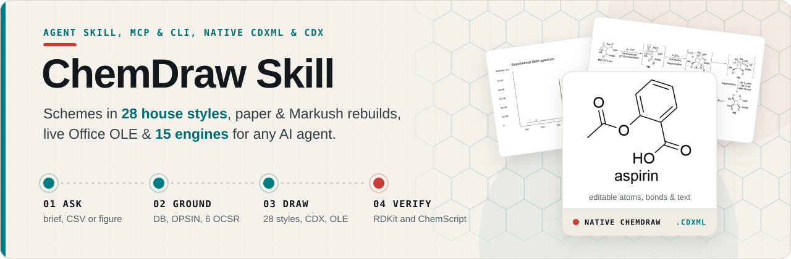
  </picture>
</p>

<p align="center">
  <a href="https://github.com/ZiChenWang114514/chemdraw-skill/actions/workflows/validate.yml"></a>
  <a href="https://zichenwang114514.github.io/chemdraw-skill/en/"></a>
  
  
  <a href="LICENSE"></a>
</p>

<p align="center">
  <b>English</b> &nbsp;/&nbsp; <a href="README.zh-cn.md">&#31616;&#20307;&#20013;&#25991;</a>
  &nbsp;&nbsp;
  <a href="#quick-start"><b>Quick start</b></a>, <a href="#what-it-handles">What it handles</a>, <a href="#gallery">Gallery</a>, <a href="#journal-and-group-house-styles">28 house styles</a>, <a href="#reaction-calculator-and-chemistry-reports">Calculator</a>, <a href="#prediction-and-analysis-engines">Engines</a>, <a href="#platform-support">Platforms</a>, <a href="#common-questions">FAQ</a>, <a href="docs/guide.md">Guide</a>, <a href="https://zichenwang114514.github.io/chemdraw-skill/en/"><b>Website</b></a>
</p>

**ChemDraw Skill** lets an AI coding agent produce editable native ChemDraw documents (`.cdxml` and `.cdx`) and live Word or PowerPoint objects, not static images or guessed SMILES. It works with **Claude Code**, **Codex**, **Gemini CLI**, **GitHub Copilot**, **Cursor**, **OpenCode** and any other agent that runs shell commands or speaks MCP.

Give it a reaction in plain words, a CSV or Excel substrate table, a crop of a published scheme or a patent Markush claim. It returns a checked figure in one of **28 empirical journal and research-group house styles** (*JACS*, *Angew. Chem.*, *Nature*, *Science*, *ACS Document 1996*, Baran, MacMillan, Studer and more). It also runs ChemDraw's **stoichiometry calculator**, writes **ACS characterization text**, and can call **15 opt-in local engines** for structure recognition (OCSR), retrosynthesis and NMR prediction.

> **What you need:** 64-bit Python 3.10 to 3.13. Desktop ChemDraw is optional: without it you still get editable CDXML, structure checks and reports; native PNG rendering, `.cdx` files and Office objects need it.
>
> **Why not let the model write SMILES and draw them with RDKit?** A SMILES recalled from memory is often a different compound (a missing counter-ion, a lost stereocentre), and an RDKit picture cannot be edited in ChemDraw or Word. Here every structure comes from a resolver, a parser or your file and is read back after drawing, and the result is a native ChemDraw document.

## Quick start

Three steps: install, check the machine, send a first request.

<!-- prerequisites -->
<details>
<summary><b>Prerequisites and optional flags</b> (64-bit Python 3.10 to 3.13, about 760 MB of disk, desktop ChemDraw optional)</summary>
<br>

| Item | What to know |
| --- | --- |
| **Desktop ChemDraw** *(optional)* | An activated ChemDraw on Windows or macOS adds native 300 dpi PNG rendering, `.cdx` conversion, the interactive stoichiometry grid and Word/PowerPoint objects. Without it the Skill still builds, edits, recognises and checks `.cdxml` files and runs the batch calculators on Windows, macOS and Linux ([what changes without ChemDraw](skill/chemdraw/references/operations.md#no-chemdraw-on-this-host)). |
| **Runtime and disk** | One shared virtual environment of about 760 MB on 64-bit Python 3.10 to 3.13. `--extras` alone installs the minimal core; `--extras publication office` installs selected groups. |
| **Optional flags** | `--opsin` adds offline IUPAC name-to-structure (it fetches Java on first use on Windows; install Java yourself on macOS and Linux). `--mapping` installs RXNMapper and LocalMapper in their own environments. OCR in the `image` group uses Tesseract. |
| **Offline smoke test** | `cdx.py py $HOME/.claude/skills/chemdraw/scripts/smoke_all_tools.py --output-dir NEW_DIR` calls every tool once on this machine (add `--network` to include the online endpoints). |

</details>

**1. Install.** The installer runs on Python 3.9+ and finds a 64-bit Python 3.10 to 3.13 for the runtime by itself.

```bash
git clone https://github.com/ZiChenWang114514/chemdraw-skill.git
cd chemdraw-skill
python scripts/install.py --agent claude agents --runtime --apply
```

Leave out `--apply` to preview the target folders first. If Python 3.14+ is your only interpreter, install 3.12 (for example `uv python install 3.12`) or pass `--python <interpreter>`.

**2. Check your machine.** The doctor reports desktop ChemDraw, Office, the Python extras and the installed engines.

```bash
python $HOME/.claude/skills/chemdraw/scripts/cdx.py doctor
```

**3. Send a first request.** Paste one of these into your agent.

```text
Use the ChemDraw Skill to draw salicylic acid + Ac2O -> aspirin (H2SO4 cat., rt, 2 h, 85%) in acs_jacs style as editable CDXML and render a 300 dpi PNG.
```

```text
Use the ChemDraw Skill to reproduce ./scheme.png as editable CDXML, match the original orientation, verify structures side by side, and render a native preview.
```

```text
Use the ChemDraw Skill to run ChemDraw's stoichiometry grid on "OCc1ccccc1.CC(=O)Cl>CCN(CC)CC.ClCCl>CC(=O)OCc1ccccc1" and read back the amounts as JSON.
```

No agent at hand? The same entry point works from a terminal:

```bash
python $HOME/.claude/skills/chemdraw/scripts/cdx.py resolve aspirin Cs2CO3 --offline   # needs no ChemDraw
python $HOME/.claude/skills/chemdraw/scripts/cdx.py draw --name aspirin aspirin.cdxml --style acs_jacs --render
python $HOME/.claude/skills/chemdraw/scripts/cdx.py calc "OCc1ccccc1.CC(=O)Cl>>CC(=O)OCc1ccccc1"
```

<details>
<summary><b>Other agents, project installs, the plugin archive and MCP</b></summary>
<br>

| `--agent` | Skill folder | Discovered by |
| --- | --- | --- |
| `claude` | `~/.claude/skills/` | Claude Code (also read by GitHub Copilot and OpenCode) |
| `agents` | `~/.agents/skills/` | The shared Agent Skills root: Codex, Gemini CLI, GitHub Copilot, Cursor, OpenCode and others |
| `gemini`, `copilot`, `cursor`, `opencode`, `kimi`, `pi` | Agent-specific folder | Use when you want each client kept apart |
| `codex`, `zcode`, `dsh`, `qoder`, `codebuddy`, `lingma`, `comate`, `bailian`, `qwen`, `trae`, `windsurf`, `cline`, `roo`, `goose`, `kiro`, `aider`, `amp`, `continue`, `zed`, `openhands`, `antigravity` | Client-specific folder | More clients (add `--mcp` to register the `cdxml-toolkit` server as well) |

- **Project or custom location.** `--project <repo>` installs project-scoped copies (`.claude/skills/`, `.agents/skills/`, `.github/skills/`, ...); `--destination <folder>` installs anywhere.
- **One runtime for every copy.** `python scripts/install.py --runtime-only --apply` upgrades it in place and rolls back if the upgrade fails.
- **Claude Code plugin.** Each release carries the Skill as a plugin archive with `SHA256SUMS` (built by `scripts/build_plugin.py`). The plugin holds the Skill only, so run the installer once with `--runtime-only --apply` for the runtime.
- **Editors.** `python vscode/scripts/build_vsix.py --install-all` installs the companion extension for VS Code, Cursor, Windsurf, Qoder, Trae, Kiro, Cline and Roo Code: visual editors for `.cdxml` and `.mol`, a 2D structure and substructure query pad, and a 3D Mol* viewer.
- **Agents that do not discover `SKILL.md`** need one line in their instruction file that points to it. MCP setup and the full command reference are in [agent integration](skill/chemdraw/references/agent-integration.md).

</details>

<details>
<summary><b><code>cdx.py</code> command cheat sheet</b></summary>
<br>

Agents and people call one entry point, `cdx.py`. Any Python can start it; it re-runs itself inside the toolkit runtime.

```bash
# Resolve and draw
python <skill>/scripts/cdx.py resolve aspirin                             # name/SMILES/CAS -> SMILES, formula, MW
python <skill>/scripts/cdx.py draw --name aspirin aspirin.cdxml --style acs_jacs --render
python <skill>/scripts/cdx.py draw --smiles "c1ccccc1,CC(=O)O" grid.cdxml --columns 2 --number --properties mw,formula --render
python <skill>/scripts/cdx.py draw --reaction "CC(=O)O.CCO>O=S(=O)(O)O>CCOC(C)=O" --yield "88%" rxn.cdxml --render

# Styles, inspection and stoichiometry
python <skill>/scripts/cdx.py styles                                      # list 16 presets + 28 house styles
python <skill>/scripts/cdx.py inspect rxn.cdxml                           # structures, formulas, MW, topology
python <skill>/scripts/cdx.py report "OCc1ccccc1.CC(=O)Cl>>CC(=O)OCc1ccccc1" --balance
python <skill>/scripts/cdx.py calc "OCc1ccccc1.CC(=O)Cl>>CC(=O)OCc1ccccc1"

# Recognition, Office and diagnostics
python <skill>/scripts/cdx.py ocsr figure_crop.png                        # structure recognition (or decimer)
python <skill>/scripts/cdx.py render figure.cdxml                         # native 300 dpi PNG
python <skill>/scripts/cdx.py office-edit deck.pptx                       # embed or update live ChemDraw objects
python <skill>/scripts/cdx.py call resolve_name -a query=aspirin          # any registered tool, key=value arguments
python <skill>/scripts/cdx.py studio                                      # 2D structure and query studio
python <skill>/scripts/cdx.py molstar aspirin                             # 3D Mol* conformer and PDB viewer
python <skill>/scripts/cdx.py tools                                       # list the registered tools
python <skill>/scripts/cdx.py doctor --text                               # capability check and run log (--log latest)
```

</details>

## What it handles

Every request goes through the same four stages: take the request or data, ground each structure in a resolver, parser or file, build native CDXML, then read the saved file back with RDKit and ChemScript. Five workflows sit on top of them:

| Workflow | Start from | You get |
| --- | --- | --- |
| **Draw a new figure** | [One request](#one-command-figures), [28 house styles](#journal-and-group-house-styles), [ACS 1996 specs](#exam-and-lecture-drawings-in-acs-document-1996-style), [CSV or Excel](#data-driven-publication-figures) | A `.cdxml` checked by read-back and a native 300 dpi `.png` |
| **Rebuild an existing figure** | [A paper scheme](#reproduce-a-paper-figure), [a patent Markush claim](#markush-demo) | Editable `.cdxml`, `.cxsmiles` and a side-by-side comparison |
| **Run chemistry arithmetic** | [Stoichiometry, SI tables, characterization and mapping](#reaction-calculator-and-chemistry-reports) | ChemDraw's grid as JSON, ACS paragraphs, PMI and atom maps |
| **Predict and recognise** | [15 opt-in engines](#prediction-and-analysis-engines) | OCSR, retrosynthesis, product and NMR candidates, each labelled as a prediction |
| **Publish into Office** | `cdx.py office-edit` | Live ChemDraw objects in Word and PowerPoint, with a PDF preview |

<details>
<summary><b>Full capability list by area</b></summary>
<br>

| Area | What you get |
| --- | --- |
| **Structures and reactions** | Resolve names, CAS numbers and SMILES; draw, edit, clean, merge, segment, convert and render CDXML or CDX without disturbing open ChemDraw windows. |
| **New figures from a request** | Single reactions, linear, convergent and divergent routes, catalytic cycles, substrate-scope panels and mechanisms, drawn and checked in one pass. |
| **Journal and group styles** | 28 empirical house styles measured from 179 openly licensed figures across 23 figure types, on top of 16 stock ChemDraw presets. |
| **Exam, lecture and paper figures** | ACS Document 1996 drawings from compact JSON: `GenericNickname` abbreviations, CJK notes, boxed codes, orbital lobes, TS brackets and 3D templates (chair, Newman, Haworth, Fischer). |
| **Data-driven figures** | Substrate-scope and SAR panels bound to CSV or XLSX by compound ID, so later data updates keep manual ChemDraw edits. |
| **Reaction mechanisms** | Curved full- and half-headed arrows routed from the electron moves you list, with exact coordinates, charges and counterions. |
| **Patent Markush structures** | Generic structures from a patent figure and its claims (R groups, variable rings, multicentre bonds, repeat counts), exported as CDXML, CXSMILES and V3000 MOL. |
| **Image recognition** | Candidate structures with confidence scores and bounding boxes, from the DECIMER API or local weights. |
| **Engines and predictions** | 15 opt-in engines in their own environments: 6 OCSR readers, PDF segmentation, retrosynthesis, forward products, reaction conditions and 1H/13C shifts. |
| **Calculators and reports** | ChemDraw stoichiometry grids with JSON read-back, batch SI materials tables with PMI, HRMS and ACS characterization text, 138-entry GHS safety reminders, route yield and atom mapping. |
| **TLC and apparatus** | Native TLC plates (lanes, spots, Rf, co-spots, stains, 2D plates) and laboratory apparatus assembled from ChemDraw templates. |
| **Spectra and plots** | Processed 1D NMR (Bruker, JCAMP-DX, JEOL, Varian/Agilent) with peak picking, integration, solvent flags, zoom insets and stacked plots; numerical data as curves. |
| **Experimental records** | LCMS plate and chromatogram reports (Waters, OpenLynx, Shimadzu, Agilent, mzML/mzXML) with Cl/Br `M+2` checks, internal-standard ratios and 24- and 96-well heatmaps; SciFinder RDF. |
| **Molecule comparison** | RDKit fingerprint similarity everywhere; exact stereochemical identity through ChemScript (Windows) or ChemDraw (macOS). |
| **Office documents** | Live editable ChemDraw objects in desktop Word and PowerPoint on Windows and macOS. |
| **ChemScript and ChemDraw interfaces** | A bridge to the Windows ChemScript SDK and an audited catalog of ChemDraw 22.2 COM objects, CDXML elements and menu commands ([details](docs/guide.md#chemdraw-interface-coverage)). |
| **Remote workstation access** | An optional authenticated Streamable HTTP server for a Windows ChemDraw host, with health and Prometheus endpoints. |

`cdx.py tools` prints the registered tools; the generated [public inventory](skill/chemdraw/references/toolkit-public-inventory.md) lists the audited symbols of the bundled toolkit.

</details>

## Gallery

Every card is a native ChemDraw render of an editable `.cdxml` file in this repository. Click a card for its workflow, source data and verification record.

<table>
  <tr>
    <td colspan="3" align="center">
      <a href="#journal-and-group-house-styles">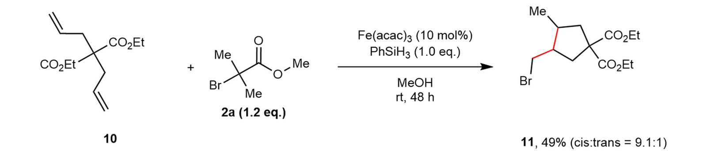</a>
      <br><b>28 empirical journal &amp; group house styles + 16 ChemDraw presets</b><br><sub>Measured from 179 openly licensed figures across 23 figure types; 47 literature replicas record what each style reproduces and where it differs</sub>
    </td>
  </tr>
  <tr>
    <td colspan="3" align="center">
      <a href="#paper-scheme-demo">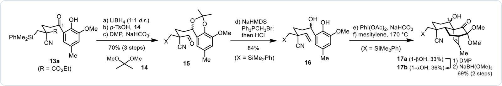</a>
      <br><sub>Original paper figure</sub><br><br>
      <a href="#paper-scheme-demo">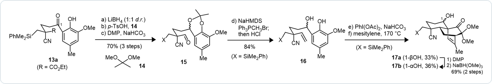</a>
      <br><b>Paper reaction scheme → editable ChemDraw</b><br><sub>Five structures, conditions, yields and compound labels rebuilt from the image</sub>
    </td>
  </tr>
  <tr>
    <td colspan="3" align="center">
      <a href="#markush-demo">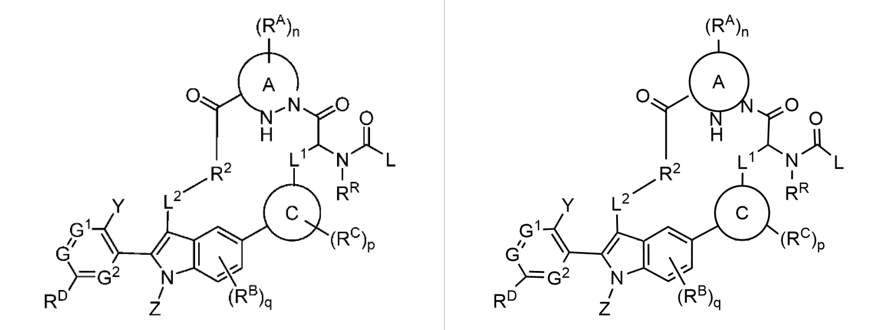</a>
      <br><b>Patent Markush structure → editable ChemDraw</b><br><sub>Patent figure (left) and native rebuild (right): R groups, variable rings, a multicentre bond and repeat counts</sub>
    </td>
  </tr>
  <tr>
    <td width="33%" align="center" valign="top">
      <a href="#complex-synthesis-demo">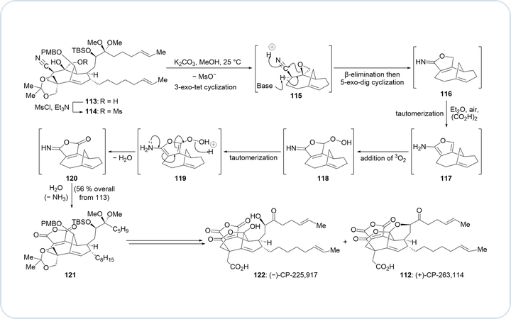</a>
      <br><b>Complex synthesis</b><br><sub>Full multi-step scheme with mechanism arrows</sub>
    </td>
    <td width="33%" align="center" valign="top">
      <a href="#mechanism-demo">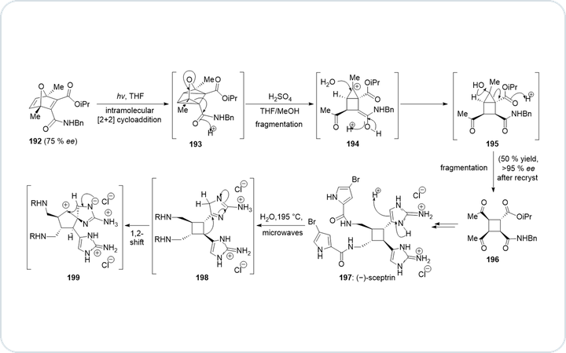</a>
      <br><b>Reaction mechanism</b><br><sub>Electron arrows, charges and counterions</sub>
    </td>
    <td width="33%" align="center" valign="top">
      <a href="#stereo-reconstruction-demo">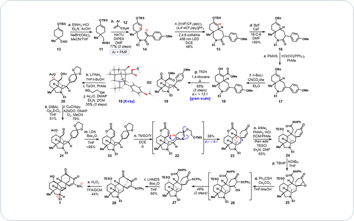</a>
      <br><b>Twenty-structure synthesis</b><br><sub>Stereo agreement across chemistry readers: 20/20</sub>
    </td>
  </tr>
  <tr>
    <td width="33%" align="center" valign="top">
      <a href="#exam-and-lecture-drawings-in-acs-document-1996-style">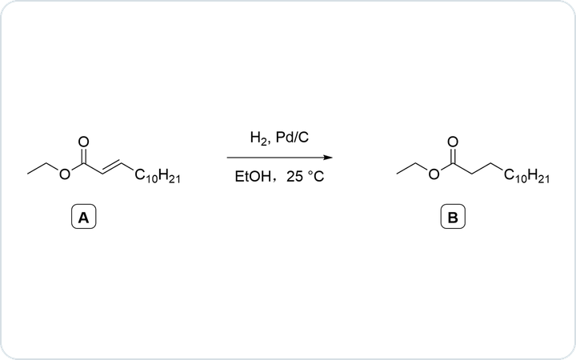</a>
      <br><b>Exam and lecture figures</b><br><sub>ACS Document 1996 style from a compact JSON spec</sub>
    </td>
    <td width="33%" align="center" valign="top">
      <a href="#scientific-drawings-demo">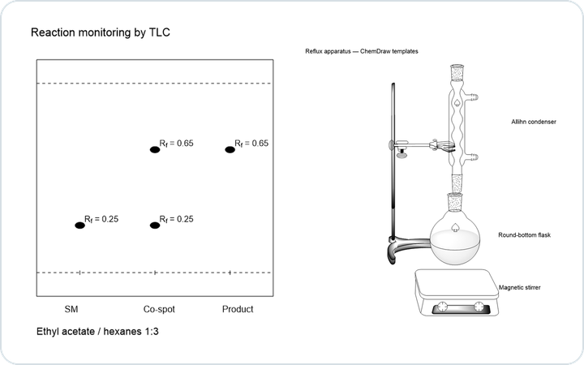</a>
      <br><b>TLC and apparatus</b><br><sub>Native plates, Rf values and ChemDraw templates</sub>
    </td>
    <td width="33%" align="center" valign="top">
      <a href="#scientific-drawings-demo">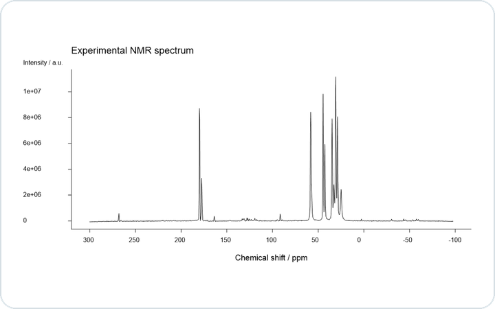</a>
      <br><b>Spectra and plots</b><br><sub>Processed 1D NMR and numerical data as curves</sub>
    </td>
  </tr>
  <tr>
    <td colspan="3" align="center">
      <a href="#prediction-and-analysis-engines">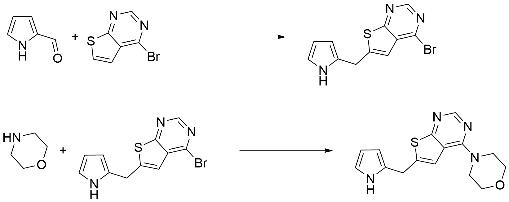</a>
      <br><b>Predictions from opt-in engines</b><br><sub>Retrosynthesis, products and NMR shifts, checked against recorded lab routes and measured spectra, misses kept</sub>
    </td>
  </tr>
</table>

## Draw and style new figures

When the structures are known and the figure does not exist yet, one request draws it, styles it and checks it.

<a id="one-command-figures"></a>

### A new figure from one request

Ask in one sentence, such as *"Draw aspirin from salicylic acid and acetic anhydride, H2SO4 (cat.), rt, 2 h, 85%."* The agent writes a short JSON brief, and one command builds, renders and checks the figure:

```json
{
  "species": [
    {"id": "SA", "smiles": "OC(=O)c1ccccc1O", "label": "1"},
    {"id": "Ac2O", "name": "Ac2O"},
    {"id": "ASP", "smiles": "CC(=O)Oc1ccccc1C(=O)O", "label": "2"}
  ],
  "steps": [
    {"substrates": ["SA", "Ac2O"], "products": ["ASP"],
     "above": ["H2SO4 (cat.)"], "below": ["rt, 2 h"], "yield": "85%"}
  ]
}
```

```bash
python skill/chemdraw/scripts/cdx.py draw brief.json aspirin.cdxml --render
```

<p align="center">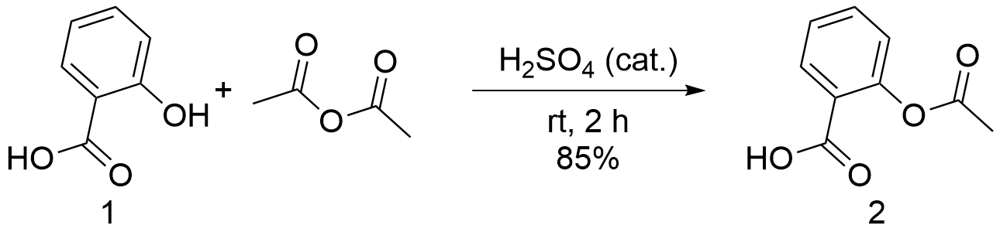</p>

For a single step you can skip the file: `cdx.py draw --reaction "A.B>reagent>C" out.cdxml` (add `--compact` for tight multi-step or narrow-column layouts). The same command draws four kinds of figure:

| Figure | The brief lists | You get |
| --- | --- | --- |
| **Reaction or route** | Species, steps, conditions, yields | Single reactions, linear, convergent and divergent routes or catalytic cycles, with row wrapping, reversible and resonance arrows, dative bonds and radicals |
| **Substrate scope** | Compounds with labels, groups and measured values | Multi-page grids that keep each label and value under its structure; a value you did not give prints as a dash, never `0` |
| **Mechanism** | Species, steps and the electron moves | Full- or half-headed curved arrows placed from the drawn coordinates and routed around atoms and labels |
| **Molecule or structure panel** | One or more structures | Single molecules or multi-column grids with numbering, formula and MW captions, ring fills and highlighted substituents |

<table>
  <tr>
    <td width="50%" align="center" valign="top">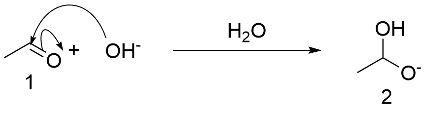<br><sub>Mechanism: two curved arrows for a hydroxide addition</sub></td>
    <td width="50%" align="center" valign="top">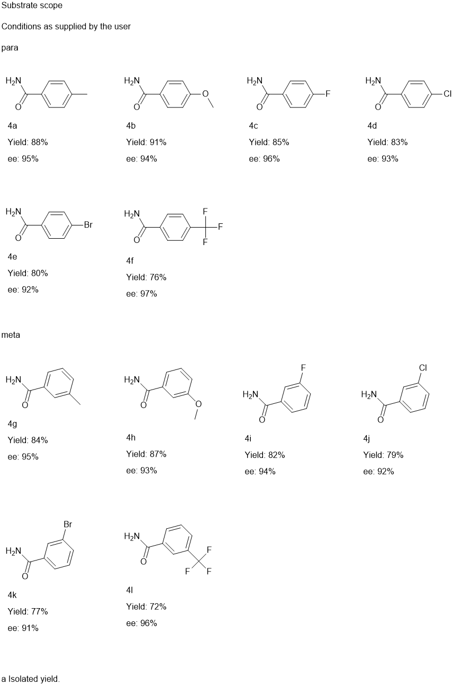<br><sub>Substrate scope: twelve compounds on one page</sub></td>
  </tr>
</table>

Every brief passes the same checks:

- **Structures are grounded.** A SMILES you give is used as written; a name goes through the built-in reagent table and then PubChem (not under `CHEMDRAW_OFFLINE=1`). A name that does not resolve stops the run.
- **Nothing is invented.** Conditions you left out stay blank and are noted in the report. A mechanism step without electron moves is refused.
- **Atoms and charges balance.** Each step is checked, a missing by-product is named in the report and never drawn silently, and the saved structures are read back against the brief.
- **Layout is measured.** Overlaps, small text and page overflow trigger one roomier re-layout, which the report records.
- **Files are safe.** Existing files are never overwritten. Without desktop ChemDraw the result is marked as an unrendered draft; look at the native PNG before you publish.

The brief schema and the report fields are in [drawing a new reaction scheme](skill/chemdraw/references/scheme-drawing.md).

<a id="journal-and-group-house-styles"></a>

### Journal and group house styles

One `style` parameter selects from two layers:

- **16 measurement presets** read from ChemDraw's stock style sheets (`acs1996` by default, plus `wiley`, `rsc`, `nature`, `synthesis` and 11 others). They set bond length, line width and fonts only.
- **28 empirical house-style cards** for 13 journals, 7 publishers, patents and textbooks, and 8 research groups, measured from 179 figure crops in 81 openly licensed papers and textbooks. A convention is recorded only when at least two crops agree.

Each card covers 23 figure types. Layout, numbering, abbreviations, arrow and line geometry and colours are applied automatically; conventions the tool cannot draw yet come back as finishing guidance.

```bash
python skill/chemdraw/scripts/cdx.py styles                 # presets and house styles
python skill/chemdraw/scripts/cdx.py styles studer_group    # one card with its evidence
python skill/chemdraw/scripts/cdx.py draw brief.json out.cdxml --style studer_group --render
```

<table>
  <tr>
    <td width="50%" align="center" valign="top">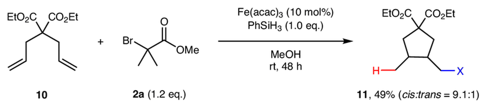<br><sub>Published scheme (Studer group, <i>Nat. Commun.</i> 2024, CC BY 4.0)</sub></td>
    <td width="50%" align="center" valign="top"><br><sub>Drawn with <code>"style": "studer_group"</code> and rendered by ChemDraw</sub></td>
  </tr>
</table>

One Suzuki coupling, one brief, six house styles:

<p align="center">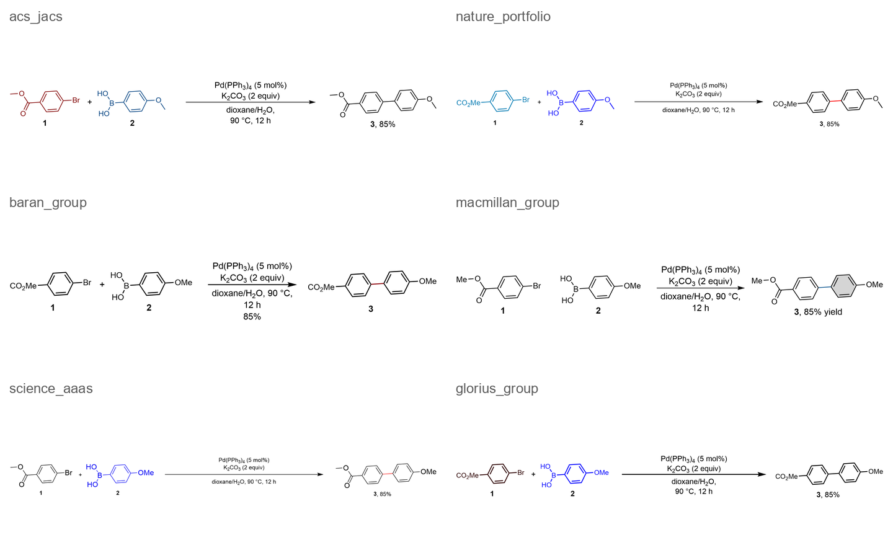</p>

<details>
<summary><b>All 28 styles at a glance</b></summary>
<br>

**Publishers, patents and textbooks**

| Style | Base preset | Draws like |
| --- | --- | --- |
| `nature_portfolio` | `nature` | Nature, Nat. Chem.: bold number with the yield on its line (`3a, 85%`), new bond in red, substrates in teal and blue |
| `science_aaas` | `nature` | Science, Sci. Adv.: yield on the label line, new bond in red, incoming component in blue |
| `wiley_angew` | `wiley` | Angew. Chem., Chem. Eur. J.: bold numbers, reagents above and solvent below, substrates side by side |
| `rsc_journals` | `rsc` | Chem. Sci., Chem. Commun.: bold numbers, yield in parentheses after the number |
| `cell_press_chem` | `wiley` | Chem, Chem Catalysis: bold numbers, yield under the arrow, lettered panels |
| `openstax_chemistry` | `chemdraw_slide` | Textbook figures: unnumbered species, short open-headed arrows, changing atoms in dark red |
| `uspto_patents` | `j_mol_mod` | US patents: black line art, Times labels, plain compound numbers, Markush formulas |

**Journals**

| Style | Base preset | Draws like |
| --- | --- | --- |
| `acs_jacs` | `acs1996` | JACS, Org. Lett., J. Org. Chem.: bold numbers, yield after the number, substrates in maroon and navy |
| `org_lett` | `acs1996` | Org. Lett.: yield under the product number, scope grids, optimisation tables |
| `jmed_chem` | `acs1996` | J. Med. Chem.: a step letter above each arrow, short arrows, SAR tables |
| `acs_chem_biol` | `acs1996` | ACS Chem. Biol.: multi-panel figures, PROTAC linkers in pink, structure panels |
| `jacs_au` | `acs1996` | JACS Au: concept panels, photophysical diagrams, flow set-ups |
| `oprd_process` | `acs1996` | Org. Process Res. Dev.: equivalents and volumes, yields under the arrow, scale stated |
| `jchem_educ` | `acs1996` | J. Chem. Educ.: teaching mechanisms, assignment panels, plain thin arrows |
| `mdpi_molecules` | `acs1996` | Molecules: new bond in bold red, introduced group in blue |
| `beilstein_joc` | `nature` | Beilstein J. Org. Chem.: general reaction over a product grid, `2a: 69%` |
| `chemeurj` | `wiley` | Chem. Eur. J.: ChemDraw palette colours, grey boxes behind products |
| `dalton_transactions` | `rsc` | Dalton Trans.: metal precursors as formulas, heteroatoms coloured by element |
| `natural_product_reports` | `rsc` | Nat. Prod. Rep.: bold yields under the arrow, the target named in a rounded box |
| `polymer_chemistry` | `rsc` | Polymer Chem.: repeat units in brackets with subscript n, catalysts above the arrow |

**Research groups**

| Style | Base preset | Draws like |
| --- | --- | --- |
| `baran_group` | `acs1996` | Baran (Scripps): new bonds in dark red, many abbreviated groups |
| `macmillan_group` | `acs1996` | MacMillan (Princeton): new bond in dark blue, grey highlight, `6, 76% yield`, no plus sign |
| `lipshutz_group` | `acs1996` | Lipshutz (UCSB): yield under the number, surfactant and water below the arrow |
| `glorius_group` | `acs1996` | Glorius (Münster): reagent fragments colour-coded, photocatalysis concept panels |
| `houk_group` | `acs1996` | Houk (UCLA): free-energy profiles, transition-state panels, pathway maps |
| `list_group` | `nature` | List (MPI Mülheim): yield and e.r. stacked under the product, IDPi catalysts |
| `sarpong_group` | `nature` | Sarpong (Berkeley): caged polycycles with bold front bonds, skeletal editing |
| `studer_group` | `nature` | Studer (Münster): transferred H and new bonds in red, ratios after the yield |

</details>

- **47 literature replicas.** 47 published figures were redrawn from briefs and archived with their reference crop, brief and native render. Each `CASE.md` lists what is reproduced and every difference from the paper; no case is a complete match ([style gallery and replica index](showcase/house-styles/gallery/README.md#literature-replicas)).
- **Evidence is kept.** Each style folder stores its CC BY evidence crops and source DOIs, and every draw report says which conventions were applied or skipped and why. The styles are measured conventions, not official publisher templates, and copy no source artwork.
- **One figure, one-off styling.** A brief can set `title`, `panel_label`, per-species colours, abbreviations, orientation, captions and boxes without changing the card. MCP clients read a card at `chemdraw://style-guide/{name}`.
- **Known ChemDraw limit.** A left-attached abbreviation sits at the right coordinates, but ChemDraw spells some of them right-flowing (`CO2Me`, not `MeO2C`) until **Clean Up Structure** runs.

<a id="data-driven-publication-figures"></a>

### SAR and substrate-scope figures from CSV or Excel

Build substrate-scope and SAR panels from a CSV or XLSX table (XLSX needs the `publication` extra) and trusted structures. Compound IDs bind each measurement to its ChemDraw object, so a later data update or structure swap keeps your manual layout and annotations, and an ambiguous match produces a conflict draft instead of a guess ([workflow and examples](skill/chemdraw/references/data-driven-figures.md)).

### Exam and lecture drawings in ACS Document 1996 style

Write the figure as a compact JSON spec (SMILES with abbreviation nodes such as `C10H21`, conditions, arrows, bold compound codes and Chinese notes) and get editable ACS 1996 CDXML with a native PNG:

```bash
python skill/chemdraw/scripts/cdx.py build skill/chemdraw/assets/acs1996/example.json example.cdxml --render
```

<p align="center">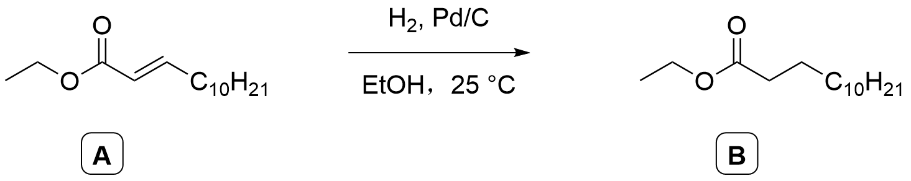</p>

Abbreviations stay real `GenericNickname` nodes with subscripts and the right attachment side; CJK text uses a Chinese font while Latin text, digits and symbols stay in Arial ([ACS 1996 drawing guide](skill/chemdraw/references/acs1996-drawings.md)).

## Reproduce a paper figure

Start from the whole figure and work through eight steps, each of which leaves something you can inspect:

<p align="center">
  <code>Inspect</code> → <code>Crop structures</code> → <code>DECIMER</code> → <code>Match orientation</code> → <code>Side-by-side review</code> → <code>Correct chemistry</code> → <code>Assemble layout</code> → <code>Native preview</code>
</p>

```text
Use the ChemDraw Skill to reproduce this paper figure. Read the whole scheme,
crop each complete structure, and obtain DECIMER candidates. Match the original
orientation, inspect actual side-by-side previews, and correct only the affected
structures. Transcribe the conditions, then deliver editable CDXML and a
native preview.
```

<table>
  <tr>
    <td width="50%" align="center" valign="top">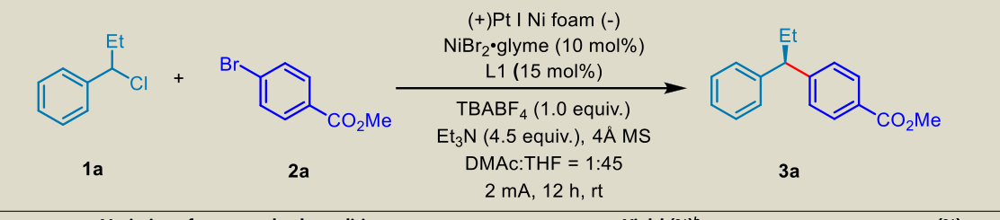<br><sub>Published scheme (CC BY 4.0)</sub></td>
    <td width="50%" align="center" valign="top">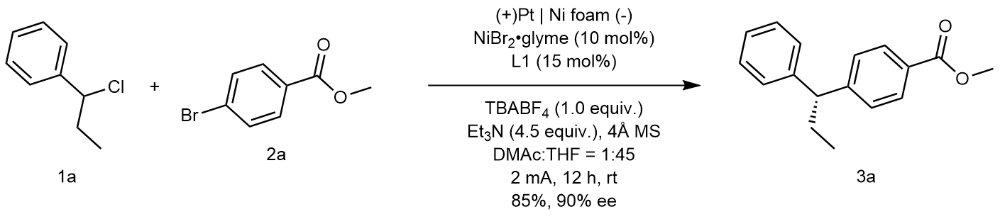<br><sub>Drawn from <code>brief.json</code> with <code>"style": "nature_portfolio"</code></sub></td>
  </tr>
</table>

Three openly licensed schemes are rebuilt end to end, each with its reference crop, brief and native render:

| Case | House style | Files |
| --- | --- | --- |
| Pd-catalysed amination in water, *JACS Au* 2024 | `lipshutz_group` | [CASE.md](skill/chemdraw/assets/paper-replica/jacs-au-pd-amination/CASE.md) |
| DPDTC synthesis for amide coupling, *Chem. Sci.* 2023 | `rsc_journals` | [CASE.md](skill/chemdraw/assets/paper-replica/chem-sci-amide-coupling/CASE.md) |
| Ni-catalysed electroreductive arylation, *Nat. Commun.* 2025 | `nature_portfolio` | [CASE.md](skill/chemdraw/assets/paper-replica/nat-commun-ni-ereductive/CASE.md) |

- **Guides.** [Image reconstruction guide](skill/chemdraw/references/image-visual-review.md), [task template](skill/chemdraw/assets/paper-replica/task-template.json), [worked example](skill/chemdraw/assets/paper-replica/example/CASE.md), and 47 more redrawn figures in the [style gallery](showcase/house-styles/gallery/README.md#literature-replicas).
- **Helpers.** Crop, mask and comparison tools that keep the region-to-result mapping; coordinate tracing for folded chains and bridged rings; explicit stereo edits by atom index with read-back; fixed-coordinate assembly of the final scheme.
- **What leaves your machine.** Recognition uploads only the crops you select to the DECIMER API. `cdx.py decimer --preflight` lists them first, and offline mode sends nothing.
- **Offline rebuild.** `python skill/chemdraw/scripts/cdx.py py skill/chemdraw/assets/paper-reconstructions/rebuild.py ./paper-figures-output` rebuilds the two complex schemes shown below without repeating recognition ([rebuild example](skill/chemdraw/assets/paper-reconstructions/README.md)).

## Reaction calculator and chemistry reports

These tools start from structures you supply (SMILES, MOL/SDF or CDXML). Exact stoichiometry runs in desktop ChemDraw; everything else runs with RDKit on any system. No tool overwrites an existing file.

| You want | Tool | You get |
| --- | --- | --- |
| How much of each reagent and solvent to weigh | `cdx.py calc`, `stoichiometry_grid` | ChemDraw's own stoichiometry grid under the reaction, and its numbers as JSON |
| An SI materials table for many reactions | `si_materials_tables` | Markdown, CSV, printable HTML or JSON, up to 100 reactions |
| HRMS and characterization text | `cdx.py report --hrms`, `hrms_line`, `characterization_text` | `HRMS (ESI) m/z calcd for ...` and ACS-order paragraphs |
| Overall yield and PMI of a route | `route_summary` | One table for a linear or convergent route |
| Which atom becomes which | `cdx.py report --map`, `map_reaction_atoms` | Atom maps, bond changes, reaction-centre SMARTS, reaction type |
| Formula, mass, adducts, logP | `cdx.py report`, `molecule_report` | A property sheet |
| Does the reaction balance? | `cdx.py report --balance`, `check_reaction_balance` | The missing by-product and suggested coefficients |
| Every structure in a file | `cdx.py inspect`, `export_structures` | Structures, formulas, MW, scheme topology, SMILES, InChI, CSV or SDF |

```bash
python <skill>/scripts/cdx.py calc "OCc1ccccc1.CC(=O)Cl>CCN(CC)CC.ClCCl>CC(=O)OCc1ccccc1"
```

<p align="center">
  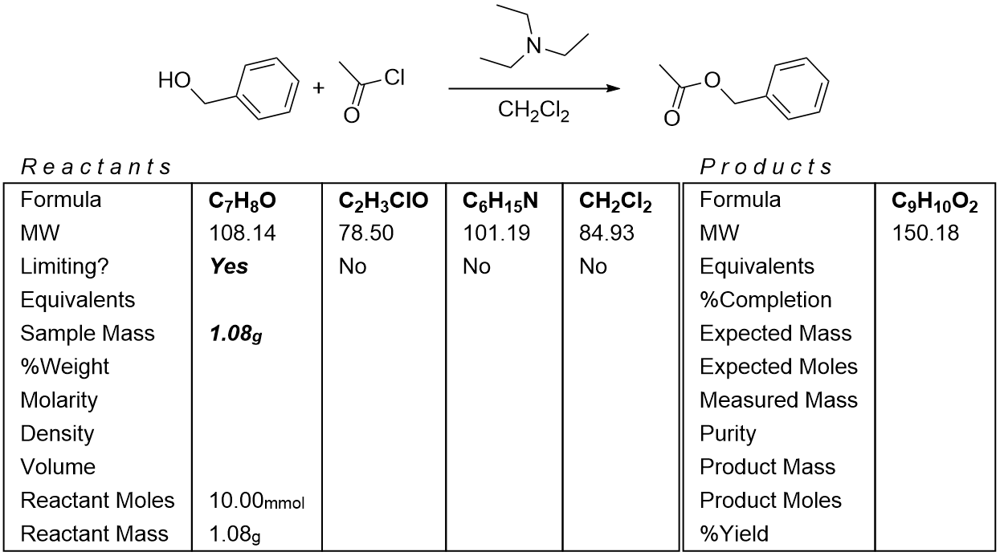
</p>

- **ChemDraw's own grid.** `cdx.py calc` runs **Structure &gt; Analyze Stoichiometry** on a reaction SMILES or a `.cdxml` and writes a new file; your open documents are untouched (a ChemDraw window appears briefly, because menu commands need one). Edit a mass, volume or equivalents cell and ChemDraw recomputes the rest.
- **Numbers read back, not recalculated.** `cdx.py calc --read reaction-stoichiometry.cdxml` returns every row as JSON, with or without ChemDraw installed, so the agent quotes ChemDraw's numbers.
- **Without ChemDraw.** `si_materials_tables` computes up to 100 reactions with molarity, atom economy and process mass intensity (PMI; E-factor = PMI − 1).
- **138-reagent safety reminders.** `reagent_safety` attaches GHS pictograms, H-statements, boiling and flash points and structural alerts (azides, peroxides, organolithiums, acyl chlorides, hydrides). A chemical that is not in the table shows `"not listed"`, never `"safe"`; the supplier's SDS decides.
- **Characterization text.** `characterization_text` writes one ACS-order paragraph per compound from the digits you supply, and warns when the total 1H integration or the 13C signal count does not fit the structure. It never changes your peaks.
- **Atom mapping.** `map_reaction_atoms` has a built-in substructure mapper that flags an ambiguous atom origin instead of guessing. `cdx.py install-mappers` adds RXNMapper and LocalMapper, and `compare: true` runs every installed mapper. A mapping gives the reaction-centre SMARTS, one of 19 reaction types, or map numbers written onto a copy of your scheme.
- **Route summary.** `route_summary` scales a linear or convergent route back from the final amount and reports the longest-linear-sequence yield and cumulative PMI. A missing input returns `null` with a warning.

Inputs and rules: [chemistry reports guide](skill/chemdraw/references/chemistry-reports.md).

## Featured demos

Real paper figures and experimental data. Each demo has a native preview, a comparison with its reference and an editable download.

<a id="stereo-reconstruction-demo"></a>

### Twenty structures: resolving stereo-reader disagreement

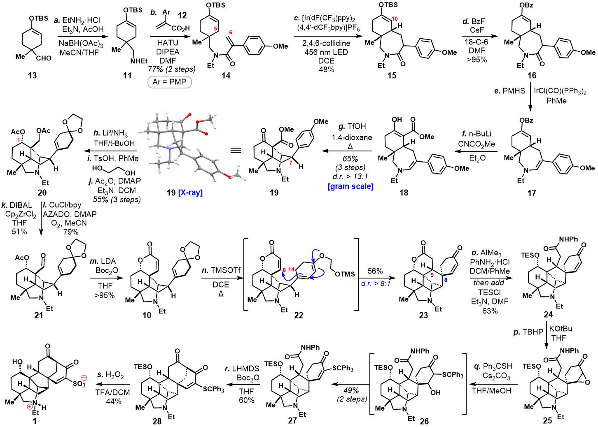

Drawn literally from the source, 16 of the 20 structures are read differently by ChemScript and RDKit. The saved revision makes both readers agree on all 20 while keeping the reviewed molecules. A later edit of three captions took 2 native calls instead of 8, because checked structures are cached. The X-ray image is cropped from the source paper and is not covered by the repository licence.

[Editable CDXML](toolkit/assets/readme/stereo-reconstruction/reconstruction.cdxml) · [Failure analysis, workflow and rights](toolkit/assets/readme/stereo-reconstruction/CASE.md) · [Per-compound evidence](toolkit/assets/readme/stereo-reconstruction/verification.json) · [Incremental-edit timings](toolkit/assets/readme/stereo-reconstruction/incremental-verification.json)

<a id="paper-scheme-demo"></a>

### Paper reaction scheme

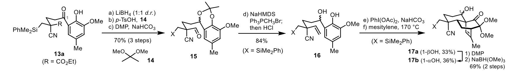

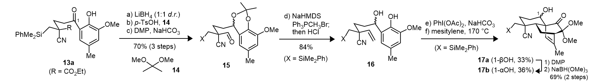

The published scheme (top) and its rebuild saved by ChemDraw (bottom). The five structures read back from the saved CDXML match the reference structures, and the shared wavy bond of 17a/17b is kept as drawn in the original.

[Editable CDXML](assets/readme/paper-replica/replica.cdxml) · [Structure-by-structure comparison](assets/readme/paper-replica/structure-comparison.png) · [Source and verification](assets/readme/paper-replica/provenance.json)

<a id="mechanism-demo"></a>

### Sceptrin mechanism

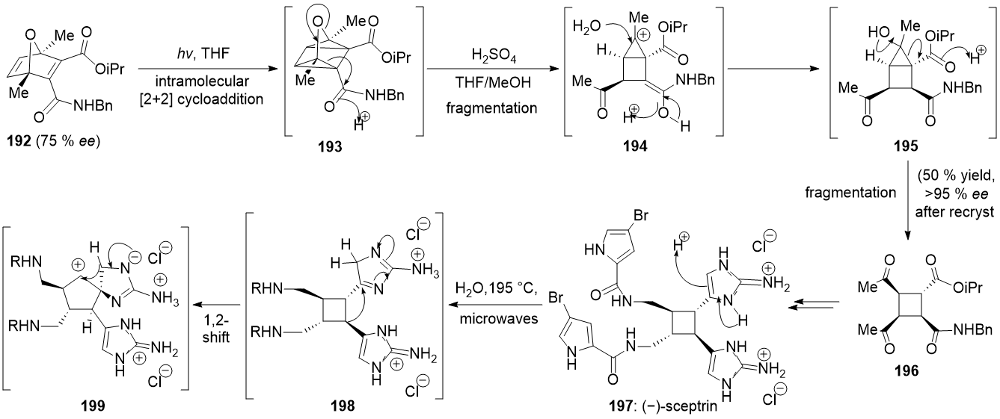

Eight numbered structures and six chloride counterions keep their atoms, stereochemistry and formal charges through a real ChemDraw CDXML → CDX → CDXML save cycle. R groups stay generic substituents, as in the source.

[Editable CDXML](assets/readme/mechanism/mechanism.cdxml) · [Native CDX](assets/readme/mechanism/mechanism.cdx) · [Reference excerpt](assets/readme/mechanism/reference.png) · [Side-by-side comparison](assets/readme/mechanism/comparison.png) · [Verification](assets/readme/mechanism/provenance.json)

<a id="markush-demo"></a>

### Patent Markush structure


`cdx.py markush` rebuilds a generic structure from a patent figure and its claim text: R groups and linkers, variable rings, multicentre position-variation bonds and repeat counts. The agent transcribes labels, checks a read-back image and maps the claim clauses; deterministic code does the geometry, the CDXML and the CXSMILES and V3000 export. Here the output matches the hand-written reference atom for atom.

[Editable CDXML](assets/readme/markush/markush.cdxml) · [Markush spec](assets/readme/markush/markush.json) · [CXSMILES](assets/readme/markush/markush.cxsmiles) · [V3000 molfile](assets/readme/markush/markush.mol) · [Verification and limits](assets/readme/markush/provenance.json) · [Workflow](skill/chemdraw/references/markush.md)

<a id="scientific-drawings-demo"></a>

### Native scientific drawings

<table>
  <tr>
    <td width="50%" align="center" valign="top">
      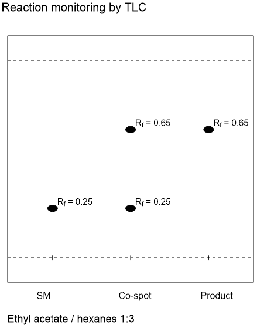<br>
      <b>TLC plate</b><br><sub>Editable plate, lane and spot objects with Rf values · <a href="assets/readme/scientific/tlc.cdxml">CDXML</a></sub>
    </td>
    <td width="50%" align="center" valign="top">
      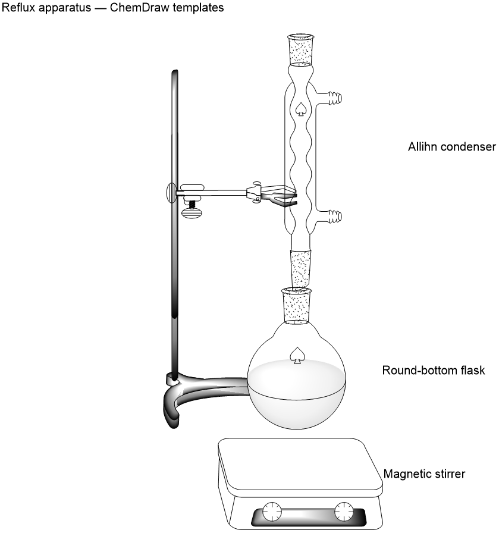<br>
      <b>Apparatus</b><br><sub>Assembled from ChemDraw's own templates · <a href="assets/readme/scientific/apparatus.cdxml">CDXML</a></sub>
    </td>
  </tr>
  <tr>
    <td width="50%" align="center" valign="top">
      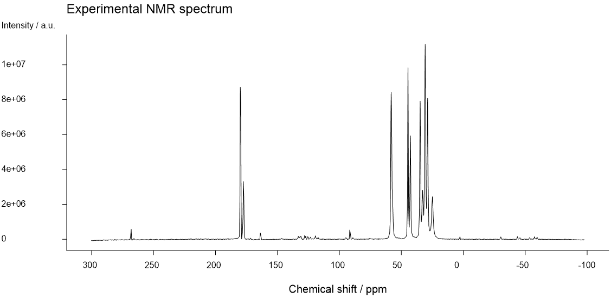<br>
      <b>Experimental NMR</b><br><sub>Real processed 1D data with peak picking and integration · <a href="assets/readme/scientific/nmr.cdxml">CDXML</a></sub>
    </td>
    <td width="50%" align="center" valign="top">
      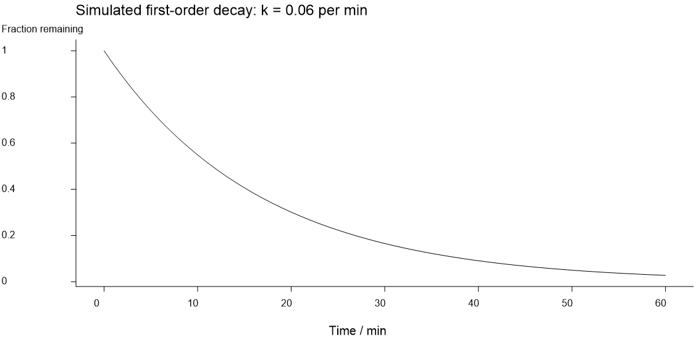<br>
      <b>Reaction kinetics</b><br><sub>A simulated first-order decay as an editable plot · <a href="assets/readme/scientific/kinetics.cdxml">CDXML</a></sub>
    </td>
  </tr>
</table>

[Run these examples](skill/chemdraw/references/scientific-workflows.md) · [Data and template provenance](assets/readme/scientific/provenance.json)

<a id="complex-synthesis-demo"></a>

### Complex syntheses: 101–112 and 113–122

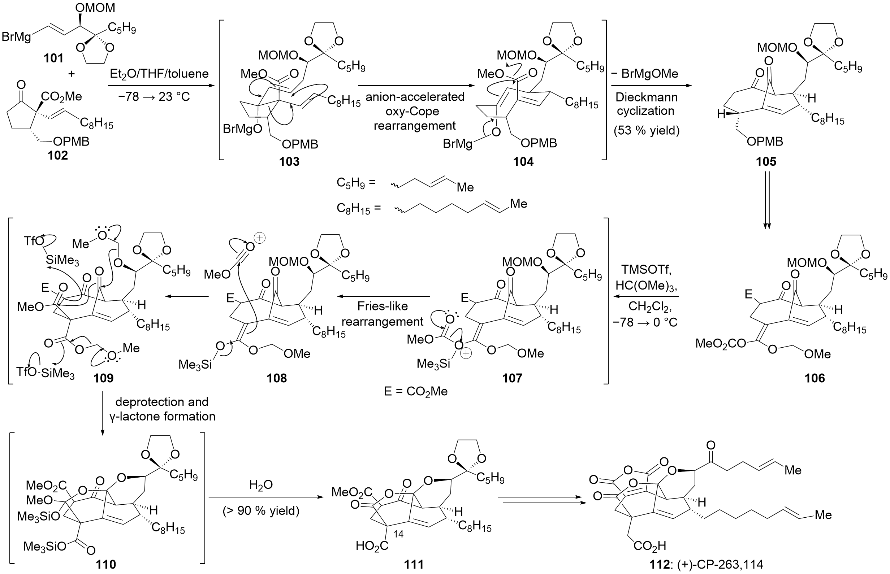

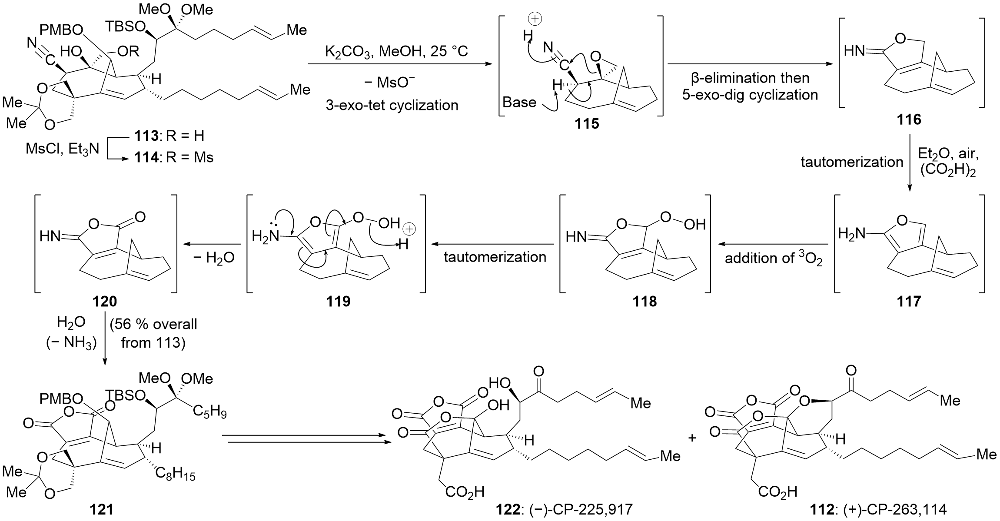

Two full schemes with editable structures. Every compound number, reaction condition and mechanism arrow is included, and native saving keeps connectivity, charges, isotopes and alkene geometry. The [atom-level comparison](skill/chemdraw/assets/paper-reconstructions/stereochemistry-check.json) records component hashes and atom mappings.

101–112: [Editable CDXML](assets/readme/synthesis-101-112/figure.cdxml) · [Reference comparison](assets/readme/synthesis-101-112/comparison-full.png) · [Verification](assets/readme/synthesis-101-112/provenance.json)<br>
113–122: [Editable CDXML](assets/readme/synthesis-113-122/figure.cdxml) · [Reference comparison](assets/readme/synthesis-113-122/comparison-full.png) · [Verification](assets/readme/synthesis-113-122/provenance.json)

## Prediction and analysis engines

Fifteen opt-in engines read structure images, cut structures out of PDFs, and predict retrosynthetic routes, products, reaction conditions and 1H/13C shifts.

- **Nothing downloads until you agree.** Each engine lives in its own environment. `cdx.py engines --recommend NEED` shows what a task needs, and `CHEMDRAW_ENGINE_HOME` moves the storage to another disk.
- **Local and labelled.** Only `decimer-api` sends an image over the network; the 14 local engines run offline once installed. Every output is marked as a model prediction, and engines that disagree are shown side by side, never merged.

### The fifteen engines

| Engine | Does | Disk | Licence | GPU |
| --- | --- | --- | --- | --- |
| `decimer-api` | image to structure, remote service | none | MIT | no |
| `decimer-local` | the same model on this computer | 2.4 GB | MIT | no (CPU) |
| `molscribe` | image to structure | 4.7 GB | MIT | yes |
| `molnextr` | image to structure | 4.8 GB | Apache-2.0 | yes |
| `molparser` | image to structure, Markush | 3.4 GB | weights non-commercial | yes |
| `molvec` | image to structure, rule-based | 2 MB | Apache-2.0 | no (Java) |
| `decimer-segmentation` | find structures on a page | 2.1 GB | MIT | no |
| `aizynthfinder` | retrosynthesis, routes | 1.7 GB | MIT | no |
| `synplanner` | retrosynthesis, routes | 4.8 GB | MIT | yes |
| `reactiont5-forward` | products | 3.9 GB | MIT | yes |
| `reactiont5-retro` | single-step retrosynthesis | 3.9 GB | MIT | yes |
| `retrochimera` | single-step retrosynthesis and routes | 8.5 GB | research use only | yes |
| `magnet` | 1H and 13C shifts | 5.4 GB | MIT | yes |
| `nmrnet-pp` | 1H and 13C shifts, second model | 4.5 GB | code MIT, weights CC BY 4.0 | yes |
| `reacon` | catalyst, solvent and reagent sets | 3.6 GB | none stated by the authors | yes |

Sizes are for Windows with CUDA PyTorch; CPU installs are smaller ([full registry](skill/chemdraw/references/engines.md)). The cases below ran on a Windows laptop (RTX 5090) against reviewed structures, lab-book entries or measured spectra, and every miss is kept ([results and provenance](assets/readme/engines/provenance.json)). Times include model loading; `--accel on` keeps a resident worker, which cut a repeated `predict products` call from 13.7 s to 0.6 s.

<details>
<summary><b>Structure images and PDFs</b></summary>
<br>

> **You say:** "Read this structure with every local engine and show me where they disagree." · "Pull every structure out of this PDF and read them."

Three crops from a published scheme (compounds 13a, 16 and 17, with R and SiMe<sub>2</sub>Ph drawn as abbreviations) and a clean ChemDraw drawing of imatinib went through six engines. A reading counts as right when its connectivity equals the reviewed structure, with R and X read as a wildcard; stereochemistry is not scored.

<table>
  <tr>
    <td align="center" valign="bottom">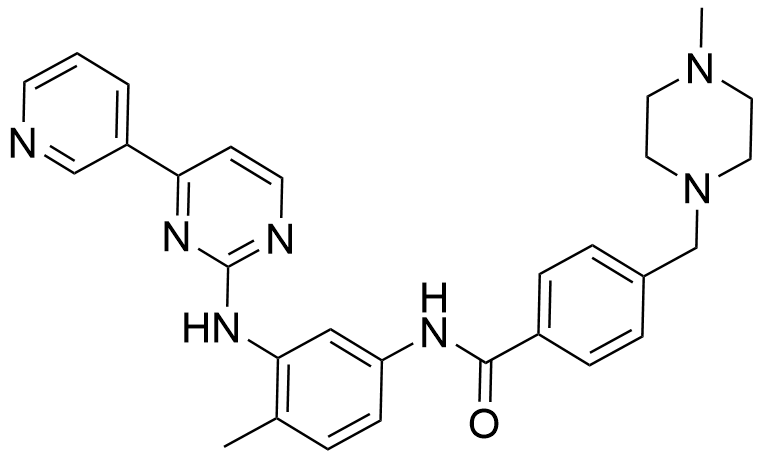<br><sub>imatinib</sub></td>
    <td align="center" valign="bottom">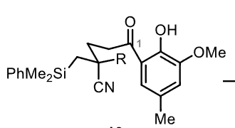<br><sub>13a</sub></td>
    <td align="center" valign="bottom">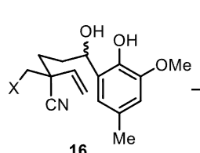<br><sub>16</sub></td>
    <td align="center" valign="bottom">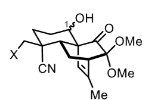<br><sub>17</sub></td>
  </tr>
</table>

| Image | MolScribe | MolNexTR | MolParser | MolVec | DECIMER (remote) | DECIMER (local) |
| --- | --- | --- | --- | --- | --- | --- |
| imatinib, clean drawing | right | right | right | right | right | right |
| 13a, R and SiMe<sub>2</sub>Ph | wrong (silyl group lost, stray fragment) | right | right | wrong (P for R) | wrong (Hg on the ring) | wrong (Hg on the ring, stray fragments) |
| 16, X abbreviation | wrong (X lost, stray C) | wrong (X lost) | invalid SMILES | wrong (ethyl for CH<sub>2</sub>X) | wrong (NHMe in place of the ring methyl) | wrong (NHMe in place of the ring methyl) |
| 17, bridged cage | invalid SMILES | right (carries a <sup>14</sup>C label) | invalid SMILES | wrong | right | right |
| **Right** | 1 of 4 | 3 of 4 | 2 of 4 | 1 of 4 | 2 of 4 | 2 of 4 |
| Time per image | 17 s | 19 s | 15 s | 3 s | 4 s (network) | 57 s (CPU) |

Agreement between two independent models was a useful hint: on 13a MolNexTR and MolParser agree and are right, and on 17 MolNexTR and DECIMER agree and are right. On 16 all six fail and no two models agree, which is the signal to read the drawing yourself. `decimer-local` runs the same DECIMER V2 weights on the CPU and matches the remote service on every image.

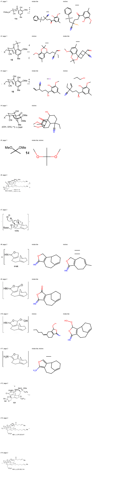

A two-page PDF went through DECIMER Segmentation, then MolScribe and MolVec for each crop. Page 1 gave 5 crops for its 5 structures, and only 1 of them was read by both engines; the others lose their abbreviated groups. Page 2 gave 9 crops, five with no reading from either engine. The contact sheet puts each crop beside what each engine read, which is how these misses are caught. The run took 418 s for 14 crops.

**Install:** `ocsr-standard` (MolScribe and MolVec, 4.7 GB), `ocsr-full` (adds MolNexTR and MolParser, 12.9 GB), `pdf` (segmenter, MolScribe, MolVec, 6.8 GB). MolParser's weights are non-commercial only. MolVec needs Java. [Details](skill/chemdraw/references/engines.md#reading-a-structure-image)

</details>

<details>
<summary><b>Routes, products and conditions</b></summary>
<br>

> **You say:** "Find precursors for this target with the local retrosynthesis engines and draw the routes." · "What does this reaction give, and under what conditions?"

Two steps from a lab notebook ([KL-CC-001 and KL-CC-002](toolkit/samples/KL-CC-002/scheme.png): a Pd-catalysed amination, then a butyllithium alkylation) and the published amide disconnection of imatinib have a known answer to check against.

| Retrosynthesis | AiZynthFinder | RetroChimera | ReactionT5 (retro) | SynPlanner |
| --- | --- | --- | --- | --- |
| KL-CC-001, recorded: 4-bromothieno[2,3-d]pyrimidine + morpholine | recorded pair at rank 2; rank 1 is the 4-chloro analogue | chloro analogue at rank 1, recorded pair not in the top 5 | miss (2,4-dichloro compound with a phosphine mixed in) | recorded pair in route 4; route 1 is the chloro analogue |
| imatinib, amide + aniline | rank 2 (acid) and 3 (acid chloride) | rank 1 (acid chloride) | miss | no search: the target is in its building-block list |
| KL-CC-002, recorded 2-step route | miss | miss | miss | miss |
| Time | 18 to 34 s | 99 to 155 s | 15 to 19 s | 44 to 76 s |

No engine proposed the recorded last step of KL-CC-002. The three top routes below are drawn as predicted, and the figure tool's balance check flags the missing by-products in each.

<table>
  <tr>
    <td width="33%" align="center" valign="top"><br><sub>AiZynthFinder</sub></td>
    <td width="33%" align="center" valign="top">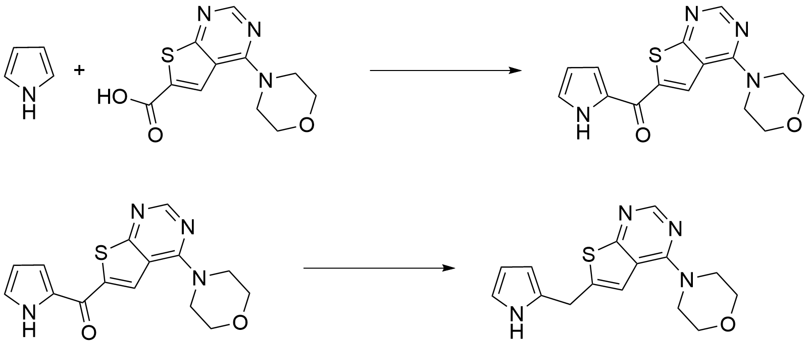<br><sub>SynPlanner</sub></td>
    <td width="33%" align="center" valign="top">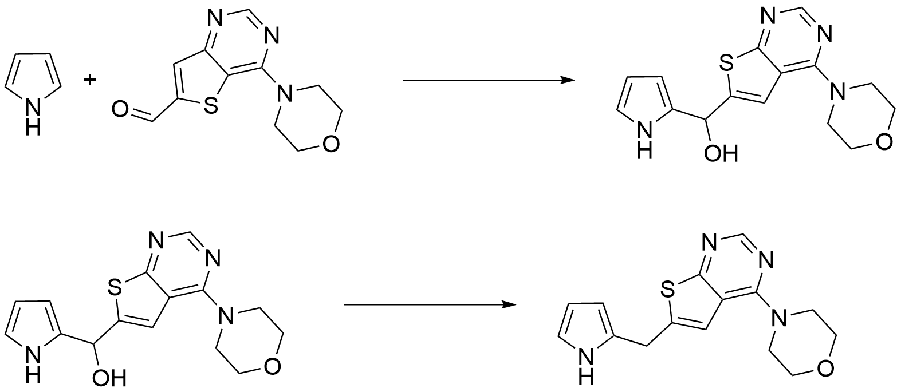<br><sub>RetroChimera</sub></td>
  </tr>
</table>

**Products.** ReactionT5 (forward) returned the recorded product at rank 1 for all three reactions (11 to 16 s); lower ranks include a dehydromorpholine and a furan with O in place of S. **Conditions.** Reacon missed all three: sodium azide in THF for the amination, sodium hydride in DMF for the alkylation (recorded: n-BuLi, THF), and dichloromethane first for the imatinib amide. It returns catalyst, solvent and reagent sets only, never temperature, time or amounts.

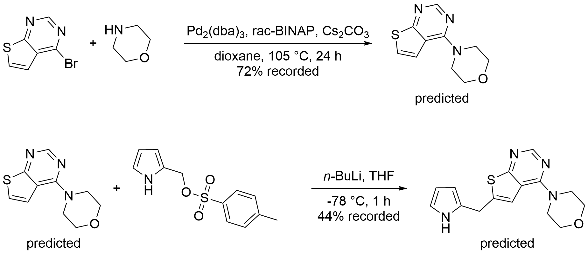

**Install:** `retro` (AiZynthFinder, 1.7 GB), `products` (3.9 GB), `conditions` (Reacon, 3.6 GB); SynPlanner and ReactionT5 retro by name; `retro-chimera` (8.5 GB, needs about 14 GB of free memory). RetroChimera is for research use only, and Reacon's authors state no licence, so it is downloaded from their repository only when you ask. [Details](skill/chemdraw/references/engines.md#predictions)

</details>

<details>
<summary><b>NMR shifts against measured spectra</b></summary>
<br>

> **You say:** "Predict the 1H and 13C shifts of caffeine with both NMR models and compare them with the measured spectrum."

The chart plots BMRB's processed caffeine spectrum in D<sub>2</sub>O (`bmse000206`) as an editable ChemDraw curve, with each predicted shift as a line and the measured peaks as ticks.

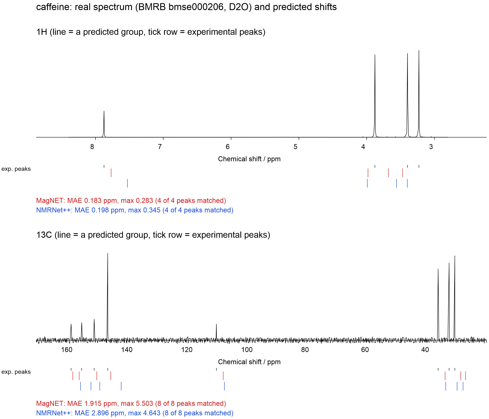

Both engines were also run on 20 assigned molecules from `nmrshiftdb2` with paired <sup>1</sup>H and <sup>13</sup>C spectra (215 <sup>1</sup>H and 323 <sup>13</sup>C groups; exchangeable protons excluded). Values are per-molecule mean absolute errors in ppm.

| Subset | Molecules | MagNET <sup>1</sup>H | NMRNet++ <sup>1</sup>H | MagNET <sup>13</sup>C | NMRNet++ <sup>13</sup>C |
| --- | --- | --- | --- | --- | --- |
| **All** | 20 | **0.21** (max 1.08) | **0.11** (max 0.84) | **2.89** (max 15.90) | **1.14** (max 10.37) |
| CDCl<sub>3</sub> | 13 | 0.19 | 0.10 | 3.11 | 1.10 |
| DMSO-<i>d</i><sub>6</sub> | 7 | 0.26 | 0.13 | 2.48 | 1.22 |

**Read the two columns differently.** MagNET was trained on computed shieldings only, so its errors are a real test on experimental data. All 20 records come from `nmrshiftdb2`, which is part of NMRNet++'s training corpus, so its numbers are an in-corpus ceiling. Runs took about 30 s per molecule on a GPU. A predicted value never goes into an experimental characterization line.

**Install:** `nmr` (MagNET, 5.4 GB) and `nmr-pp` (NMRNet++, 4.5 GB; its weights are CC BY 4.0, and it takes no solvent). [Per-molecule results for all 20](assets/readme/engines/nmr/benchmark20.json) · [Caffeine chart and data](assets/readme/engines/nmr/caffeine/)

</details>

<details>
<summary><b>LCMS plates</b></summary>
<br>

> **You say:** "Check this OpenLynx report against the plate map and tell me which wells contain the expected product."

No engine is needed. The 24-well Waters report and plate map from the PyParse example dataset (Apache-2.0) were parsed in 11 s, and the expected product was found in 24 of 24 wells: 21 as [M+H]<sup>+</sup>, two Boc-protected piperazines as the [M+H−C<sub>4</sub>H<sub>8</sub>]<sup>+</sup> fragment, and one carboxylic acid as [M−H]<sup>−</sup>.

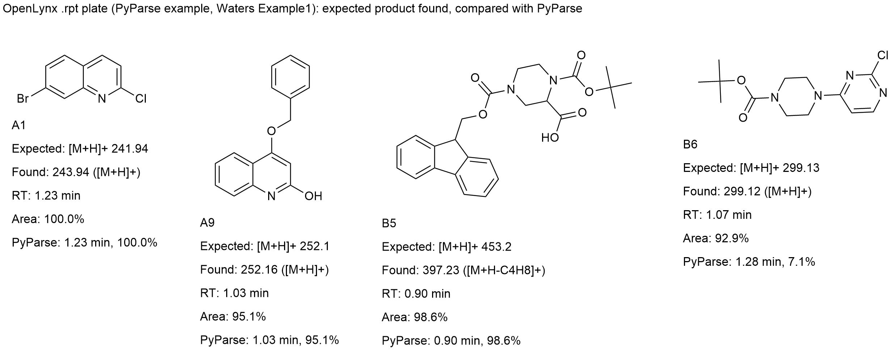

Retention time and purity agree with PyParse's own output to 0.01 in 23 wells. In the other well, B6, the toolkit takes the peak that carries the intact [M+H]<sup>+</sup> (92.9%) and PyParse takes the fragment peak (7.1%); [match_plate.py](assets/readme/engines/lcms/match_plate.py) shows the rule. The LCMS tools also read OpenLynx `.rpt`, Waters PDF and `.raw` folders, Shimadzu `.daml`, Agilent `report.txt` and `mzML`/`mzXML`, check Cl/Br `M+2` isotope patterns and track internal-standard ratios over time.

</details>

## Platform support

The portable layer (CDXML generation and editing, RDKit checks, the command line and MCP) runs on Windows, macOS and Linux. Native ChemDraw is driven through COM on Windows and AppleScript on macOS, with the same tools and outputs.

| Capability | Windows | macOS | Linux |
| --- | :---: | :---: | :---: |
| CDXML, RDKit, command-line and MCP workflows | ✅ | ✅ | ✅ |
| ChemDraw-native rendering, conversion and cleanup | ✅ <sub>activated install</sub> | ✅ <sub>ChemDraw for macOS</sub> | — |
| ChemScript operations (names, formulas, cleanup, substructure) | ✅ <sub>compatible SDK</sub> | ✅ <sub>ChemDraw + OPSIN + RDKit</sub> | — |
| Raw ChemScript SDK programs | ✅ <sub>compatible SDK</sub> | ✅ <sub>emulated core API</sub> | — |
| Editable Office ChemDraw objects | ✅ <sub>desktop Office</sub> | ✅ <sub>vector preview, `cdx.py office-edit`</sub> | — |
| PDF previews of Office files | ✅ <sub>desktop Office</sub> | ✅ <sub>activated Microsoft 365</sub> | — |

<sub>✅ supported, — not supported (no bridge exists)</sub>

ChemDraw, Microsoft Office, ChemScript and the DECIMER model weights are not bundled. The [setup guide](docs/guide.md#first-time-setup) covers installation options, manual runtimes and diagnostics, and [operations](skill/chemdraw/references/operations.md#macos) lists the macOS differences (the Automation permission, the hidden ChemDraw instance, font substitution, vector previews and the ChemScript emulation).

<details>
<summary><b>What each goal needs</b></summary>
<br>

| Goal | Add to the core setup |
| --- | --- |
| Create and edit CDXML | Any agent with shell access, 64-bit Python 3.10–3.13 and the bundled toolkit runtime (built from `toolkit/` by `scripts/install.py --runtime`) |
| Native PNG, CDX or ChemDraw cleanup | A licensed, activated desktop ChemDraw: COM automation on Windows, or ChemDraw for macOS with the Automation permission |
| Molecule comparison or ChemScript SDK calls | RDKit for similarity; compatible ChemScript DLLs on Windows for exact checks and raw SDK programs (macOS answers with ChemDraw, OPSIN and RDKit) |
| Editable Word or PowerPoint objects | Desktop ChemDraw to build them; desktop Word or PowerPoint (activated on macOS) for PDF previews |
| Local structure recognition | The DECIMER model weights and their dependencies |
| More OCSR engines and predictions | `cdx.py engines --recommend NEED`, then `cdx.py install-engines --bundle NAME` once you agree; 2 MB to 8.5 GB per engine, removable with `remove-engines` ([engines](skill/chemdraw/references/engines.md)) |
| Remote access to a ChemDraw workstation | A Windows host, authenticated HTTP configuration and an encrypted network path |

</details>

**Help wanted on macOS.** The macOS path is tested on ChemDraw 26.0, macOS 26.6 and Apple silicon. Reports are welcome for Intel Macs and other ChemDraw versions, PDF previews through Microsoft 365 for macOS, and ChemScript SDK members beyond the emulated `StructureData`, `ReactionData` and `LargestCommonSubstructure`. Open a focused issue or pull request with the macOS version, chip, ChemDraw build, permission prompts, command output and a minimal file; do not submit proprietary papers, credentials or licensed ChemDraw assets ([contributing guide](.github/contributing.md)).

## Testing and security

- **Continuous checks.** Every pull request, merge and release runs `validate.yml`: distribution rules, the toolkit suite on Windows (Python 3.13) and Linux (Python 3.12), the Skill suite on Windows, and a smoke test of the installed wheel. Native ChemDraw, ChemScript and Office automation are checked on a licensed Windows workstation and on macOS 26.6 (Apple silicon, ChemDraw 26.0), outside CI.
- **Files are not overwritten.** Tools write to new paths and refuse an existing file unless you ask.
- **Network use is explicit.** `cdx.py decimer` uploads only the crops you select. Stoichiometry, reports and atom mappers run locally, and `CHEMDRAW_OFFLINE=1` turns off the PubChem fallback for names.
- **Engines are isolated.** Optional engines run offline in their own environments, from downloads pinned by hash, and label every output as a prediction.
- **Remote HTTP is authenticated.** It needs a bearer token, a host allowlist and an encrypted tunnel or HTTPS proxy ([security policy](.github/SECURITY.md)).

## Common questions

<details>
<summary><b>Which agents can use it, and do I need ChemDraw or MCP?</b></summary>
<br>

Any agent that reads `SKILL.md` and runs shell commands works through `cdx.py`, including Claude Code, Codex, Gemini CLI, GitHub Copilot, Cursor and OpenCode. MCP is optional. Desktop ChemDraw is optional too: without it you still build, edit and check `.cdxml`, recognise structures and run the batch calculators; with it you add native PNG rendering, `.cdx`, the stoichiometry grid and Office objects. See [agent integration](skill/chemdraw/references/agent-integration.md).

</details>

<details>
<summary><b>Will it invent SMILES, reaction conditions or mechanisms?</b></summary>
<br>

No. A name resolves through a checked reagent table, PubChem, OPSIN or ChemScript, and a name that does not resolve stops the run. Conditions you did not give stay blank. A mechanism draws only the electron moves you list, and flags an arrow that starts where there is no lone pair, charge or radical.

</details>

<details>
<summary><b>Are the house styles official journal templates?</b></summary>
<br>

No. The 28 house styles are conventions measured from openly licensed figures, on top of the 16 ChemDraw presets, and they copy no source artwork. `cdx.py styles` lists them, and each card links its evidence. See [journal and group house styles](#journal-and-group-house-styles).

</details>

<details>
<summary><b>How far can I trust the safety reminders and the engines?</b></summary>
<br>

`reagent_safety` is a bench reminder for 138 common reagents plus structural alerts. A compound outside the table reports `"not listed"`, never `"safe"`, and the supplier's SDS decides. The [15 optional engines](#the-fifteen-engines) return candidates: agreement between independent models is a hint, and disagreement means review by hand. Respect the upstream licences (`molparser` non-commercial, `retrochimera` research only, `reacon` none stated).

</details>

## Documentation

| Start here | Go deeper |
| --- | --- |
| [Installation, troubleshooting and operations](docs/guide.md) | [Generated tool signatures](skill/chemdraw/references/mcp-signatures.md) |
| [Quick start in Chinese](docs/zh-cn.md), [Chinese setup guide](docs/guide.zh-cn.md) | [Audited public inventory of the bundled toolkit](skill/chemdraw/references/toolkit-public-inventory.md) |
| [Agent integration and `cdx.py` command reference](skill/chemdraw/references/agent-integration.md) | [Toolkit developer reference](toolkit/docs/agent-reference.md), [Generated MCP tool reference](toolkit/docs/mcp-tools.md) |
| [Task-oriented workflow catalog](skill/chemdraw/references/workflow-router.md) | [Remote HTTP setup](skill/chemdraw/references/operations.md#remote-http-only-when-asked) |
| [Contributing guide](.github/contributing.md), [Security policy](.github/SECURITY.md) | [Repository instructions for contributors](AGENTS.md) |
| [Website &amp; Molecule Lab](https://zichenwang114514.github.io/chemdraw-skill/en/) | [Landing page source and deployment](docs/website.md) |

The deployable Skill lives in [`skill/chemdraw`](skill/chemdraw). The chemistry runtime it drives, the `cdxml_toolkit` Python package, lives in [`toolkit`](toolkit) with its own tests.

## Upgrading to 0.8.0

- **MCP servers list 26 tools by default** (the `standard` profile) instead of all 71. Start the server with `--profile full` or set `CHEMDRAW_MCP_PROFILE=full` for the rest; `cdx.py call` reaches every tool either way.
- **Results have one shape.** `ok` is true only when the tool finished and its checks passed; a failure carries `error` with `code`, `message` and `hint`, and a result that failed a chemistry check is returned under `rejected_result`. The exit code of `cdx.py` follows `ok`.
- **Names resolve in a fixed order.** A name that only the secondary abbreviation table knows is marked low confidence or not resolved. Each result reports `source_tier`, `components` and unspecified stereocentres.
- **One layout was removed.** `render_scheme` no longer accepts `numbered-parallel`.
- **The installed Skill is about 2 MB.** The style gallery and its evidence moved to `showcase/house-styles/`; ChemDraw member lists are read with `cdx.py catalog LAYER NAME`.

## License

Repository-authored code and scripts by ZiChenWang114514 are licensed for noncommercial use under the **PolyForm Strict License 1.0.0**, and prompts, house-style cards, documentation and website content are licensed under **CC BY-NC-ND 4.0**; see [LICENSE](LICENSE) for full terms and commercial inquiries. Original upstream `cdxml-toolkit` code in [`toolkit/`](toolkit) by Hiu Fung Kevin Lee retains its [MIT License](toolkit/LICENSE), alongside community additions under [PolyForm Strict 1.0.0](toolkit/LICENSE-POLYFORM-STRICT.txt) and [third-party notices](toolkit/NOTICE.md). ChemDraw, Microsoft Office, agent clients, the MCP Python SDK, RDKit, DECIMER and their dependencies retain their respective licenses and usage terms.

This is an independent community project. It is not affiliated with or endorsed by Revvity, Anthropic, OpenAI, Google, GitHub, Microsoft, Anysphere, the OpenCode maintainers, or the maintainers of the upstream `cdxml-toolkit`, the MCP Python SDK, RDKit or DECIMER.

<p align="right"><a href="#top">Back to top ↑</a></p>
