<a id="top"></a>

<p align="center">
  <picture>
    <source media="(prefers-color-scheme: dark)" srcset="./assets/readme/hero-dark.svg">
    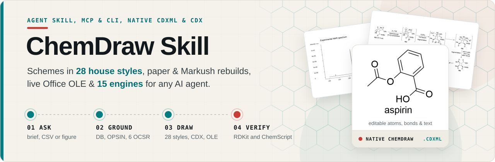
  </picture>
</p>

<h1 align="center">ChemDraw Skill</h1>

<h3 align="center">Editable ChemDraw chemistry for Claude Code, Codex and any AI coding agent</h3>

<p align="center">
  Draw in the house style of 28 journals, publishers and research groups (JACS, Angew, Nature, Science, Baran, MacMillan and more), rebuild paper figures, build SAR panels from a spreadsheet and put live ChemDraw objects into Word and PowerPoint.
  The same Skill also weighs out reactions, writes characterization paragraphs and maps atoms across a reaction.<br>
  It runs in Claude Code, Codex, Gemini CLI, GitHub Copilot, Cursor, OpenCode and any agent that can run a shell command.
</p>

<p align="center">
  <a href="https://github.com/ZiChenWang114514/chemdraw-skill/actions/workflows/validate.yml"></a>
  
  
  <a href="skill/chemdraw/references/agent-integration.md"></a>
  <a href="LICENSE"></a>
</p>

<p align="center">
  <b>English</b> · <a href="README.zh-cn.md">&#31616;&#20307;&#20013;&#25991;</a>
  <br>
  <a href="#quick-start">Quick start</a> · <a href="#gallery">Gallery</a> · <a href="#what-it-handles">What it handles</a> · <a href="#reaction-calculator-and-chemistry-reports">Calculator</a> · <a href="#featured-demos">Demos</a> · <a href="#prediction-and-analysis-engines">Engines</a> · <a href="#platform-support">Platforms</a> · <a href="#common-questions">FAQ</a> · <a href="docs/guide.md">Guide</a> · <a href="https://zichenwang114514.github.io/chemdraw-skill/en/">Website</a>
</p>

<br>

<table>
  <tr>
    <td colspan="3" align="center">
      <a href="#journal-and-group-house-styles">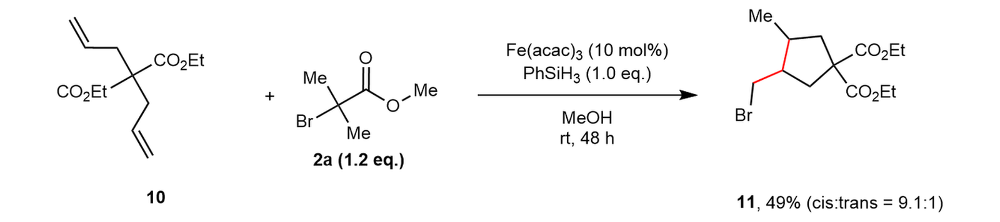</a>
      <br><b>28 journal and group house styles</b><br><sub>Measured from 179 published figures; 23 figure types, 47 literature replicas</sub>
    </td>
  </tr>
  <tr>
    <td width="25%" valign="top"><b>Structures with a source</b><br><sub>A structure comes from a database, OPSIN, ChemScript or DECIMER. The agent does not type SMILES from memory.</sub></td>
    <td width="25%" valign="top"><b>Editable output</b><br><sub>Results are CDXML. Atoms, bonds and text can be changed in ChemDraw afterwards.</sub></td>
    <td width="25%" valign="top"><b>One command</b><br><sub><code>cdx.py</code> runs every tool in any agent. MCP is optional.</sub></td>
    <td width="25%" valign="top"><b>Checked after saving</b><br><sub>ChemDraw renders and saves the file, then the chemistry is read back and compared with the input.</sub></td>
  </tr>
</table>

## Gallery

Every card is a native ChemDraw render of an editable file in this repository. Click one to open its case.

<table>
  <tr>
    <td colspan="3" align="center">
      <a href="#paper-scheme-demo">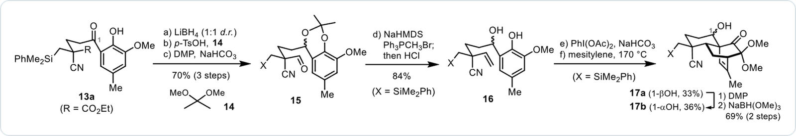</a>
      <br><sub>Original paper figure</sub><br><br>
      <a href="#paper-scheme-demo">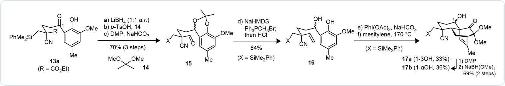</a>
      <br><b>Paper reaction scheme → editable ChemDraw</b><br><sub>Five structures, conditions, yields and compound labels rebuilt from the image</sub>
    </td>
  </tr>
  <tr>
    <td colspan="3" align="center">
      <a href="#markush-demo">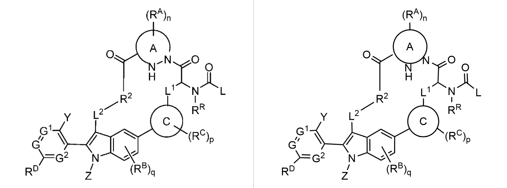</a>
      <br><b>Patent Markush structure → editable ChemDraw</b><br><sub>Patent figure (left) and native rebuild (right): R groups, variable rings, a multicentre bond and repeat counts</sub>
    </td>
  </tr>
  <tr>
    <td width="33%" align="center" valign="top">
      <a href="#synthesis-113-demo">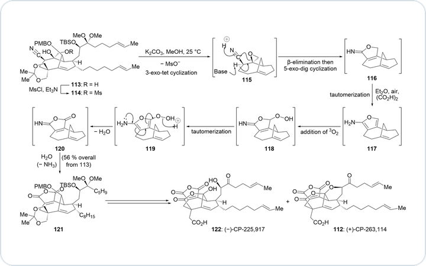</a>
      <br><b>Complex synthesis</b><br><sub>Full multi-step scheme with mechanism arrows</sub>
    </td>
    <td width="33%" align="center" valign="top">
      <a href="#mechanism-demo">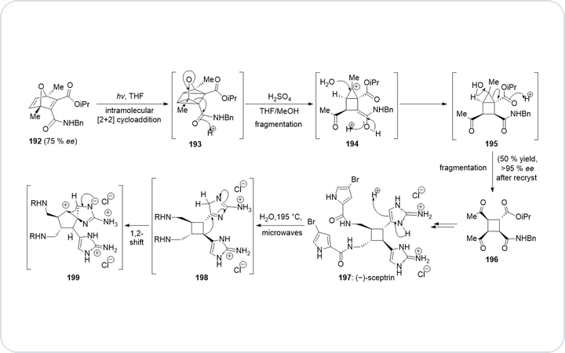</a>
      <br><b>Reaction mechanism</b><br><sub>Electron arrows, charges and counterions</sub>
    </td>
    <td width="33%" align="center" valign="top">
      <a href="#stereo-reconstruction-demo">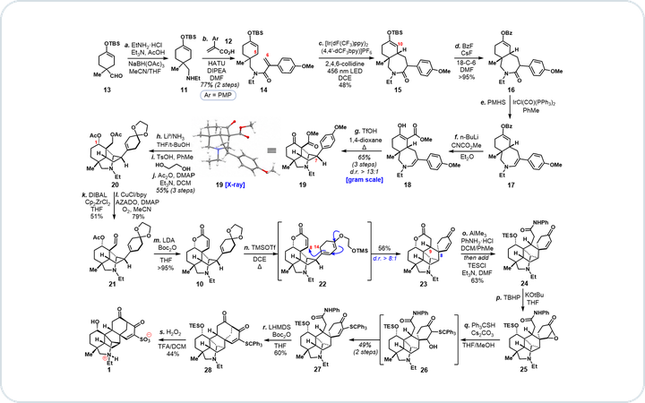</a>
      <br><b>Twenty-structure synthesis</b><br><sub>Stereo agreement across chemistry readers: 20/20</sub>
    </td>
  </tr>
  <tr>
    <td width="33%" align="center" valign="top">
      <a href="#exam-and-lecture-drawings-in-acs-document-1996-style">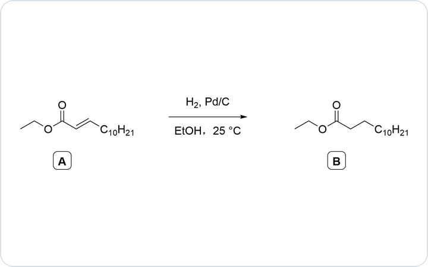</a>
      <br><b>Exam and lecture figures</b><br><sub>ACS Document 1996 style from a small JSON spec</sub>
    </td>
    <td width="33%" align="center" valign="top">
      <a href="#tlc-demo">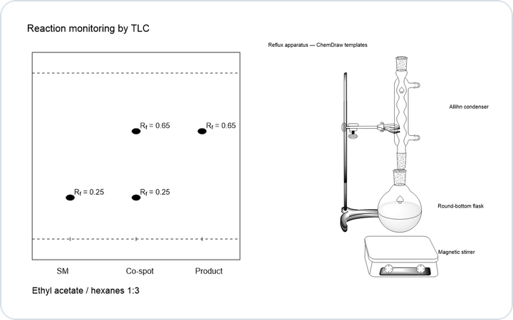</a>
      <br><b>TLC and apparatus</b><br><sub>Native plates, Rf values and ChemDraw templates</sub>
    </td>
    <td width="33%" align="center" valign="top">
      <a href="#nmr-demo">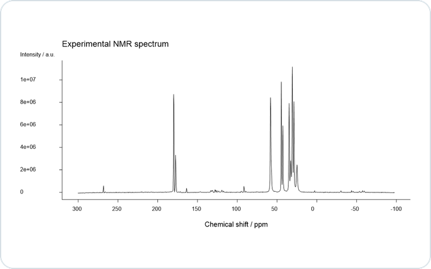</a>
      <br><b>Spectra and plots</b><br><sub>Processed 1D NMR and numerical data as curves</sub>
    </td>
  </tr>
  <tr>
    <td width="50%" align="center" valign="top">
      <a href="#prediction-and-analysis-engines">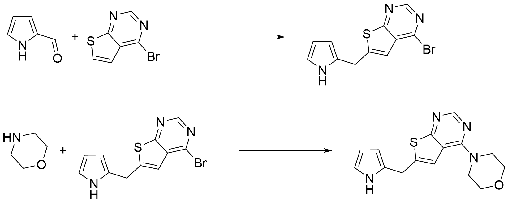</a>
      <br><b>Predicted routes</b><br><sub>Four engines, one recorded route, misses shown</sub>
    </td>
    <td width="50%" align="center" valign="top">
      <a href="#prediction-and-analysis-engines">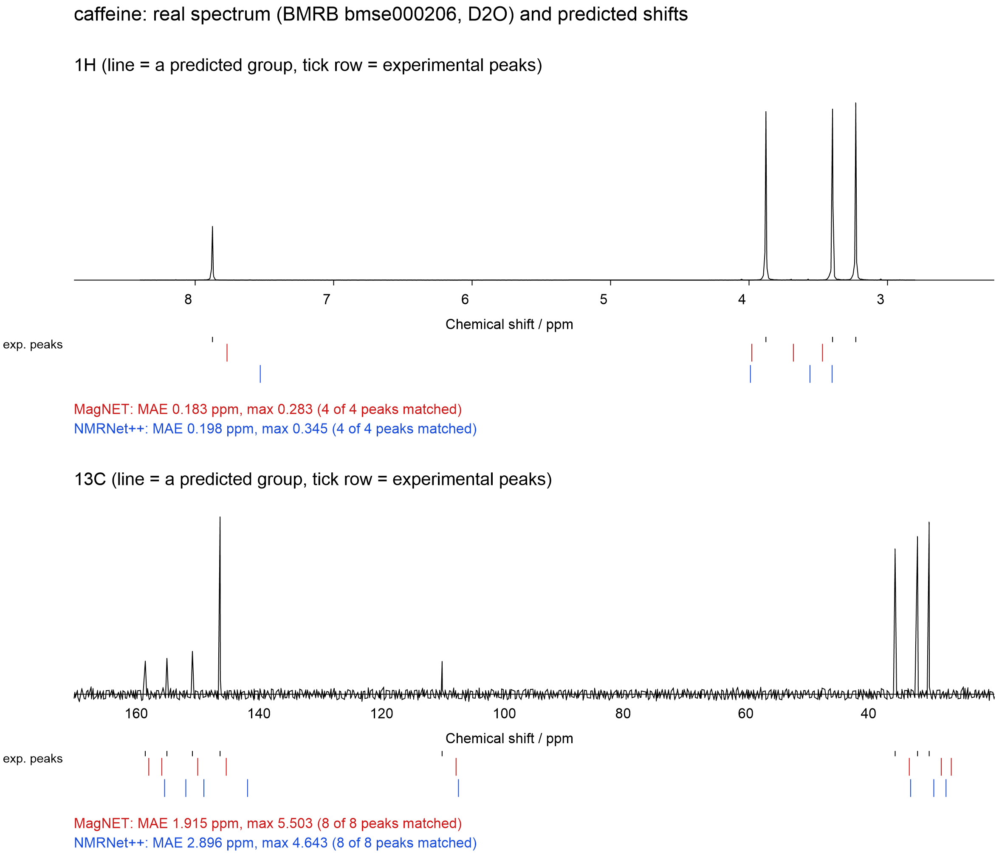</a>
      <br><b>Predicted against measured NMR</b><br><sub>MagNET and NMRNet++ on a real spectrum</sub>
    </td>
  </tr>
  </table>

## Quick start

<!-- prerequisites -->
**Before you start**, check what this machine has:

- **ChemDraw.** Native rendering, the PNG in step 3, CDX conversion and Word/PowerPoint objects need licensed desktop ChemDraw on Windows or macOS. Without it the Skill still builds, edits, checks and recognises structures and runs the calculators ([what changes](skill/chemdraw/references/operations.md#no-chemdraw-on-this-host)).
- **Python.** A 64-bit Python 3.10–3.13 builds the runtime; the installer itself runs on 3.9+.
- **Disk.** The default runtime is a virtual environment of about 760 MB. `--extras` with no names installs the core only, and `--extras publication office` adds just those groups.
- **Optional tools**, none installed by default:
  - `--opsin` adds name-to-structure. OPSIN needs Java, which is fetched on first use on Windows and must be installed on macOS and Linux.
  - Text recognition in the `image` extra needs the Tesseract program.
  - `--mapping` adds the machine-learning atom-mapping backends (RXNMapper, LocalMapper), each in its own environment.

**1. Install.** The installer needs Python 3.9+ and finds a 64-bit Python 3.10–3.13 for the toolkit runtime on its own (through the `py` launcher, `uv`-managed interpreters or `python3.x` on PATH).

```bash
git clone https://github.com/ZiChenWang114514/chemdraw-skill.git
cd chemdraw-skill
python scripts/install.py --agent claude agents --runtime          # preview only
python scripts/install.py --agent claude agents --runtime --apply  # install
```

**2. Check** what works on this machine:

```bash
python $HOME/.claude/skills/chemdraw/scripts/cdx.py doctor
```

To call every tool once and see which ones work here, run `cdx.py py $HOME/.claude/skills/chemdraw/scripts/smoke_all_tools.py --output-dir NEW_DIR` (offline unless `--network` is given).

**3. Ask** your agent in plain language:

```text
Use the ChemDraw Skill to draw aspirin as editable CDXML, render it natively and show me the PNG.
```

> [!NOTE]
> Python 3.14 and newer are not supported by the bundled toolkit yet. If that is your only Python, install 3.12 (for example `uv python install 3.12`) or pass `--python <interpreter>`.

To try ChemDraw's own reaction calculator instead of a drawing, run `python $HOME/.claude/skills/chemdraw/scripts/cdx.py calc "OCc1ccccc1.CC(=O)Cl>>CC(=O)OCc1ccccc1"` ([details](#reaction-calculator-and-chemistry-reports)).

<details>
<summary><b>Choose agents and install locations</b></summary>
<br>

| `--agent` | Skill folder | Read by |
| --- | --- | --- |
| `claude` | `~/.claude/skills/` | Claude Code (also GitHub Copilot and OpenCode) |
| `agents` | `~/.agents/skills/` | The shared Agent Skills folder: Codex, Gemini CLI, GitHub Copilot, Cursor, OpenCode and others |
| `gemini`, `copilot`, `cursor`, `opencode`, `kimi`, `pi` | each agent's own folder | when you prefer the agent-specific location |

- `--project <repo>` installs project-scoped copies (`.claude/skills/`, `.agents/skills/`, `.github/skills/`, ...); `--destination <folder>` installs anywhere.
- Agents without Skill discovery need one line in their instruction file pointing at `SKILL.md`.
- All copies share one runtime. Re-running the installer upgrades in place; a replaced copy is backed up and restored if anything fails.

Details for each agent, command allowlisting and optional MCP registration: [agent integration](skill/chemdraw/references/agent-integration.md).

</details>

<details>
<summary><b>The <code>cdx.py</code> entry point</b></summary>
<br>

Agents call one entry point, which any Python can start; it re-launches itself in the toolkit runtime:

```bash
python <skill>/scripts/cdx.py tools                                         # the registered tools
python <skill>/scripts/cdx.py call resolve_name --args query.json           # query.json: {"query": "aspirin"}
python <skill>/scripts/cdx.py render figure.cdxml                           # native 300 dpi PNG
python <skill>/scripts/cdx.py decimer crop.png                              # structure recognition
```

</details>

## What it handles

A request usually falls into one of five kinds of work. Each links to its section; the table after them lists every tool area.

- **Draw a new figure** from a short brief: [one command](#one-command-figures), in the [house style](#journal-and-group-house-styles) of a journal or research group, or as [exam and lecture drawings](#exam-and-lecture-drawings-in-acs-document-1996-style).
- **Rebuild an existing figure** from a paper image or PDF: [reproduce a paper figure](#reproduce-a-paper-figure).
- **Do the arithmetic**: [stoichiometry, materials tables, characterization text and atom mapping](#reaction-calculator-and-chemistry-reports).
- **Predict and read**: [structure recognition, routes, products, conditions and NMR shifts](#prediction-and-analysis-engines).
- **Put it in a document**: editable ChemDraw objects in Word and PowerPoint.

<details>
<summary><b>Every tool area, in one table</b></summary>
<br>

| Area | What you get |
| --- | --- |
| **Structures and reactions** | Resolve names and identifiers; draw, edit, clean, merge, segment, convert and render CDXML or CDX documents. Work in a live ChemDraw window without disturbing the document you have open. |
| **New figures from a request** | A reaction, a linear, convergent or divergent route, a catalytic cycle, a substrate-scope panel or a mechanism, drawn from a short brief. Chemistry and layout are checked in the same command. [Details](#one-command-figures). |
| **Journal and group styles** | 28 house styles for journals, publishers, patents, textbooks and research groups, measured from 179 openly licensed figures, on top of 16 measurement presets read from ChemDraw's own style sheets. Each style records how that source sets compound numbers, yields, conditions, abbreviations, colours, line widths and arrows across 23 kinds of figure. [Details](#journal-and-group-house-styles). |
| **Exam, lecture and paper figures** | ACS Document 1996 drawings from a JSON spec: abbreviations, Chinese notes, boxed compound codes, ring shading, orbital lobes, transition-state brackets and 3D templates such as chair, Newman, Haworth and Fischer. |
| **Data-driven figures** | Substrate-scope and SAR panels from CSV or XLSX that stay editable and can be updated. |
| **Reaction mechanisms** | Curved arrows drawn from a list of electron moves, or rebuilt from explicit atom coordinates, charges and counterions. |
| **Patent Markush structures** | Generic structures from a patent image and its claim text: R groups, variable rings, multicentre bonds and repeat counts, saved as CXSMILES, a V3000 molfile and an editable drawing. |
| **Image recognition** | Candidate structures with confidence values and bounding boxes, from the DECIMER API or local models. |
| **Engines and predictions** | Fifteen optional engines, installed only when you agree: six image readers compared on one picture, structures from a PDF, precursors and routes, products, reaction conditions and 1H/13C shifts. Every result is a labelled prediction. [Cases and install sizes](#prediction-and-analysis-engines). |
| **Calculators and reports** | ChemDraw's own stoichiometry grid read back as data; SI materials tables with process mass intensity; HRMS lines and characterization paragraphs; safety reminders from a 116-entry GHS table; route yield; atom mapping; property sheets and reaction balance. [Details](#reaction-calculator-and-chemistry-reports). |
| **TLC and apparatus** | Native TLC plates with lanes, spots, Rf values, co-spot lanes, stain palettes and 2D plates, and apparatus built from ChemDraw templates. |
| **Spectra and plots** | Processed 1D NMR from Bruker, JCAMP-DX, JEOL and Varian/Agilent files with peak picking, integration, residual solvent flags, multiplets, zoom insets and stacked spectra; numerical data as editable curves. |
| **Experimental records** | LCMS reports (Waters, OpenLynx, Shimadzu, Agilent ChemStation, mzML and mzXML) with Cl/Br isotope checks, internal-standard normalization and 24/96-well purity heatmaps; SciFinder RDF and lab-book workflows. |
| **Molecule comparison** | RDKit fingerprint similarity everywhere; exact identity checks through ChemScript on Windows or ChemDraw on macOS. |
| **Office documents** | Editable ChemDraw objects in desktop Word and PowerPoint, built with ChemDraw on Windows or macOS. |
| **ChemScript and ChemDraw interfaces** | The ChemScript SDK on Windows, and a catalog of ChemDraw 22.2's COM objects, CDXML elements and menu commands, each marked as having a tool, a checked recipe or documentation only. [Details](docs/guide.md#chemdraw-interface-coverage). |
| **Remote workstation access** | Optionally expose a Windows host through Streamable HTTP with health and Prometheus endpoints. |

The generated [public inventory](skill/chemdraw/references/toolkit-public-inventory.md) lists the audited symbols of the bundled toolkit, separately from the registered tools (`cdx.py tools` prints the current count).

</details>

<a id="one-command-figures"></a>

### A new figure from one request

When the structures are known and the figure does not exist yet, ask for it in a sentence: "Draw aspirin from salicylic acid and acetic anhydride, H2SO4 (cat.), rt, 2 h, 85%." Your agent turns that into a short JSON brief, and one command draws the figure and checks it:

```bash
python skill/chemdraw/scripts/cdx.py draw brief.json aspirin.cdxml --render
```

```json
{
  "species": [
    {"id": "SA", "smiles": "OC(=O)c1ccccc1O", "label": "1"},
    {"id": "Ac2O", "name": "Ac2O"},
    {"id": "ASP", "smiles": "CC(=O)Oc1ccccc1C(=O)O", "label": "2"}
  ],
  "steps": [
    {"substrates": ["SA", "Ac2O"], "products": ["ASP"],
     "above": ["H2SO4 (cat.)"], "below": ["rt, 2 h"], "yield": "85%"}
  ]
}
```

<p align="center">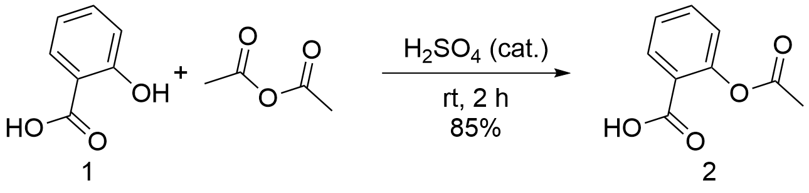</p>

The same command draws three kinds of figure:

| Figure | What the brief lists | What you get |
| --- | --- | --- |
| **Reaction or route** | Species, steps, conditions, yields | One reaction, a linear route, a convergent route whose arms merge, one starting material with several products, or a catalytic cycle (`catalytic-cycle`). Long routes wrap onto rows; `reversible` and `resonance` arrows, coordination/dative bonds and radicals are supported. |
| **Substrate scope** | Compounds with labels, groups and the values you measured | A panel packed onto as many editable pages as needed, each label and value kept next to its structure. A value you did not give shows a dash, never zero. |
| **Mechanism** | Species, steps and each electron move | Curved arrows placed from the drawn coordinates, with full or half heads, routed around atoms and labels. |

<table>
  <tr>
    <td width="50%" align="center" valign="top">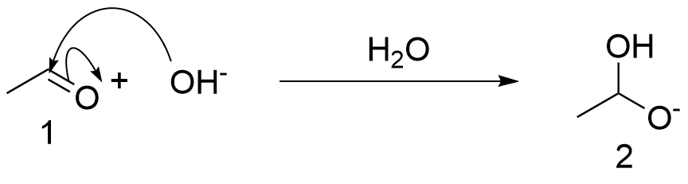<br><sub>Mechanism: two curved arrows for a hydroxide addition</sub></td>
    <td width="50%" align="center" valign="top">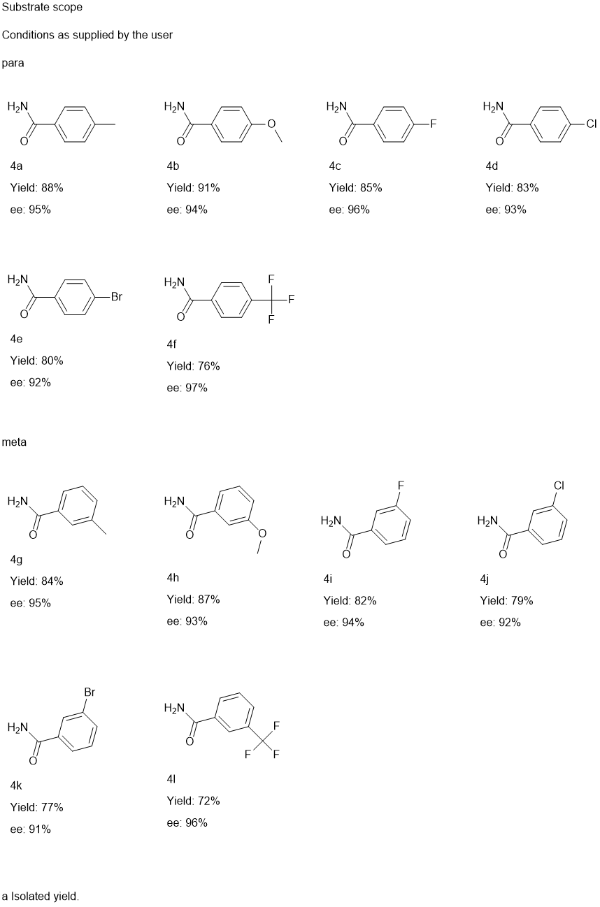<br><sub>Substrate scope: twelve compounds on one page</sub></td>
  </tr>
</table>

What the command does with a brief:

- **Structures come from you or from a table.** A SMILES you give is used as written. A name is looked up in the built-in reagent table and then PubChem (not when `CHEMDRAW_OFFLINE=1`); a name that cannot be resolved stops the run and asks for a SMILES.
- **Conditions come only from you.** A step without conditions is drawn without them and the report says so. Nothing is filled in from the tool's own chemistry.
- **The chemistry is checked.** Atom and charge balance is computed for each step, and a missing by-product is named, not drawn. After saving, the structures in the file are compared with the brief.
- **The geometry is checked.** Overlaps, text that is too small and a drawing wider than the page are measured. If a check fails, the figure is laid out once more with more room and the report says what changed.
- **Mechanisms are drawn, not predicted.** You list the electron moves; a step without moves is refused. An arrow that starts on an atom with no lone pair, charge or radical is drawn and flagged.
- **Nothing is overwritten.** The report lists every structure with where it came from, the checks that passed or did not run, and the path of the native PNG. Without ChemDraw the file is reported as an unrendered draft. Open the PNG before you use the figure.

See [drawing a new reaction scheme](skill/chemdraw/references/scheme-drawing.md) for the full brief and report.

<a id="journal-and-group-house-styles"></a>

### Journal and group house styles

A figure can follow a journal or a research group in two layers, both chosen with the same `style` name. A **measurement preset** is one of sixteen style sheets read from ChemDraw's own stock files (`acs1996`, the default, plus `wiley`, `rsc`, `nature`, `synthesis` and others); it fixes bond length, line widths and fonts and nothing else.

A **house style** is a card that names one of those presets as its base and adds what that journal or group does on the page: how compound numbers are set, where the yield goes, how conditions split around the arrow, which groups are abbreviated, which bonds or fragments are coloured, the line width and arrow length measured from its figures, and how it draws each kind of figure. There are **28 cards** (13 journals, 7 publishers, patents and textbooks, 8 research groups), read from **179 figure crops in 81 openly licensed papers and textbooks**. A convention is set only when two crops agree; where they disagree the card leaves it empty, says why in a note, and the default drawing is kept.

Each card is split by **figure type**, 23 in all: reaction schemes, substrate scope, mechanisms, catalytic cycles, energy profiles, total synthesis, retrosynthesis, structure panels, SAR and optimisation tables, concept panels, graphical abstracts, stereochemical models, derivatisation, biosynthesis, biomolecules, coordination complexes, polymers, Markush structures, process routes, photophysical diagrams, assignment panels and setup diagrams. The tools apply the scheme conventions, the compound-number style, abbreviations and the measured geometry to schemes and scope panels, curved-arrow colour and weight to mechanisms and arrow colour to catalytic cycles; the other figure-type conventions come back as guidance for finishing the figure.

Put the name in a brief (draw, scope and mechanism briefs, compose manifests and `cdx.py build` specs all take it), or override it on the command line:

```json
{
  "style": "studer_group",
  "species": [
    {"id": "10", "smiles": "C=CCC(CC=C)(C(=O)OCC)C(=O)OCC", "label": "10"},
    {"id": "2a", "smiles": "COC(=O)C(C)(C)Br", "label": "2a (1.2 eq.)"},
    {"id": "11", "smiles": "CCOC(=O)C1(C(=O)OCC)CC(C)C(CBr)C1", "label": "11"}
  ],
  "steps": [{"substrates": ["10", "2a"], "products": ["11"],
             "above": ["Fe(acac)3 (10 mol%)", "PhSiH3 (1.0 eq.)"], "below": ["MeOH", "rt, 48 h"],
             "yield": "49% (cis:trans = 9.1:1)"}]
}
```

```bash
python skill/chemdraw/scripts/cdx.py styles                 # presets and house styles
python skill/chemdraw/scripts/cdx.py styles studer_group    # one card with its evidence
python skill/chemdraw/scripts/cdx.py draw brief.json out.cdxml --style studer_group --render
```

A brief can also style one figure without touching the card: a `title` and a bold `panel_label`; per species `color`, `atom_colors`, `bond_colors`, `abbreviate`, `orientation` (mirror or turn a structure), a `caption` under the compound number and a `box` (frame or fill, dashed or rounded); and condition lines written as runs with their own colour, bold or italic. Abbreviations cover the common groups (CO2Me, OBn, Boc, Cbz, Ts, Tf, OTf, Ms, Bpin, TMS, OTBS, TIPS, Bz, Piv, PhthN, NMe2 and more).

<table>
  <tr>
    <td width="50%" align="center" valign="top">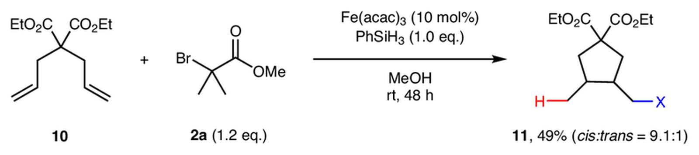<br><sub>Published scheme (Studer group, <i>Nat. Commun.</i> 2024, CC BY 4.0)</sub></td>
    <td width="50%" align="center" valign="top"><br><sub>Drawn with <code>"style": "studer_group"</code> and rendered by ChemDraw</sub></td>
  </tr>
</table>

<details>
<summary><b>All 28 styles at a glance</b></summary>
<br>

**Publishers, patents and textbooks**

| Style | Base preset | Draws like |
| --- | --- | --- |
| `nature_portfolio` | `nature` | Nature, Nat. Chem.: bold number with the yield on its line (`3a, 85%`), new bond in red, substrates in teal and blue |
| `science_aaas` | `nature` | Science, Sci. Adv.: yield on the label line, new bond in red, incoming component in blue |
| `wiley_angew` | `wiley` | Angew. Chem., Chem. Eur. J.: bold numbers, reagents above and solvent below, substrates side by side |
| `rsc_journals` | `rsc` | Chem. Sci., Chem. Commun.: bold numbers, yield in parentheses after the number |
| `cell_press_chem` | `wiley` | Chem, Chem Catalysis: bold numbers, yield under the arrow, lettered panels |
| `openstax_chemistry` | `chemdraw_slide` | Textbook figures: unnumbered species, short open-headed arrows, changing atoms in dark red |
| `uspto_patents` | `j_mol_mod` | US patents: black line art, Times labels, plain compound numbers, Markush formulas |

**Journals**

| Style | Base preset | Draws like |
| --- | --- | --- |
| `acs_jacs` | `acs1996` | JACS, Org. Lett., J. Org. Chem.: bold numbers, yield after the number, substrates in maroon and navy |
| `org_lett` | `acs1996` | Org. Lett.: yield under the product number, scope grids, optimisation tables |
| `jmed_chem` | `acs1996` | J. Med. Chem.: a step letter above each arrow, short arrows, SAR tables |
| `acs_chem_biol` | `acs1996` | ACS Chem. Biol.: multi-panel figures, PROTAC linkers in pink, structure panels |
| `jacs_au` | `acs1996` | JACS Au: concept panels, photophysical diagrams, flow set-ups |
| `oprd_process` | `acs1996` | Org. Process Res. Dev.: equivalents and volumes, yields under the arrow, scale stated |
| `jchem_educ` | `acs1996` | J. Chem. Educ.: teaching mechanisms, assignment panels, plain thin arrows |
| `mdpi_molecules` | `acs1996` | Molecules: new bond in bold red, introduced group in blue |
| `beilstein_joc` | `nature` | Beilstein J. Org. Chem.: general reaction over a product grid, `2a: 69%` |
| `chemeurj` | `wiley` | Chem. Eur. J.: ChemDraw palette colours, grey boxes behind products |
| `dalton_transactions` | `rsc` | Dalton Trans.: metal precursors as formulas, heteroatoms coloured by element |
| `natural_product_reports` | `rsc` | Nat. Prod. Rep.: bold yields under the arrow, the target named in a rounded box |
| `polymer_chemistry` | `rsc` | Polymer Chem.: repeat units in brackets with subscript n, catalysts above the arrow |

**Research groups**

| Style | Base preset | Draws like |
| --- | --- | --- |
| `baran_group` | `acs1996` | Baran (Scripps): new bonds in dark red, many abbreviated groups |
| `macmillan_group` | `acs1996` | MacMillan (Princeton): new bond in dark blue, grey highlight, `6, 76% yield`, no plus sign |
| `lipshutz_group` | `acs1996` | Lipshutz (UCSB): yield under the number, surfactant and water below the arrow |
| `glorius_group` | `acs1996` | Glorius (Münster): reagent fragments colour-coded, photocatalysis concept panels |
| `houk_group` | `acs1996` | Houk (UCLA): free-energy profiles, transition-state panels, pathway maps |
| `list_group` | `nature` | List (MPI Mülheim): yield and e.r. stacked under the product, IDPi catalysts |
| `sarpong_group` | `nature` | Sarpong (Berkeley): caged polycycles with bold front bonds, skeletal editing |
| `studer_group` | `nature` | Studer (Münster): transferred H and new bonds in red, ratios after the yield |

</details>

The same Suzuki coupling drawn from one brief in six of the styles; the [style gallery](skill/chemdraw/assets/house-styles/gallery/README.md) shows all 28 and four presets:

<p align="center">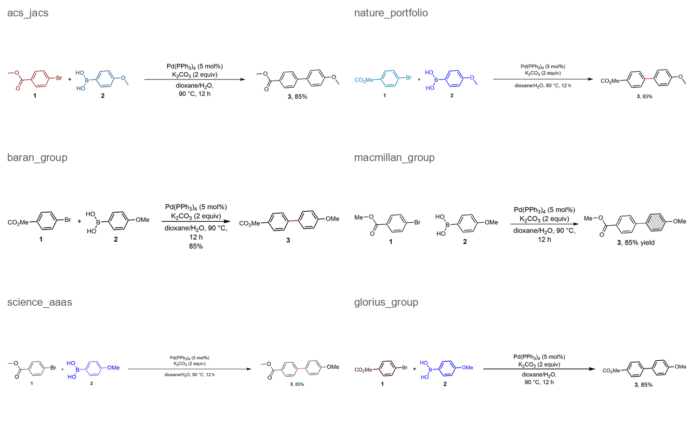</p>

**Literature replicas.** The cards were tested by redrawing their own evidence. The showcase holds 47 published figures, from single schemes to catalytic cycles, scope grids and total syntheses, each redrawn from a brief in that style and kept as a case with the reference crop, the brief, the ChemDraw render and a `CASE.md`. The case lists every convention the card claims for that figure type, says whether the replica matches it, and names what the tools could not do. The [replica index](skill/chemdraw/assets/house-styles/gallery/README.md#literature-replicas) links every case.

Each style has a folder beside the gallery with its evidence crops and a README listing the sources; the crops are reproduced under their CC BY licences and each card lists the DOIs. The draw report says which conventions were applied and which were skipped and why. One known limit: a group abbreviated on the left of its parent is placed correctly, but desktop ChemDraw spells some of them right-flowing (CO2Me rather than MeO2C) until Clean Up Structure is run. [Drawing a new reaction scheme](skill/chemdraw/references/scheme-drawing.md) has the full list of conventions and brief options. MCP clients read a card from `chemdraw://style-guide/{name}`.

<a id="data-driven-publication-figures"></a>

### SAR and substrate-scope figures from CSV or Excel

Create substrate-scope and full-structure SAR panels from CSV/XLSX and trusted structures. Stable compound IDs bind measurements to editable ChemDraw objects. Update data or replace a structure after native editing while preserving unrelated layout and annotations; ambiguous matches produce conflict drafts. See the [workflow and examples](skill/chemdraw/references/data-driven-figures.md). XLSX support requires the toolkit `publication` extra.

### Exam and lecture drawings in ACS Document 1996 style

Write the figure as a small JSON spec: SMILES with abbreviation nodes such as C10H21, conditions, arrows, bold compound codes and Chinese notes. You get editable ACS 1996 CDXML and a native ChemDraw PNG:

```bash
python skill/chemdraw/scripts/cdx.py build skill/chemdraw/assets/acs1996/example.json example.cdxml --render
```

<p align="center">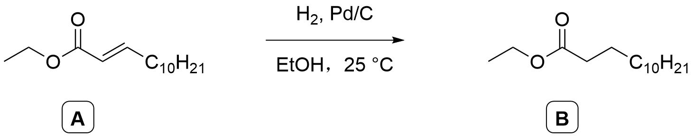</p>

Abbreviations stay real `GenericNickname` nodes with correct subscripts and label direction. Chinese characters are set in a CJK font while Latin text, digits and symbols stay in Arial. See the [ACS 1996 drawing guide](skill/chemdraw/references/acs1996-drawings.md).

## Reproduce a paper figure

Start with the whole figure, then follow one route:

<p align="center">
  <code>Inspect</code> → <code>Crop structures</code> → <code>DECIMER</code> → <code>Match orientation</code> → <code>Side-by-side review</code> → <code>Correct chemistry</code> → <code>Assemble layout</code> → <code>Native preview</code>
</p>

```text
Use the ChemDraw Skill to reproduce this paper figure. Read the whole scheme,
crop each complete structure, and obtain DECIMER candidates. Match the original
orientation, inspect actual side-by-side previews, and correct only the affected
structures. Transcribe the conditions, then deliver editable CDXML and a
native preview.
```

[Image reconstruction guide](skill/chemdraw/references/image-visual-review.md) · [Minimal task template](skill/chemdraw/assets/paper-replica/task-template.json) · [Drawing examples](skill/chemdraw/assets/paper-replica/example/CASE.md)

Three openly licensed schemes are rebuilt as worked cases, each with the reference crop, the brief in the journal's style and the native render:

| Case | Journal style | Files |
| --- | --- | --- |
| Pd-catalysed amination in water, *JACS Au* 2024 | `lipshutz_group` | [CASE.md](skill/chemdraw/assets/paper-replica/jacs-au-pd-amination/CASE.md) |
| DPDTC synthesis for amide coupling, *Chem. Sci.* 2023 | `rsc_journals` | [CASE.md](skill/chemdraw/assets/paper-replica/chem-sci-amide-coupling/CASE.md) |
| Ni-catalysed electroreductive arylation, *Nat. Commun.* 2025 | `nature_portfolio` | [CASE.md](skill/chemdraw/assets/paper-replica/nat-commun-ni-ereductive/CASE.md) |

<table>
  <tr>
    <td width="50%" align="center" valign="top">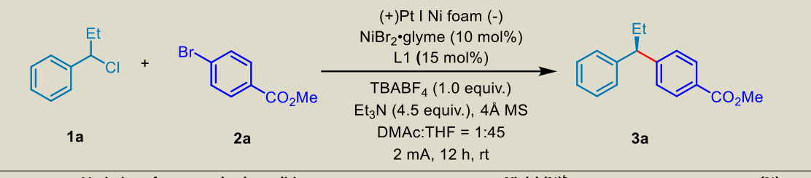<br><sub>Published scheme (CC BY 4.0)</sub></td>
    <td width="50%" align="center" valign="top">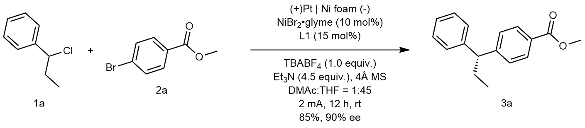<br><sub>Drawn from <code>brief.json</code> with <code>"style": "nature_portfolio"</code></sub></td>
  </tr>
</table>

| Need | Ready-to-use route |
| --- | --- |
| Crop and review an image | Crop/mask and comparison helpers that keep the region-to-result mapping |
| Match a folded chain or bridged ring | Trace source coordinates, then check crossings and bond order |
| Correct stereochemistry | Inspect atom indices, apply an explicit edit, and read back the final CDXML |
| Assemble the final scheme | Fixed-coordinate figures, rich conditions, arrows and native preview |
| Work beyond drawing | RDKit stereo/tautomer enumeration, MCS and R-group decomposition |

For many more figures, the [style gallery](skill/chemdraw/assets/house-styles/gallery/README.md#literature-replicas) shows 47 published figures redrawn in their journal or group style, each with its brief.

Recognition uploads only the task images and crops to the DECIMER API (`cdx.py decimer --preflight` shows what would be sent; offline requests are honored).

<details>
<summary><b>Rebuild the two complex schemes offline</b></summary>
<br>

Both schemes are built from real molecular objects (editable atoms, bonds and expandable abbreviations), together with text, brackets and electron arrows. The [atom-level comparison](skill/chemdraw/assets/paper-reconstructions/stereochemistry-check.json) records component hashes and atom mappings.

After installing the runtime, rebuild both layouts offline without repeating DECIMER recognition (use a new output directory):

```bash
python skill/chemdraw/scripts/cdx.py py skill/chemdraw/assets/paper-reconstructions/rebuild.py ./paper-figures-output
```

Native previews need desktop ChemDraw (Windows or macOS). See the [rebuild example](skill/chemdraw/assets/paper-reconstructions/README.md).

</details>

## Reaction calculator and chemistry reports

These tools start from structures you supply (SMILES, MOL or SDF, CDXML) and do the arithmetic and bookkeeping with RDKit, except the stoichiometry grid, which ChemDraw computes. They do not recognise or edit structures, and only the grid and the name tool need ChemDraw. Each one returns its result in the reply and can also write a new file; an existing file is never overwritten.

| You want | Tool | You get |
| --- | --- | --- |
| How much of each reagent and solvent to weigh | `cdx.py calc`, `stoichiometry_grid` | ChemDraw's own stoichiometry grid under the reaction, and its numbers as JSON |
| An SI materials table for many reactions | `si_materials_tables` | Markdown, CSV, printable HTML or JSON, up to 100 reactions |
| HRMS and characterization text | `hrms_line`, `characterization_text` | `HRMS (ESI) m/z calcd for ...` and ACS-order paragraphs |
| Overall yield and PMI of a route | `route_summary` | One table for a linear or convergent route |
| Which atom becomes which | `map_reaction_atoms` | Atom maps, bond changes, reaction-centre SMARTS, reaction type |
| Formula, mass, adducts, logP | `molecule_report` | A property sheet |
| Does the reaction balance? | `check_reaction_balance` | The missing by-product and suggested coefficients |
| Every structure in a file | `export_structures` | SMILES, InChI, CSV or SDF |

### ChemDraw's reaction calculator

```bash
python <skill>/scripts/cdx.py calc "OCc1ccccc1.CC(=O)Cl>CCN(CC)CC.ClCCl>CC(=O)OCc1ccccc1"
```

This runs ChemDraw's own **Structure > Analyze Stoichiometry** command on the reaction (a reaction SMILES or your own `.cdxml` file) and opens the result in ChemDraw. ChemDraw puts its stoichiometry grid under the reaction: formula, MW, equivalents, sample mass, molarity, density, volume and moles for each reactant and reagent, and expected mass, measured mass, purity and percent yield for the product. Type a mass, volume or equivalents into the grid and ChemDraw recomputes the rest. While the command runs, a ChemDraw window appears for a moment, because ChemDraw runs menu commands only in a visible window. Your open drawings are not touched, and the result is a new file next to the source (`--output` names it).

After you have typed the amounts and saved, `cdx.py calc --read reaction-stoichiometry.cdxml` returns every row of the grid as JSON, so the agent quotes ChemDraw's numbers instead of its own. Reading back works without ChemDraw; drawing the grid needs desktop ChemDraw on Windows or macOS.

<p align="center">
  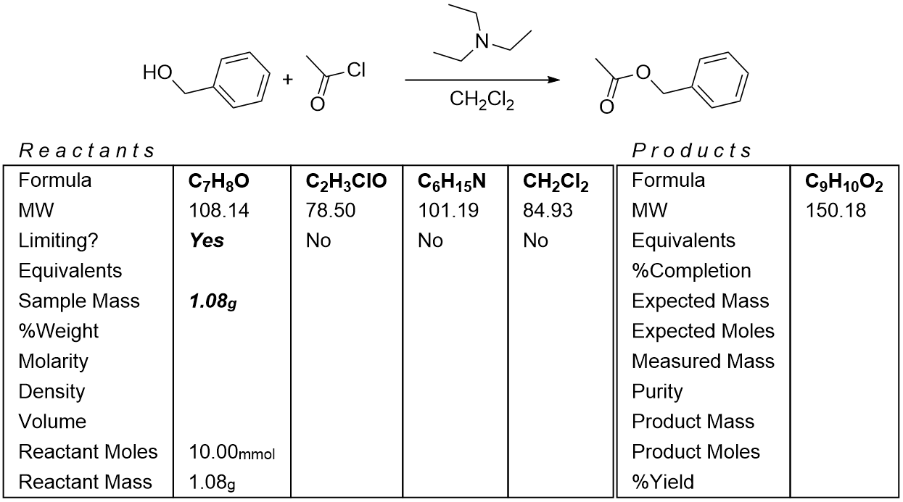
</p>

For amounts without ChemDraw, `si_materials_tables` writes materials tables for up to 100 reactions with concentration, atom economy and process mass intensity (PMI; E-factor is PMI minus 1).

**Safety reminders.** With `reagent_safety`, the materials table also shows GHS pictograms, H-statements, boiling and flash point. They come from a built-in table of 116 common solvents and bench reagents, plus SMARTS alerts for azides, peroxides, organolithiums, acyl chlorides and hydrides. A substance that is not in the table is shown as "not listed", not as safe. The table is a reminder, and the supplier's SDS takes precedence.

### Characterization text

`characterization_text` writes one paragraph per compound in ACS order: appearance, Rf, mp, rotation, IR, 1H and 13C NMR, other nuclei, HRMS. It prints the digits you give it and leaves out anything you did not supply. It also compares the 1H integral and the 13C signal count with the structure and reports a mismatch as a warning. It does not change a peak to make a check pass.

### Atom mapping and reaction type

`map_reaction_atoms` has a built-in substructure method. Where a product atom could come from several reactant atoms it says so instead of choosing. Two learned mappers, RXNMapper and LocalMapper, can be installed with `cdx.py install-mappers`; `compare: true` runs all installed methods side by side. Many reactions can be mapped in one call, which matters because each learned mapper takes 10 to 35 seconds to start.

With a finished mapping you can also ask for the reaction centre as a reaction SMARTS (`template`), a reaction type read from the structures (`classify`, 19 templates, otherwise "unclassified"), and the map numbers written beside the atoms of a copy of your drawing (`map_numbers_into_scheme`). Check the picture when an atom label such as H2N is crowded.

### Route summary

`route_summary` takes the steps of a synthesis in order, each with a yield and the masses used and obtained (or a reaction as in `si_materials_tables`). It returns the overall yield along the longest linear sequence and the cumulative PMI, scaling every step to the amount the next step consumes. Convergent routes work through the `into` field. A missing number gives `null` and a warning, not a guess. Work-up and purification solvents count only if you include them in the input mass.

```text
Use the ChemDraw Skill to run ChemDraw's stoichiometry grid on this amide coupling, and read the amounts back after I edit them.
Write the characterization paragraph for compound 3a from these NMR peaks and this HRMS value.
```

The full inputs and rules are in the [chemistry reports guide](skill/chemdraw/references/chemistry-reports.md).

## Featured demos

Real paper images and data, with native previews, reference comparisons and editable downloads.

| Case | What it shows |
| --- | --- |
| [Twenty structures](#stereo-reconstruction-demo) | Resolving stereo disagreement between chemistry readers: 20 of 20 agree between ChemScript and RDKit |
| [Paper reaction scheme](#paper-scheme-demo) | Five structures, conditions, yields and wavy bonds, rebuilt as an editable figure |
| [Sceptrin mechanism](#mechanism-demo) | Eight structures, electron arrows, charges and conditions, rebuilt as an editable figure |
| [Patent Markush structure](#markush-demo) | R groups, variable rings and a multicentre bond from a patent figure and its claim text; structure matches the reference, with CXSMILES and V3000 |
| [Native TLC](#tlc-demo) | Editable lanes, spots and Rf values; runnable example |
| [Native apparatus](#apparatus-demo) | Assembly from native ChemDraw templates; runnable example |
| [Experimental NMR](#nmr-demo) | Real processed 1D data as an editable spectrum; runnable example |
| [Simulated reaction kinetics](#kinetics-demo) | Numerical data as editable curves; runnable example |
| [Complex synthesis: 101–112](#synthesis-101-demo) | Full native scheme with every compound, condition and arrow |
| [Complex synthesis: 113–122](#synthesis-113-demo) | Full native scheme with every compound, condition and arrow |

<a id="stereo-reconstruction-demo"></a>

### Twenty structures: resolving stereo-reader disagreement

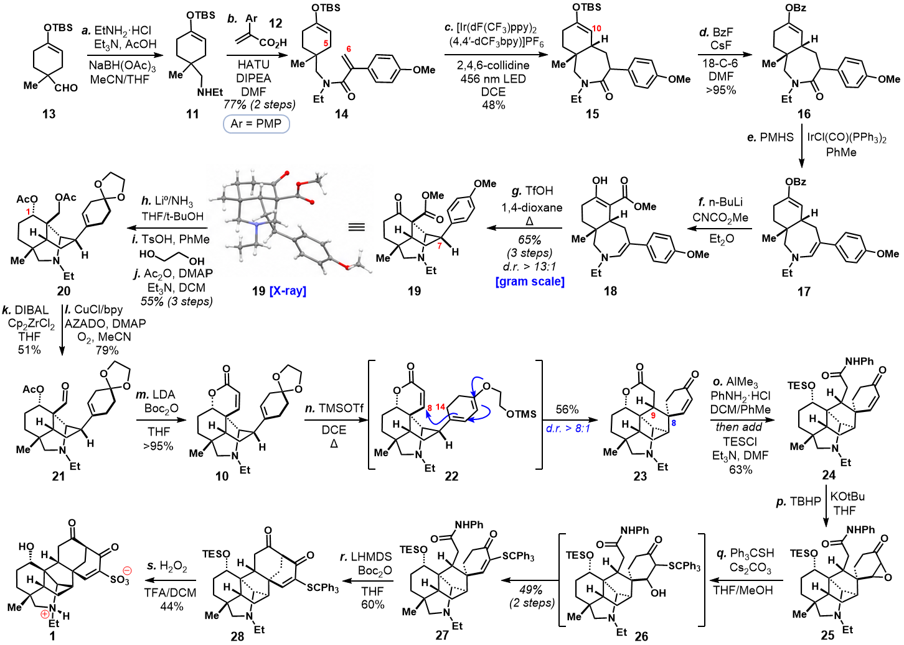

A drawing that follows the source literally is read differently by ChemScript and RDKit for 16 of its structures. The saved revision makes both readers agree on **all 20** while keeping the reviewed molecules; compound **1** uses explicit stereobonds for this.

[Editable CDXML](toolkit/assets/readme/stereo-reconstruction/reconstruction.cdxml) · [Failure analysis, workflow and rights](toolkit/assets/readme/stereo-reconstruction/CASE.md) · [Per-compound evidence and versions](toolkit/assets/readme/stereo-reconstruction/verification.json)

The X-ray image is cropped from the source paper and is not covered by the MIT license.

<details>
<summary><b>Incremental workflow:</b> three caption edits, 8 → 2 native calls</summary>
<br>

Linked structure and scene records, verified candidate caching, local checks and explicit dual-variant acceptance. Editing only the three changed captions took 2 native calls instead of 8 (8.88 s instead of 33.53 s) in the measured run linked below. [Source-oriented version](toolkit/assets/readme/stereo-reconstruction/source-oriented.cdxml) · [Workflow](skill/chemdraw/references/image-visual-review.md#repeated-structures-and-local-repairs) · [Measured evidence](toolkit/assets/readme/stereo-reconstruction/incremental-verification.json)

</details>

<a id="paper-scheme-demo"></a>

### Paper reaction scheme

A published reaction scheme rebuilt as an editable ChemDraw document. The example keeps the five structures, reaction conditions, yields and compound labels of the reference image.

**Original paper figure**

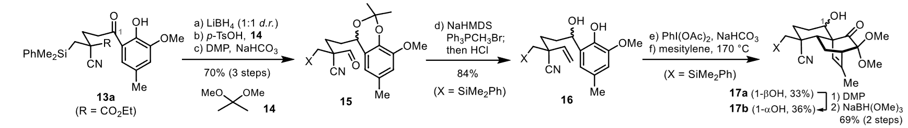

**Editable reconstruction, saved by ChemDraw**

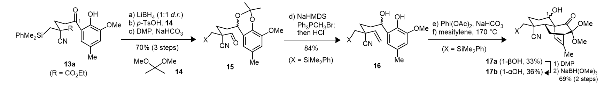

[Download editable CDXML](assets/readme/paper-replica/replica.cdxml) · [Inspect structure-by-structure comparisons](assets/readme/paper-replica/structure-comparison.png) · [Source and verification details](assets/readme/paper-replica/provenance.json)

The five structures read back from the saved CDXML match the reference structures, and the shared wavy bond of 17a/17b is kept as drawn in the original.

<a id="mechanism-demo"></a>

### Sceptrin mechanism

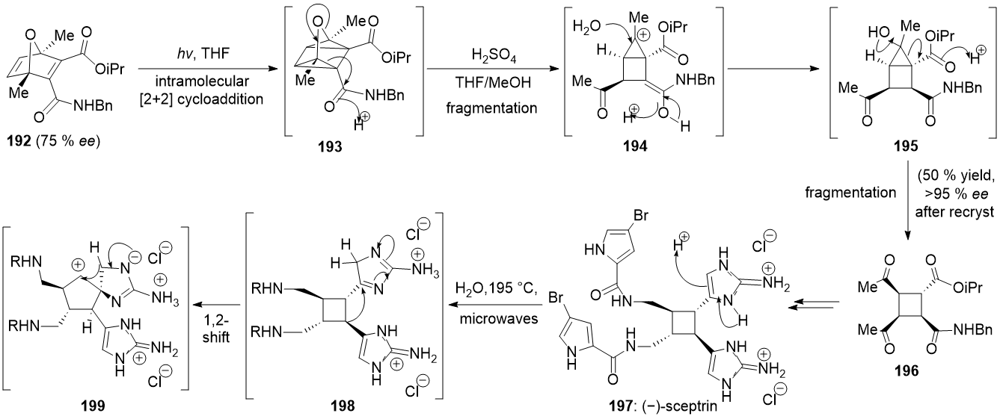

<details>
<summary>Show the reference excerpt</summary>
<br>

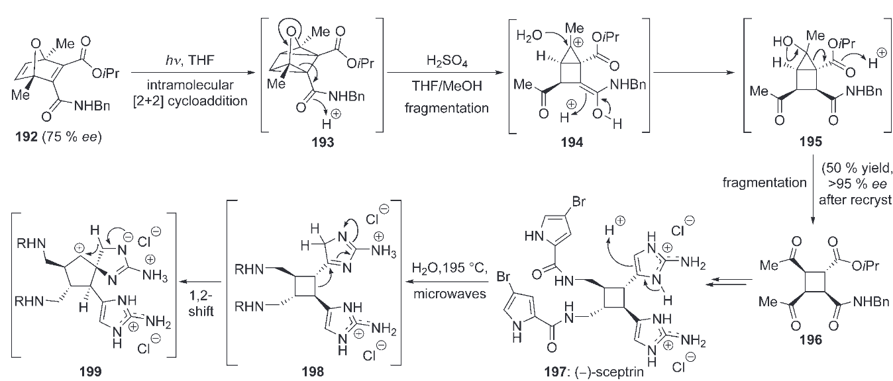

</details>

[Editable CDXML](assets/readme/mechanism/mechanism.cdxml) · [Native CDX](assets/readme/mechanism/mechanism.cdx) · [Side-by-side comparison](assets/readme/mechanism/comparison.png) · [Verification details](assets/readme/mechanism/provenance.json)

Eight numbered structures and six chloride counterions keep their atoms, stereochemistry and formal charges through a real ChemDraw CDXML → CDX → CDXML save cycle. R groups stay generic substituents, as in the source.

<a id="markush-demo"></a>

### Patent Markush structure


[Editable CDXML](assets/readme/markush/markush.cdxml) · [Markush spec](assets/readme/markush/markush.json) · [CXSMILES](assets/readme/markush/markush.cxsmiles) · [V3000 molfile](assets/readme/markush/markush.mol) · [Verification and limitations](assets/readme/markush/provenance.json) · [Workflow](skill/chemdraw/references/markush.md)

A generic structure from a patent figure plus claim text: R groups and linkers, two variable rings, a group that can sit on three ring positions, and repeat counts. `cdx.py markush` guides the extraction: the agent transcribes the labels, checks a read-back image, reviews the side-by-side render and turns each claim clause into values, while code does the geometry, the structure and the drawing. In the included example the result matches a hand-written reference spec atom for atom, and the drawing follows the source layout (drawn ink overlaps the source at 0.99). The structure is also saved as CXSMILES and as a V3000 molfile, so other chemistry software can read it.

### Native scientific drawings

<table>
  <tr>
    <td width="50%" valign="top">
      <a id="tlc-demo"></a>
      <b>Native TLC</b><br>
      <sub>Native TLC plate, lane and spot objects with illustrative Rf values.</sub><br><br>
      <p align="center">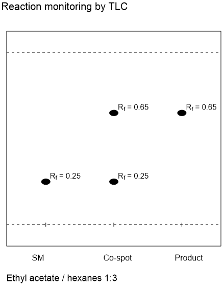</p>
      <sub><a href="assets/readme/scientific/tlc.cdxml">Editable CDXML</a> · <a href="skill/chemdraw/references/scientific-workflows.md">Run this example</a> · <a href="assets/readme/scientific/provenance.json">Data and template provenance</a></sub>
    </td>
    <td width="50%" valign="top">
      <a id="apparatus-demo"></a>
      <b>Native apparatus</b><br>
      <sub>Built from installed ChemDraw apparatus templates, preserving their editable native artwork.</sub><br><br>
      <p align="center">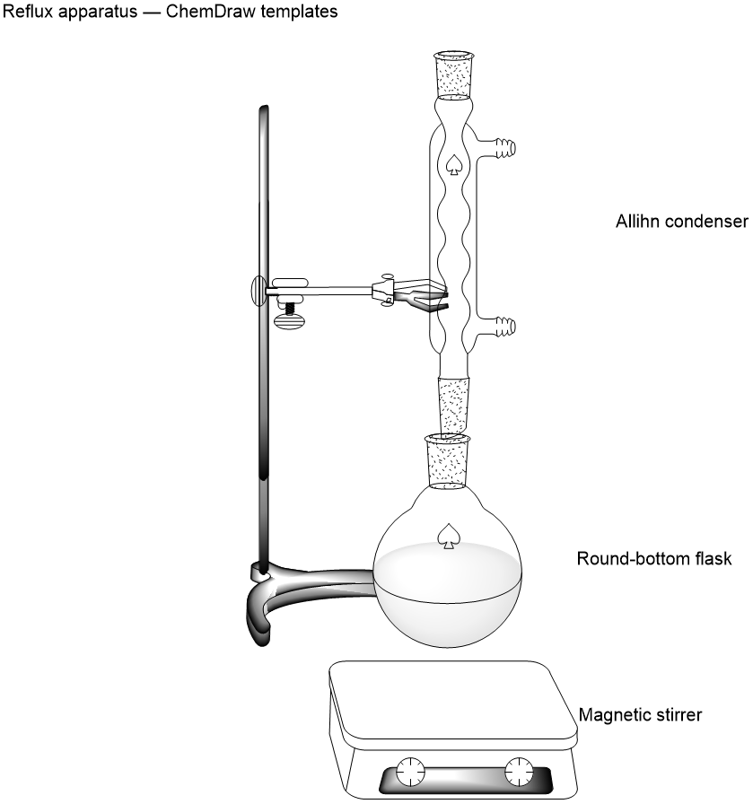</p>
      <sub><a href="assets/readme/scientific/apparatus.cdxml">Editable CDXML</a> · <a href="skill/chemdraw/references/scientific-workflows.md">Run this example</a> · <a href="assets/readme/scientific/provenance.json">Data and template provenance</a></sub>
    </td>
  </tr>
  <tr>
    <td width="50%" valign="top">
      <a id="nmr-demo"></a>
      <b>Experimental NMR</b><br>
      <sub>Real processed 1D NMR data, with peak picking and selected-region integration.</sub><br><br>
      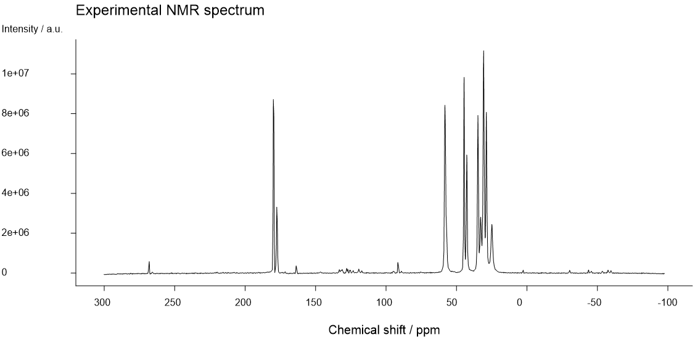<br>
      <sub><a href="assets/readme/scientific/nmr.cdxml">Editable CDXML</a> · <a href="skill/chemdraw/references/scientific-workflows.md">Run this example</a> · <a href="assets/readme/scientific/provenance.json">Data and template provenance</a></sub>
    </td>
    <td width="50%" valign="top">
      <a id="kinetics-demo"></a>
      <b>Simulated reaction kinetics</b><br>
      <sub>A simulated first-order decay turned into an editable plot.</sub><br><br>
      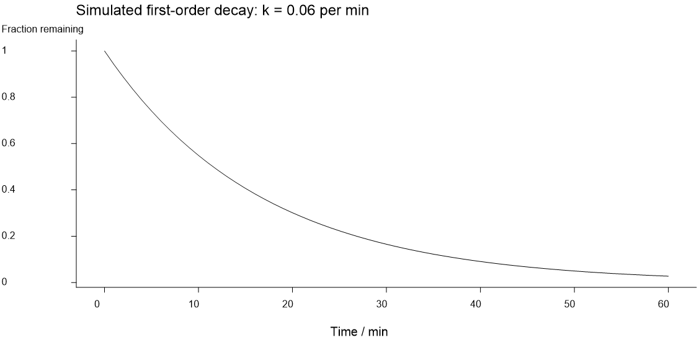<br>
      <sub><a href="assets/readme/scientific/kinetics.cdxml">Editable CDXML</a> · <a href="skill/chemdraw/references/scientific-workflows.md">Run this example</a> · <a href="assets/readme/scientific/provenance.json">Data and template provenance</a></sub>
    </td>
  </tr>
</table>

<a id="synthesis-101-demo"></a>

### Complex synthesis: 101–112

**Full scheme with editable structures.** Every compound number, reaction condition and mechanism arrow is included, and native saving keeps connectivity, charges, isotopes and alkene geometry.

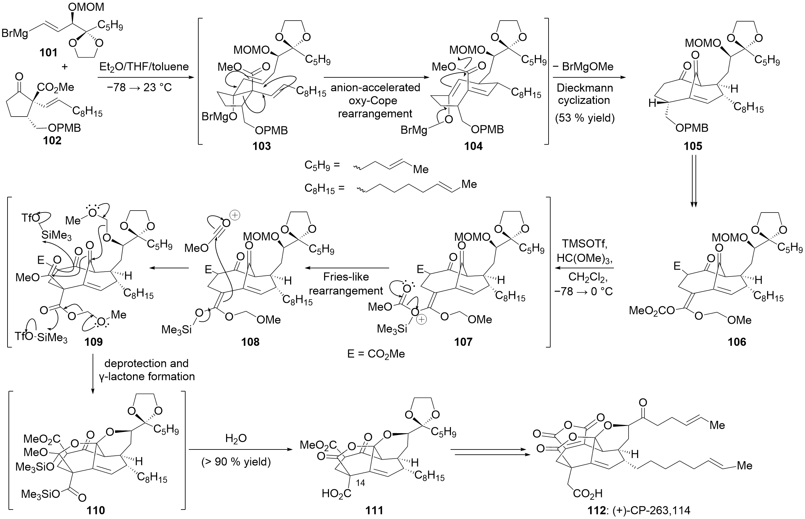

[Full editable CDXML](assets/readme/synthesis-101-112/figure.cdxml) · [Reference comparison](assets/readme/synthesis-101-112/comparison-full.png) · [Verification and provenance](assets/readme/synthesis-101-112/provenance.json)

<details>
<summary>Compare the complete reference and reconstruction</summary>

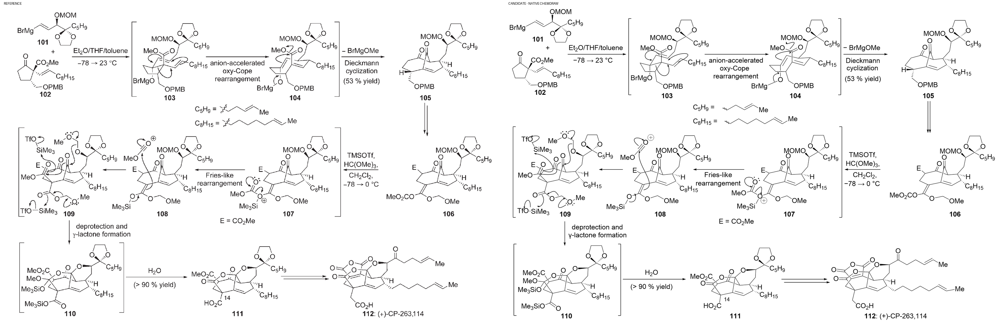

</details>

<a id="synthesis-113-demo"></a>

### Complex synthesis: 113–122

**Full scheme with editable structures.** Every compound number, reaction condition and mechanism arrow is included, and native saving keeps connectivity, charges, isotopes and alkene geometry.

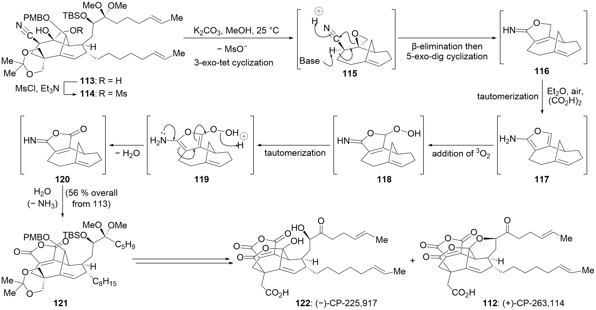

[Full editable CDXML](assets/readme/synthesis-113-122/figure.cdxml) · [Reference comparison](assets/readme/synthesis-113-122/comparison-full.png) · [Verification and provenance](assets/readme/synthesis-113-122/provenance.json)

<details>
<summary>Compare the complete reference and reconstruction</summary>

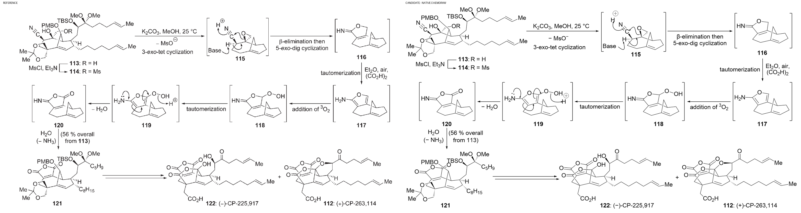

</details>

## Prediction and analysis engines

Fifteen optional engines read structure images, find structures in a PDF, and predict precursors, products, reaction conditions and NMR shifts. Nothing is installed until you agree, each engine lives in its own environment, a local engine uploads nothing while it runs (the remote DECIMER service is the one engine that sends an image out), and every answer is labelled a model prediction. Disagreeing engines are shown side by side, never merged.

### The fifteen engines

| Engine | Does | Disk | Licence | GPU |
| --- | --- | --- | --- | --- |
| `decimer-api` | image to structure, remote service | none | MIT | no |
| `decimer-local` | the same model on this computer | 2.4 GB | MIT | no (CPU) |
| `molscribe` | image to structure | 4.7 GB | MIT | yes |
| `molnextr` | image to structure | 4.8 GB | Apache-2.0 | yes |
| `molparser` | image to structure, Markush | 3.4 GB | weights non-commercial | yes |
| `molvec` | image to structure, rule-based | 2 MB | Apache-2.0 | no (Java) |
| `decimer-segmentation` | find structures on a page | 2.1 GB | MIT | no |
| `aizynthfinder` | retrosynthesis, routes | 1.7 GB | MIT | no |
| `synplanner` | retrosynthesis, routes | 4.8 GB | MIT | yes |
| `reactiont5-forward` | products | 3.9 GB | MIT | yes |
| `reactiont5-retro` | single-step retrosynthesis | 3.9 GB | MIT | yes |
| `retrochimera` | single-step retrosynthesis and routes | 8.5 GB | research use only | yes |
| `magnet` | 1H and 13C shifts | 5.4 GB | MIT | yes |
| `nmrnet-pp` | 1H and 13C shifts, second model | 2.8 GB | code MIT, weights CC BY 4.0 | yes |
| `reacon` | catalyst, solvent and reagent sets | 1.9 GB | none stated by the authors | yes |

Sizes are finished installs on Windows with the CUDA build of PyTorch; a CPU install is smaller. `CHEMDRAW_ENGINE_HOME` moves them to another disk. `cdx.py engines --recommend NEED` says what a task needs before anything is downloaded. The licence and registry details are in [engines.md](skill/chemdraw/references/engines.md).

The cases below were run on one Windows laptop with an RTX 5090 GPU. Each is scored against a reviewed structure, a recorded experiment or a measured spectrum, and the misses are kept. They show how the engines behave on these inputs, not how accurate they are in general. Inputs, outputs, scoring and timings are in [`assets/readme/engines/`](assets/readme/engines/provenance.json). Cold one-shot times below include model loading. A one-off call is a clean process; batches and multi-step searches (or `--accel on`) keep a resident worker for the next call, which cut a repeated `predict products` call from 13.7 s to 0.6 s here (`cdx.py stop-daemons` ends the workers), and every engine reply records its actual `execution.device` (`cuda:0` or `cpu`).

Open a case to see its images and results.

<details>
<summary><b>Structure images and PDFs</b></summary>
<br>

> **You say:** "Read this structure with every local engine and show me where they disagree." · "Pull every structure out of this PDF and read them."

Three crops from a published scheme (compounds 13a, 16 and 17, with R and SiMe<sub>2</sub>Ph drawn as abbreviations) and a clean ChemDraw drawing of imatinib went through six engines. A reading counts as right when its connectivity equals the reviewed structure, with R and X read as a wildcard; stereochemistry is not scored.

<table>
  <tr>
    <td align="center" valign="bottom">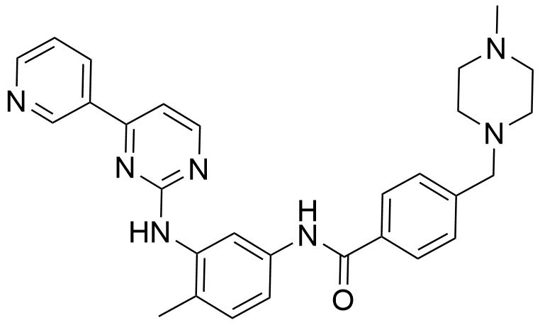<br><sub>imatinib</sub></td>
    <td align="center" valign="bottom">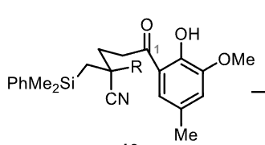<br><sub>13a</sub></td>
    <td align="center" valign="bottom">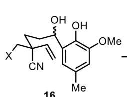<br><sub>16</sub></td>
    <td align="center" valign="bottom">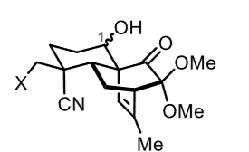<br><sub>17</sub></td>
  </tr>
</table>

| Image | MolScribe | MolNexTR | MolParser | MolVec | DECIMER (remote) | DECIMER (local) |
| --- | --- | --- | --- | --- | --- | --- |
| imatinib, clean drawing | right | right | right | right | right | right |
| 13a, R and SiMe<sub>2</sub>Ph | wrong (silyl group lost, stray fragment) | right | right | wrong (P for R) | wrong (Hg on the ring) | wrong (Hg on the ring, stray fragments) |
| 16, X abbreviation | wrong (X lost, stray C) | wrong (X lost) | invalid SMILES | wrong (ethyl for CH<sub>2</sub>X) | wrong (NHMe in place of the ring methyl) | wrong (NHMe in place of the ring methyl) |
| 17, bridged cage | invalid SMILES | right (carries a <sup>14</sup>C label) | invalid SMILES | wrong | right | right |
| **Right** | 1 of 4 | 3 of 4 | 2 of 4 | 1 of 4 | 2 of 4 | 2 of 4 |
| Time per image | 17 s | 19 s | 15 s | 3 s | 4 s (network) | 57 s (CPU) |

Two engines agreeing was a useful hint here: on 13a MolNexTR and MolParser agree and are right, on 17 MolNexTR and DECIMER agree and are right. On 16 all six fail and no two independent models agree, which is the signal to read the drawing yourself. `decimer-local` runs the same DECIMER V2 weights in its own Python 3.11 + TensorFlow 2.15 CPU environment and matches the remote service on every image (scores 0.994 on imatinib, 0.913 on 17, 0.889 on 16 and 0.846 on 13a), taking 51 to 87 s per call because it loads the model each time.

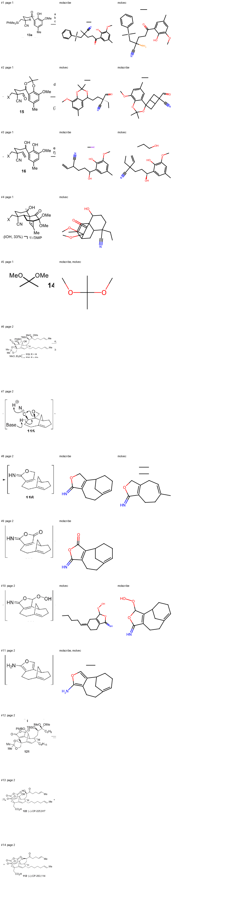

A two-page PDF of the same scheme and a second published scheme went through DECIMER Segmentation, then MolScribe and MolVec for each crop. Page 1 gave 5 crops for its 5 structures, and only 1 of them (2,2-dimethoxypropane) was read by both engines; the others lose their abbreviated groups, and one crop includes a neighbour's text. Page 2 gave 9 crops, five of them with no reading from either engine. The sheet puts each crop beside what each engine read, which is how these misses are caught; the run took 418 s for 14 crops.

**Install:** `ocsr-standard` (MolScribe and MolVec, 4.7 GB), `ocsr-full` (adds MolNexTR and MolParser, 12.9 GB), `pdf` (segmenter, MolScribe, MolVec, 6.8 GB). MolParser's weights are non-commercial only. MolVec needs Java. [Details](skill/chemdraw/references/engines.md#reading-a-structure-image)

</details>

<details>
<summary><b>Routes, products and conditions</b></summary>
<br>

> **You say:** "Find precursors for this target with the local retrosynthesis engines and draw the routes." · "What does this reaction give, and under what conditions?"

Two steps from a lab notebook ([KL-CC-001 and KL-CC-002](toolkit/samples/KL-CC-002/scheme.png): a Pd-catalysed amination, then a butyllithium alkylation) and the published amide disconnection of imatinib have a known answer to check against.

| Retrosynthesis | AiZynthFinder | RetroChimera | ReactionT5 (retro) | SynPlanner |
| --- | --- | --- | --- | --- |
| KL-CC-001, recorded: 4-bromothieno[2,3-d]pyrimidine + morpholine | recorded pair at rank 2; rank 1 is the 4-chloro analogue | chloro analogue at rank 1, recorded pair not in the top 5 | miss (2,4-dichloro compound with a phosphine mixed in) | recorded pair in route 4; route 1 is the chloro analogue |
| imatinib, amide + aniline | rank 2 (acid) and 3 (acid chloride) | rank 1 (acid chloride) | miss | no search: the target is in its building-block list |
| KL-CC-002, recorded 2-step route | miss | miss | miss | miss |
| Time | 18 to 34 s | 99 to 155 s | 15 to 19 s | 44 to 76 s |

For KL-CC-002 no engine proposed the recorded last step. AiZynthFinder's top route starts from two of the three recorded building blocks (the bromo heterocycle and morpholine) but closes the C–C bond from an aldehyde instead of a tosylate; SynPlanner's and RetroChimera's top routes go through different disconnections. All three route schemes below are drawn as predicted, and the figure tool's balance check flags missing by-products in each.

<table>
  <tr>
    <td width="33%" align="center" valign="top"><br><sub>AiZynthFinder</sub></td>
    <td width="33%" align="center" valign="top">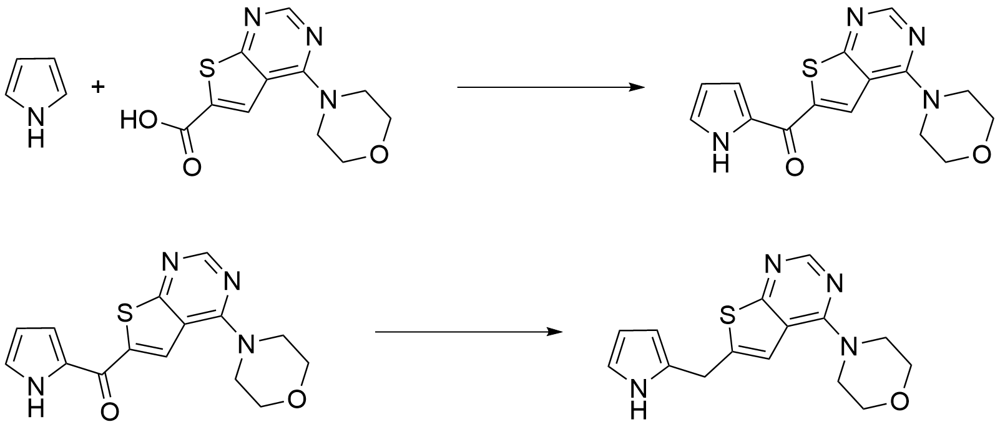<br><sub>SynPlanner</sub></td>
    <td width="33%" align="center" valign="top">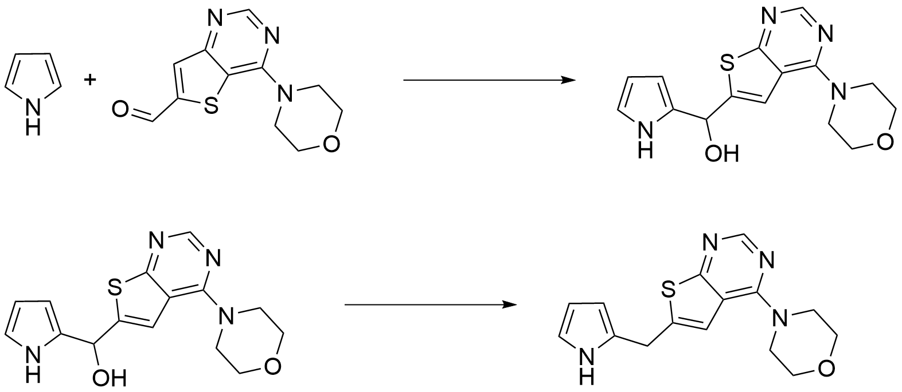<br><sub>RetroChimera</sub></td>
  </tr>
</table>

**Products.** ReactionT5 (forward) returned the recorded product at rank 1 for all three reactions (11 to 16 s); ranks 2 to 5 include a dehydromorpholine and a furan with O in place of S, which is why only the top answers are worth reading. **Conditions.** Reacon missed all three: it proposed sodium azide in THF for the amination (no template matched, which it reports), sodium hydride in DMF for the alkylation (recorded: n-BuLi, THF), and dichloromethane first for the imatinib amide (pyridine, the classic medium, came third). It returns catalyst, solvent and reagent sets only, never temperature, time or amounts. Times are 16 to 27 s.

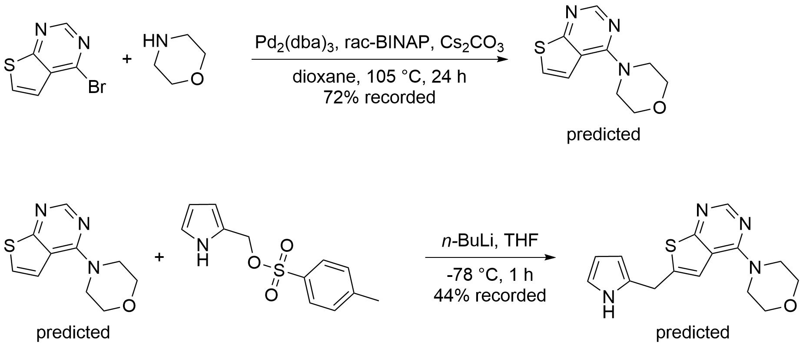

**Install:** `retro` (AiZynthFinder, 1.7 GB), `products` (3.9 GB), `conditions` (Reacon, 1.9 GB); SynPlanner and ReactionT5 retro by name; `retro-chimera` (8.5 GB, needs about 14 GB of free memory). RetroChimera is for research use only and Reacon's authors state no licence, so it is downloaded from their repository only when you ask. [Details](skill/chemdraw/references/engines.md#predictions)

</details>

<details>
<summary><b>NMR shifts against a measured spectrum</b></summary>
<br>

> **You say:** "Predict the 1H and 13C shifts of caffeine with both NMR models and compare them with the measured spectrum."

The chart below plots BMRB's processed caffeine spectrum in D<sub>2</sub>O (`bmse000206`) as an editable ChemDraw curve with each predicted shift drawn as a line and the measured peaks as ticks. `MagNET` averages shifts across a Boltzmann-weighted 3D conformer ensemble (298.15 K) with Karplus <sup>3</sup><i>J</i><sub>HH</sub> coupling estimation, and `nmr.compare_shifts` provides Hungarian 1-to-1 candidate peak matching (`model_assisted_candidate_assignment`) with outlier warnings. To measure accuracy systematically, both engines were run on **20 assigned organic molecules and natural products** from `nmrshiftdb2` with paired raw <sup>1</sup>H and <sup>13</sup>C Bruker spectra (13 in CDCl<sub>3</sub>, 7 in DMSO-<i>d</i><sub>6</sub>; 215 non-exchangeable C–H <sup>1</sup>H topological groups and 323 <sup>13</sup>C topological groups; exchangeable OH, NH and SH protons excluded on both sides, and degenerate keto–enol tautomer symmetry applied on curcumin). Values below are per-molecule macro mean absolute errors in ppm.


| Subset | Molecules | <sup>1</sup>H groups | MagNET <sup>1</sup>H | NMRNet++ <sup>1</sup>H | <sup>13</sup>C groups | MagNET <sup>13</sup>C | NMRNet++ <sup>13</sup>C |
| --- | --- | --- | --- | --- | --- | --- | --- |
| **All 20 molecules** | 20 | 215 | **0.21** (pooled 0.22, max 1.08) | **0.11** (pooled 0.12, max 0.84) | 323 | **2.89** (pooled 3.08, max 15.90) | **1.14** (pooled 1.23, max 10.37) |
| CDCl<sub>3</sub> | 13 | 165 | 0.19 | 0.10 | 234 | 3.11 | 1.10 |
| DMSO-<i>d</i><sub>6</sub> | 7 | 50 | 0.26 | 0.13 | 89 | 2.48 | 1.22 |
| ShiftDB-Lit-eligible (`<=1` chiral centre) | 7 | 55 | 0.21 | 0.10 | 92 | 2.71 | 0.68 |
| Excluded from ShiftDB-Lit (`>=2` chiral centres or absent) | 13 | 160 | 0.21 | 0.12 | 231 | 2.99 | 1.39 |

<details>
<summary><b>Per-molecule MAE across all 20 benchmark compounds (ppm)</b></summary>
<br>

| # | Molecule (`nmrshiftdb2` ID) | Solvent | <sup>1</sup>H groups | MagNET <sup>1</sup>H | NMRNet++ <sup>1</sup>H | <sup>13</sup>C groups | MagNET <sup>13</sup>C | NMRNet++ <sup>13</sup>C |
| --- | --- | --- | --- | --- | --- | --- | --- | --- |
| 1 | Sinensetin (`20237348`) | CDCl<sub>3</sub> | 10 | 0.14 | 0.02 | 20 | 4.15 | 0.23 |
| 2 | Colchicine (`60000009`)* | CDCl<sub>3</sub> | 12 | 0.29 | 0.12 | 22 | 4.99 | 0.42 |
| 3 | Quinine (`60004827`) | CDCl<sub>3</sub> | 16 | 0.25 | 0.12 | 20 | 3.48 | 0.87 |
| 4 | Rosmarinic acid (`20252986`) | DMSO-<i>d</i><sub>6</sub> | 10 | 0.38 | 0.04 | 18 | 2.74 | 0.39 |
| 5 | Curcumin (`10027206`)* | DMSO-<i>d</i><sub>6</sub> | 7 | 0.30 | 0.10 | 11 | 3.05 | 0.86 |
| 6 | Caffeine (`10016316`)* | DMSO-<i>d</i><sub>6</sub> | 4 | 0.16 | 0.24 | 8 | 0.90 | 0.32 |
| 7 | Strychnine (`40265284`) | CDCl<sub>3</sub> | 16 | 0.13 | 0.10 | 21 | 2.07 | 1.28 |
| 8 | *N*-Boc-dioxolopyranoisoquinoline (`60001975`) | CDCl<sub>3</sub> | 9 | 0.16 | 0.08 | 16 | 2.48 | 1.11 |
| 9 | Piperine (`10016311`)* | CDCl<sub>3</sub> | 11 | 0.12 | 0.03 | 15 | 3.42 | 0.23 |
| 10 | Galanthamine (`20062583`) | CDCl<sub>3</sub> | 12 | 0.22 | 0.14 | 17 | 4.09 | 2.62 |
| 11 | Brazilein (`20192008`)* | DMSO-<i>d</i><sub>6</sub> | 7 | 0.17 | 0.11 | 16 | 1.82 | 1.94 |
| 12 | Cocaine (`10016310`) | CDCl<sub>3</sub> | 12 | 0.18 | 0.20 | 15 | 2.60 | 0.89 |
| 13 | 4-(2,2,2-Trifluoroethoxy)aniline (`60004996`) | DMSO-<i>d</i><sub>6</sub> | 3 | 0.15 | 0.13 | 6 | 1.58 | 1.27 |
| 14 | Cytisine (`60000003`) | CDCl<sub>3</sub> | 9 | 0.11 | 0.10 | 11 | 2.21 | 1.40 |
| 15 | Lawsone (`20143612`)* | DMSO-<i>d</i><sub>6</sub> | 5 | 0.27 | 0.08 | 10 | 2.85 | 0.81 |
| 16 | Cnicin (`40265326`) | DMSO-<i>d</i><sub>6</sub> | 14 | 0.38 | 0.23 | 20 | 4.45 | 2.92 |
| 17 | (−)-*trans*-Δ<sup>9</sup>-THC (`40265338`) | CDCl<sub>3</sub> | 14 | 0.20 | 0.10 | 20 | 3.27 | 0.63 |
| 18 | 3-*O*-Acetyl-11-keto-β-boswellic acid (`60000007`) | CDCl<sub>3</sub> | 23 | 0.27 | 0.16 | 32 | 2.91 | 2.36 |
| 19 | Artemisinin (`20253147`) | CDCl<sub>3</sub> | 12 | 0.19 | 0.13 | 15 | 2.82 | 2.09 |
| 20 | Nicotine (`10008712`)* | CDCl<sub>3</sub> | 9 | 0.17 | 0.04 | 10 | 1.96 | 0.20 |

<sub>* Marked molecules also pass NMRNet++'s ShiftDB-Lit (<code>&lt;=1</code> chiral centre) filter. Unassigned 1-to-1 Hungarian peak matching on the same 20 molecules gives 0.16 / 2.58 ppm for MagNET and 0.09 / 1.00 ppm for NMRNet++ because swapping nearby signals hides assignment errors.</sub>

</details>

**Training-set overlap note.** All 20 records originate from `nmrshiftdb2`, which forms part of NMRNet++'s supervised 5-fold cross-validation training corpus (~80% in fold 0's training split), and 7 of the 20 also pass its ShiftDB-Lit filter (where NMRNet++ averages 0.68 ppm on <sup>13</sup>C vs 1.39 ppm on the remaining 13 molecules). MagNET was trained strictly on synthetic AIMNet2/GIAO DFT shieldings with zero experimental NMR spectra in training, so its 0.21 ppm (<sup>1</sup>H) and 2.89 ppm (<sup>13</sup>C) errors represent a genuine out-of-training experimental test, whereas NMRNet++'s 0.11 and 1.14 ppm reflect training-corpus overlap and should be read as an in-corpus ceiling. Runs took 22 to 60 s per molecule (mean 29 s) for MagNET and 24 to 62 s (mean 33 s) for NMRNet++ on GPU. Predicted values never go into an experimental characterization line.

**Install:** `nmr` (MagNET, 5.4 GB) and `nmr-pp` (NMRNet++, 2.8 GB; its weights are CC BY 4.0, and it takes no solvent). [20-molecule benchmark JSON](assets/readme/engines/nmr/benchmark20.json) · [Caffeine chart and data](assets/readme/engines/nmr/caffeine/)

</details>

<details>
<summary><b>LCMS plates</b></summary>
<br>

> **You say:** "Check this OpenLynx report against the plate map and tell me which wells contain the expected product."

No engine is needed. The 24-well Waters report and plate map from the PyParse example dataset (Apache-2.0) were parsed in 11 s. The expected product was found in 24 of 24 wells: 21 as [M+H]<sup>+</sup>, two Boc-protected piperazines (B3, B5) as the [M+H−C<sub>4</sub>H<sub>8</sub>]<sup>+</sup> fragment, and the carboxylic acid in B11 as [M−H]<sup>−</sup>. Against PyParse's own output the retention time and purity agree to 0.01 in 23 wells. The exception, B6, is a matching choice: the toolkit takes the peak carrying the intact [M+H]<sup>+</sup> (92.9%), PyParse the peak of the fragment (7.1%). [match_plate.py](assets/readme/engines/lcms/match_plate.py) shows the rule. Beyond plate reports, the LCMS tools parse OpenLynx `.rpt`, Waters PDF and `.raw` directories, Shimadzu `.daml`, Agilent `report.txt` and open `mzML`/`mzXML`, with Cl/Br `M+2` isotope-envelope verification and internal-standard (`IS`) ratio tracking across timepoints.

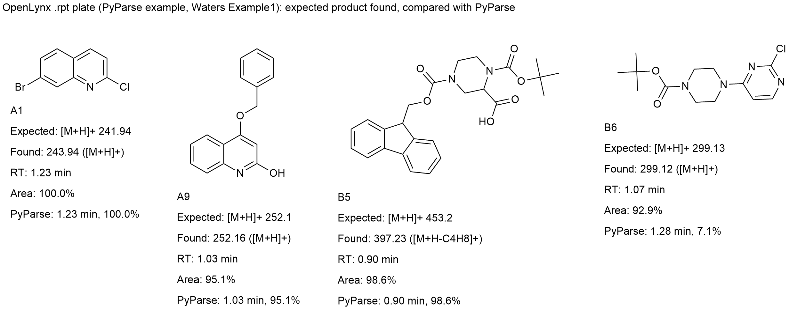

</details>

## Platform support

The portable chemistry layer (CDXML generation and editing, RDKit validation, the command line and MCP) runs on Windows, macOS and Linux. Native ChemDraw is driven through COM on Windows and through AppleScript on macOS, with the same tools and outputs.

| Capability | Windows | macOS | Linux |
| --- | :---: | :---: | :---: |
| CDXML, RDKit, command-line and MCP workflows | ✅ | ✅ | ✅ |
| ChemDraw-native rendering, conversion and cleanup | ✅ <sub>activated install</sub> | ✅ <sub>ChemDraw for macOS</sub> | — |
| ChemScript operations (names, formulas, cleanup, substructure) | ✅ <sub>compatible SDK</sub> | ✅ <sub>ChemDraw + OPSIN + RDKit</sub> | — |
| Raw ChemScript SDK programs | ✅ <sub>compatible SDK</sub> | ✅ <sub>emulated core API</sub> | — |
| Editable Office ChemDraw objects | ✅ <sub>desktop Office</sub> | ✅ <sub>vector preview, `cdx.py office-edit`</sub> | — |
| PDF previews of Office files | ✅ <sub>desktop Office</sub> | ✅ <sub>activated Microsoft 365</sub> | — |

<sub>✅ supported · — not supported (no bridge exists)</sub>

macOS differences — the Automation permission, the hidden ChemDraw instance, font substitution, SVG-based vector OLE previews, `office-edit` instead of double-click editing, and the ChemScript emulation — are listed in [operations](skill/chemdraw/references/operations.md#macos).

<details>
<summary><b>Required components</b></summary>
<br>

| Goal | Add to the core setup |
| --- | --- |
| Create and edit CDXML | Any agent with shell access, 64-bit Python 3.10–3.13, and the bundled toolkit runtime (built from `toolkit/` by `scripts/install.py --runtime`) |
| Native PNG, CDX or ChemDraw cleanup | Licensed and activated desktop ChemDraw: COM automation on Windows, or ChemDraw for macOS with the Automation permission |
| Molecule comparison or ChemScript SDK calls | RDKit for portable similarity; compatible ChemScript DLLs on a Windows host for exact checks and raw SDK programs (macOS answers the ChemScript operations with ChemDraw, OPSIN and RDKit) |
| Editable Word or PowerPoint objects | Desktop ChemDraw to build them; desktop Word and/or PowerPoint (activated on macOS) for PDF previews |
| Local optical structure recognition | DECIMER model weights and their runtime dependencies |
| More OCSR engines, retrosynthesis, product, reaction-condition and NMR prediction | `cdx.py engines --recommend NEED` then `cdx.py install-engines --bundle NAME`, once you agree: each engine in its own environment, from 2 MB up to about 8.5 GB (RetroChimera, which also needs about 14 GB free memory) with model files, removable with `remove-engines`; set `CHEMDRAW_ENGINE_HOME` to another disk before installing, and keep it set, to put them there; licence limits: MolParser's weights are non-commercial, RetroChimera is for research only, Reacon has no licence ([engines](skill/chemdraw/references/engines.md)) |
| Remote access to a ChemDraw workstation | A Windows host plus authenticated HTTP configuration and an encrypted network path |

ChemDraw, Microsoft Office, ChemScript and DECIMER model weights are not bundled. The [setup guide](docs/guide.md#first-time-setup) covers installation options, manual runtimes and diagnostics.

</details>

## Testing and security

- Every pull request, merge and release runs one CI file (`validate.yml`): the distribution checks, the toolkit suite on Windows (Python 3.13) and Linux (3.12), the Skill tests on Windows and the package build. macOS and Python 3.10 are supported but not run in CI. Native ChemDraw, ChemScript and Office features are tested by hand on a licensed Windows workstation. The macOS AppleScript path was tested on macOS 26.6 (Apple silicon) with ChemDraw 26.0.
- Tools write to a new output path and refuse to overwrite an existing file unless you ask.
- Image recognition sends only the selected images to the DECIMER API. `cdx.py decimer --preflight` shows what would be sent, and an offline request is honored. The reports and the mappers run locally, and ChemDraw's stoichiometry grid is computed by ChemDraw on your machine. Only the reports look a name up online, when it is not in the built-in table; `CHEMDRAW_OFFLINE=1` turns that off.
- Optional prediction engines run locally in separate environments and upload nothing; their downloads are checked against pinned hashes. Their answers are model predictions and are labelled as such.
- The HTTP server needs a bearer key and an allowed host list for remote use, and should sit behind an encrypted tunnel or an HTTPS proxy. See the [security policy](.github/SECURITY.md).

## Common questions

<details>
<summary><b>Can any AI agent use this ChemDraw Skill?</b></summary>
<br>

Yes. An agent needs to read the Skill instructions and run shell commands; every tool runs through `cdx.py`. The installer places the Skill where Claude Code, Codex, Gemini CLI, GitHub Copilot, Cursor, OpenCode and other agents that read `SKILL.md` folders discover it. Agents without Skill discovery can be pointed at `SKILL.md` from their instruction file, and clients that prefer MCP (Model Context Protocol) can register the bundled server. See [agent integration](skill/chemdraw/references/agent-integration.md).

</details>

<details>
<summary><b>Do I need an MCP server?</b></summary>
<br>

No. The command line covers every tool and keeps the same worker isolation, native ChemDraw lock and timeouts. MCP remains available for clients that want typed tool calls.

</details>

<details>
<summary><b>Can it draw in the style of a particular journal or research group?</b></summary>
<br>

Yes, for 28 of them, from JACS, Angew. Chem., Nature and Science to the Baran, MacMillan, Glorius and Houk groups. A style records how that journal or group sets compound numbers, where it puts the yield, how it splits conditions around the arrow, which bonds it colours, and its line widths and arrow lengths, measured from openly licensed figures. Add `--style NAME` to a draw command; `cdx.py styles` lists them. A style follows the conventions seen in those figures. It is not a publisher template and does not copy any figure. See [journal and group house styles](#journal-and-group-house-styles) and the [style gallery](skill/chemdraw/assets/house-styles/gallery/README.md).

</details>

<details>
<summary><b>Can I generate SAR figures from an Excel spreadsheet?</b></summary>
<br>

Yes. Use trusted structures with CSV or XLSX measurements to produce editable structure–activity relationship (SAR) panels or substrate-scope figures. Stable compound IDs retain data binding, and project updates preserve unrelated manual layout changes. See the [data-driven figure workflow](skill/chemdraw/references/data-driven-figures.md).

</details>

<details>
<summary><b>Will it make up reaction conditions or predict a mechanism?</b></summary>
<br>

No. For a figure drawn from a request, conditions, yields and measured values come only from what you gave; a missing one stays missing and the report says so. A name it cannot resolve is refused instead of guessed. Mechanisms are drawn from electron moves you list, and the tool flags an arrow that starts where there is no lone pair or charge, but it does not judge whether the mechanism is right. See [a new figure from one request](#one-command-figures).

</details>

<details>
<summary><b>Can it work out how much of each reagent to weigh?</b></summary>
<br>

Yes, with ChemDraw's own calculator. `cdx.py calc` runs Structure > Analyze Stoichiometry on a reaction given as SMILES or a ChemDraw file and opens the grid in ChemDraw, where you type a mass, volume or equivalents and ChemDraw computes the rest; `cdx.py calc --read` reads the saved numbers back. Without ChemDraw, `si_materials_tables` gives amounts tables in which every default is marked as assumed. See [reaction calculator and chemistry reports](#reaction-calculator-and-chemistry-reports).

</details>

<details>
<summary><b>How far can I trust the safety information?</b></summary>
<br>

It is a reminder from a built-in table of 116 common solvents and bench reagents plus SMARTS structural alerts: GHS pictograms, H-statements, boiling and flash point. A substance that is not in the table is shown as "not listed", never as safe. The values were written from typical supplier classifications and differ between suppliers, so check the SDS of the product you actually use.

</details>

<details>
<summary><b>What do the prediction engines need, and how far can I trust them?</b></summary>
<br>

They need disk space (from 2 MB to about 8.5 GB per engine, [listed above](#the-fifteen-engines)), a network once to install, and for most of them an NVIDIA GPU is optional but makes them faster; they run offline afterwards. RetroChimera needs about 14 GB of free memory. Treat every answer as a candidate. In the cases above the engines recovered a recorded product and some recorded precursors, missed others, and agreed with measured NMR shifts to about 0.2 ppm for 1H and 2 to 3 ppm for 13C on one fair test. Reacon's conditions missed all three recorded ones. When engines agree it is a hint, and when they do not it is the signal to check by hand. Licences: MolParser's weights are non-commercial, RetroChimera is for research only, Reacon's authors state no licence.

</details>

<details>
<summary><b>Can I reconstruct a paper figure as an editable ChemDraw file?</b></summary>
<br>

The [paper reconstruction workflow](skill/chemdraw/references/image-visual-review.md) combines grounded structures, layout reconstruction and native visual review. It produces editable CDXML with a native preview.

</details>

## Building the macOS path together

The macOS adapter drives ChemDraw for macOS through its AppleScript dictionary with timeouts, a per-user native lock, staged temporary files and save-cycle read-back, and maps ChemScript-only behavior to ChemDraw, OPSIN and RDKit. Help is still welcome with:

- Intel Macs and other ChemDraw versions (tested: ChemDraw 26.0 on macOS 26.6, Apple silicon);
- PDF previews through an activated Microsoft 365 for macOS;
- ChemScript SDK members beyond the emulated `StructureData`, `ReactionData` and `LargestCommonSubstructure` core.

Please open a focused issue or pull request with the exact macOS version, chip, ChemDraw build, permission prompts, command output and a minimal reproducible file. Do not submit proprietary papers, credentials or licensed ChemDraw assets. Start with the [contributing guide](.github/contributing.md).

## Documentation

| Start here | Go deeper |
| --- | --- |
| [Installation, troubleshooting and operations](docs/guide.md) | [Generated tool signatures](skill/chemdraw/references/mcp-signatures.md) |
| [Quick start in Chinese](docs/zh-cn.md) · [Chinese setup guide](docs/guide.zh-cn.md) | [Audited public inventory of the bundled toolkit](skill/chemdraw/references/toolkit-public-inventory.md) |
| [Agent integration and `cdx.py` command reference](skill/chemdraw/references/agent-integration.md) | [Toolkit developer reference](toolkit/docs/agent-reference.md) · [Generated MCP tool reference](toolkit/docs/mcp-tools.md) |
| [Task-oriented workflow catalog](skill/chemdraw/references/workflow-router.md) | [Remote HTTP setup](skill/chemdraw/references/operations.md#remote-http-only-when-asked) |
| [Contributing guide](.github/contributing.md) · [Security policy](.github/SECURITY.md) | [Repository instructions for contributors](AGENTS.md) |
| [Website](https://zichenwang114514.github.io/chemdraw-skill/en/) | [Landing page source and deployment](docs/website.md) |

The deployable Skill lives in [`skill/chemdraw`](skill/chemdraw). The chemistry runtime it drives, the `cdxml_toolkit` Python package, lives in [`toolkit`](toolkit) with its own tests.

## License

Repository-authored code and documentation are licensed under the [MIT License](LICENSE). The bundled toolkit in [`toolkit/`](toolkit) is based on Hiu Fung Kevin Lee's original `cdxml-toolkit` and keeps its own [MIT License](toolkit/LICENSE) and [third-party notices](toolkit/NOTICE.md). ChemDraw, Microsoft Office, agent clients, the MCP Python SDK, RDKit, DECIMER and their dependencies retain their respective licenses and usage terms.

This is an independent community project. It is not affiliated with or endorsed by Revvity, Anthropic, OpenAI, Google, GitHub, Microsoft, Anysphere, the OpenCode maintainers, or the maintainers of the upstream `cdxml-toolkit`, the MCP Python SDK, RDKit or DECIMER.

<p align="right"><a href="#top">Back to top ↑</a></p>
