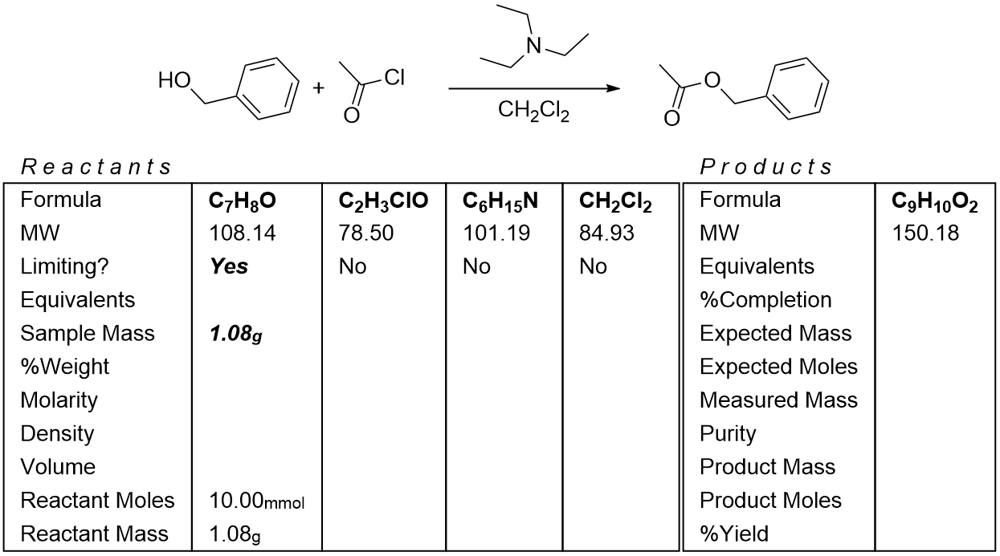

<a id="top"></a>

<p align="center">
  <picture>
    <source media="(prefers-color-scheme: dark)" srcset="./assets/readme/hero-dark.svg">
    
  </picture>
</p>

<h1 align="center">ChemDraw Skill</h1>

<h3 align="center">Editable ChemDraw chemistry for Claude Code, Codex and any AI coding agent</h3>

<p align="center">
  Draw structures, rebuild paper figures, build SAR panels from a spreadsheet and put live ChemDraw objects into Word and PowerPoint.
  The same Skill also weighs out reactions, writes characterization paragraphs and maps atoms across a reaction.<br>
  It runs in Claude Code, Codex, Gemini CLI, GitHub Copilot, Cursor, OpenCode and any agent that can run a shell command.
</p>

<p align="center">
  <a href="https://github.com/ZiChenWang114514/chemdraw-skill/actions/workflows/validate.yml"></a>
  
  
  <a href="skill/chemdraw/references/agent-integration.md"></a>
  <a href="LICENSE"></a>
</p>

<p align="center">
  <b>English</b> · <a href="README.zh-cn.md">&#31616;&#20307;&#20013;&#25991;</a>
  <br>
  <a href="#quick-start">Quick start</a> · <a href="#gallery">Gallery</a> · <a href="#what-it-handles">What it handles</a> · <a href="#reaction-calculator-and-chemistry-reports">Calculator</a> · <a href="#featured-demos">Demos</a> · <a href="#platform-support">Platforms</a> · <a href="#common-questions">FAQ</a> · <a href="docs/guide.md">Guide</a> · <a href="https://zichenwang114514.github.io/chemdraw-skill/en/">Website</a>
</p>

<br>

<table>
  <tr>
    <td width="25%" valign="top"><b>Structures with a source</b><br><sub>A structure comes from a database, OPSIN, ChemScript or DECIMER. The agent does not type SMILES from memory.</sub></td>
    <td width="25%" valign="top"><b>Editable output</b><br><sub>Results are CDXML. Atoms, bonds and text can be changed in ChemDraw afterwards.</sub></td>
    <td width="25%" valign="top"><b>One command</b><br><sub><code>cdx.py</code> runs every tool in any agent. MCP is optional.</sub></td>
    <td width="25%" valign="top"><b>Checked after saving</b><br><sub>ChemDraw renders and saves the file, then the chemistry is read back and compared with the input.</sub></td>
  </tr>
</table>

## Gallery

Every card is a native ChemDraw render of an editable file in this repository. Click one to open its case.

<table>
  <tr>
    <td colspan="3" align="center">
      <a href="#paper-scheme-demo"></a>
      <br><sub>Original paper figure</sub><br><br>
      <a href="#paper-scheme-demo"></a>
      <br><b>Paper reaction scheme → editable ChemDraw</b><br><sub>Five structures, conditions, yields and compound labels rebuilt from the image</sub>
    </td>
  </tr>
  <tr>
    <td colspan="3" align="center">
      <a href="#markush-demo"></a>
      <br><b>Patent Markush structure → editable ChemDraw</b><br><sub>Patent figure (left) and native rebuild (right): R groups, variable rings, a multicentre bond and repeat counts</sub>
    </td>
  </tr>
  <tr>
    <td width="33%" align="center" valign="top">
      <a href="#synthesis-113-demo"></a>
      <br><b>Complex synthesis</b><br><sub>Full multi-step scheme with mechanism arrows</sub>
    </td>
    <td width="33%" align="center" valign="top">
      <a href="#mechanism-demo"></a>
      <br><b>Reaction mechanism</b><br><sub>Electron arrows, charges and counterions</sub>
    </td>
    <td width="33%" align="center" valign="top">
      <a href="#stereo-reconstruction-demo"></a>
      <br><b>Twenty-structure synthesis</b><br><sub>Stereo agreement across chemistry readers: 20/20</sub>
    </td>
  </tr>
  <tr>
    <td width="33%" align="center" valign="top">
      <a href="#exam-and-lecture-drawings-in-acs-document-1996-style"></a>
      <br><b>Exam and lecture figures</b><br><sub>ACS Document 1996 style from a small JSON spec</sub>
    </td>
    <td width="33%" align="center" valign="top">
      <a href="#tlc-demo"></a>
      <br><b>TLC and apparatus</b><br><sub>Native plates, Rf values and ChemDraw templates</sub>
    </td>
    <td width="33%" align="center" valign="top">
      <a href="#nmr-demo"></a>
      <br><b>Spectra and plots</b><br><sub>Processed 1D NMR and numerical data as curves</sub>
    </td>
  </tr>
</table>

## Quick start

<!-- prerequisites -->
**Before you start**, check what this machine has:

- **ChemDraw.** Native rendering, the PNG in step 3, CDX conversion and Word/PowerPoint objects need licensed desktop ChemDraw on Windows or macOS. Without it the Skill still builds, edits, checks and recognises structures and runs the calculators ([what changes](skill/chemdraw/references/operations.md#no-chemdraw-on-this-host)).
- **Python.** A 64-bit Python 3.10–3.13 builds the runtime; the installer itself runs on 3.9+.
- **Disk.** The default runtime is a virtual environment of about 760 MB. `--extras` with no names installs the core only, and `--extras publication office` adds just those groups.
- **Optional tools.** Name-to-structure through OPSIN is not installed by default: add `--opsin`. OPSIN needs Java, which is fetched on first use on Windows and must be installed on macOS and Linux. Text recognition in the `image` extra needs the Tesseract program.

**1. Install.** The installer needs Python 3.9+ and finds a 64-bit Python 3.10–3.13 for the toolkit runtime on its own (through the `py` launcher, `uv`-managed interpreters or `python3.x` on PATH).

```bash
git clone https://github.com/ZiChenWang114514/chemdraw-skill.git
cd chemdraw-skill
python scripts/install.py --agent claude agents --runtime          # preview only
python scripts/install.py --agent claude agents --runtime --apply  # install
```

**2. Check** what works on this machine:

```bash
python $HOME/.claude/skills/chemdraw/scripts/cdx.py doctor
```

**3. Ask** your agent in plain language:

```text
Use the ChemDraw Skill to draw aspirin as editable CDXML, render it natively and show me the PNG.
```

> [!NOTE]
> Python 3.14 and newer are not supported by the bundled toolkit yet. If that is your only Python, install 3.12 (for example `uv python install 3.12`) or pass `--python <interpreter>`.

To try ChemDraw's own reaction calculator instead of a drawing, run `python $HOME/.claude/skills/chemdraw/scripts/cdx.py calc "OCc1ccccc1.CC(=O)Cl>>CC(=O)OCc1ccccc1"` ([details](#reaction-calculator-and-chemistry-reports)).

<details>
<summary><b>Choose agents and install locations</b></summary>
<br>

| `--agent` | Skill folder | Read by |
| --- | --- | --- |
| `claude` | `~/.claude/skills/` | Claude Code (also GitHub Copilot and OpenCode) |
| `agents` | `~/.agents/skills/` | The shared Agent Skills folder: Codex, Gemini CLI, GitHub Copilot, Cursor, OpenCode and others |
| `gemini`, `copilot`, `cursor`, `opencode`, `kimi`, `pi` | each agent's own folder | when you prefer the agent-specific location |

- `--project <repo>` installs project-scoped copies (`.claude/skills/`, `.agents/skills/`, `.github/skills/`, ...); `--destination <folder>` installs anywhere.
- Agents without Skill discovery need one line in their instruction file pointing at `SKILL.md`.
- All copies share one runtime. Re-running the installer upgrades in place; a replaced copy is backed up and restored if anything fails.

Details for each agent, command allowlisting and optional MCP registration: [agent integration](skill/chemdraw/references/agent-integration.md).

</details>

<details>
<summary><b>The <code>cdx.py</code> entry point</b></summary>
<br>

Agents call one entry point, which any Python can start; it re-launches itself in the toolkit runtime:

```bash
python <skill>/scripts/cdx.py tools                                         # the registered tools
python <skill>/scripts/cdx.py call resolve_name --args query.json           # query.json: {"query": "aspirin"}
python <skill>/scripts/cdx.py render figure.cdxml                           # native 300 dpi PNG
python <skill>/scripts/cdx.py decimer crop.png                              # structure recognition
```

</details>

## What it handles

| Area | What you get |
| --- | --- |
| **Structures and reactions** | Resolve names and identifiers; draw, edit, clean, merge, polish, segment, convert and render CDXML or CDX documents. |
| **New figures from a request** | A reaction, a multi-step route, a substrate-scope panel or a mechanism, drawn from a short brief with the chemistry and layout checked in the same command. [Details below](#one-command-figures). |
| **Exam, lecture and paper figures** | ACS Document 1996 drawings from a JSON spec, with abbreviation nodes, rich text, Chinese notes, arrows and boxed compound codes. |
| **Data-driven figures** | Substrate-scope and SAR panels from CSV/XLSX that stay editable and updatable. |
| **Image recognition** | Candidate structures, confidence values and bounding boxes through the DECIMER API or, on request, local DECIMER models. |
| **Molecule comparison** | RDKit fingerprint similarity everywhere; exact-identity checks through ChemScript on Windows or ChemDraw for macOS. |
| **Calculators and reports** | ChemDraw's own stoichiometry grid for amounts and yield, read back as data; SI materials tables with process mass intensity; HRMS lines and whole characterization paragraphs; reagent safety reminders; overall yield of a route; atom mapping; property sheets, reaction balance and structure export. [Details below](#reaction-calculator-and-chemistry-reports). |
| **TLC and apparatus** | Native TLC plates, lanes, spots and ChemDraw apparatus templates, with Rf calculation and editable assembly. |
| **Spectra and scientific plots** | Peak picking and selected-region integration of processed 1D NMR data; numerical data as editable curves. |
| **Patent Markush structures** | Generic structures from a patent image and claim text: R groups, variable rings, multicentre bonds and repeat counts, saved as CXSMILES, a V3000 molfile and an editable drawing that follows the source layout. |
| **Reaction mechanisms** | Curved arrows drawn from a list of electron moves, or reconstructed with explicit atom coordinates, charges and counterions. |
| **Office documents** | Editable ChemDraw objects in desktop Word and PowerPoint documents, built with ChemDraw on Windows or macOS. |
| **Experimental records** | File discovery and selected LCMS, SciFinder RDF and lab-book workflows. |
| **ChemScript SDK** | Inspect the installed public catalog and run supported declarative calls in a separate worker process on Windows (macOS answers the ChemScript operations and an emulation of the core SDK classes with ChemDraw, OPSIN and RDKit). |
| **ChemDraw interface coverage** | A catalog of the ChemScript SDK, ChemDraw COM objects, CDXML elements and menu commands in ChemDraw 22.2, each entry marked as having a dedicated tool, a checked recipe, or documentation only; plus tools for CDXML elements, COM calls and ChemDraw's own molecular properties. [Details](docs/guide.md#chemdraw-interface-coverage). |
| **Remote workstation access** | Optionally expose a Windows native host through Streamable HTTP with health and Prometheus endpoints. |

The generated [public inventory](skill/chemdraw/references/toolkit-public-inventory.md) lists the audited symbols of the bundled toolkit, separately from the registered tools (`cdx.py tools` prints the current count).

### Exam and lecture drawings in ACS Document 1996 style

Write the figure as a small JSON spec: SMILES with abbreviation nodes such as C10H21, conditions, arrows, bold compound codes and Chinese notes. You get editable ACS 1996 CDXML and a native ChemDraw PNG:

```bash
python skill/chemdraw/scripts/cdx.py build skill/chemdraw/assets/acs1996/example.json example.cdxml --render
```

<p align="center"></p>

Abbreviations stay real `GenericNickname` nodes with correct subscripts and label direction. Chinese characters are set in a CJK font while Latin text, digits and symbols stay in Arial. See the [ACS 1996 drawing guide](skill/chemdraw/references/acs1996-drawings.md).

<a id="one-command-figures"></a>

### A new figure from one request

When the structures are known and the figure does not exist yet, ask for it in a sentence: "Draw aspirin from salicylic acid and acetic anhydride, H2SO4 (cat.), rt, 2 h, 85%." Your agent turns that into a short JSON brief, and one command draws the figure and checks it:

```bash
python skill/chemdraw/scripts/cdx.py draw brief.json aspirin.cdxml --render
```

```json
{
  "species": [
    {"id": "SA", "smiles": "OC(=O)c1ccccc1O", "label": "1"},
    {"id": "Ac2O", "name": "Ac2O"},
    {"id": "ASP", "smiles": "CC(=O)Oc1ccccc1C(=O)O", "label": "2"}
  ],
  "steps": [
    {"substrates": ["SA", "Ac2O"], "products": ["ASP"],
     "above": ["H2SO4 (cat.)"], "below": ["rt, 2 h"], "yield": "85%"}
  ]
}
```

<p align="center"></p>

The same command draws three kinds of figure:

| Figure | What the brief lists | What you get |
| --- | --- | --- |
| **Reaction or route** | Species, steps, conditions, yields | One reaction, a linear route, a convergent route whose arms merge, or one starting material with several products. Long routes wrap onto rows; `reversible` and `resonance` arrows are available. |
| **Substrate scope** | Compounds with labels, groups and the values you measured | A panel packed onto as many editable pages as needed, each label and value kept next to its structure. A value you did not give shows a dash, never zero. |
| **Mechanism** | Species, steps and each electron move | Curved arrows placed from the drawn coordinates, with full or half heads, routed around atoms and labels. |

<table>
  <tr>
    <td width="50%" align="center" valign="top"><br><sub>Mechanism: two curved arrows for a hydroxide addition</sub></td>
    <td width="50%" align="center" valign="top"><br><sub>Substrate scope: twelve compounds on one page</sub></td>
  </tr>
</table>

What the command does with a brief:

- **Structures come from you or from a table.** A SMILES you give is used as written. A name is looked up in the built-in reagent table and then PubChem (not when `CHEMDRAW_OFFLINE=1`); a name that cannot be resolved stops the run and asks for a SMILES.
- **Conditions come only from you.** A step without conditions is drawn without them and the report says so. Nothing is filled in from the tool's own chemistry.
- **The chemistry is checked.** Atom and charge balance is computed for each step, and a missing by-product is named, not drawn. After saving, the structures in the file are compared with the brief.
- **The geometry is checked.** Overlaps, text that is too small and a drawing wider than the page are measured. If a check fails, the figure is laid out once more with more room and the report says what changed.
- **Mechanisms are drawn, not predicted.** You list the electron moves; a step without moves is refused. An arrow that starts on an atom with no lone pair, charge or radical is drawn and flagged.
- **Nothing is overwritten.** The report lists every structure with where it came from, the checks that passed or did not run, and the path of the native PNG. Without ChemDraw the file is reported as an unrendered draft. Open the PNG before you use the figure.

See [drawing a new reaction scheme](skill/chemdraw/references/scheme-drawing.md) for the full brief and report.

<a id="data-driven-publication-figures"></a>

### SAR and substrate-scope figures from CSV or Excel

Create substrate-scope and full-structure SAR panels from CSV/XLSX and trusted structures. Stable compound IDs bind measurements to editable ChemDraw objects. Update data or replace a structure after native editing while preserving unrelated layout and annotations; ambiguous matches produce conflict drafts. See the [workflow and examples](skill/chemdraw/references/data-driven-figures.md). XLSX support requires the toolkit `publication` extra.

## Reaction calculator and chemistry reports

These tools start from structures you supply (SMILES, MOL or SDF, CDXML) and do the arithmetic and bookkeeping with RDKit, except the stoichiometry grid, which ChemDraw computes. They do not recognise or edit structures, and only the grid and the name tool need ChemDraw. Each one returns its result in the reply and can also write a new file; an existing file is never overwritten.

| You want | Tool | You get |
| --- | --- | --- |
| How much of each reagent and solvent to weigh | `cdx.py calc`, `stoichiometry_grid` | ChemDraw's own stoichiometry grid under the reaction, and its numbers as JSON |
| An SI materials table for many reactions | `si_materials_tables` | Markdown, CSV, printable HTML or JSON, up to 100 reactions |
| HRMS and characterization text | `hrms_line`, `characterization_text` | `HRMS (ESI) m/z calcd for ...` and ACS-order paragraphs |
| Overall yield and PMI of a route | `route_summary` | One table for a linear or convergent route |
| Which atom becomes which | `map_reaction_atoms` | Atom maps, bond changes, reaction-centre SMARTS, reaction type |
| Formula, mass, adducts, logP | `molecule_report` | A property sheet |
| Does the reaction balance? | `check_reaction_balance` | The missing by-product and suggested coefficients |
| Every structure in a file | `export_structures` | SMILES, InChI, CSV or SDF |

### ChemDraw's reaction calculator

```bash
python <skill>/scripts/cdx.py calc "OCc1ccccc1.CC(=O)Cl>CCN(CC)CC.ClCCl>CC(=O)OCc1ccccc1"
```

This runs ChemDraw's own **Structure > Analyze Stoichiometry** command on the reaction (a reaction SMILES or your own `.cdxml` file) and opens the result in ChemDraw. ChemDraw puts its stoichiometry grid under the reaction: formula, MW, equivalents, sample mass, molarity, density, volume and moles for each reactant and reagent, and expected mass, measured mass, purity and percent yield for the product. Type a mass, volume or equivalents into the grid and ChemDraw recomputes the rest. While the command runs, a ChemDraw window appears for a moment, because ChemDraw runs menu commands only in a visible window. Your open drawings are not touched, and the result is a new file next to the source (`--output` names it).

After you have typed the amounts and saved, `cdx.py calc --read reaction-stoichiometry.cdxml` returns every row of the grid as JSON, so the agent quotes ChemDraw's numbers instead of its own. Reading back works without ChemDraw; drawing the grid needs desktop ChemDraw on Windows or macOS.

<p align="center">
  
</p>

For amounts without ChemDraw, `si_materials_tables` writes materials tables for up to 100 reactions with concentration, atom economy and process mass intensity (PMI; E-factor is PMI minus 1). With `reagent_safety` it adds GHS pictograms, H-statements, boiling and flash point for common solvents and reagents from a built-in table of about fifty entries. A substance that is not in the table is shown as "not listed", not as safe. The table is a reminder, and the supplier's SDS takes precedence.

### Characterization text

`characterization_text` writes one paragraph per compound in ACS order: appearance, Rf, mp, rotation, IR, 1H and 13C NMR, other nuclei, HRMS. It prints the digits you give it and leaves out anything you did not supply. It also compares the 1H integral and the 13C signal count with the structure and reports a mismatch as a warning. It does not change a peak to make a check pass.

### Atom mapping and reaction type

`map_reaction_atoms` has a built-in substructure method. Where a product atom could come from several reactant atoms it says so instead of choosing. Two learned mappers, RXNMapper and LocalMapper, can be installed with `cdx.py install-mappers`; `compare: true` runs all installed methods side by side. Many reactions can be mapped in one call, which matters because each learned mapper takes 10 to 35 seconds to start.

With a finished mapping you can also ask for the reaction centre as a reaction SMARTS (`template`), a reaction type read from the structures (`classify`, 19 templates, otherwise "unclassified"), and the map numbers written beside the atoms of a copy of your drawing (`map_numbers_into_scheme`). Check the picture when an atom label such as H2N is crowded.

### Route summary

`route_summary` takes the steps of a synthesis in order, each with a yield and the masses used and obtained (or a reaction as in `si_materials_tables`). It returns the overall yield along the longest linear sequence and the cumulative PMI, scaling every step to the amount the next step consumes. Convergent routes work through the `into` field. A missing number gives `null` and a warning, not a guess. Work-up and purification solvents count only if you include them in the input mass.

```text
Use the ChemDraw Skill to run ChemDraw's stoichiometry grid on this amide coupling, and read the amounts back after I edit them.
Write the characterization paragraph for compound 3a from these NMR peaks and this HRMS value.
```

The full inputs and rules are in the [chemistry reports guide](skill/chemdraw/references/chemistry-reports.md).

## Featured demos

Real paper images and data, with native previews, reference comparisons and editable downloads.

| Case | What it demonstrates | Highlights |
| --- | --- | --- |
| [Twenty structures](#stereo-reconstruction-demo) | Resolving stereo disagreement between chemistry readers | 20/20 stereo agreement between ChemScript and RDKit |
| [Paper reaction scheme](#paper-scheme-demo) | Five structures, conditions, yields and wavy bonds | Complete editable figure |
| [Sceptrin mechanism](#mechanism-demo) | Eight structures, electron arrows, charges and conditions | Complete editable figure |
| [Patent Markush structure](#markush-demo) | R groups, variable rings and a multicentre bond from a patent figure plus claim text | Structure matches the reference; CXSMILES and V3000 included |
| [Native TLC](#tlc-demo) | Editable lanes, spots and Rf | Runnable example |
| [Native apparatus](#apparatus-demo) | Assembly from native ChemDraw templates | Runnable example |
| [Experimental NMR](#nmr-demo) | Real processed 1D data and an editable spectrum | Runnable example |
| [Simulated reaction kinetics](#kinetics-demo) | Numerical data as editable curves | Runnable example |
| [Complex synthesis: 101–112](#synthesis-101-demo) | Full native scheme and electron arrows | Every compound, condition and arrow |
| [Complex synthesis: 113–122](#synthesis-113-demo) | Full native scheme and electron arrows | Every compound, condition and arrow |

<a id="stereo-reconstruction-demo"></a>

### Twenty structures: resolving stereo-reader disagreement


A drawing that follows the source literally is read differently by ChemScript and RDKit for 16 of its structures. The saved revision makes both readers agree on **all 20** while keeping the reviewed molecules; compound **1** uses explicit stereobonds for this.

[Editable CDXML](toolkit/assets/readme/stereo-reconstruction/reconstruction.cdxml) · [Failure analysis, workflow and rights](toolkit/assets/readme/stereo-reconstruction/CASE.md) · [Per-compound evidence and versions](toolkit/assets/readme/stereo-reconstruction/verification.json)

The X-ray image is cropped from the source paper and is not covered by the MIT license.

<details>
<summary><b>Incremental workflow:</b> three caption edits, 8 → 2 native calls</summary>
<br>

Linked structure and scene records, verified candidate caching, local checks and explicit dual-variant acceptance. Editing only the three changed captions took 2 native calls instead of 8 (8.88 s instead of 33.53 s) in the measured run linked below. [Source-oriented version](toolkit/assets/readme/stereo-reconstruction/source-oriented.cdxml) · [Workflow](skill/chemdraw/references/incremental-reconstruction.md) · [Measured evidence](toolkit/assets/readme/stereo-reconstruction/incremental-verification.json)

</details>

<a id="paper-scheme-demo"></a>

### Paper reaction scheme

A published reaction scheme rebuilt as an editable ChemDraw document. The example keeps the five structures, reaction conditions, yields and compound labels of the reference image.

**Original paper figure**


**Editable reconstruction, saved by ChemDraw**


[Download editable CDXML](assets/readme/paper-replica/replica.cdxml) · [Inspect structure-by-structure comparisons](assets/readme/paper-replica/structure-comparison.png) · [Source and verification details](assets/readme/paper-replica/provenance.json)

The five structures read back from the saved CDXML match the reference structures, and the shared wavy bond of 17a/17b is kept as drawn in the original.

<a id="mechanism-demo"></a>

### Sceptrin mechanism


<details>
<summary>Show the reference excerpt</summary>
<br>


</details>

[Editable CDXML](assets/readme/mechanism/mechanism.cdxml) · [Native CDX](assets/readme/mechanism/mechanism.cdx) · [Side-by-side comparison](assets/readme/mechanism/comparison.png) · [Verification details](assets/readme/mechanism/provenance.json)

Eight numbered structures and six chloride counterions keep their atoms, stereochemistry and formal charges through a real ChemDraw CDXML → CDX → CDXML save cycle. R groups stay generic substituents, as in the source.

<a id="markush-demo"></a>

### Patent Markush structure


[Editable CDXML](assets/readme/markush/markush.cdxml) · [Markush spec](assets/readme/markush/markush.json) · [CXSMILES](assets/readme/markush/markush.cxsmiles) · [V3000 molfile](assets/readme/markush/markush.mol) · [Verification and limitations](assets/readme/markush/provenance.json) · [Workflow](skill/chemdraw/references/markush.md)

A generic structure from a patent figure plus claim text: R groups and linkers, two variable rings, a group that can sit on three ring positions, and repeat counts. `cdx.py markush` guides the extraction: the agent transcribes the labels, checks a read-back image, reviews the side-by-side render and turns each claim clause into values, while code does the geometry, the structure and the drawing. In the included example the result matches a hand-written reference spec atom for atom, and the drawing follows the source layout (drawn ink overlaps the source at 0.99). The structure is also saved as CXSMILES and as a V3000 molfile, so other chemistry software can read it.

### Native scientific drawings

<table>
  <tr>
    <td width="50%" valign="top">
      <a id="tlc-demo"></a>
      <b>Native TLC</b><br>
      <sub>Native TLC plate, lane and spot objects with illustrative Rf values.</sub><br><br>
      <p align="center"></p>
      <sub><a href="assets/readme/scientific/tlc.cdxml">Editable CDXML</a> · <a href="skill/chemdraw/references/scientific-workflows.md">Run this example</a> · <a href="assets/readme/scientific/provenance.json">Data and template provenance</a></sub>
    </td>
    <td width="50%" valign="top">
      <a id="apparatus-demo"></a>
      <b>Native apparatus</b><br>
      <sub>Built from installed ChemDraw apparatus templates, preserving their editable native artwork.</sub><br><br>
      <p align="center"></p>
      <sub><a href="assets/readme/scientific/apparatus.cdxml">Editable CDXML</a> · <a href="skill/chemdraw/references/scientific-workflows.md">Run this example</a> · <a href="assets/readme/scientific/provenance.json">Data and template provenance</a></sub>
    </td>
  </tr>
  <tr>
    <td width="50%" valign="top">
      <a id="nmr-demo"></a>
      <b>Experimental NMR</b><br>
      <sub>Real processed 1D NMR data, with peak picking and selected-region integration.</sub><br><br>
      <br>
      <sub><a href="assets/readme/scientific/nmr.cdxml">Editable CDXML</a> · <a href="skill/chemdraw/references/scientific-workflows.md">Run this example</a> · <a href="assets/readme/scientific/provenance.json">Data and template provenance</a></sub>
    </td>
    <td width="50%" valign="top">
      <a id="kinetics-demo"></a>
      <b>Simulated reaction kinetics</b><br>
      <sub>A simulated first-order decay turned into an editable plot.</sub><br><br>
      <br>
      <sub><a href="assets/readme/scientific/kinetics.cdxml">Editable CDXML</a> · <a href="skill/chemdraw/references/scientific-workflows.md">Run this example</a> · <a href="assets/readme/scientific/provenance.json">Data and template provenance</a></sub>
    </td>
  </tr>
</table>

<a id="synthesis-101-demo"></a>

### Complex synthesis: 101–112

**Full scheme with editable structures.** Every compound number, reaction condition and mechanism arrow is included, and native saving keeps connectivity, charges, isotopes and alkene geometry.


[Full editable CDXML](assets/readme/synthesis-101-112/figure.cdxml) · [Reference comparison](assets/readme/synthesis-101-112/comparison-full.png) · [Verification and provenance](assets/readme/synthesis-101-112/provenance.json)

<details>
<summary>Compare the complete reference and reconstruction</summary>


</details>

<a id="synthesis-113-demo"></a>

### Complex synthesis: 113–122

**Full scheme with editable structures.** Every compound number, reaction condition and mechanism arrow is included, and native saving keeps connectivity, charges, isotopes and alkene geometry.


[Full editable CDXML](assets/readme/synthesis-113-122/figure.cdxml) · [Reference comparison](assets/readme/synthesis-113-122/comparison-full.png) · [Verification and provenance](assets/readme/synthesis-113-122/provenance.json)

<details>
<summary>Compare the complete reference and reconstruction</summary>


</details>

## Reproduce a paper figure

Start with the whole figure, then follow one route:

<p align="center">
  <code>Inspect</code> → <code>Crop structures</code> → <code>DECIMER</code> → <code>Match orientation</code> → <code>Side-by-side review</code> → <code>Correct chemistry</code> → <code>Assemble layout</code> → <code>Native preview</code>
</p>

```text
Use the ChemDraw Skill to reproduce this paper figure. Read the whole scheme,
crop each complete structure, and obtain DECIMER candidates. Match the original
orientation, inspect actual side-by-side previews, and correct only the affected
structures. Transcribe the conditions, then deliver editable CDXML and a
native preview.
```

[Image reconstruction guide](skill/chemdraw/references/image-visual-review.md) · [Minimal task template](skill/chemdraw/assets/paper-replica/task-template.json) · [Drawing examples](skill/chemdraw/assets/paper-replica/example/CASE.md)

| Need | Ready-to-use route |
| --- | --- |
| Crop and review an image | Crop/mask and comparison helpers that keep the region-to-result mapping |
| Match a folded chain or bridged ring | Trace source coordinates, then check crossings and bond order |
| Correct stereochemistry | Inspect atom indices, apply an explicit edit, and read back the final CDXML |
| Assemble the final scheme | Fixed-coordinate figures, rich conditions, arrows and native preview |
| Work beyond drawing | RDKit stereo/tautomer enumeration, MCS and R-group decomposition |

Recognition uploads only the task images and crops to the DECIMER API (`cdx.py decimer --preflight` shows what would be sent; offline requests are honored).

<details>
<summary><b>Rebuild the two complex schemes offline</b></summary>
<br>

Both schemes are built from real molecular objects (editable atoms, bonds and expandable abbreviations), together with text, brackets and electron arrows. The [atom-level comparison](skill/chemdraw/assets/paper-reconstructions/stereochemistry-check.json) records component hashes and atom mappings.

After installing the runtime, rebuild both layouts offline without repeating DECIMER recognition (use a new output directory):

```bash
python skill/chemdraw/scripts/cdx.py py skill/chemdraw/assets/paper-reconstructions/rebuild.py ./paper-figures-output
```

Native previews need desktop ChemDraw (Windows or macOS). See the [rebuild example](skill/chemdraw/assets/paper-reconstructions/README.md).

</details>

## Platform support

The portable chemistry layer (CDXML generation and editing, RDKit validation, the command line and MCP) runs on Windows, macOS and Linux. Native ChemDraw is driven through COM on Windows and through AppleScript on macOS, with the same tools and outputs.

| Capability | Windows | macOS | Linux |
| --- | :---: | :---: | :---: |
| CDXML, RDKit, command-line and MCP workflows | ✅ | ✅ | ✅ |
| ChemDraw-native rendering, conversion and cleanup | ✅ <sub>activated install</sub> | ✅ <sub>ChemDraw for macOS</sub> | — |
| ChemScript operations (names, formulas, cleanup, substructure) | ✅ <sub>compatible SDK</sub> | ✅ <sub>ChemDraw + OPSIN + RDKit</sub> | — |
| Raw ChemScript SDK programs | ✅ <sub>compatible SDK</sub> | ✅ <sub>emulated core API</sub> | — |
| Editable Office ChemDraw objects | ✅ <sub>desktop Office</sub> | ✅ <sub>vector preview, `cdx.py office-edit`</sub> | — |
| PDF previews of Office files | ✅ <sub>desktop Office</sub> | ✅ <sub>activated Microsoft 365</sub> | — |

<sub>✅ supported · — not supported (no bridge exists)</sub>

macOS differences — the Automation permission, the hidden ChemDraw instance, font substitution, SVG-based vector OLE previews, `office-edit` instead of double-click editing, and the ChemScript emulation — are listed in [operations](skill/chemdraw/references/operations.md#macos).

<details>
<summary><b>Required components</b></summary>
<br>

| Goal | Add to the core setup |
| --- | --- |
| Create and edit CDXML | Any agent with shell access, 64-bit Python 3.10–3.13, and the bundled toolkit runtime (built from `toolkit/` by `scripts/install.py --runtime`) |
| Native PNG, CDX or ChemDraw cleanup | Licensed and activated desktop ChemDraw: COM automation on Windows, or ChemDraw for macOS with the Automation permission |
| Molecule comparison or ChemScript SDK calls | RDKit for portable similarity; compatible ChemScript DLLs on a Windows host for exact checks and raw SDK programs (macOS answers the ChemScript operations with ChemDraw, OPSIN and RDKit) |
| Editable Word or PowerPoint objects | Desktop ChemDraw to build them; desktop Word and/or PowerPoint (activated on macOS) for PDF previews |
| Local optical structure recognition | DECIMER model weights and their runtime dependencies |
| Remote access to a ChemDraw workstation | A Windows host plus authenticated HTTP configuration and an encrypted network path |

ChemDraw, Microsoft Office, ChemScript and DECIMER model weights are not bundled. The [setup guide](docs/guide.md#first-time-setup) covers installation options, manual runtimes and diagnostics.

</details>

## Testing and security

- CI runs the Skill tests on Windows and Linux (Python 3.12, MCP 1.28.1 and 2.0.0), the toolkit suite on Python 3.10–3.13, and an end-to-end install on Windows, Linux and macOS. Native ChemDraw, ChemScript and Office features are tested by hand on a licensed Windows workstation. The macOS AppleScript path was tested on macOS 26.6 (Apple silicon) with ChemDraw 26.0.
- Tools write to a new output path and refuse to overwrite an existing file unless you ask.
- Image recognition sends only the selected images to the DECIMER API. `cdx.py decimer --preflight` shows what would be sent, and an offline request is honored. The reports and the mappers run locally, and ChemDraw's stoichiometry grid is computed by ChemDraw on your machine. Only the reports look a name up online, when it is not in the built-in table; `CHEMDRAW_OFFLINE=1` turns that off.
- The HTTP server needs a bearer key and an allowed host list for remote use, and should sit behind an encrypted tunnel or an HTTPS proxy. See the [security policy](.github/SECURITY.md).

## Common questions

<details>
<summary><b>Can any AI agent use this ChemDraw Skill?</b></summary>
<br>

Yes. An agent needs to read the Skill instructions and run shell commands; every tool runs through `cdx.py`. The installer places the Skill where Claude Code, Codex, Gemini CLI, GitHub Copilot, Cursor, OpenCode and other agents that read `SKILL.md` folders discover it. Agents without Skill discovery can be pointed at `SKILL.md` from their instruction file, and clients that prefer MCP (Model Context Protocol) can register the bundled server. See [agent integration](skill/chemdraw/references/agent-integration.md).

</details>

<details>
<summary><b>Do I need an MCP server?</b></summary>
<br>

No. The command line covers every tool and keeps the same worker isolation, native ChemDraw lock and timeouts. MCP remains available for clients that want typed tool calls.

</details>

<details>
<summary><b>Can I generate SAR figures from an Excel spreadsheet?</b></summary>
<br>

Yes. Use trusted structures with CSV or XLSX measurements to produce editable structure–activity relationship (SAR) panels or substrate-scope figures. Stable compound IDs retain data binding, and project updates preserve unrelated manual layout changes. See the [data-driven figure workflow](skill/chemdraw/references/data-driven-figures.md).

</details>

<details>
<summary><b>Will it make up reaction conditions or predict a mechanism?</b></summary>
<br>

No. For a figure drawn from a request, conditions, yields and measured values come only from what you gave; a missing one stays missing and the report says so. A name it cannot resolve is refused instead of guessed. Mechanisms are drawn from electron moves you list, and the tool flags an arrow that starts where there is no lone pair or charge, but it does not judge whether the mechanism is right. See [a new figure from one request](#one-command-figures).

</details>

<details>
<summary><b>Can it work out how much of each reagent to weigh?</b></summary>
<br>

Yes, with ChemDraw's own calculator. `cdx.py calc` runs Structure > Analyze Stoichiometry on a reaction given as SMILES or a ChemDraw file and opens the grid in ChemDraw, where you type a mass, volume or equivalents and ChemDraw computes the rest; `cdx.py calc --read` reads the saved numbers back. Without ChemDraw, `si_materials_tables` gives amounts tables in which every default is marked as assumed. See [reaction calculator and chemistry reports](#reaction-calculator-and-chemistry-reports).

</details>

<details>
<summary><b>How far can I trust the safety information?</b></summary>
<br>

It is a reminder from a built-in table of about fifty common solvents and reagents: GHS pictograms, H-statements, boiling and flash point. A substance that is not in the table is shown as "not listed", never as safe. The values were written from typical supplier classifications and differ between suppliers, so check the SDS of the product you actually use.

</details>

<details>
<summary><b>Can I reconstruct a paper figure as an editable ChemDraw file?</b></summary>
<br>

The [paper reconstruction workflow](skill/chemdraw/references/image-visual-review.md) combines grounded structures, layout reconstruction and native visual review. It produces editable CDXML with a native preview.

</details>

## Building the macOS path together

The macOS adapter drives ChemDraw for macOS through its AppleScript dictionary with timeouts, a per-user native lock, staged temporary files and save-cycle read-back, and maps ChemScript-only behavior to ChemDraw, OPSIN and RDKit. Help is still welcome with:

- Intel Macs and other ChemDraw versions (tested: ChemDraw 26.0 on macOS 26.6, Apple silicon);
- PDF previews through an activated Microsoft 365 for macOS;
- ChemScript SDK members beyond the emulated `StructureData`, `ReactionData` and `LargestCommonSubstructure` core.

Please open a focused issue or pull request with the exact macOS version, chip, ChemDraw build, permission prompts, command output and a minimal reproducible file. Do not submit proprietary papers, credentials or licensed ChemDraw assets. Start with the [contributing guide](.github/contributing.md).

## Documentation

| Start here | Go deeper |
| --- | --- |
| [Installation, troubleshooting and operations](docs/guide.md) | [Generated tool signatures](skill/chemdraw/references/mcp-signatures.md) |
| [Quick start in Chinese](docs/zh-cn.md) · [Chinese setup guide](docs/guide.zh-cn.md) | [Audited public inventory of the bundled toolkit](skill/chemdraw/references/toolkit-public-inventory.md) |
| [Agent integration and `cdx.py` command reference](skill/chemdraw/references/agent-integration.md) | [Toolkit developer reference](toolkit/docs/agent-reference.md) · [Generated MCP tool reference](toolkit/docs/mcp-tools.md) |
| [Task-oriented workflow catalog](skill/chemdraw/references/workflow-router.md) | [Remote HTTP setup](skill/chemdraw/references/operations.md#remote-http-only-when-asked) |
| [Contributing guide](.github/contributing.md) · [Security policy](.github/SECURITY.md) | [Repository instructions for contributors](AGENTS.md) |
| [Website](https://zichenwang114514.github.io/chemdraw-skill/en/) | [Landing page source and deployment](docs/website.md) |

The deployable Skill lives in [`skill/chemdraw`](skill/chemdraw). The chemistry runtime it drives, the `cdxml_toolkit` Python package, lives in [`toolkit`](toolkit) with its own tests.

## License

Repository-authored code and documentation are licensed under the [MIT License](LICENSE). The bundled toolkit in [`toolkit/`](toolkit) is based on Hiu Fung Kevin Lee's original `cdxml-toolkit` and keeps its own [MIT License](toolkit/LICENSE) and [third-party notices](toolkit/NOTICE.md). ChemDraw, Microsoft Office, agent clients, the MCP Python SDK, RDKit, DECIMER and their dependencies retain their respective licenses and usage terms.

This is an independent community project. It is not affiliated with or endorsed by Revvity, Anthropic, OpenAI, Google, GitHub, Microsoft, Anysphere, the OpenCode maintainers, or the maintainers of the upstream `cdxml-toolkit`, the MCP Python SDK, RDKit or DECIMER.

<p align="right"><a href="#top">Back to top ↑</a></p>
