<a id="top"></a>

<p align="center">
  <picture>
    <source media="(prefers-color-scheme: dark)" srcset="./assets/readme/hero-dark.svg">
    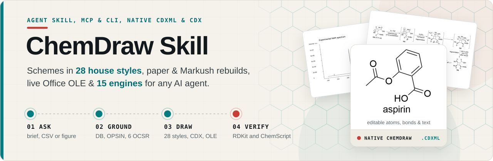
  </picture>
</p>

<h1 align="center">ChemDraw Skill：AI 绘制可编辑化学结构式</h1>

<h3 align="center">让 Claude Code、Codex 等任意 AI 编程 Agent 都能产出可编辑的 ChemDraw 化学图</h3>

<p align="center">
  画化学结构、复刻论文图、用表格数据生成 SAR 图，在 Word 和 PowerPoint 里放入可编辑的 ChemDraw 对象。
  同一个 Skill 还能算反应的投料量、写表征段落、给反应做原子映射。<br>
  Claude Code、Codex、Gemini CLI、GitHub Copilot、Cursor、OpenCode 以及任何能执行命令行的 Agent 都可以用。
</p>

<p align="center">
  <a href="https://github.com/ZiChenWang114514/chemdraw-skill/actions/workflows/validate.yml"></a>
  
  
  <a href="skill/chemdraw/references/agent-integration.md"></a>
  <a href="LICENSE"></a>
</p>

<p align="center">
  <a href="README.md">English</a> · <b>简体中文</b>
  <br>
  <a href="#快速开始">快速开始</a> · <a href="#作品展示">作品展示</a> · <a href="#支持的工作">支持的工作</a> · <a href="#反应计算器与化学报告">计算器</a> · <a href="#主打案例">案例</a> · <a href="#预测与分析引擎">引擎</a> · <a href="#平台支持">平台</a> · <a href="#常见问题">常见问题</a> · <a href="docs/guide.zh-cn.md">指南</a> · <a href="https://zichenwang114514.github.io/chemdraw-skill/">官网</a>
</p>

<br>

<table>
  <tr>
    <td width="25%" valign="top"><b>结构有来源</b><br><sub>结构来自数据库、OPSIN、ChemScript 或 DECIMER，Agent 不凭记忆写 SMILES。</sub></td>
    <td width="25%" valign="top"><b>输出可编辑</b><br><sub>结果是 CDXML，原子、键和文字之后仍能在 ChemDraw 里修改。</sub></td>
    <td width="25%" valign="top"><b>一个命令</b><br><sub><code>cdx.py</code> 在任何 Agent 里运行所有工具，MCP 可选。</sub></td>
    <td width="25%" valign="top"><b>保存后核对</b><br><sub>ChemDraw 渲染并保存文件，再把化学结构读回来与输入比较。</sub></td>
  </tr>
</table>

## 作品展示

每张卡片都是本仓库中可编辑文件的 ChemDraw 原生渲染。点击卡片查看对应案例。

<table>
  <tr>
    <td colspan="3" align="center">
      <a href="#paper-scheme-demo">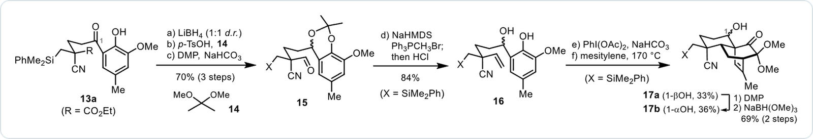</a>
      <br><sub>论文原图</sub><br><br>
      <a href="#paper-scheme-demo">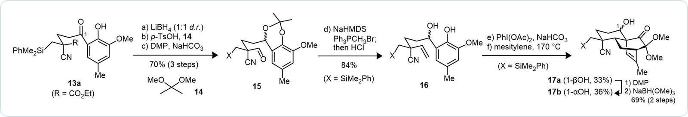</a>
      <br><b>论文反应路线 → 可编辑 ChemDraw</b><br><sub>从图片复刻五个结构、反应条件、产率和化合物编号</sub>
    </td>
  </tr>
  <tr>
    <td colspan="3" align="center">
      <a href="#markush-demo">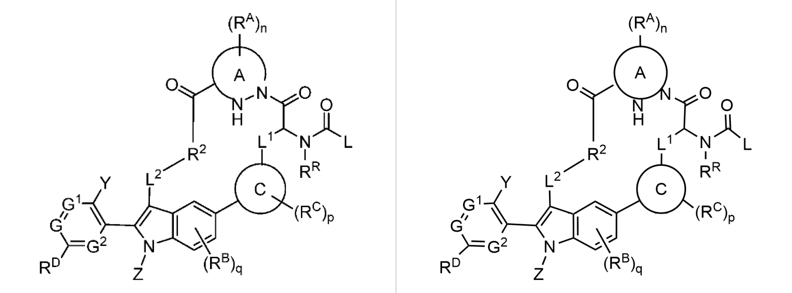</a>
      <br><b>专利 Markush 通式 → 可编辑 ChemDraw</b><br><sub>左为专利原图，右为原生复刻：R 基、可变环、多中心键与重复次数</sub>
    </td>
  </tr>
  <tr>
    <td width="33%" align="center" valign="top">
      <a href="#synthesis-113-demo">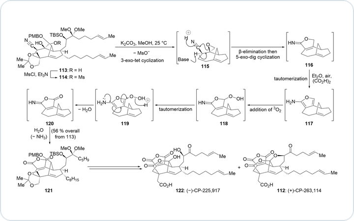</a>
      <br><b>复杂合成路线</b><br><sub>完整多步路线与机理箭头</sub>
    </td>
    <td width="33%" align="center" valign="top">
      <a href="#mechanism-demo">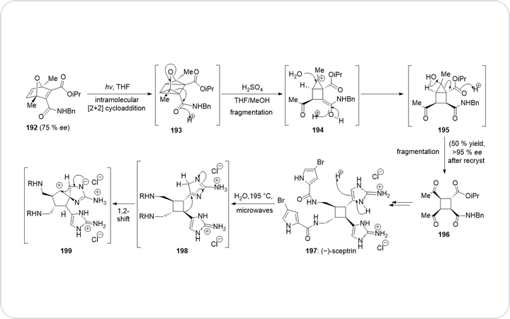</a>
      <br><b>反应机理</b><br><sub>电子箭头、电荷与抗衡离子</sub>
    </td>
    <td width="33%" align="center" valign="top">
      <a href="#stereo-reconstruction-demo">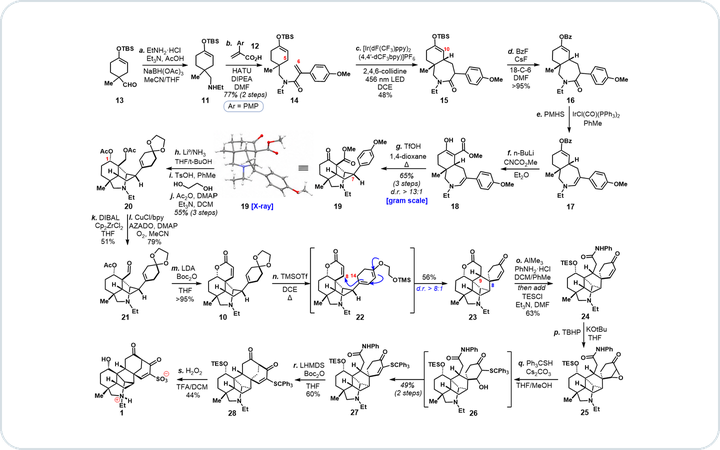</a>
      <br><b>20 个结构的合成路线</b><br><sub>不同化学软件读取的立体信息 20/20 一致</sub>
    </td>
  </tr>
  <tr>
    <td width="33%" align="center" valign="top">
      <a href="#acs1996-drawings">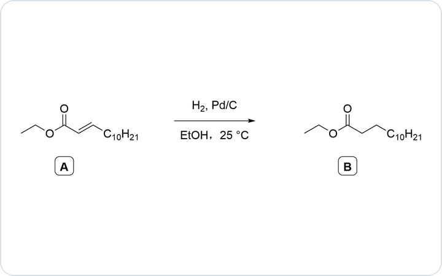</a>
      <br><b>试卷与讲义插图</b><br><sub>由小型 JSON 生成 ACS Document 1996 格式</sub>
    </td>
    <td width="33%" align="center" valign="top">
      <a href="#tlc-demo">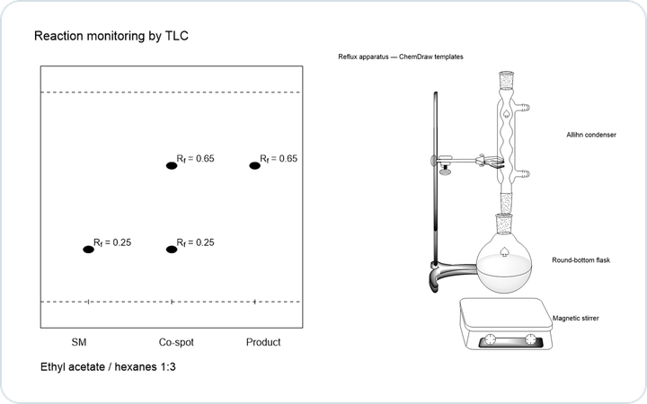</a>
      <br><b>TLC 与装置图</b><br><sub>原生 TLC 板、Rf 值与 ChemDraw 装置模板</sub>
    </td>
    <td width="33%" align="center" valign="top">
      <a href="#nmr-demo">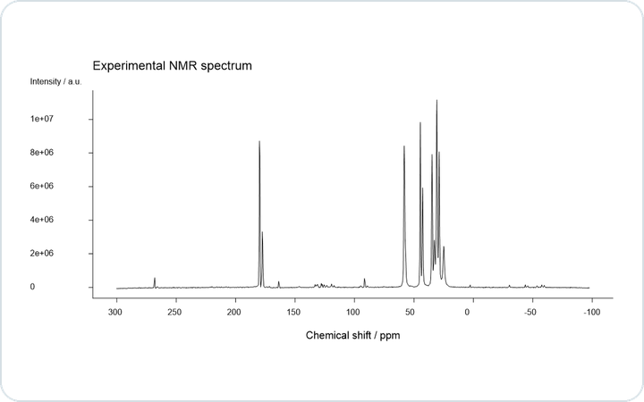</a>
      <br><b>谱图与科研绘图</b><br><sub>已处理的一维 NMR 与数值曲线</sub>
    </td>
  </tr>
  <tr>
    <td width="50%" align="center" valign="top">
      <a href="#预测与分析引擎">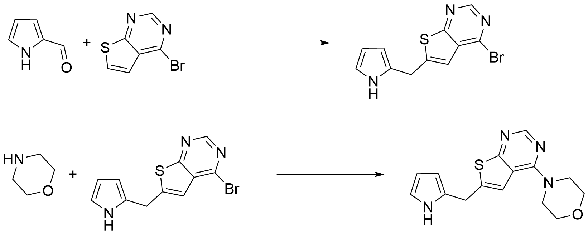</a>
      <br><b>预测的合成路线</b><br><sub>四个引擎对照一条已记录的路线，错的也照实展示</sub>
    </td>
    <td width="50%" align="center" valign="top">
      <a href="#预测与分析引擎">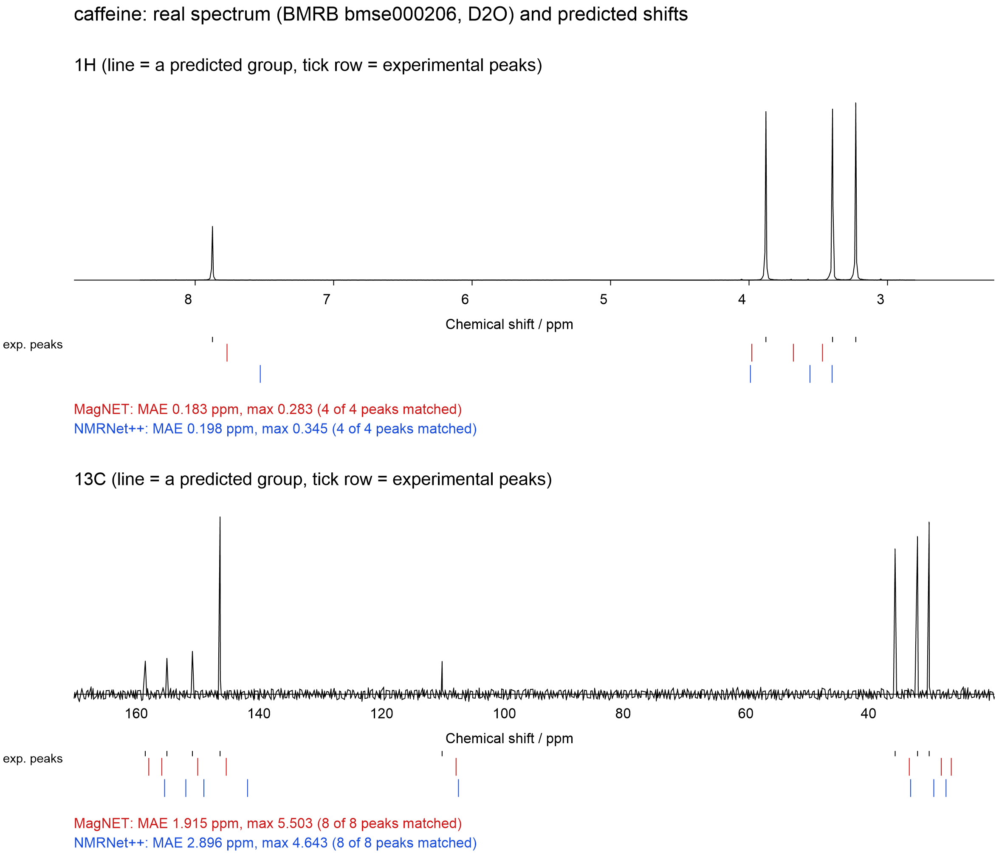</a>
      <br><b>预测与实测核磁对比</b><br><sub>MagNET 与 NMRNet++ 对照真实谱图</sub>
    </td>
  </tr>
</table>

## 快速开始

<!-- prerequisites -->
**开始之前**，先确认本机具备以下条件：

- **ChemDraw。** 原生渲染、第 3 步中的 PNG、CDX 转换以及 Word/PowerPoint 对象都需要 Windows 或 macOS 上已激活的桌面版 ChemDraw。没有 ChemDraw 时，Skill 仍可构建、编辑、检查和识别结构，也能使用各类计算器（[具体差异](skill/chemdraw/references/operations.md#no-chemdraw-on-this-host)）。
- **Python。** 构建运行时需要 64 位 Python 3.10–3.13；安装脚本本身在 3.9+ 上即可运行。
- **磁盘空间。** 默认运行时是一个约 760 MB 的虚拟环境。`--extras` 后不跟名称时只安装核心部分，`--extras publication office` 则只额外安装这两组依赖。
- **可选工具。** 默认不安装 OPSIN 名称转结构，需要时加 `--opsin`。OPSIN 依赖 Java：Windows 上首次使用时自动下载，macOS 和 Linux 需自行安装。`image` 依赖组中的文字识别需要 Tesseract 程序。加 `--mapping` 会装上机器学习原子映射后端（RXNMapper、LocalMapper），各自在独立环境中。

**1. 安装。** 安装脚本需要 Python 3.9+，它会自动查找 64 位 Python 3.10–3.13 作为工具包运行时（通过 `py` 启动器、`uv` 管理的解释器或 PATH 上的 `python3.x`）。

```bash
git clone https://github.com/ZiChenWang114514/chemdraw-skill.git
cd chemdraw-skill
python scripts/install.py --agent claude agents --runtime          # 仅预览
python scripts/install.py --agent claude agents --runtime --apply  # 安装
```

**2. 检查**本机可用的功能：

```bash
python $HOME/.claude/skills/chemdraw/scripts/cdx.py doctor
```

想把每个工具都调用一遍、看看哪些在本机可用，运行 `cdx.py py $HOME/.claude/skills/chemdraw/scripts/smoke_all_tools.py --output-dir 新目录`（默认离线，加 `--network` 才联网）。

**3. 提问**，直接用自然语言告诉 Agent：

```text
用 ChemDraw Skill 把阿司匹林画成可编辑 CDXML，用 ChemDraw 原生渲染并给我看 PNG。
```

> [!NOTE]
> 内置工具包目前尚不支持 Python 3.14 及更新版本。如果你只有 3.14，请先安装 3.12（例如 `uv python install 3.12`）或用 `--python <解释器>` 指定。

想先试 ChemDraw 自带的反应计算器而不是画图，可以运行 `python $HOME/.claude/skills/chemdraw/scripts/cdx.py calc "OCc1ccccc1.CC(=O)Cl>>CC(=O)OCc1ccccc1"`（[说明](#反应计算器与化学报告)）。

<details>
<summary><b>选择 Agent 与安装位置</b></summary>
<br>

| `--agent` | Skill 目录 | 读取它的 Agent |
| --- | --- | --- |
| `claude` | `~/.claude/skills/` | Claude Code（GitHub Copilot 和 OpenCode 也会读取） |
| `agents` | `~/.agents/skills/` | Agent Skills 通用目录：Codex、Gemini CLI、GitHub Copilot、Cursor、OpenCode 等 |
| `gemini`、`copilot`、`cursor`、`opencode`、`kimi`、`pi` | 各 Agent 自己的目录 | 需要装到专属目录时使用 |

- `--project <仓库>` 安装到项目级目录（`.claude/skills/`、`.agents/skills/`、`.github/skills/` 等）；`--destination <目录>` 可装到任意位置。
- 不支持自动发现 Skill 的 Agent，只需在它的指令文件里加一行指向 `SKILL.md`。
- 所有副本共用一套运行时。重复运行安装脚本即可原地升级；被替换的旧副本会先备份，出错时自动恢复。

各 Agent 的具体接入方式、命令白名单和可选的 MCP 注册见 [Agent 接入](skill/chemdraw/references/agent-integration.md)。

</details>

<details>
<summary><b><code>cdx.py</code> 统一入口</b></summary>
<br>

Agent 通过同一个入口调用所有功能；任何 Python 都能启动它，它会自动切换到工具包运行时：

```bash
python <skill>/scripts/cdx.py tools                                         # 列出已注册的工具
python <skill>/scripts/cdx.py call resolve_name --args query.json           # query.json: {"query": "aspirin"}
python <skill>/scripts/cdx.py render figure.cdxml                           # 原生 300 dpi PNG
python <skill>/scripts/cdx.py decimer crop.png                              # 结构识别
```

</details>

## 支持的工作

| 领域 | 能做什么 |
| --- | --- |
| **结构与反应** | 解析名称和标识符；绘制、编辑、清理、合并、润色、拆分、转换和渲染 CDXML 或 CDX 文档。 |
| **按需求新画图** | 由简短的说明画出单步反应、线性/收敛/发散或催化循环（`catalytic-cycle`）路线、底物拓展图或机理（支持配位键与自由基），并在同一条命令里检查化学与版面。[详见下文](#one-command-figures)。 |
| **试卷、讲义与论文插图** | 由 JSON 描述生成 ACS Document 1996 格式插图，支持缩写节点、富文本、中文注释、箭头和带框化合物代号。 |
| **数据驱动绘图** | 由 CSV/XLSX 生成可编辑、可持续更新的底物拓展图和 SAR 图。 |
| **图像识别** | 通过 DECIMER API（或按要求使用本地 DECIMER 模型）提取候选结构、置信度和外接矩形。 |
| **引擎与预测** | 十五个可选引擎，经你同意才安装：六个 OCSR 引擎对同一张图的比对、PDF/图片批量识别（`recognize_batch`）、前体、路线、产物、反应条件和 1H/13C 位移，每个案例都对照已知答案运行并报告实际运行设备（`execution.device`）。自适应复杂度分类器（`--accel auto\|on\|off`、`--task-hint`）让简单单次调用保持无状态子进程，而在复杂、批量或连续突发任务中自动预热常驻工作守护进程（将重复 GPU 调用从约 21 秒降至 0.8 秒）。每个结果都标注为预测。[案例与安装大小](#预测与分析引擎)。 |
| **分子比较** | 各平台均可使用 RDKit 指纹相似度；精确身份检查在 Windows 上通过 ChemScript，在 macOS 上通过 ChemDraw for macOS。 |
| **计算与报告** | ChemDraw 自带的化学计量表（用量、收率，可读回为数据）；含过程质量强度的 SI 原料表；HRMS 表征句与完整表征段落；基于扩展的 116 条 GHS 试剂安全表与 SMARTS 官能团结构警示的安全提示；多步路线总收率；原子映射；性质表、反应配平检查与结构导出。[详见下文](#反应计算器与化学报告)。 |
| **TLC 与装置** | 原生 TLC 板、泳道、斑点及 ChemDraw 装置模板；支持 Rf 计算和可编辑装置组装。 |
| **谱图与科研绘图** | 通过 `nmrglue` 原生读取一维 NMR（Bruker `1r` 与原始 `fid`、JCAMP-DX `.jdx`/`.dx`、JEOL `.jdf`、Varian/Agilent `.fid`）及 CSV/FT 数据，支持寻峰、指定区间积分、氘代残留溶剂自动标注、多重峰裂分（*J* 耦合）、局部放大插图（`inset_region`）以及多系列可编辑曲线。 |
| **专利 Markush 通式** | 从专利图片和权利要求文本提取通式：R 基、可变环、多中心键与重复次数，保存为 CXSMILES、V3000 molfile 和沿用原图版式的可编辑绘图。 |
| **反应机理** | 根据你列出的电子转移绘制弯箭头，或按明确的原子坐标复刻机理，包括电荷和抗衡离子。 |
| **Office 文档** | 在桌面版 Word 和 PowerPoint 文档中嵌入可编辑的 ChemDraw 对象，可在 Windows 或 macOS 上用 ChemDraw 生成。 |
| **实验记录** | 发现文件，并处理选定的 LCMS（Waters PDF、OpenLynx `.rpt`、含 `_HEADER.TXT` 元数据与色谱图的 Waters `.raw`、Shimadzu `.daml`、Agilent ChemStation `report.txt` 以及开放格式 `mzML` / `mzXML`），支持 Cl/Br `M+2` 同位素包络校验与跨时间点内标（`IS`）归一化，以及 SciFinder RDF 和实验记录工作流。 |
| **ChemScript SDK** | 在 Windows 上检查已安装的公共目录，并在独立工作进程中执行受支持的声明式调用（macOS 上由 ChemDraw、OPSIN 和 RDKit 完成 ChemScript 操作，并模拟核心 SDK 类）。 |
| **ChemDraw 接口覆盖** | 为 ChemDraw 22.2 的 ChemScript SDK、COM 对象、CDXML 元素和菜单命令建立目录，每一条标明是有专用工具、有已核对的配方，还是仅有文档；并提供操作 CDXML 元素、调用 COM 以及获取 ChemDraw 自身分子性质的工具。[详见](docs/guide.zh-cn.md#chemdraw-接口覆盖)。 |
| **远程工作站访问** | 可选地通过 Streamable HTTP 对外提供 Windows 原生主机服务，带健康检查与 Prometheus 端点。 |

生成的[公共接口清单](skill/chemdraw/references/toolkit-public-inventory.md)记录了内置工具包中已审计的公共符号，与已注册工具分开统计（`cdx.py tools` 会打印当前数量）。

<a id="acs1996-drawings"></a>

### 试卷与讲义插图：ACS Document 1996 格式

用一个小 JSON 描述图：带 C10H21 等缩写节点的 SMILES、反应条件、箭头、加粗化合物代号和中文注释，即可得到可编辑的 ACS 1996 CDXML 与 ChemDraw 原生 PNG：

```bash
python skill/chemdraw/scripts/cdx.py build skill/chemdraw/assets/acs1996/example.json example.cdxml --render
```

<p align="center">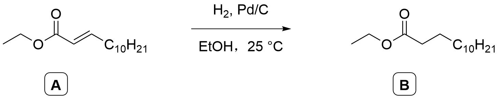</p>

缩写基团保存为真实的 `GenericNickname` 节点，下标与标签方向自动处理。中文字符使用中文字体，同一段里的英文、数字和符号保持 Arial。详见 [ACS 1996 绘图指南](skill/chemdraw/references/acs1996-drawings.md)。

<a id="one-command-figures"></a>

### 一句话生成新图

结构已知、图还不存在时，直接说一句话：“用水杨酸和乙酸酐画阿司匹林，H2SO4（催化量），室温 2 h，收率 85%。”你的 agent 会把它整理成一份简短的 JSON 说明，一条命令就能画图并做检查：

```bash
python skill/chemdraw/scripts/cdx.py draw brief.json aspirin.cdxml --render
```

```json
{
  "species": [
    {"id": "SA", "smiles": "OC(=O)c1ccccc1O", "label": "1"},
    {"id": "Ac2O", "name": "Ac2O"},
    {"id": "ASP", "smiles": "CC(=O)Oc1ccccc1C(=O)O", "label": "2"}
  ],
  "steps": [
    {"substrates": ["SA", "Ac2O"], "products": ["ASP"],
     "above": ["H2SO4 (cat.)"], "below": ["rt, 2 h"], "yield": "85%"}
  ]
}
```

<p align="center">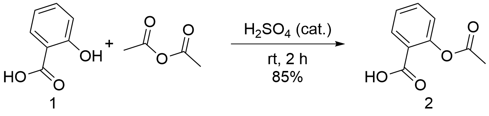</p>

同一条命令可以画三种图：

| 图的类型 | 说明里要列出的内容 | 得到什么 |
| --- | --- | --- |
| **反应或路线** | 物种、步骤、条件、收率 | 单步反应、线性路线、两条支线汇合的收敛路线、一个原料生成多个产物的发散路线，或催化循环（`catalytic-cycle`）。长路线自动换行；支持 `reversible`（平衡）和 `resonance`（共振）箭头、配位键与自由基。 |
| **底物拓展** | 带编号、分组的化合物和你测得的数值 | 按需要排成多页可编辑版面，每个编号和数值都紧跟自己的结构。你没给的数值显示为短横线，绝不写成 0。 |
| **反应机理** | 物种、步骤和每一次电子转移 | 根据已绘制的坐标放置弯箭头，区分全箭头和半箭头，并绕开原子和标签。 |

<table>
  <tr>
    <td width="50%" align="center" valign="top">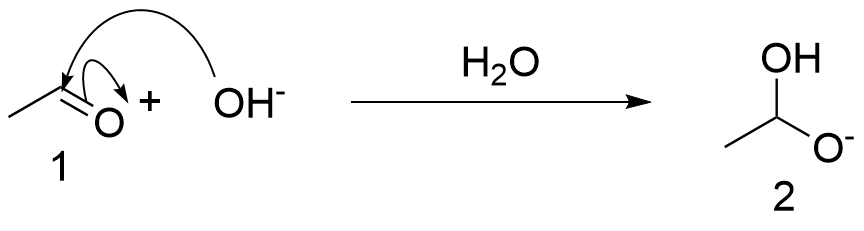<br><sub>机理：氢氧根加成，两条弯箭头</sub></td>
    <td width="50%" align="center" valign="top">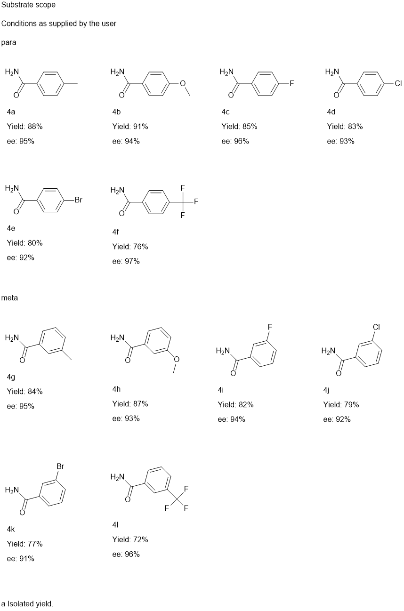<br><sub>底物拓展：十二个化合物排在一页</sub></td>
  </tr>
</table>

这条命令对说明做的事：

- **结构来自你或查表。** 你给的 SMILES 原样使用；名称先查内置试剂表，再查 PubChem（设置 `CHEMDRAW_OFFLINE=1` 时不联网）。无法解析的名称会让运行停下并要求提供 SMILES。
- **条件只来自你。** 没有给条件的步骤就不画条件，报告里会注明；工具不会自己补充化学内容。
- **检查化学。** 逐步计算原子与电荷是否守恒，缺少的副产物只会点名，不会画出来。保存之后，再把文件中的结构与说明逐一比对。
- **检查几何。** 测量重叠、过小的文字和超出页宽的图形。检查不通过时，会留出更多空间重新排版一次，并在报告里说明改了什么。
- **机理只画不推。** 电子转移由你列出，没有电子转移的步骤会被拒绝；箭头起点没有孤对电子、电荷或自由基时，照画但会标出提醒。
- **不覆盖已有文件。** 报告列出每个结构的来源、通过或未运行的检查，以及原生 PNG 的路径。没有 ChemDraw 时，文件会被标为未渲染的草稿。使用前请先打开 PNG 看一遍。

完整的说明格式和报告字段见[绘制新反应图](skill/chemdraw/references/scheme-drawing.md)。

<a id="从数据生成可持续修改的论文图"></a>

### 从 CSV / Excel 生成 SAR 图和底物拓展图

将 CSV/XLSX 与可信结构生成底物拓展图或完整结构 SAR 图。化合物 ID 绑定结构和实验指标；在 ChemDraw 手工编辑后更新数据或替换结构，保留无关布局与注释；无法唯一匹配时输出冲突草稿。详见[使用指南与示例](skill/chemdraw/references/data-driven-figures.md)。读取 XLSX 需要工具包的 `publication` 可选依赖。

## 反应计算器与化学报告

这些工具从你给出的结构（SMILES、MOL 或 SDF、CDXML）出发，用 RDKit 做计算和整理；化学计量表除外，它由 ChemDraw 计算。它们不识别、也不修改结构，只有化学计量表和命名工具需要 ChemDraw。每个工具既在回复里给出结果，也可以写成新文件，已有文件不会被覆盖。

| 想做的事 | 工具 | 得到什么 |
| --- | --- | --- |
| 每种试剂和溶剂该称多少 | `cdx.py calc`、`stoichiometry_grid` | 反应下方 ChemDraw 自带的化学计量表，及其 JSON 数值 |
| 一批反应的 SI 原料表 | `si_materials_tables` | Markdown、CSV、可打印 HTML 或 JSON，最多 100 个反应 |
| HRMS 与表征文字 | `hrms_line`、`characterization_text` | `HRMS (ESI) m/z calcd for ...` 与按 ACS 顺序排列的段落 |
| 多步路线的总收率和 PMI | `route_summary` | 线性或汇聚路线的一张表 |
| 哪个原子变成哪个原子 | `map_reaction_atoms` | 原子映射、键变化、反应中心 SMARTS、反应类型 |
| 分子式、质量、加合物、logP | `molecule_report` | 性质表 |
| 反应是否配平 | `check_reaction_balance` | 缺失的副产物与建议系数 |
| 文件里的全部结构 | `export_structures` | SMILES、InChI、CSV 或 SDF |

### ChemDraw 自带的反应计算器

```bash
python <skill>/scripts/cdx.py calc "OCc1ccccc1.CC(=O)Cl>CCN(CC)CC.ClCCl>CC(=O)OCc1ccccc1"
```

命令对反应（反应 SMILES 或你自己的 `.cdxml` 文件）运行 ChemDraw 自带的 **Structure > Analyze Stoichiometry**，并在 ChemDraw 里打开结果。ChemDraw 会在反应下方放上它的化学计量表：每个反应物和试剂的分子式、分子量、当量、样品质量、摩尔浓度、密度、体积和物质的量，以及产物的预期质量、实测质量、纯度和收率。在表里填入质量、体积或当量，ChemDraw 会重新算出其余数值。命令运行时会短暂出现一个 ChemDraw 窗口，因为 ChemDraw 只在可见窗口里执行菜单命令。你打开的图不会被改动，结果是源文件旁边的一个新文件（可用 `--output` 指定）。

填好用量并保存后，`cdx.py calc --read reaction-stoichiometry.cdxml` 会把表中每一行以 JSON 返回，这样智能体引用的是 ChemDraw 的数值，而不是它自己算的。读回不需要 ChemDraw；生成计量表需要 Windows 或 macOS 上的桌面版 ChemDraw。

<p align="center">
  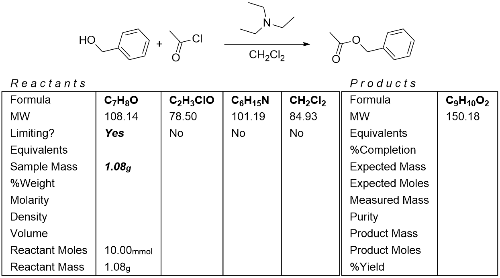
</p>

不用 ChemDraw 计算用量时，`si_materials_tables` 可为最多 100 个反应写出原料表，含浓度、原子经济性和过程质量强度（PMI；E 因子等于 PMI 减 1）。加上 `reagent_safety` 后，它会从内置的 116 种常见溶剂与试剂表以及 SMARTS 官能团结构警示（叠氮、过氧化物、有机锂、酰氯、金属氢化物等）中给出常见溶剂和试剂的 GHS 图标、H 说明、沸点和闪点。表里没有的物质显示为“未收录”，而不是安全。这张表只是提醒，以供应商的 SDS 为准。

### 表征文字

`characterization_text` 为每个化合物写一段，顺序遵循 ACS：外观、Rf、熔点、比旋光度、IR、1H 与 13C 核磁、其他核、HRMS。你给出的数字原样输出，没有提供的内容直接省略。它还会把 1H 积分和 13C 信号数与结构对照，不一致时给出警告，但不会为了通过检查去改任何一个峰。

### 原子映射与反应类型

`map_reaction_atoms` 自带子结构方法。产物原子可能来自多个反应物原子时，它会如实指出，而不替你选一个。RXNMapper 和 LocalMapper 两个学习型映射器可用 `cdx.py install-mappers` 安装；`compare: true` 会把已安装的方法并排比较。多个反应可以一次映射，这很重要，因为每个学习型映射器启动一次要 10 到 35 秒。

映射完成后还可以要求：反应中心的反应 SMARTS（`template`）、仅凭结构判断的反应类型（`classify`，19 个模板，判断不了就是“未分类”），以及把映射编号写在你的图副本的原子旁（`map_numbers_into_scheme`）。遇到 H2N 这类拥挤的原子标签，请看一下图。

### 路线汇总

`route_summary` 按顺序接收合成的各步，每步给出收率以及投入和得到的质量（也可以给 `si_materials_tables` 格式的反应）。它返回最长线性序列上的总收率和累计 PMI，并把每一步缩放到下一步实际消耗的量。汇聚路线通过 `into` 字段表示。缺少的数字得到 `null` 和警告，不会猜。后处理和纯化溶剂只有算进投入质量才会计入。

```text
用 ChemDraw Skill 对这个酰胺偶联运行 ChemDraw 的化学计量表，等我改完用量再读回来。
根据这些核磁峰和这个 HRMS 数值，写出化合物 3a 的表征段落。
```

完整的输入和规则见[化学报告指南](skill/chemdraw/references/chemistry-reports.md)。

## 主打案例

从真实论文图片和数据出发，直接查看原生预览、原图对照和可编辑文件。

| 案例 | 展示内容 | 亮点 |
| --- | --- | --- |
| [20 个结构](#stereo-reconstruction-demo) | 修复不同化学软件之间的立体信息分歧 | ChemScript 与 RDKit 立体信息 20/20 一致 |
| [论文反应路线](#paper-scheme-demo) | 五个结构、条件、产率与波浪键 | 完整可编辑复刻 |
| [Sceptrin 反应机理](#mechanism-demo) | 八个结构、电子箭头、电荷与条件 | 完整可编辑复刻 |
| [专利 Markush 通式](#markush-demo) | 从专利图片和权利要求文本提取 R 基、可变环与多中心键 | 结构与参考一致，附 CXSMILES 与 V3000 |
| [原生 TLC](#tlc-demo) | 可编辑泳道、斑点与 Rf | 可运行示例 |
| [原生装置图](#apparatus-demo) | 原生 ChemDraw 模板组装 | 可运行示例 |
| [实验 NMR 谱图](#nmr-demo) | 真实一维数据与可编辑谱图 | 可运行示例 |
| [模拟反应动力学](#kinetics-demo) | 数值数据转为可编辑曲线 | 可运行示例 |
| [复杂合成：101–112](#synthesis-101-demo) | 完整原生路线图与机理箭头 | 全部化合物、条件与箭头 |
| [复杂合成：113–122](#synthesis-113-demo) | 完整原生路线图与机理箭头 | 全部化合物、条件与箭头 |

<a id="stereo-reconstruction-demo"></a>

### 20 个结构：修复跨软件立体信息不一致

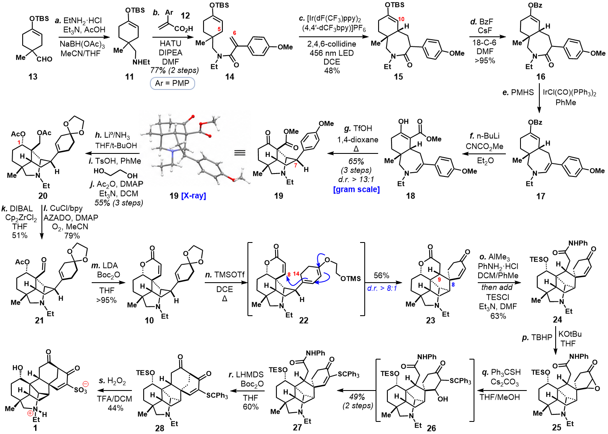

完全照原图画法绘制时，有 16 个结构在 ChemScript 与 RDKit 中读法不同。保存后的修复版让两者对**全部 20 个结构**读法一致，并保持复核后的目标分子；产物 **1** 为此改用了显式楔键。

[下载 CDXML](toolkit/assets/readme/stereo-reconstruction/reconstruction.cdxml) · [踩坑复盘、改进流程与版权说明](toolkit/assets/readme/stereo-reconstruction/CASE.md) · [逐结构证据与软件版本](toolkit/assets/readme/stereo-reconstruction/verification.json)

X-ray 图像裁自原论文，不在 MIT 许可范围内。

<details>
<summary><b>增量流程：</b>修改三处标题，原生调用 8 → 2 次</summary>
<br>

关联化学与绘图记录、验证缓存依赖、按变化局部检查，并分别验收原图版和兼容版。只修改变化的三处标题字号时，下方链接的实测中原生调用从 8 次减至 2 次，耗时从 33.53 秒降至 8.88 秒。[原图画法版](toolkit/assets/readme/stereo-reconstruction/source-oriented.cdxml) · [使用流程](skill/chemdraw/references/incremental-reconstruction.md) · [实测证据](toolkit/assets/readme/stereo-reconstruction/incremental-verification.json)

</details>

<a id="paper-scheme-demo"></a>

### 论文反应路线

把一张已发表的反应图复刻成可编辑的 ChemDraw 文档。示例保留了原图中的五个结构、反应条件、产率和化合物编号。

**论文原图**

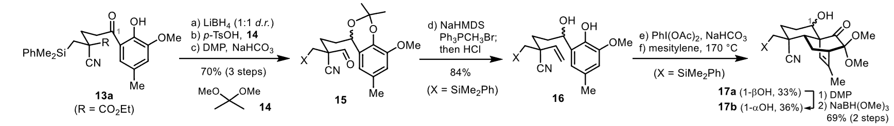

**可编辑复刻，由 ChemDraw 保存**

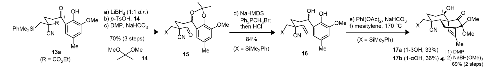

[下载可编辑 CDXML](assets/readme/paper-replica/replica.cdxml) · [查看逐结构左右对照](assets/readme/paper-replica/structure-comparison.png) · [案例来源与验证范围](assets/readme/paper-replica/provenance.json)

从保存的 CDXML 回读的五个结构与参考结构一致，17a/17b 共用的波浪键按原图保留。

<a id="mechanism-demo"></a>

### Sceptrin 反应机理

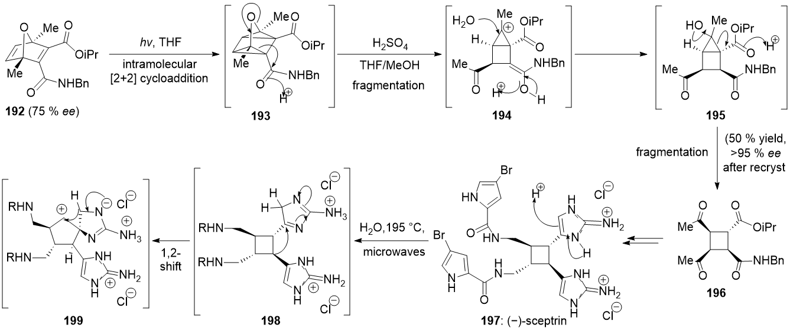

<details>
<summary>展开原始截图</summary>
<br>

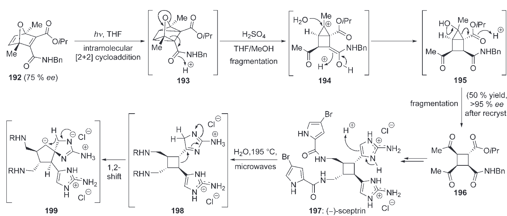

</details>

[可编辑 CDXML](assets/readme/mechanism/mechanism.cdxml) · [原生 CDX](assets/readme/mechanism/mechanism.cdx) · [左右对照](assets/readme/mechanism/comparison.png) · [验证详情](assets/readme/mechanism/provenance.json)

八个编号结构和六个氯离子经过真实的 ChemDraw CDXML → CDX → CDXML 保存后，原子、立体化学和形式电荷保持不变。R 基团与原图一样保留为通用取代基。

<a id="markush-demo"></a>

### 专利 Markush 通式


[可编辑 CDXML](assets/readme/markush/markush.cdxml) · [Markush 结构定义](assets/readme/markush/markush.json) · [CXSMILES](assets/readme/markush/markush.cxsmiles) · [V3000 molfile](assets/readme/markush/markush.mol) · [验证与局限](assets/readme/markush/provenance.json) · [工作流程](skill/chemdraw/references/markush.md)

输入是一张专利通式图和一段权利要求文本。结构里有 R 基和连接基、两个可变环、一个可以连在三个环位置之一的基团，以及重复次数。`cdx.py markush` 引导整个提取：agent 负责转录标签、核对读回图、检查左右对照图，并把每条权利要求转成取值，几何、结构和绘图都由代码完成。在附带的示例中，结果与手写的参考结构逐原子一致，绘图沿用原图版式（所绘墨迹与原图的重合度为 0.99）。结构同时保存为 CXSMILES 和 V3000 molfile，其他化学软件也能读取。

### 原生科研绘图

<table>
  <tr>
    <td width="50%" valign="top">
      <a id="tlc-demo"></a>
      <b>原生 TLC</b><br>
      <sub>原生 TLC 板、泳道和斑点，Rf 数值为示例。</sub><br><br>
      <p align="center">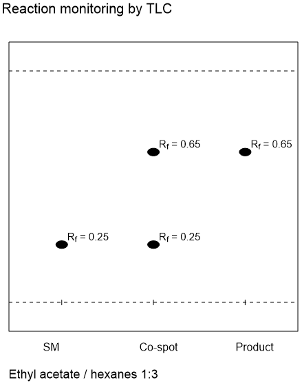</p>
      <sub><a href="assets/readme/scientific/tlc.cdxml">可编辑 CDXML</a> · <a href="skill/chemdraw/references/scientific-workflows.md">运行示例</a> · <a href="assets/readme/scientific/provenance.json">数据与模板来源</a></sub>
    </td>
    <td width="50%" valign="top">
      <a id="apparatus-demo"></a>
      <b>原生装置图</b><br>
      <sub>由 ChemDraw 自带装置模板组装，保留原生可编辑图形。</sub><br><br>
      <p align="center">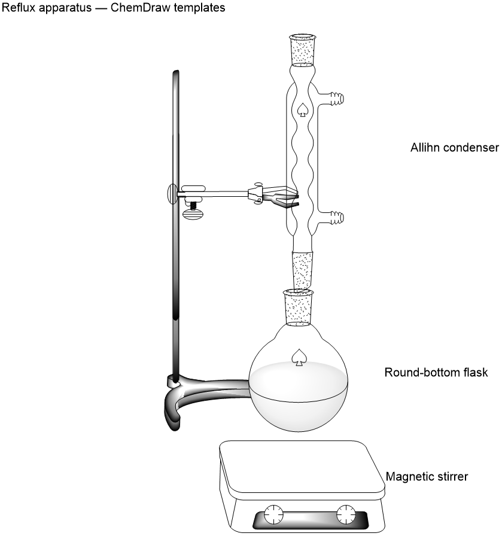</p>
      <sub><a href="assets/readme/scientific/apparatus.cdxml">可编辑 CDXML</a> · <a href="skill/chemdraw/references/scientific-workflows.md">运行示例</a> · <a href="assets/readme/scientific/provenance.json">数据与模板来源</a></sub>
    </td>
  </tr>
  <tr>
    <td width="50%" valign="top">
      <a id="nmr-demo"></a>
      <b>实验 NMR 谱图</b><br>
      <sub>真实的已处理一维 NMR 数据，支持寻峰和指定区间积分。</sub><br><br>
      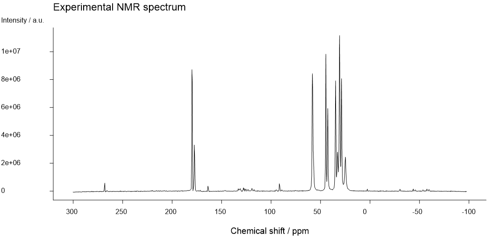<br>
      <sub><a href="assets/readme/scientific/nmr.cdxml">可编辑 CDXML</a> · <a href="skill/chemdraw/references/scientific-workflows.md">运行示例</a> · <a href="assets/readme/scientific/provenance.json">数据与模板来源</a></sub>
    </td>
    <td width="50%" valign="top">
      <a id="kinetics-demo"></a>
      <b>模拟反应动力学</b><br>
      <sub>把模拟的一阶衰减数据画成可编辑曲线。</sub><br><br>
      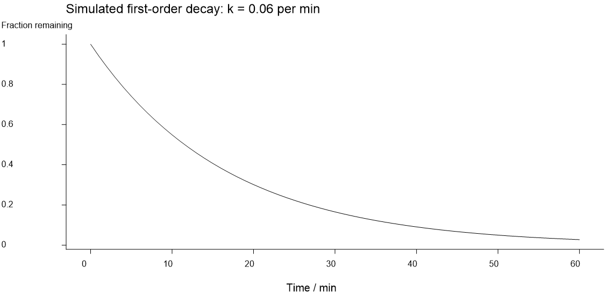<br>
      <sub><a href="assets/readme/scientific/kinetics.cdxml">可编辑 CDXML</a> · <a href="skill/chemdraw/references/scientific-workflows.md">运行示例</a> · <a href="assets/readme/scientific/provenance.json">数据与模板来源</a></sub>
    </td>
  </tr>
</table>

<a id="synthesis-101-demo"></a>

### 复杂合成：101–112

**完整路线图与可编辑结构。** 包含全部化合物编号、反应条件和机理箭头，原生保存后连接关系、电荷、同位素和双键几何保持不变。

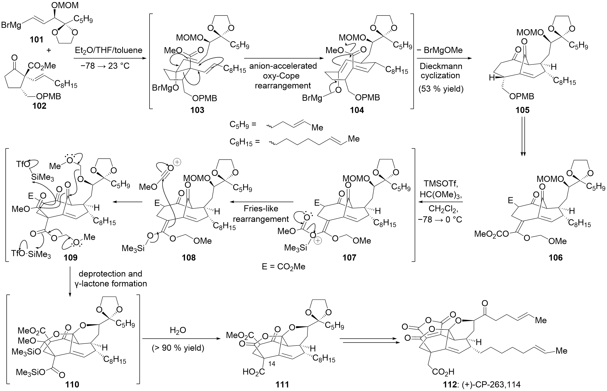

[完整 CDXML](assets/readme/synthesis-101-112/figure.cdxml) · [原图与复刻对照](assets/readme/synthesis-101-112/comparison-full.png) · [验证与来源](assets/readme/synthesis-101-112/provenance.json)

<details>
<summary>展开原图与复刻对照</summary>

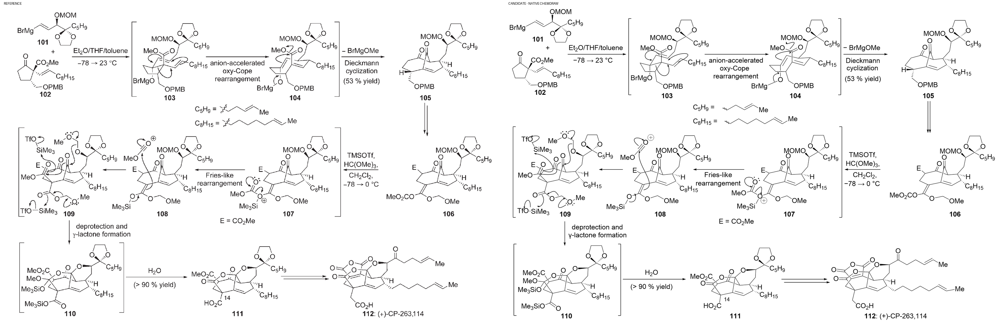

</details>

<a id="synthesis-113-demo"></a>

### 复杂合成：113–122

**完整路线图与可编辑结构。** 包含全部化合物编号、反应条件和机理箭头，原生保存后连接关系、电荷、同位素和双键几何保持不变。

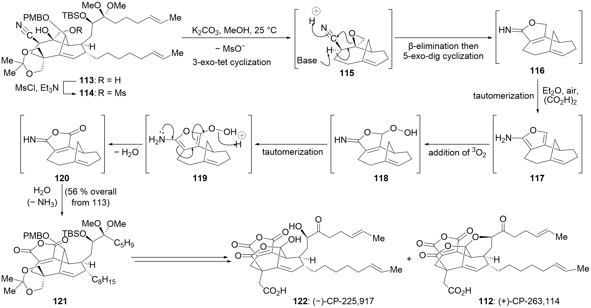

[完整 CDXML](assets/readme/synthesis-113-122/figure.cdxml) · [原图与复刻对照](assets/readme/synthesis-113-122/comparison-full.png) · [验证与来源](assets/readme/synthesis-113-122/provenance.json)

<details>
<summary>展开原图与复刻对照</summary>

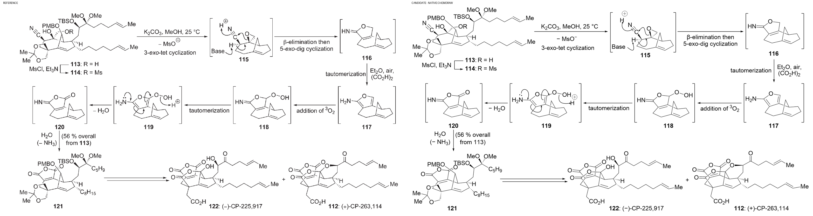

</details>

## 预测与分析引擎

十五个可选引擎负责读结构图、从 PDF 中找结构，以及预测前体、产物、反应条件和核磁位移。你同意之前不会安装任何东西；每个引擎各用一个独立环境；本地引擎运行时不上传内容（远程 DECIMER 是唯一会把图片发出去的引擎）；每个结果都标注为模型预测。多个引擎意见不一致时并排列出，不合并。

下面的案例都在同一台带 RTX 5090 显卡的 Windows 笔记本上运行，各自对照已核对的结构、实验记录或实测谱图打分，出错的地方照实保留。它们说明引擎在这些输入上的表现，不代表一般情况下的准确率。输入、输出、打分和耗时都在 [`assets/readme/engines/`](assets/readme/engines/provenance.json)。下表中的冷启动单次耗时包含模型加载时间；自适应加速分类器（`--accel auto|on|off`、`--task-hint`）会让简单单次调用保持无状态（`oneshot`，零常驻显存），并在复杂、批量、多步或连续突发任务中自动预热常驻工作守护进程（将热态 GPU 推理从约 21 秒降至 **0.8 秒**，并为 PDF 提供单次批处理 OCSR `recognize_batch`），且每次引擎回复都会记录实际运行的 `execution.device`（`cuda:0` 或 `cpu`）。

### 结构图与 PDF

> **你可以说：**“用本地所有引擎读这个结构，告诉我它们哪里不一致。”·“把这个 PDF 里的结构都抽出来并读一遍。”

从一张已发表的路线图里裁出三个结构（化合物 13a、16、17，其中 R 和 SiMe<sub>2</sub>Ph 以缩写绘出），再加一张 ChemDraw 画的伊马替尼，交给六个引擎。读出的连接关系与已核对的结构相同才算对，R 和 X 按通配符处理，立体化学不计分。

<table>
  <tr>
    <td align="center" valign="bottom">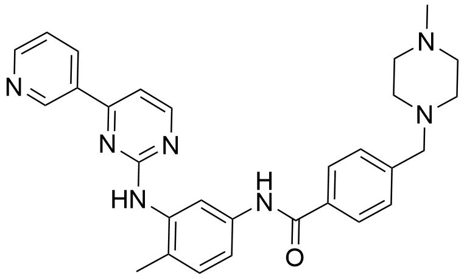<br><sub>伊马替尼</sub></td>
    <td align="center" valign="bottom">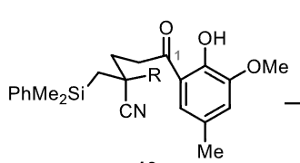<br><sub>13a</sub></td>
    <td align="center" valign="bottom">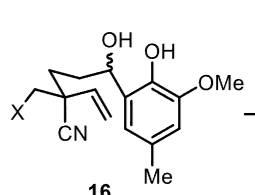<br><sub>16</sub></td>
    <td align="center" valign="bottom">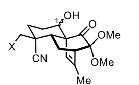<br><sub>17</sub></td>
  </tr>
</table>

| 图片 | MolScribe | MolNexTR | MolParser | MolVec | DECIMER（远程） | DECIMER（本地） |
| --- | --- | --- | --- | --- | --- | --- |
| 伊马替尼，清晰绘图 | 对 | 对 | 对 | 对 | 对 | 对 |
| 13a，R 与 SiMe<sub>2</sub>Ph | 错（丢了硅基，多出碎片） | 对 | 对 | 错（把 R 读成 P） | 错（环上多出 Hg） | 错（环上多出 Hg，附带碎片） |
| 16，X 缩写 | 错（丢了 X，多出一个 C） | 错（丢了 X） | SMILES 无效 | 错（CH<sub>2</sub>X 读成乙基） | 错（环上甲基读成 NHMe） | 错（环上甲基读成 NHMe） |
| 17，桥环笼状结构 | SMILES 无效 | 对（带一个 <sup>14</sup>C 标记） | SMILES 无效 | 错 | 对 | 对 |
| **答对** | 4 个中 1 个 | 4 个中 3 个 | 4 个中 2 个 | 4 个中 1 个 | 4 个中 2 个 | 4 个中 2 个 |
| 每张图耗时 | 17 秒 | 19 秒 | 15 秒 | 3 秒 | 4 秒（网络） | 57 秒（CPU） |

这里两个引擎读得一致是个有用的提示：13a 上 MolNexTR 和 MolParser 一致且正确，17 上 MolNexTR 和 DECIMER 一致且正确。16 上六个全错，也没有两个独立模型一致，这时就该自己对着图看。`decimer-local` 在独立的 Python 3.11 + TensorFlow 2.15 CPU 环境里运行同一套 DECIMER V2 权重，四张图的识别与远程服务完全一致（伊马替尼对、置信度 0.994，17 对、0.913，16 错、0.889，13a 错、0.846），每次调用因重新加载模型需 51 到 87 秒。

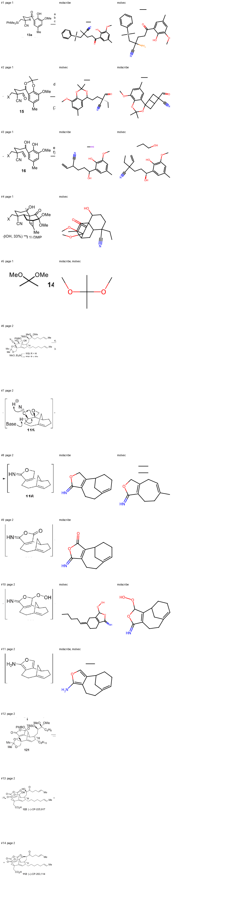

同一张路线图和另一张已发表的路线图做成两页 PDF，先用 DECIMER Segmentation 切分，再用 MolScribe 和 MolVec 读每个片段。第 1 页切出 5 个片段，对应它的 5 个结构，只有 1 个（2,2-二甲氧基丙烷）两个引擎都读对；其余的丢了缩写基团，还有一个片段带进了邻近的文字。第 2 页切出 9 个片段，其中 5 个两个引擎都没读出结果。联系表把每个片段和各引擎读出的结构并排放在一起，这些错误就是靠它发现的；14 个片段共用了 418 秒。

**安装：** `ocsr-standard`（MolScribe 与 MolVec，4.7 GB）、`ocsr-full`（再加 MolNexTR 和 MolParser，12.9 GB）、`pdf`（切分器、MolScribe、MolVec，6.8 GB）。MolParser 的权重仅限非商业用途，MolVec 需要 Java。[详情](skill/chemdraw/references/engines.md#reading-a-structure-image)

### 路线、产物与反应条件

> **你可以说：**“用本地逆合成引擎给这个目标分子找前体，并把路线画出来。”·“这个反应会得到什么，用什么条件？”

用来核对的有三个已知答案：实验记录里的两步（[KL-CC-001 和 KL-CC-002](toolkit/samples/KL-CC-002/scheme.png)：一步钯催化胺化，一步丁基锂烷基化），以及伊马替尼已发表的酰胺断键。

| 逆合成 | AiZynthFinder | RetroChimera | ReactionT5（逆合成） | SynPlanner |
| --- | --- | --- | --- | --- |
| KL-CC-001，记录：4-溴噻吩并[2,3-d]嘧啶 + 吗啉 | 记录的组合排第 2；第 1 是 4-氯类似物 | 第 1 是氯类似物，记录的组合不在前 5 | 未命中（给出 2,4-二氯化合物，还混进一种膦） | 记录的组合在第 4 条路线；第 1 条是氯类似物 |
| 伊马替尼，酰胺 + 苯胺 | 第 2（酸）和第 3（酰氯） | 第 1（酰氯） | 未命中 | 没有检索：目标本身在它的砌块库里 |
| KL-CC-002，记录的两步路线 | 未命中 | 未命中 | 未命中 | 未命中 |
| 耗时 | 18 到 34 秒 | 99 到 155 秒 | 15 到 19 秒 | 44 到 76 秒 |

KL-CC-002 上没有任何引擎给出记录的最后一步。AiZynthFinder 的第一条路线用到了三个记录原料中的两个（溴代杂环和吗啉），但用醛而不是甲苯磺酸酯来构建那个 C–C 键；SynPlanner 和 RetroChimera 的第一条路线走的是别的断键。下面三条路线都按“预测”绘制，作图工具的配平检查在每条里都指出了缺失的副产物。

<table>
  <tr>
    <td width="33%" align="center" valign="top"><br><sub>AiZynthFinder</sub></td>
    <td width="33%" align="center" valign="top">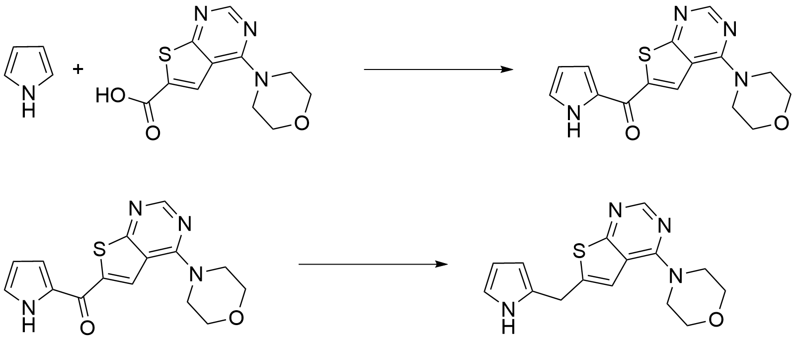<br><sub>SynPlanner</sub></td>
    <td width="33%" align="center" valign="top">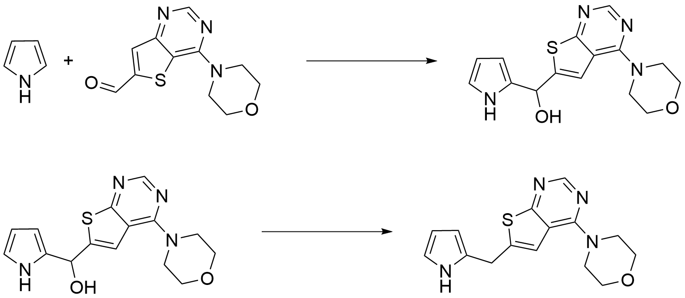<br><sub>RetroChimera</sub></td>
  </tr>
</table>

**产物。** ReactionT5（正向）在三个反应上都把记录的产物排在第 1（11 到 16 秒）；第 2 到第 5 名里有脱氢吗啉，也有把 S 换成 O 的呋喃，所以只有排在最前面的答案值得看。**反应条件。** Reacon 三个全没命中：胺化给出叠氮化钠加 THF（没有匹配的模板，它自己会如实报告），烷基化给出氢化钠加 DMF（记录是 n-BuLi、THF），伊马替尼酰胺首位是二氯甲烷（经典的吡啶排第 3）。它只返回催化剂、溶剂和试剂组合，不给温度、时间和用量。耗时 16 到 27 秒。

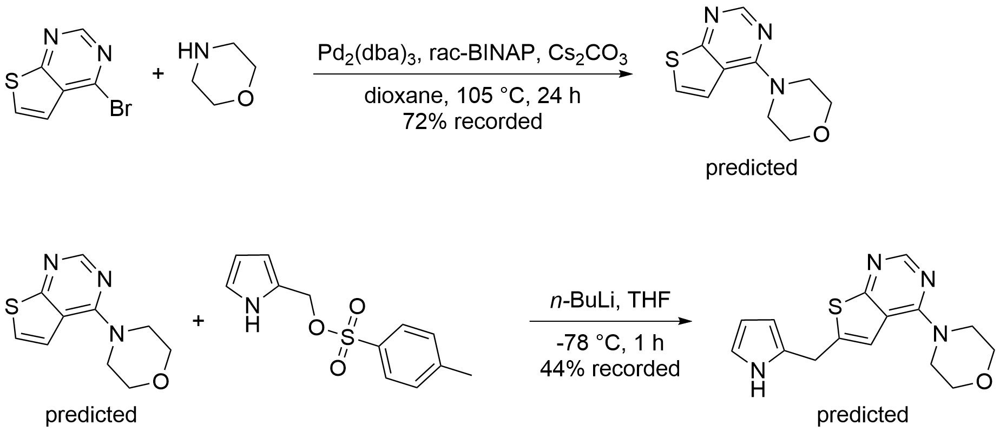

**安装：** `retro`（AiZynthFinder，1.7 GB）、`products`（3.9 GB）、`conditions`（Reacon，1.9 GB）；SynPlanner 和 ReactionT5 逆合成按名称安装；`retro-chimera`（8.5 GB，运行需要约 14 GB 可用内存）。RetroChimera 仅供研究使用；Reacon 的作者没有声明许可证，所以只在你要求时才从他们的仓库下载。[详情](skill/chemdraw/references/engines.md#predictions)

### 对照实测谱图的核磁位移

> **你可以说：**“用两个核磁模型预测咖啡因的 1H 和 13C 位移，并和实测谱图对比。”

下图把 BMRB 的咖啡因 D<sub>2</sub>O 处理后谱图（`bmse000206`）画成可编辑的 ChemDraw 曲线，每个预测位移画一条竖线，实测峰画成刻度。`MagNET` 对玻尔兹曼加权三维构象系综（298.15 K）取位移平均并提供 Karplus <sup>3</sup><i>J</i><sub>HH</sub> 耦合常数估算，`nmr.compare_shifts` 则提供一对一匈牙利候选峰匹配（`model_assisted_candidate_assignment`）与离群值警告。为了系统衡量误差，我们用 `nmrshiftdb2` 中同时具备原始 Bruker <sup>1</sup>H 和 <sup>13</sup>C 谱且已完成原子归属的 **20 个有机分子与天然产物**（13 个 CDCl<sub>3</sub>、7 个 DMSO-<i>d</i><sub>6</sub>；共 215 个非活泼 C–H <sup>1</sup>H 拓扑等价组和 323 个 <sup>13</sup>C 拓扑等价组；两侧均剔除活泼 OH、NH、SH 质子，姜黄素按快速互变的简并酮-烯醇对称性归并）跑完两个模型。下表为按分子平均的绝对误差（MAE，单位 ppm）。


| 子集 | 分子数 | <sup>1</sup>H 组数 | MagNET <sup>1</sup>H | NMRNet++ <sup>1</sup>H | <sup>13</sup>C 组数 | MagNET <sup>13</sup>C | NMRNet++ <sup>13</sup>C |
| --- | --- | --- | --- | --- | --- | --- | --- |
| **全部 20 个分子** | 20 | 215 | **0.21**（合并 0.22，最大 1.08） | **0.11**（合并 0.12，最大 0.84） | 323 | **2.89**（合并 3.08，最大 15.90） | **1.14**（合并 1.23，最大 10.37） |
| CDCl<sub>3</sub> | 13 | 165 | 0.19 | 0.10 | 234 | 3.11 | 1.10 |
| DMSO-<i>d</i><sub>6</sub> | 7 | 50 | 0.26 | 0.13 | 89 | 2.48 | 1.22 |
| 符合 ShiftDB-Lit 筛选（`<=1` 个手性中心） | 7 | 55 | 0.21 | 0.10 | 92 | 2.71 | 0.68 |
| 不在 ShiftDB-Lit 中（`>=2` 个手性中心或未收录） | 13 | 160 | 0.21 | 0.12 | 231 | 2.99 | 1.39 |

<details>
<summary><b>展开全部 20 个分子的逐分子平均绝对误差（ppm）</b></summary>
<br>

| # | 分子（`nmrshiftdb2` 编号） | 溶剂 | <sup>1</sup>H 组数 | MagNET <sup>1</sup>H | NMRNet++ <sup>1</sup>H | <sup>13</sup>C 组数 | MagNET <sup>13</sup>C | NMRNet++ <sup>13</sup>C |
| --- | --- | --- | --- | --- | --- | --- | --- | --- |
| 1 | 橘皮素 Sinensetin（`20237348`） | CDCl<sub>3</sub> | 10 | 0.14 | 0.02 | 20 | 4.15 | 0.23 |
| 2 | 秋水仙碱 Colchicine（`60000009`）* | CDCl<sub>3</sub> | 12 | 0.29 | 0.12 | 22 | 4.99 | 0.42 |
| 3 | 奎宁 Quinine（`60004827`） | CDCl<sub>3</sub> | 16 | 0.25 | 0.12 | 20 | 3.48 | 0.87 |
| 4 | 迷迭香酸 Rosmarinic acid（`20252986`） | DMSO-<i>d</i><sub>6</sub> | 10 | 0.38 | 0.04 | 18 | 2.74 | 0.39 |
| 5 | 姜黄素 Curcumin（`10027206`）* | DMSO-<i>d</i><sub>6</sub> | 7 | 0.30 | 0.10 | 11 | 3.05 | 0.86 |
| 6 | 咖啡因 Caffeine（`10016316`）* | DMSO-<i>d</i><sub>6</sub> | 4 | 0.16 | 0.24 | 8 | 0.90 | 0.32 |
| 7 | 士的宁 Strychnine（`40265284`） | CDCl<sub>3</sub> | 16 | 0.13 | 0.10 | 21 | 2.07 | 1.28 |
| 8 | *N*-Boc-二氧杂环戊烯并吡喃异喹啉（`60001975`） | CDCl<sub>3</sub> | 9 | 0.16 | 0.08 | 16 | 2.48 | 1.11 |
| 9 | 胡椒碱 Piperine（`10016311`）* | CDCl<sub>3</sub> | 11 | 0.12 | 0.03 | 15 | 3.42 | 0.23 |
| 10 | 加兰他敏 Galanthamine（`20062583`） | CDCl<sub>3</sub> | 12 | 0.22 | 0.14 | 17 | 4.09 | 2.62 |
| 11 | 苏木红素 Brazilein（`20192008`）* | DMSO-<i>d</i><sub>6</sub> | 7 | 0.17 | 0.11 | 16 | 1.82 | 1.94 |
| 12 | 可卡因 Cocaine（`10016310`） | CDCl<sub>3</sub> | 12 | 0.18 | 0.20 | 15 | 2.60 | 0.89 |
| 13 | 4-(2,2,2-三氟乙氧基)苯胺（`60004996`） | DMSO-<i>d</i><sub>6</sub> | 3 | 0.15 | 0.13 | 6 | 1.58 | 1.27 |
| 14 | 野靛碱 Cytisine（`60000003`） | CDCl<sub>3</sub> | 9 | 0.11 | 0.10 | 11 | 2.21 | 1.40 |
| 15 | 指甲花醌 Lawsone（`20143612`）* | DMSO-<i>d</i><sub>6</sub> | 5 | 0.27 | 0.08 | 10 | 2.85 | 0.81 |
| 16 | 蓟苦素 Cnicin（`40265326`） | DMSO-<i>d</i><sub>6</sub> | 14 | 0.38 | 0.23 | 20 | 4.45 | 2.92 |
| 17 | (−)-反式-Δ<sup>9</sup>-四氢大麻酚（`40265338`） | CDCl<sub>3</sub> | 14 | 0.20 | 0.10 | 20 | 3.27 | 0.63 |
| 18 | 3-*O*-乙酰基-11-酮-β-乳香酸（`60000007`） | CDCl<sub>3</sub> | 23 | 0.27 | 0.16 | 32 | 2.91 | 2.36 |
| 19 | 青蒿素 Artemisinin（`20253147`） | CDCl<sub>3</sub> | 12 | 0.19 | 0.13 | 15 | 2.82 | 2.09 |
| 20 | 尼古丁 Nicotine（`10008712`）* | CDCl<sub>3</sub> | 9 | 0.17 | 0.04 | 10 | 1.96 | 0.20 |

<sub>* 标星号的 7 个分子同时符合 NMRNet++ 的 ShiftDB-Lit（<code>&lt;=1</code> 个手性中心）筛选条件。若不做原子归属、改用一对一匈牙利就近配峰，同一批 20 个分子的误差会降到 MagNET 0.16 / 2.58 ppm、NMRNet++ 0.09 / 1.00 ppm，因为相近谱峰互换会掩盖归属错误。</sub>

</details>

**训练集重合说明。** 这 20 条记录全部来自 `nmrshiftdb2`，而 `nmrshiftdb2` 本身属于 NMRNet++ 五折交叉验证的监督训练语料（第 0 折训练集覆盖其中约 80%），其中 7 个分子还进入了它的 ShiftDB-Lit 子集（这 7 个分子的 <sup>13</sup>C MAE 仅 0.68 ppm，其余 13 个为 1.39 ppm）。相比之下，MagNET 完全在 AIMNet2/GIAO DFT 计算屏蔽常数上训练，训练过程中未见过任何实验核磁谱图，因此它的 0.21 ppm（<sup>1</sup>H）和 2.89 ppm（<sup>13</sup>C）是严格的库外实测表现，而 NMRNet++ 的 0.11 和 1.14 ppm 含有训练语料重合，应视为库内上限。GPU 上单分子耗时：MagNET 为 22 到 60 秒（平均 29 秒），NMRNet++ 为 24 到 62 秒（平均 33 秒）。预测值绝不写进实验表征句。

**安装：** `nmr`（MagNET，5.4 GB）和 `nmr-pp`（NMRNet++，2.8 GB；权重为 CC BY 4.0，且不接受溶剂参数）。[20 个分子的实测对比 JSON](assets/readme/engines/nmr/benchmark20.json) · [咖啡因谱图与数据](assets/readme/engines/nmr/caffeine/)

### LCMS 板

> **你可以说：**“把这份 OpenLynx 报告和板图对一下，告诉我哪些孔里有预期的产物。”

这一项不需要引擎。PyParse 示例数据集（Apache-2.0）里的 24 孔 Waters 报告和板图，解析用了 11 秒。24 个孔都找到了预期产物：21 个是 [M+H]<sup>+</sup>，两个 Boc 保护的哌嗪（B3、B5）是 [M+H−C<sub>4</sub>H<sub>8</sub>]<sup>+</sup> 碎片，B11 的羧酸是 [M−H]<sup>−</sup>。与 PyParse 自己的输出相比，23 个孔的保留时间和纯度相差不超过 0.01。例外是 B6，它是匹配规则的取舍：工具箱取带完整 [M+H]<sup>+</sup> 的峰（92.9%），PyParse 取碎片峰（7.1%）。规则见 [match_plate.py](assets/readme/engines/lcms/match_plate.py)。除孔板报告外，LCMS 工具还支持解析 OpenLynx `.rpt`、Waters PDF 与 `.raw` 目录、Shimadzu `.daml`、Agilent `report.txt` 以及开放格式 `mzML`/`mzXML`，并提供 Cl/Br `M+2` 同位素包络校验与跨时间点内标（`IS`）比值追踪。

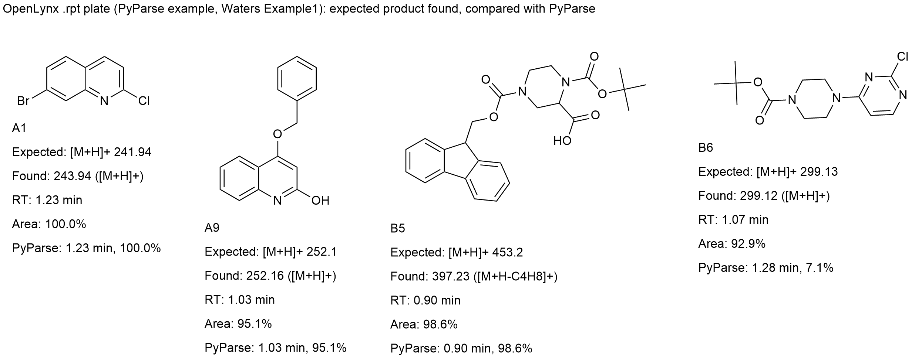

### 十五个引擎一览

| 引擎 | 作用 | 磁盘 | 许可 | GPU |
| --- | --- | --- | --- | --- |
| `decimer-api` | 图片转结构，远程服务 | 无 | MIT | 否 |
| `decimer-local` | 同一模型在本机运行 | 2.4 GB | MIT | 否（CPU） |
| `molscribe` | 图片转结构 | 4.7 GB | MIT | 是 |
| `molnextr` | 图片转结构 | 4.8 GB | Apache-2.0 | 是 |
| `molparser` | 图片转结构，含 Markush | 3.4 GB | 权重仅限非商业 | 是 |
| `molvec` | 图片转结构，基于规则 | 2 MB | Apache-2.0 | 否（Java） |
| `decimer-segmentation` | 在页面上找结构 | 2.1 GB | MIT | 否 |
| `aizynthfinder` | 逆合成、路线 | 1.7 GB | MIT | 否 |
| `synplanner` | 逆合成、路线 | 4.8 GB | MIT | 是 |
| `reactiont5-forward` | 产物 | 3.9 GB | MIT | 是 |
| `reactiont5-retro` | 单步逆合成 | 3.9 GB | MIT | 是 |
| `retrochimera` | 单步逆合成与路线 | 8.5 GB | 仅限研究 | 是 |
| `magnet` | 1H 和 13C 位移 | 5.4 GB | MIT | 是 |
| `nmrnet-pp` | 1H 和 13C 位移，第二个模型 | 2.8 GB | 代码 MIT，权重 CC BY 4.0 | 是 |
| `reacon` | 催化剂、溶剂和试剂组合 | 1.9 GB | 作者未声明 | 是 |

大小是 Windows 上装好后的实测值，含 CUDA 版 PyTorch，CPU 安装更小。`CHEMDRAW_ENGINE_HOME` 可把它们装到别的磁盘。`cdx.py engines --recommend 需求` 会在下载任何东西之前说明某项任务需要什么。许可和注册表细节见 [engines.md](skill/chemdraw/references/engines.md)。

## 复刻论文反应图

先读整图，再沿一条路线执行：

<p align="center">
  <code>整图读图</code> → <code>裁切结构</code> → <code>DECIMER</code> → <code>匹配原图取向</code> → <code>左右对照</code> → <code>修正结构</code> → <code>组装版式</code> → <code>原生预览</code>
</p>

```text
使用 ChemDraw Skill 复刻这张论文图。先读完整反应流程，再裁切各个完整结构，
取得 DECIMER 识别候选。按原图取向重绘，实际查看左右对照并修正受影响结构；
转录反应条件，最后交付可编辑 CDXML 和原生预览。
```

[图像复刻指南](skill/chemdraw/references/image-visual-review.md) · [最小任务模板](skill/chemdraw/assets/paper-replica/task-template.json) · [绘图示例](skill/chemdraw/assets/paper-replica/example/CASE.md)

| 遇到的需求 | 现成处理路线 |
| --- | --- |
| 图像裁切与复核 | 裁切、遮罩和对照工具，保留区域与识别结果的对应关系 |
| 折叠链条或桥环取向 | 追踪原图坐标，检查交叉关系和键级 |
| 修正立体化学 | 查看原子编号，经接口明确修改，再读回最终 CDXML |
| 组装整张反应图 | 固定坐标、富文本条件、多种箭头和原生预览 |
| 绘图之外的化学处理 | RDKit 立体异构体与互变异构体枚举、MCS 和 R-group 分解 |

识别时只把任务图片及其裁切图上传到 DECIMER API（`cdx.py decimer --preflight` 可先查看将要发送的内容；要求离线时不上传）。

<details>
<summary><b>离线重建两张复杂路线图</b></summary>
<br>

两张路线图都由真实的分子对象（可编辑的原子、键和可展开缩写）以及文字、括号和电子箭头组成。[逐原子检查记录](skill/chemdraw/assets/paper-reconstructions/stereochemistry-check.json)给出组件哈希及原子对应关系。

安装运行时后，可离线重建这两张布局，无需再次调用 DECIMER（请使用新的输出目录）：

```bash
python skill/chemdraw/scripts/cdx.py py skill/chemdraw/assets/paper-reconstructions/rebuild.py ./paper-figures-output
```

原生预览需要桌面版 ChemDraw（Windows 或 macOS）。详见[重建示例](skill/chemdraw/assets/paper-reconstructions/README.md)。

</details>

## 平台支持

可移植化学层（CDXML 生成与编辑、RDKit 校验、命令行和 MCP）支持 Windows、macOS 和 Linux。原生 ChemDraw 在 Windows 上通过 COM 驱动，在 macOS 上通过 AppleScript 驱动，工具与输出相同。

| 能力 | Windows | macOS | Linux |
| --- | :---: | :---: | :---: |
| CDXML、RDKit、命令行与 MCP 工作流 | ✅ | ✅ | ✅ |
| ChemDraw 原生渲染、转换与清理 | ✅ <sub>需激活安装</sub> | ✅ <sub>ChemDraw for macOS</sub> | — |
| ChemScript 操作（命名、分子式、清理、子结构） | ✅ <sub>需兼容 SDK</sub> | ✅ <sub>ChemDraw + OPSIN + RDKit</sub> | — |
| 原始 ChemScript SDK 程序 | ✅ <sub>需兼容 SDK</sub> | ✅ <sub>核心 API 模拟</sub> | — |
| 可编辑 Office ChemDraw 对象 | ✅ <sub>桌面版 Office</sub> | ✅ <sub>矢量预览，`cdx.py office-edit`</sub> | — |
| Office 文件的 PDF 预览 | ✅ <sub>桌面版 Office</sub> | ✅ <sub>已激活的 Microsoft 365</sub> | — |

<sub>✅ 支持 · — 不支持（没有可用的 bridge）</sub>

macOS 上的差异（自动化权限、隐藏的 ChemDraw 实例、字体替换、基于 SVG 的矢量 OLE 预览、以 `office-edit` 代替双击编辑，以及 ChemScript 模拟）见[运维说明](skill/chemdraw/references/operations.md#macos)。

<details>
<summary><b>所需组件</b></summary>
<br>

| 目标 | 在核心安装基础上增加 |
| --- | --- |
| 创建和编辑 CDXML | 能执行命令行的任意 Agent、64 位 Python 3.10–3.13，以及内置工具包运行时（由 `scripts/install.py --runtime` 从 `toolkit/` 构建） |
| 原生 PNG、CDX 或 ChemDraw 清理 | 已获得许可并激活的桌面版 ChemDraw：Windows 上 COM 自动化可正常工作，或 macOS 上已授予自动化权限的 ChemDraw for macOS |
| 分子比较或 ChemScript SDK 调用 | 可移植相似度比较使用 RDKit；精确检查和原始 SDK 程序需 Windows 主机上的兼容 ChemScript DLL（macOS 上由 ChemDraw、OPSIN 和 RDKit 完成 ChemScript 操作） |
| 可编辑的 Word 或 PowerPoint 对象 | 用桌面版 ChemDraw 生成；PDF 预览需桌面版 Word 和/或 PowerPoint（macOS 上需已激活） |
| 本地光学结构识别 | DECIMER 模型权重及其运行时依赖 |
| 更多 OCSR 引擎、逆合成、产物、反应条件与核磁预测 | `cdx.py engines --recommend 需求` 后经你同意再 `cdx.py install-engines --bundle 名称`：每个引擎一个独立环境，连同模型文件从 2 MB 到约 8.5 GB 不等（最大的是 RetroChimera，运行时还需要约 14 GB 空闲内存），可用 `remove-engines` 删除；想装到其他磁盘，就在安装前设置 `CHEMDRAW_ENGINE_HOME`，并且之后一直保留这个设置；许可限制：MolParser 的权重仅限非商业用途，RetroChimera 仅供研究，Reacon 没有许可证（见[引擎说明](skill/chemdraw/references/engines.md)） |
| 远程访问 ChemDraw 工作站 | Windows 主机、经过身份验证的 HTTP 配置以及加密网络通道 |

项目不附带 ChemDraw、Microsoft Office、ChemScript 和 DECIMER 模型权重。安装选项、手动创建运行时和诊断方法见[安装指南](docs/guide.zh-cn.md#首次安装)。

</details>

## 测试与安全

- 每个 PR 只跑一小组 CI：发布校验、Windows（Python 3.13）和 Linux（3.12）上的工具包测试、Windows 上的 Skill 测试和打包。其余部分每周跑一次，每次发版前也要先跑通：Linux 和 MCP 1.28.1 上的 Skill 测试、Python 3.10 和 macOS 上的工具包测试、两个 MCP SDK 大版本，以及 Windows、Linux 和 macOS 上的端到端安装测试。ChemDraw、ChemScript 和 Office 的原生功能在一台已授权的 Windows 工作站上手动测试；macOS 的 AppleScript 路径在 macOS 26.6（Apple 芯片）和 ChemDraw 26.0 上测试过。
- 工具只写入新的输出路径，除非你明确要求，否则不会覆盖已有文件。
- 图像识别只把选定的图片发送到 DECIMER API。`cdx.py decimer --preflight` 可以先看将要发送什么，要求离线时不上传。各类报告和映射器在本地运行，ChemDraw 的化学计量表由本机的 ChemDraw 计算；只有报告在名称不在内置表中时才会联网查询，设置 `CHEMDRAW_OFFLINE=1` 可关闭。
- 可选的预测引擎在各自的独立环境中本地运行，不上传任何内容；下载内容按固定哈希校验。它们的结果是模型预测，并会如此标注。
- 远程使用 HTTP 服务时需要 Bearer 密钥和允许的主机列表，并应放在加密隧道或 HTTPS 代理之后。详见[安全策略](.github/SECURITY.md)。

## 常见问题

<details>
<summary><b>任意 AI Agent 都能使用这个 ChemDraw Skill 吗？</b></summary>
<br>

可以。Agent 需要能读取 Skill 指令并执行命令行，所有工具都通过 `cdx.py` 运行。安装脚本会把 Skill 放到 Claude Code、Codex、Gemini CLI、GitHub Copilot、Cursor、OpenCode 等读取 `SKILL.md` 目录的 Agent 能发现的位置；不支持 Skill 自动发现的 Agent，可在其指令文件中指向 `SKILL.md`；偏好 MCP（Model Context Protocol，模型上下文协议）的客户端也可以注册自带的服务。详见 [Agent 接入](skill/chemdraw/references/agent-integration.md)。

</details>

<details>
<summary><b>必须使用 MCP 服务吗？</b></summary>
<br>

不需要。命令行覆盖全部工具，并保留同样的工作进程隔离、ChemDraw 原生锁和超时控制。需要类型化工具调用的客户端仍可使用 MCP。

</details>

<details>
<summary><b>能从 Excel 实验数据生成 SAR 图和底物拓展图吗？</b></summary>
<br>

可以。将可信结构与 CSV/XLSX 数据绑定，生成可编辑的构效关系（SAR）图或底物拓展图。稳定的化合物 ID 保持数据对应，更新项目时保留无关的手工布局修改。详见[数据驱动绘图指南](skill/chemdraw/references/data-driven-figures.md)。

</details>

<details>
<summary><b>它会编造反应条件或推测机理吗？</b></summary>
<br>

不会。按需求画的图，条件、收率和实测数值只取自你给的内容；缺的就保持缺失，并在报告里说明。解析不了的名称会被拒绝，而不是猜一个。机理只按你列出的电子转移绘制，箭头起点没有孤对电子或电荷时会提醒，但不会判断机理本身对不对。详见[一句话生成新图](#one-command-figures)。

</details>

<details>
<summary><b>能帮我算每种试剂该称多少吗？</b></summary>
<br>

可以，用的是 ChemDraw 自带的计算器。`cdx.py calc` 对以 SMILES 或 ChemDraw 文件给出的反应运行 Structure > Analyze Stoichiometry，并在 ChemDraw 里打开化学计量表；在表里填质量、体积或当量，其余数值由 ChemDraw 算出；`cdx.py calc --read` 把保存后的数值读回来。没有 ChemDraw 时，`si_materials_tables` 给出用量表，其中所有默认值都标明是假设值。详见[反应计算器与化学报告](#反应计算器与化学报告)。

</details>

<details>
<summary><b>安全信息可以信到什么程度？</b></summary>
<br>

它只是提醒，来自内置的 116 种常见溶剂与试剂表以及 SMARTS 官能团结构警示：GHS 图标、H 说明、沸点和闪点。表里没有的物质显示“未收录”，不会显示成安全。表中的数值按常见供应商的分类写成，各家会有出入，请以你实际使用的产品的 SDS 为准。

</details>

<details>
<summary><b>预测引擎需要什么？结果能信到什么程度？</b></summary>
<br>

它们需要磁盘空间（每个引擎从 2 MB 到约 8.5 GB，见[上文](#十五个引擎一览)），安装时联网一次，大多数有 NVIDIA 显卡会更快但不是必需的；装好后可离线运行。RetroChimera 需要约 14 GB 空闲内存。每个答案都只当候选：上面的案例里，引擎找回了记录的产物和部分记录的前体，也漏掉了另一些；在较公平的一次测试里，预测位移与实测相差约 1H 0.2 ppm、13C 2 到 3 ppm；Reacon 给出的条件三个记录的都没命中。多个引擎一致只是个提示，不一致就说明该人工核对。许可：MolParser 的权重仅限非商业用途，RetroChimera 仅供研究，Reacon 的作者没有声明许可证。

</details>

<details>
<summary><b>能把文献结构图复刻成可编辑 ChemDraw 文件吗？</b></summary>
<br>

[论文图复刻流程](skill/chemdraw/references/image-visual-review.md)结合结构确认、版式重建与原生视觉复核，输出可编辑 CDXML 和原生预览。

</details>

## 共同建设 macOS 支持

macOS 适配器通过 ChemDraw for macOS 的 AppleScript 字典驱动 ChemDraw，带超时、按用户的原生锁、暂存临时文件和保存后回读，并把 ChemScript 专有行为映射到 ChemDraw、OPSIN 和 RDKit。仍欢迎以下方面的帮助：

- Intel Mac 和其他 ChemDraw 版本（已测试：macOS 26.6、Apple 芯片上的 ChemDraw 26.0）；
- 通过已激活的 Microsoft 365 for macOS 生成 PDF 预览；
- 模拟范围（`StructureData`、`ReactionData`、`LargestCommonSubstructure` 核心）之外的 ChemScript SDK 成员。

请从[贡献指南](.github/contributing.md)开始，提交聚焦的 issue 或 PR，并附上准确的 macOS 版本、芯片、ChemDraw 构建号、权限提示、命令输出和最小复现文件。不要上传私有论文、凭据或受许可保护的 ChemDraw 资源。

## 文档

| 从这里开始 | 深入了解 |
| --- | --- |
| [安装与首次使用](docs/zh-cn.md) | [自动生成的工具签名](skill/chemdraw/references/mcp-signatures.md) |
| [安装、故障处理与运行维护](docs/guide.zh-cn.md) · [英文运维指南](docs/guide.md) | [经过审计的内置工具包公共清单](skill/chemdraw/references/toolkit-public-inventory.md) |
| [Agent 接入与 `cdx.py` 命令参考](skill/chemdraw/references/agent-integration.md) | [工具包开发者参考](toolkit/docs/agent-reference.md) · [生成的 MCP 工具参考](toolkit/docs/mcp-tools.md) |
| [面向任务的工作流目录](skill/chemdraw/references/workflow-router.md) | [远程 HTTP 配置](skill/chemdraw/references/operations.md#remote-http-only-when-asked) |
| [贡献指南](.github/contributing.md) · [安全策略](.github/SECURITY.md) | [仓库贡献者说明](AGENTS.md) |
| [官网](https://zichenwang114514.github.io/chemdraw-skill/) | [落地页源码与部署说明](docs/website.md) |

可部署的 Skill 位于 [`skill/chemdraw`](skill/chemdraw)。它所驱动的化学运行时，即 `cdxml_toolkit` Python 包，位于 [`toolkit`](toolkit)，并带有自己的测试。

## 许可证

仓库自行编写的代码与文档采用 [MIT 许可证](LICENSE)。[`toolkit/`](toolkit) 中的内置工具包基于 Hiu Fung Kevin Lee 的原始 `cdxml-toolkit`，保留其自身的 [MIT 许可证](toolkit/LICENSE)和[第三方声明](toolkit/NOTICE.md)。ChemDraw、Microsoft Office、各 Agent 客户端、MCP Python SDK、RDKit、DECIMER 及其依赖项继续适用各自的许可证与使用条款。

本项目为独立社区项目，与 Revvity、Anthropic、OpenAI、Google、GitHub、Microsoft、Anysphere、OpenCode 维护者以及上游 `cdxml-toolkit`、MCP Python SDK、RDKit 或 DECIMER 的维护者不存在隶属关系，也未获得其认可。

<p align="right"><a href="#top">返回顶部 ↑</a></p>
