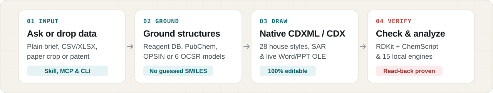
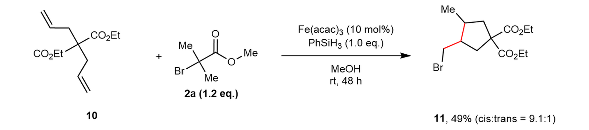
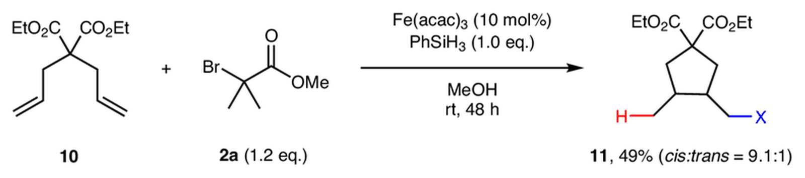
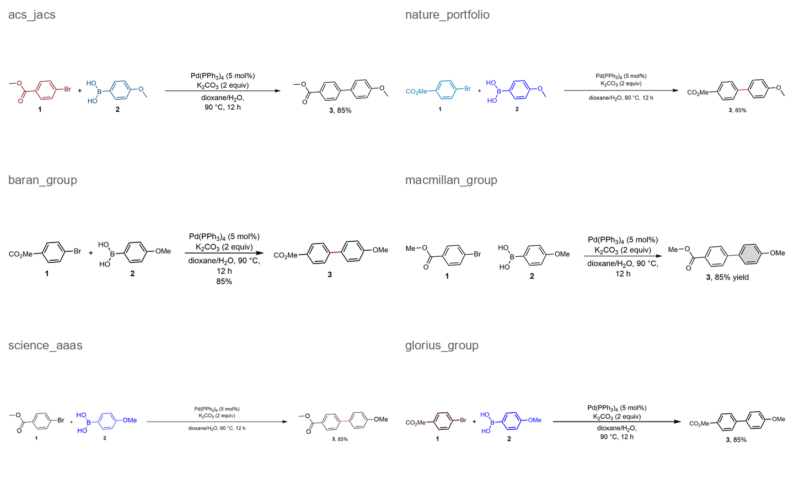
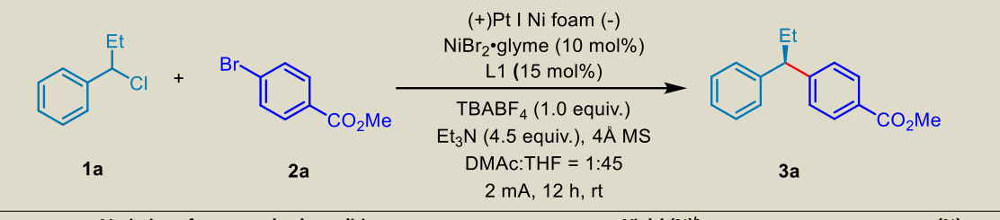
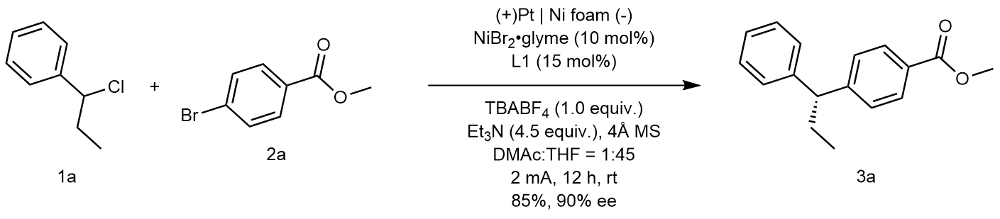

<a id="top"></a>

<p align="center">
  <picture>
    <source media="(prefers-color-scheme: dark)" srcset="./assets/readme/hero-dark.svg">
    
  </picture>
</p>

<p align="center">
  <a href="https://github.com/ZiChenWang114514/chemdraw-skill/actions/workflows/validate.yml"></a>
  <a href="https://zichenwang114514.github.io/chemdraw-skill/"></a>
  
  
  <a href="LICENSE"></a>
</p>

<p align="center">
  <a href="README.md">English</a> &nbsp;/&nbsp; <b>简体中文</b>
  &nbsp;&nbsp;
  <a href="#快速开始"><b>快速开始</b></a>、<a href="#支持的工作">支持的工作</a>、<a href="#作品展示">作品展示</a>、<a href="#期刊与课题组画法风格">28 种画法风格</a>、<a href="#反应计算器与化学报告">计算器</a>、<a href="#预测与分析引擎">引擎</a>、<a href="#平台支持">平台</a>、<a href="#常见问题">常见问题</a>、<a href="docs/guide.zh-cn.md">指南</a>、<a href="https://zichenwang114514.github.io/chemdraw-skill/"><b>官网</b></a>
</p>

**ChemDraw Skill** 为 **Claude Code**、**Codex**、**Gemini CLI**、**GitHub Copilot**、**Cursor**、**OpenCode** 及任意支持命令行或 MCP 的 AI Agent 提供确定性的化学科研绘图与分析工作流，直接产出**原生可编辑的 ChemDraw 文档（`.cdxml` 与 `.cdx`）**以及可双击编辑的 **Word/PowerPoint 内嵌对象**，不输出无法修改的位图，也不凭记忆猜测 SMILES。只需一句自然语言反应描述、CSV 或 Excel 底物拓展与构效关系（SAR）数据表、文献反应截图或专利马库什（Markush）权利要求，即可按 **28 种实测期刊与课题组画法风格**（*JACS*、*Angew. Chem.*、*Nature*、*Science*、*ACS Document 1996*、Baran、MacMillan、Studer 等）输出发表级插图，同时集成 ChemDraw 原生**化学计量表**、**ACS 标准实验表征文段生成**以及 **15 个按需安装的本地结构识别（OCSR）、逆合成与核磁（NMR）预测引擎**。

## 快速开始

<!-- prerequisites -->
<details>
<summary><b>环境与可选参数说明</b>（64 位 Python 3.10 至 3.13，约 760 MB 运行时，桌面版 ChemDraw 可选）</summary>
<br>

| 环境项 | 说明 |
| --- | --- |
| **桌面版 ChemDraw** *(可选)* | Windows 或 macOS 上已激活的桌面版 ChemDraw 可解锁原生 300 dpi PNG 渲染、`.cdx` 转换、交互式化学计量表与 Word/PowerPoint 对象。未安装 ChemDraw 时，Skill 仍可在 Windows、macOS、Linux 上构建、编辑、识别与校验 `.cdxml` 并运行批量计算工具（[无界面模式差异](skill/chemdraw/references/operations.md#no-chemdraw-on-this-host)）。 |
| **Python 与磁盘** | 基于 64 位 Python **3.10–3.13** 的共享虚拟环境约 760 MB；单独传 `--extras` 仅装最小核心，传 `--extras publication office` 仅按需加装指定扩展组。 |
| **可选增强参数** | `--opsin` 启用离线英文命名转结构（Windows 首次使用自动下载 Java，macOS/Linux 需自装 Java）· `--mapping` 在独立环境中安装 RXNMapper 与 LocalMapper · `image` 文字识别需安装 Tesseract。 |
| **全工具离线自检** | 运行 `cdx.py py $HOME/.claude/skills/chemdraw/scripts/smoke_all_tools.py --output-dir 新目录` 可在本地逐个验证全部工具（加 `--network` 才会测试联网接口）。 |

</details>

**1. 安装**（安装脚本支持 Python 3.9+，并自动定位本机 64 位 Python 3.10–3.13 构建共享工具包环境）：

```bash
git clone https://github.com/ZiChenWang114514/chemdraw-skill.git
cd chemdraw-skill
python scripts/install.py --agent claude agents --runtime --apply
```

<sub>去掉 <code>--apply</code> 可先预览安装路径；若本机只有 Python 3.14+，请先安装 3.12（如 <code>uv python install 3.12</code>）或加 <code>--python &lt;解释器路径&gt;</code> 指定。</sub>

**2. 检查本机能力**（自动检测桌面版 ChemDraw、Office OLE、Python 可选依赖与本地引擎）：

```bash
python $HOME/.claude/skills/chemdraw/scripts/cdx.py doctor
```

**3. 复制第一条指令发给你的 Agent**：

```text
# 按期刊风格绘制可编辑反应式
用 ChemDraw Skill 按 acs_jacs 风格绘制水杨酸 + Ac2O -> 阿司匹林（H2SO4 催化，室温 2 h，收率 85%），保存为可编辑 CDXML 并用 ChemDraw 渲染 300 dpi PNG。

# 把论文反应截图复刻成可编辑 ChemDraw
用 ChemDraw Skill 复刻 ./scheme.png 为可编辑 CDXML，保持原图分子取向，左右对照核验每个结构并输出原生预览。

# 用 ChemDraw 反应计算器核算投料量
用 ChemDraw Skill 对反应 "OCc1ccccc1.CC(=O)Cl>CCN(CC)CC.ClCCl>CC(=O)OCc1ccccc1" 生成 ChemDraw 化学计量表，并把用量读回为 JSON。
```

<details>
<summary><b>选择 Agent、项目级安装与 MCP 配置</b></summary>
<br>

| `--agent` | Skill 目录 | 自动识别的客户端 |
| --- | --- | --- |
| `claude` | `~/.claude/skills/` | Claude Code（GitHub Copilot 与 OpenCode 也会读取） |
| `agents` | `~/.agents/skills/` | Agent Skills 通用目录：Codex、Gemini CLI、GitHub Copilot、Cursor、OpenCode 等 |
| `gemini`、`copilot`、`cursor`、`opencode`、`kimi`、`pi` | 各客户端专属目录 | 需要按客户端独立管理时使用 |

- `--project <仓库>` 安装至项目级目录（`.claude/skills/`、`.agents/skills/`、`.github/skills/` 等）；`--destination <目录>` 可安装至任意自定义位置。
- 不支持自动发现 `SKILL.md` 的 Agent，只需在其系统指令中加一行指向 `SKILL.md`。
- 所有副本共享同一套运行时（运行 `python scripts/install.py --runtime-only --apply` 即可原地升级，失败自动回滚）。各客户端白名单与可选 MCP 注册详见 [Agent 接入](skill/chemdraw/references/agent-integration.md)。

</details>

<details>
<summary><b><code>cdx.py</code> 一页命令速查（画图、风格、检查、计量、识别与 Office）</b></summary>
<br>

Agent 与命令行用户统一通过唯一入口 `cdx.py` 调用全部工具；任意 Python 均可启动，脚本会自动切入工具包虚拟环境：

```bash
# 解析与绘制
python <skill>/scripts/cdx.py resolve aspirin                             # 名称/SMILES/CAS -> SMILES、分子式、分子量
python <skill>/scripts/cdx.py draw --name aspirin aspirin.cdxml --style acs_jacs --render
python <skill>/scripts/cdx.py draw --smiles "c1ccccc1,CC(=O)O" grid.cdxml --columns 2 --number --properties mw,formula --render
python <skill>/scripts/cdx.py draw --reaction "CC(=O)O.CCO>O=S(=O)(O)O>CCOC(C)=O" --yield "88%" rxn.cdxml --render

# 画法风格、结构检查与化学计量
python <skill>/scripts/cdx.py styles                                      # 列出 16 个尺寸预设 + 28 个画法风格
python <skill>/scripts/cdx.py inspect rxn.cdxml                           # 列出全部结构、分子式、分子量与路线拓扑
python <skill>/scripts/cdx.py report "OCc1ccccc1.CC(=O)Cl>>CC(=O)OCc1ccccc1" --balance
python <skill>/scripts/cdx.py calc "OCc1ccccc1.CC(=O)Cl>>CC(=O)OCc1ccccc1"

# 图像识别、Office 与环境诊断
python <skill>/scripts/cdx.py ocsr figure_crop.png                        # 结构图识别（或使用 decimer）
python <skill>/scripts/cdx.py render figure.cdxml                         # ChemDraw 原生 300 dpi PNG 渲染
python <skill>/scripts/cdx.py office-edit deck.pptx                       # 嵌入或更新可编辑 ChemDraw 对象
python <skill>/scripts/cdx.py call resolve_name -a query=aspirin          # 以 key=value 直接调用任意已注册工具
python <skill>/scripts/cdx.py tools                                       # 查看全部已注册工具清单
python <skill>/scripts/cdx.py doctor --text                               # 本机能力检查与运行日志（--log latest）
```

</details>

## 支持的工作

<p align="center">
  <picture>
    <source media="(prefers-color-scheme: dark)" srcset="./assets/readme/workflow-dark.svg">
    
  </picture>
</p>

日常化学科研绘图与核算任务清晰归入五条工作流：

| 工作流 | 入口章节 | 交付产物 |
| --- | --- | --- |
| **一句话生成新图** | [单命令出图](#one-command-figures) · [28 种画法风格](#期刊与课题组画法风格) · [ACS 1996 规范](#acs1996-drawings) · [CSV/Excel SAR 图](#从数据生成可持续修改的论文图) | 经回读校验的 `.cdxml` + 原生 300 dpi `.png` |
| **复刻论文或专利原图** | [论文反应图复刻](#复刻论文反应图) · [专利 Markush 通式](#markush-demo) | 可编辑 `.cdxml`、`.cxsmiles` 与逐结构左右对照图 |
| **化学计量与表征计算** | [反应计算器、SI 原料表、ACS 表征文段与原子映射](#反应计算器与化学报告) | ChemDraw 计量表 JSON、ACS 表征段落、PMI 与原子映射 |
| **识别与模型预测** | [15 个可选本地/远程引擎](#预测与分析引擎) | 明确标注预测来源的 OCSR、逆合成、产物与核磁候选 |
| **嵌入 Office 文档** | `cdx.py office-edit` · Word 与 PowerPoint 自动化 | 桌面版 Office 原生可编辑 ChemDraw 对象 + PDF 预览 |

<details>
<summary><b>全部 17 个工具领域能力矩阵</b></summary>
<br>

| 领域 | 能做什么 |
| --- | --- |
| **结构与反应** | 解析名称/CAS/SMILES；绘制、编辑、清理、合并、切分、转换并渲染 CDXML/CDX，不干扰已打开的 ChemDraw 文档。 |
| **按一句话生成新图** | 单步反应、线性/汇聚/发散路线、催化循环、底物拓展与反应机理一步出图，同命令完成化学配平与几何检查。[详见](#one-command-figures)。 |
| **期刊与课题组风格** | 28 张实测风格卡（源于 179 张开放许可插图，覆盖 23 类科研图），叠加在 16 个 ChemDraw 官方尺寸预设之上。[详见](#期刊与课题组画法风格)。 |
| **试卷、讲义与论文插图** | 由紧凑 JSON 生成 ACS Document 1996 图形：`GenericNickname` 缩写、中文注释、带框代号、轨道瓣、过渡态括号及椅式/Newman/Haworth/Fischer 三维模板。 |
| **数据驱动的图** | 按化合物 ID 绑定 CSV/XLSX 与可信结构生成底物拓展图和 SAR 面板，后续更新数据仍保留 ChemDraw 手工排版。 |
| **反应机理** | 按显式电子转移列表布设全/半箭头弯箭头，或由精确坐标、形式电荷与抗衡离子完整重建。 |
| **专利 Markush 通式** | 结合专利附图与权利要求提取 R 基、可变环、多中心键与重复单元，同步导出可编辑 CDXML、CXSMILES 与 V3000 MOL。 |
| **图像识别** | 通过远程 DECIMER API 或本地模型权重输出候选结构、置信度与区域边框。 |
| **引擎与预测** | 15 个按需安装的独立环境引擎：6 套 OCSR 互校、PDF 结构切分、逆合成、正向产物、反应条件与 1H/13C 核磁位移预测。[实测与体积](#预测与分析引擎)。 |
| **计算器与报告** | ChemDraw 原生化学计量表生成与 JSON 回读、含 PMI 的批量 SI 原料表、HRMS 与 ACS 表征段落、116 条 GHS 安全警示、总收率与原子映射。[详见](#反应计算器与化学报告)。 |
| **TLC 与装置** | 原生 TLC 板（泳道、斑点、Rf、共点样道、显色剂配色、二维板）及基于 ChemDraw 官方模板拼装的实验装置。 |
| **谱图与科研绘图** | 解析 Bruker、JCAMP-DX、JEOL、Varian/Agilent 一维核磁（寻峰、积分、残留溶剂标注、局部放大与堆叠谱）并绘制数值曲线。 |
| **实验记录** | 解析 Waters、OpenLynx、Shimadzu、Agilent 与 `mzML`/`mzXML` 的 LCMS 数据（Cl/Br 同位素核验、内标归一化、24/96 孔纯度热图）及 SciFinder RDF。 |
| **分子比较** | 跨平台 RDKit 指纹相似度计算；Windows（ChemScript）与 macOS（ChemDraw）原生立体化学精确比对。 |
| **Office 文档** | 在 Windows 与 macOS 桌面版 Word 和 PowerPoint 中写入原生可编辑 ChemDraw 对象。 |
| **ChemScript 与 ChemDraw 接口** | Windows ChemScript SDK 桥接层，以及 ChemDraw 22.2 的 COM 对象、CDXML 元素与菜单命令覆盖目录。[详见](docs/guide.zh-cn.md#chemdraw-接口覆盖)。 |
| **远程工作站访问** | 可选将 Windows ChemDraw 主机通过带鉴权的 Streamable HTTP 暴露为远程服务，内置健康检查与 Prometheus 指标。 |

生成的[公共接口清单](skill/chemdraw/references/toolkit-public-inventory.md)记录了内置工具包中已审计的公共符号，与已注册工具分开统计（`cdx.py tools` 会打印当前数量）。

</details>

## 作品展示

下方每张卡片均为本仓库可编辑 `.cdxml` 源文件的 ChemDraw 原生渲染结果。点击任意卡片即可查看对应工作流、源数据与校验记录。

<table>
  <tr>
    <td colspan="3" align="center">
      <a href="#期刊与课题组画法风格"></a>
      <br><b>28 个实测期刊与课题组画法风格 + 16 个 ChemDraw 预设</b><br><sub>实测自 179 张开放许可插图 · 覆盖 23 类科研图 · 经 47 个文献复现案例逐项核验</sub>
    </td>
  </tr>
  <tr>
    <td colspan="3" align="center">
      <a href="#paper-scheme-demo"></a>
      <br><sub>论文原图</sub><br><br>
      <a href="#paper-scheme-demo"></a>
      <br><b>论文反应路线 → 可编辑 ChemDraw</b><br><sub>从图片复刻五个结构、反应条件、产率和化合物编号</sub>
    </td>
  </tr>
  <tr>
    <td colspan="3" align="center">
      <a href="#markush-demo"></a>
      <br><b>专利 Markush 通式 → 可编辑 ChemDraw</b><br><sub>左为专利原图，右为原生复刻：R 基、可变环、多中心键与重复次数</sub>
    </td>
  </tr>
  <tr>
    <td width="33%" align="center" valign="top">
      <a href="#synthesis-113-demo"></a>
      <br><b>复杂合成路线</b><br><sub>完整多步路线与机理箭头</sub>
    </td>
    <td width="33%" align="center" valign="top">
      <a href="#mechanism-demo"></a>
      <br><b>反应机理</b><br><sub>电子箭头、电荷与抗衡离子</sub>
    </td>
    <td width="33%" align="center" valign="top">
      <a href="#stereo-reconstruction-demo"></a>
      <br><b>20 个结构的合成路线</b><br><sub>不同化学软件读取的立体信息 20/20 一致</sub>
    </td>
  </tr>
  <tr>
    <td width="33%" align="center" valign="top">
      <a href="#acs1996-drawings"></a>
      <br><b>试卷与讲义插图</b><br><sub>由紧凑 JSON 生成 ACS Document 1996 格式</sub>
    </td>
    <td width="33%" align="center" valign="top">
      <a href="#tlc-demo"></a>
      <br><b>TLC 与装置图</b><br><sub>原生 TLC 板、Rf 值与 ChemDraw 装置模板</sub>
    </td>
    <td width="33%" align="center" valign="top">
      <a href="#nmr-demo"></a>
      <br><b>谱图与科研绘图</b><br><sub>已处理的一维 NMR 与数值曲线</sub>
    </td>
  </tr>
</table>

<table>
  <tr>
    <td width="50%" align="center" valign="top">
      <a href="#预测与分析引擎"></a>
      <br><b>预测的合成路线</b><br><sub>四个引擎对照真实实验记录路线，失误如实保留</sub>
    </td>
    <td width="50%" align="center" valign="top">
      <a href="#预测与分析引擎"></a>
      <br><b>预测与实测核磁对比</b><br><sub>MagNET 与 NMRNet++ 对照真实实验谱图</sub>
    </td>
  </tr>
</table>

## 绘制与排版新图

<a id="one-command-figures"></a>

### 一句话生成新图

当分子结构明确、需要从零画图时，直接用一句话描述需求——*“用水杨酸和乙酸酐画阿司匹林，H2SO4（催化量），室温 2 h，收率 85%。”* Agent 会将其整理为简短的 JSON 说明，一条命令即可完成绘制、渲染与多重校验：

```bash
python skill/chemdraw/scripts/cdx.py draw brief.json aspirin.cdxml --render
```

对于单步反应，也可跳过 JSON 文件，直接执行 `cdx.py draw --reaction "A.B>试剂>C" out.cdxml`（加 `--compact` 启用紧凑多步或窄栏排版）。

```json
{
  "species": [
    {"id": "SA", "smiles": "OC(=O)c1ccccc1O", "label": "1"},
    {"id": "Ac2O", "name": "Ac2O"},
    {"id": "ASP", "smiles": "CC(=O)Oc1ccccc1C(=O)O", "label": "2"}
  ],
  "steps": [
    {"substrates": ["SA", "Ac2O"], "products": ["ASP"],
     "above": ["H2SO4 (cat.)"], "below": ["rt, 2 h"], "yield": "85%"}
  ]
}
```

<p align="center"></p>

同一条命令覆盖四大类科研图：

| 图的类型 | 说明文件输入 | 输出结果 |
| --- | --- | --- |
| **反应或合成路线** | 物种、步骤、条件、收率 | 单步反应、线性/汇聚/发散路线或催化循环（`catalytic-cycle`），支持长路线自动折行、`reversible`（平衡）/`resonance`（共振）箭头、配位键与自由基。 |
| **底物拓展** | 带编号、分组的化合物及实测指标 | 自动排布多页可编辑网格，编号与指标紧随对应结构；未测数据输出短横线，绝不填 `0`。 |
| **反应机理** | 物种、步骤及每一步显式电子转移 | 按实际绘制坐标布设全箭头或鱼钩半箭头，自动避让原子与文字标签。 |
| **单分子或结构面板** | 一个或多个结构，可选编号与性质项 | 单分子或多列结构网格（`kind: "molecule"` / `"structure_panel"`），支持自动编号、分子式/分子量题注、环内底色填充与母核对齐取代基高亮。 |

<table>
  <tr>
    <td width="50%" align="center" valign="top"><br><sub>机理：氢氧根加成，两条弯箭头</sub></td>
    <td width="50%" align="center" valign="top"><br><sub>底物拓展：十二个化合物排在一页</sub></td>
  </tr>
</table>

每次运行自动执行的六道护栏：

- **结构严格溯源。** 显式给出的 SMILES 原样采用；名称依次查内置试剂表与 PubChem（设 `CHEMDRAW_OFFLINE=1` 时纯离线），无法解析立即报错停机，绝不瞎猜。
- **绝不编造反应条件。** 未填写的条件留空并在报告中注明，工具不会自行脑补试剂、溶剂或温度。
- **原子与电荷配平核验。** 逐步核算原子与电荷守恒（未画出的副产物仅在报告中点名，不擅自添画），保存后再将 CDXML 内的结构逐一回读比对。
- **几何碰撞自动重排。** 自动检测元素重叠、字号过小与超页宽问题；若未通过则自动放宽间距重排一次，并在报告中记录改动。
- **机理只按指令绘制、不擅自推导。** 必须显式列出电子转移步骤，缺失即拒绝执行；起点无孤对电子、电荷或自由基的弯箭头照画但显式告警。
- **零覆盖非破坏输出。** 绝不覆盖已有文件；无桌面版 ChemDraw 时标记为未渲染草稿，正式使用前请务必打开原生 PNG 核对。

完整说明格式与报告字段见[绘制新反应图](skill/chemdraw/references/scheme-drawing.md)。

<a id="期刊与课题组画法风格"></a>

### 期刊与课题组画法风格

画法风格采用**双层可组合架构**，统一通过 `style` 参数指定（`draw`、`scope`、`mechanism`、`compose` 清单与 `cdx.py build` 均原生支持）：

1. **16 个尺寸预设（Measurement Presets）：** 直接提取自 ChemDraw 官方样式表（默认 `acs1996`，另含 `wiley`、`rsc`、`nature`、`synthesis` 等），仅锁定键长、线宽与字体。
2. **28 张实测画法风格卡（House Styles）：** 覆盖 13 本期刊、7 家出版社/专利/教材与 8 个代表性课题组，实测自 **81 篇开放许可论文与教材中的 179 张插图截图**。仅当至少两张独立截图一致时才写入规则；存在分歧则留空并附注原因。
3. **每张卡片细分 23 类科研图：** 涵盖反应式、底物拓展、机理、催化循环、SAR 表、能量剖面、全合成、图形摘要、聚合物与 Markush 通式等。其中反应式排版、编号与收率格式、基团缩写、实测线宽/箭头长度、机理弯箭头配色、催化循环箭头配色，以及结构面板的环内填色与母核对齐取代基高亮由代码自动执行；其余专用图类的规范作为完稿指引返回。

在说明文件中写入 `"style"`，或直接在命令行传 `--style` 覆盖：

```json
{
  "style": "studer_group",
  "species": [
    {"id": "10", "smiles": "C=CCC(CC=C)(C(=O)OCC)C(=O)OCC", "label": "10"},
    {"id": "2a", "smiles": "COC(=O)C(C)(C)Br", "label": "2a (1.2 eq.)"},
    {"id": "11", "smiles": "CCOC(=O)C1(C(=O)OCC)CC(C)C(CBr)C1", "label": "11"}
  ],
  "steps": [{"substrates": ["10", "2a"], "products": ["11"],
             "above": ["Fe(acac)3 (10 mol%)", "PhSiH3 (1.0 eq.)"], "below": ["MeOH", "rt, 48 h"],
             "yield": "49% (cis:trans = 9.1:1)"}]
}
```

```bash
python skill/chemdraw/scripts/cdx.py styles                 # 预设与画法风格
python skill/chemdraw/scripts/cdx.py styles studer_group    # 单个风格卡片及其证据
python skill/chemdraw/scripts/cdx.py draw brief.json out.cdxml --style studer_group --render
```

说明文件也可以只为单张图设定局部样式而不改动卡片（`title`、`panel_label`、每个物种的 `color` / `atom_colors` / `bond_colors` / `abbreviate` / `orientation` / `caption` / `box` 及富文本条件行），内置常用基团缩写（CO2Me、OBn、Boc、Cbz、Ts、Tf、OTf、Ms、Bpin、TMS、OTBS、TIPS、Bz、Piv、PhthN、NMe2 等）。

<table>
  <tr>
    <td width="50%" align="center" valign="top"><br><sub>已发表的反应式（Studer 课题组，<i>Nat. Commun.</i> 2024，CC BY 4.0）</sub></td>
    <td width="50%" align="center" valign="top"><br><sub>用 <code>"style": "studer_group"</code> 画出并由 ChemDraw 渲染</sub></td>
  </tr>
</table>

<details>
<summary><b>28 个风格一览</b></summary>
<br>

**出版社、专利与教材**

| 风格 | 基础预设 | 画法 |
| --- | --- | --- |
| `nature_portfolio` | `nature` | Nature、Nat. Chem.：编号加粗，收率与编号同行（`3a, 85%`），新键红色，底物青蓝与蓝色 |
| `science_aaas` | `nature` | Science、Sci. Adv.：收率写在编号行，新键红色，引入的组分蓝色 |
| `wiley_angew` | `wiley` | Angew. Chem.、Chem. Eur. J.：编号加粗，试剂在上、溶剂在下，底物并排 |
| `rsc_journals` | `rsc` | Chem. Sci.、Chem. Commun.：编号加粗，收率加括号写在编号后 |
| `cell_press_chem` | `wiley` | Chem、Chem Catalysis：编号加粗，收率在箭头下方，分图带字母 |
| `openstax_chemistry` | `chemdraw_slide` | 教材插图：物种不编号，短开口箭头，变化的原子深红色 |
| `uspto_patents` | `j_mol_mod` | 美国专利：黑色线稿，Times 字体标签，编号不加粗，Markush 通式 |

**期刊**

| 风格 | 基础预设 | 画法 |
| --- | --- | --- |
| `acs_jacs` | `acs1996` | JACS、Org. Lett.、J. Org. Chem.：编号加粗，收率在编号后，底物褐红与藏青 |
| `org_lett` | `acs1996` | Org. Lett.：收率在产物编号下方，底物拓展网格，条件优化表 |
| `jmed_chem` | `acs1996` | J. Med. Chem.：每个箭头上只写步骤字母，短箭头，SAR 表 |
| `acs_chem_biol` | `acs1996` | ACS Chem. Biol.：多分图，PROTAC 连接链粉色，结构面板 |
| `jacs_au` | `acs1996` | JACS Au：概念图、光物理图、流动装置 |
| `oprd_process` | `acs1996` | Org. Process Res. Dev.：当量与体积，收率在箭头下方，标明规模 |
| `jchem_educ` | `acs1996` | J. Chem. Educ.：教学机理、谱图归属、细直箭头 |
| `mdpi_molecules` | `acs1996` | Molecules：新键加粗红色，引入的基团蓝色 |
| `beilstein_joc` | `nature` | Beilstein J. Org. Chem.：通式反应在上、产物网格在下，`2a: 69%` |
| `chemeurj` | `wiley` | Chem. Eur. J.：ChemDraw 调色板颜色，产物衬灰框 |
| `dalton_transactions` | `rsc` | Dalton Trans.：金属前体写成化学式，杂原子按元素着色 |
| `natural_product_reports` | `rsc` | Nat. Prod. Rep.：收率加粗写在箭头下方，目标分子名称放在圆角框中 |
| `polymer_chemistry` | `rsc` | Polymer Chem.：重复单元加括号和下标 n，催化剂写在箭头上方 |

**课题组**

| 风格 | 基础预设 | 画法 |
| --- | --- | --- |
| `baran_group` | `acs1996` | Baran（Scripps）：新键深红色，大量基团缩写 |
| `macmillan_group` | `acs1996` | MacMillan（Princeton）：新键深蓝色，灰色高亮，`6, 76% yield`，不画加号 |
| `lipshutz_group` | `acs1996` | Lipshutz（UCSB）：收率在编号下方，表面活性剂和水写在箭头下方 |
| `glorius_group` | `acs1996` | Glorius（Münster）：试剂片段分色，光催化概念图 |
| `houk_group` | `acs1996` | Houk（UCLA）：自由能剖面、过渡态面板、反应路径图 |
| `list_group` | `nature` | List（MPI Mülheim）：收率与 e.r. 上下叠在产物下方，IDPi 催化剂 |
| `sarpong_group` | `nature` | Sarpong（Berkeley）：笼状多环前侧键加粗，骨架编辑 |
| `studer_group` | `nature` | Studer（Münster）：转移的 H 和新键红色，收率后接比例 |

</details>

同一份说明按六种画法风格渲染的 Suzuki 偶联（[风格图库](skill/chemdraw/assets/house-styles/gallery/README.md)展示全部 28 张风格卡与 4 个预设）：

<p align="center"></p>

- **47 个文献复现案例。** 每张卡片均用其原始证据图反向核验：精选 47 张已发表插图（涵盖单步反应、催化循环、底物拓展与全合成），按对应风格从说明文件重画，并归档参考截图、说明文件、原生渲染图与逐项核对的 `CASE.md`（[复现索引](skill/chemdraw/assets/house-styles/gallery/README.md#literature-replicas)）。
- **开放许可溯源。** 每个风格目录均保存 CC BY 证据截图与来源 DOI；每次绘图报告都会逐条记录已应用与跳过的版式规则及原因。
- **已知限制与 MCP 资源。** 母核左侧缩写基团坐标准确，但桌面版 ChemDraw 在运行 **Clean Up Structure** 前可能将部分左侧基团按从左向右拼写（如显示 `CO2Me` 而非 `MeO2C`）。完整选项见[绘制新反应图](skill/chemdraw/references/scheme-drawing.md)；MCP 客户端可通过 `chemdraw://style-guide/{name}` 读取卡片。

<a id="从数据生成可持续修改的论文图"></a>

### 从 CSV / Excel 生成 SAR 图和底物拓展图

将 CSV/XLSX（读取 XLSX 需安装 `publication` 可选依赖）与可信分子结构绑定，直接生成底物拓展图或完整结构 SAR 面板。稳定的化合物 ID 将实验指标与可编辑 ChemDraw 对象关联：在 ChemDraw 中手工精修后更新数据或替换结构，仍能保留其余排版与批注；匹配存在歧义时自动生成冲突草稿（[使用指南与示例](skill/chemdraw/references/data-driven-figures.md)）。

<a id="acs1996-drawings"></a>

### 试卷与讲义插图：ACS Document 1996 格式

用一份紧凑 JSON 描述图形——含 `C10H21` 等缩写节点的 SMILES、反应条件、箭头、加粗化合物代号与中文注释——即可生成可编辑的 ACS 1996 CDXML 与 ChemDraw 原生 PNG：

```bash
python skill/chemdraw/scripts/cdx.py build skill/chemdraw/assets/acs1996/example.json example.cdxml --render
```

<p align="center"></p>

缩写基团保存为真实的 `GenericNickname` 节点，自动处理下标与接键方向；中文使用中文字体，同段内的英文、数字与化学符号保持 Arial（[ACS 1996 绘图指南](skill/chemdraw/references/acs1996-drawings.md)）。

## 复刻论文反应图

先通读整张原图，再按八步校验流水线逐级推进：

<p align="center">
  <code>整图读图</code> → <code>裁切结构</code> → <code>DECIMER</code> → <code>匹配原图取向</code> → <code>左右对照</code> → <code>修正结构</code> → <code>组装版式</code> → <code>原生预览</code>
</p>

```text
使用 ChemDraw Skill 复刻这张论文图。先读完整反应流程，再裁切各个完整结构，
取得 DECIMER 识别候选。按原图取向重绘，实际查看左右对照并修正受影响结构；
转录反应条件，最后交付可编辑 CDXML 和原生预览。
```

[图像复刻指南](skill/chemdraw/references/image-visual-review.md) · [最小任务模板](skill/chemdraw/assets/paper-replica/task-template.json) · [绘图示例](skill/chemdraw/assets/paper-replica/example/CASE.md)

三张开放许可文献反应式的端到端复刻案例，均附原始截图、对应期刊风格的说明文件与原生渲染图：

| 案例 | 期刊风格 | 文件 |
| --- | --- | --- |
| 水相钯催化胺化，*JACS Au* 2024 | `lipshutz_group` | [CASE.md](skill/chemdraw/assets/paper-replica/jacs-au-pd-amination/CASE.md) |
| 用于酰胺偶联的 DPDTC 合成，*Chem. Sci.* 2023 | `rsc_journals` | [CASE.md](skill/chemdraw/assets/paper-replica/chem-sci-amide-coupling/CASE.md) |
| 镍催化电还原芳基化，*Nat. Commun.* 2025 | `nature_portfolio` | [CASE.md](skill/chemdraw/assets/paper-replica/nat-commun-ni-ereductive/CASE.md) |

<table>
  <tr>
    <td width="50%" align="center" valign="top"><br><sub>已发表的反应式（CC BY 4.0）</sub></td>
    <td width="50%" align="center" valign="top"><br><sub>由 <code>brief.json</code> 以 <code>"style": "nature_portfolio"</code> 画出</sub></td>
  </tr>
</table>

| 遇到的需求 | 现成处理路线 |
| --- | --- |
| 图像裁切与复核 | 裁切、遮罩和对照工具，保留区域与识别结果的对应关系 |
| 折叠链条或桥环取向 | 追踪原图坐标，检查交叉关系和键级 |
| 修正立体化学 | 查看原子编号，经接口明确修改，再读回最终 CDXML |
| 组装整张反应图 | 固定坐标、富文本条件、多种箭头和原生预览 |
| 绘图之外的化学处理 | RDKit 立体异构体与互变异构体枚举、MCS 和 R-group 分解 |

更多复现实例见[风格图库](skill/chemdraw/assets/house-styles/gallery/README.md#literature-replicas)（47 张已发表插图按原期刊/课题组画法重绘，均附说明文件）。图像识别仅上传选定的裁切图片至 DECIMER API（`cdx.py decimer --preflight` 可预先核查待发送内容；离线模式下零上传）。

<details>
<summary><b>离线重建两张复杂路线图</b></summary>
<br>

两张路线图都由真实的分子对象（可编辑的原子、键和可展开缩写）以及文字、括号和电子箭头组成。[逐原子检查记录](skill/chemdraw/assets/paper-reconstructions/stereochemistry-check.json)给出组件哈希及原子对应关系。

安装运行时后，可离线重建这两张布局，无需再次调用 DECIMER（请使用新的输出目录）：

```bash
python skill/chemdraw/scripts/cdx.py py skill/chemdraw/assets/paper-reconstructions/rebuild.py ./paper-figures-output
```

原生预览需要桌面版 ChemDraw（Windows 或 macOS）。详见[重建示例](skill/chemdraw/assets/paper-reconstructions/README.md)。

</details>

## 反应计算器与化学报告

从你提供的结构（SMILES、MOL/SDF 或 CDXML）出发，调用桌面版 ChemDraw 原生化学计量表或跨平台 RDKit 完成精确核算——结构化返回计算结果，且绝不覆盖已有文件：

| 想做的事 | 工具 | 得到什么 |
| --- | --- | --- |
| 每种试剂和溶剂该称多少 | `cdx.py calc`、`stoichiometry_grid` | 反应下方 ChemDraw 自带的化学计量表，及其 JSON 数值 |
| 一批反应的 SI 原料表 | `si_materials_tables` | Markdown、CSV、可打印 HTML 或 JSON，最多 100 个反应 |
| HRMS 与表征文字 | `cdx.py report --hrms`、`hrms_line`、`characterization_text` | `HRMS (ESI) m/z calcd for ...` 与按 ACS 顺序排列的段落 |
| 多步路线的总收率和 PMI | `route_summary` | 线性或汇聚路线的一张表 |
| 哪个原子变成哪个原子 | `cdx.py report --map`、`map_reaction_atoms` | 原子映射、键变化、反应中心 SMARTS、反应类型 |
| 分子式、质量、加合物、logP | `cdx.py report`、`molecule_report` | 性质表 |
| 反应是否配平 | `cdx.py report --balance`、`check_reaction_balance` | 缺失的副产物与建议系数 |
| 文件里的全部结构 | `cdx.py inspect`、`export_structures` | 结构清单、分子式、分子量、反应拓扑、SMILES、InChI、CSV 或 SDF |

### ChemDraw 自带的反应计算器

```bash
python <skill>/scripts/cdx.py calc "OCc1ccccc1.CC(=O)Cl>CCN(CC)CC.ClCCl>CC(=O)OCc1ccccc1"
```

- **ChemDraw 原生计量表。** 对反应 SMILES 或 `.cdxml` 执行 **Structure &gt; Analyze Stoichiometry** 并另存为新文件（`--output`），不触碰你正在编辑的窗口（因菜单命令要求可见窗口，执行期间 ChemDraw 窗口会短暂闪现）。修改任意质量、体积或当量，ChemDraw 即自动重算整张表。
- **跨平台 JSON 回读。** 保存后运行 `cdx.py calc --read reaction-stoichiometry.cdxml` 即可逐行导出 JSON（回读无需安装 ChemDraw），让 Agent 直接引用 ChemDraw 算出的精确数值而非自行心算。
- **无界面批量替代。** 未安装 ChemDraw 时，`si_materials_tables` 可一次生成最多 100 个反应的原料表，含摩尔浓度、原子经济性与过程质量强度（PMI；E 因子 = PMI − 1）。
- **116 种常见试剂安全提示。** 启用 `reagent_safety` 后自动附带 GHS 象形图、H 短语、沸点/闪点及叠氮、过氧化物、有机锂、酰氯、金属氢化物的 SMARTS 结构警示；未收录物质标为“未收录”而非“安全”，实验前请以供应商 SDS 为准。

<p align="center">
  
</p>

### 表征文字

`characterization_text` 按 ACS 规范顺序（外观、Rf、熔点、比旋光、IR、1H/13C NMR、杂核谱、HRMS）为每个化合物生成表征文段：严格按你提供的有效数字原样输出，未提供的项自动省略；同时将 1H 总积分与 13C 信号数对照分子结构校验，不一致时发出警告而绝不篡改峰数据。

### 原子映射与反应类型

`map_reaction_atoms` 内置子结构映射算法（当产物原子存在多个等价反应物来源时直接标明歧义而非强行猜测），也可通过 `cdx.py install-mappers` 安装 RXNMapper 与 LocalMapper（设 `compare: true` 并排比对所有已装后端；支持单次批量映射以分摊 10–35 秒模型冷启动耗时）。完成映射后还可提取反应中心 SMARTS（`template`）、匹配 19 类反应模板（`classify`），或将映射编号写入反应式副本（`map_numbers_into_scheme`；遇 `H2N` 等紧凑标签建议目视复核）。

### 路线汇总

`route_summary` 按最终目标产物需求量沿线性或汇聚（`into`）合成路线逆向折算各步投料规模，汇总最长线性序列总收率与累计 PMI。缺失数值返回 `null` 与显式警告，绝不臆测；后处理与纯化溶剂仅在计入单步投入质量时纳入统计。

完整输入参数与核算规则见[化学报告指南](skill/chemdraw/references/chemistry-reports.md)。

## 主打案例

基于真实文献图片与实验数据构建，全部提供原生渲染预览、原图对照与可编辑源文件下载：

| 案例 | 展示什么 |
| --- | --- |
| [20 个结构](#stereo-reconstruction-demo) | 修复不同化学软件之间的立体信息分歧：ChemScript 与 RDKit 20/20 一致 |
| [论文反应路线](#paper-scheme-demo) | 五个结构、条件、产率与波浪键，完整复刻为可编辑图 |
| [Sceptrin 反应机理](#mechanism-demo) | 八个结构、电子箭头、电荷与条件，完整复刻为可编辑图 |
| [专利 Markush 通式](#markush-demo) | 从专利图片和权利要求文本提取 R 基、可变环与多中心键；结构与参考一致，附 CXSMILES 与 V3000 |
| [原生 TLC](#tlc-demo) | 可编辑泳道、斑点与 Rf；可运行示例 |
| [原生装置图](#apparatus-demo) | 用原生 ChemDraw 模板组装；可运行示例 |
| [实验 NMR 谱图](#nmr-demo) | 真实一维数据转成可编辑谱图；可运行示例 |
| [模拟反应动力学](#kinetics-demo) | 数值数据转为可编辑曲线；可运行示例 |
| [复杂合成：101–112](#synthesis-101-demo) | 完整原生路线图，含全部化合物、条件与箭头 |
| [复杂合成：113–122](#synthesis-113-demo) | 完整原生路线图，含全部化合物、条件与箭头 |

<a id="stereo-reconstruction-demo"></a>

### 20 个结构：修复跨软件立体信息不一致


完全照原图画法绘制时，有 16 个结构在 ChemScript 与 RDKit 中读法不同。保存后的修复版让两者对**全部 20 个结构**读法一致，并保持复核后的目标分子；产物 **1** 为此改用了显式楔键。

[下载 CDXML](toolkit/assets/readme/stereo-reconstruction/reconstruction.cdxml) · [踩坑复盘、改进流程与版权说明](toolkit/assets/readme/stereo-reconstruction/CASE.md) · [逐结构证据与软件版本](toolkit/assets/readme/stereo-reconstruction/verification.json)

X-ray 图像裁自原论文，不在本仓库许可证范围内。

<details>
<summary><b>增量流程：</b>只改三处文字，原生调用 8 次 → 2 次</summary>
<br>

连接的结构与场景记录、已验证候选缓存、本地检查以及双版本明确通过。在下面记录的那次实测里，只改三处文字时，原生调用从 8 次降到 2 次（耗时从 33.53 秒降到 8.88 秒）。[贴近原图的版本](toolkit/assets/readme/stereo-reconstruction/source-oriented.cdxml) · [流程说明](skill/chemdraw/references/image-visual-review.md#repeated-structures-and-local-repairs) · [实测记录](toolkit/assets/readme/stereo-reconstruction/incremental-verification.json)

</details>

<a id="paper-scheme-demo"></a>

### 论文反应路线

把已发表的反应路线复刻为可编辑的 ChemDraw 文档，保留参考图中的五个结构、反应条件、产率和化合物编号。

**论文原图**


**由 ChemDraw 保存的可编辑复刻**


[下载可编辑 CDXML](assets/readme/paper-replica/replica.cdxml) · [逐个结构对比](assets/readme/paper-replica/structure-comparison.png) · [来源与核对详情](assets/readme/paper-replica/provenance.json)

从保存后的 CDXML 读回的五个结构均与参考结构一致，17a/17b 共用的波浪键也照原图保留。

<a id="mechanism-demo"></a>

### Sceptrin 反应机理


<details>
<summary>查看论文原图节选</summary>
<br>


</details>

[可编辑 CDXML](assets/readme/mechanism/mechanism.cdxml) · [原生 CDX](assets/readme/mechanism/mechanism.cdx) · [左右对照](assets/readme/mechanism/comparison.png) · [核对详情](assets/readme/mechanism/provenance.json)

八个编号结构和六个氯抗衡离子在经历真实的 ChemDraw CDXML → CDX → CDXML 保存循环后，原子、立体化学和形式电荷均保持不变。R 基像原图一样保留为通用取代基。

<a id="markush-demo"></a>

### 专利 Markush 通式


[可编辑 CDXML](assets/readme/markush/markush.cdxml) · [Markush 说明文件](assets/readme/markush/markush.json) · [CXSMILES](assets/readme/markush/markush.cxsmiles) · [V3000 molfile](assets/readme/markush/markush.mol) · [核对与局限](assets/readme/markush/provenance.json) · [工作流程](skill/chemdraw/references/markush.md)

`cdx.py markush` 结合专利附图与权利要求文本提取通式（R 基/连接基、可变环、多中心位置可变键与重复单元）：Agent 负责转录标签、复核回读渲染图并对齐权利要求条款，确定性代码负责几何计算、CDXML 构建以及 CXSMILES/V3000 导出。该案例与手写参考逐原子一致，墨迹重合度达 0.99。

### 原生科研绘图

<table>
  <tr>
    <td width="50%" valign="top">
      <a id="tlc-demo"></a>
      <b>原生 TLC</b><br>
      <sub>原生 TLC 板、泳道与斑点对象，带示例 Rf 值。</sub><br><br>
      <p align="center"></p>
      <sub><a href="assets/readme/scientific/tlc.cdxml">可编辑 CDXML</a> · <a href="skill/chemdraw/references/scientific-workflows.md">运行此示例</a> · <a href="assets/readme/scientific/provenance.json">数据与模板来源</a></sub>
    </td>
    <td width="50%" valign="top">
      <a id="apparatus-demo"></a>
      <b>原生装置图</b><br>
      <sub>由已安装的 ChemDraw 装置模板拼装，保留可编辑的原生图元。</sub><br><br>
      <p align="center"></p>
      <sub><a href="assets/readme/scientific/apparatus.cdxml">可编辑 CDXML</a> · <a href="skill/chemdraw/references/scientific-workflows.md">运行此示例</a> · <a href="assets/readme/scientific/provenance.json">数据与模板来源</a></sub>
    </td>
  </tr>
  <tr>
    <td width="50%" valign="top">
      <a id="nmr-demo"></a>
      <b>实验 NMR 谱图</b><br>
      <sub>真实的已处理一维 NMR 数据，带寻峰与选定区域积分。</sub><br><br>
      <br>
      <sub><a href="assets/readme/scientific/nmr.cdxml">可编辑 CDXML</a> · <a href="skill/chemdraw/references/scientific-workflows.md">运行此示例</a> · <a href="assets/readme/scientific/provenance.json">数据与模板来源</a></sub>
    </td>
    <td width="50%" valign="top">
      <a id="kinetics-demo"></a>
      <b>模拟反应动力学</b><br>
      <sub>把模拟的一级衰减数据转成可编辑的曲线图。</sub><br><br>
      <br>
      <sub><a href="assets/readme/scientific/kinetics.cdxml">可编辑 CDXML</a> · <a href="skill/chemdraw/references/scientific-workflows.md">运行此示例</a> · <a href="assets/readme/scientific/provenance.json">数据与模板来源</a></sub>
    </td>
  </tr>
</table>

<a id="synthesis-101-demo"></a>

### 复杂合成：101–112

**带可编辑结构的完整路线图。** 保留全部化合物编号、反应条件与机理箭头；经 ChemDraw 原生保存后，连接关系、电荷、同位素与双键构型均保持不变。


[完整可编辑 CDXML](assets/readme/synthesis-101-112/figure.cdxml) · [原图对照](assets/readme/synthesis-101-112/comparison-full.png) · [核对与来源](assets/readme/synthesis-101-112/provenance.json)

<details>
<summary>展开查看完整原图与复刻左右对照</summary>


</details>

<a id="synthesis-113-demo"></a>

### 复杂合成：113–122

**带可编辑结构的完整路线图。** 保留全部化合物编号、反应条件与机理箭头；经 ChemDraw 原生保存后，连接关系、电荷、同位素与双键构型均保持不变。


[完整可编辑 CDXML](assets/readme/synthesis-113-122/figure.cdxml) · [原图对照](assets/readme/synthesis-113-122/comparison-full.png) · [核对与来源](assets/readme/synthesis-113-122/provenance.json)

<details>
<summary>展开查看完整原图与复刻左右对照</summary>


</details>

## 预测与分析引擎

15 个按需安装的引擎覆盖结构图像识别（OCSR）、PDF 结构切分、逆合成路线规划、正向产物预测、反应条件推荐以及 1H/13C 核磁位移预测：

- **显式确认与独立环境隔离。** 未经允许绝不自动下载；每个引擎安装在各自独立的虚拟环境中（`CHEMDRAW_ENGINE_HOME` 可迁移存储目录，`cdx.py engines --recommend 需求` 可预览体积与依赖）。
- **本地离线执行与候选来源标注。** 除 `decimer-api` 走网络外，其余 14 个本地引擎装好后均纯离线运行。每条结果均标记为模型预测；多引擎结果不一致时并排展示，绝不强行合并。

### 十五个引擎一览

| 引擎 | 用途 | 磁盘占用 | 许可 | GPU |
| --- | --- | --- | --- | --- |
| `decimer-api` | 图像转结构，远程服务 | 无 | MIT | 否 |
| `decimer-local` | 同一模型在本机运行 | 2.4 GB | MIT | 否（CPU） |
| `molscribe` | 图像转结构 | 4.7 GB | MIT | 是 |
| `molnextr` | 图像转结构 | 4.8 GB | Apache-2.0 | 是 |
| `molparser` | 图像转结构，含 Markush | 3.4 GB | 权重限非商业用途 | 是 |
| `molvec` | 图像转结构，基于规则 | 2 MB | Apache-2.0 | 否（Java） |
| `decimer-segmentation` | 在页面中定位结构 | 2.1 GB | MIT | 否 |
| `aizynthfinder` | 逆合成，多步路线 | 1.7 GB | MIT | 否 |
| `synplanner` | 逆合成，多步路线 | 4.8 GB | MIT | 是 |
| `reactiont5-forward` | 产物预测 | 3.9 GB | MIT | 是 |
| `reactiont5-retro` | 单步逆合成 | 3.9 GB | MIT | 是 |
| `retrochimera` | 单步逆合成与多步路线 | 8.5 GB | 仅供研究使用 | 是 |
| `magnet` | 1H 与 13C 化学位移 | 5.4 GB | MIT | 是 |
| `nmrnet-pp` | 1H 与 13C 化学位移，第二个模型 | 2.8 GB | 代码 MIT，权重 CC BY 4.0 | 是 |
| `reacon` | 催化剂、溶剂与试剂组合 | 1.9 GB | 作者未声明许可 | 是 |

上表体积按 Windows + CUDA 版 PyTorch 统计（纯 CPU 安装更小，完整清单见[引擎说明](skill/chemdraw/references/engines.md)）。下方实测在一台 Windows 笔记本（RTX 5090）上对照已人工核实的分子结构、实验记录或实测谱图运行，所有失误原样保留（[`assets/readme/engines/`](assets/readme/engines/provenance.json)）。冷启动耗时含模型加载；批量输入、多步搜索或显式加 `--accel on` 时工作进程常驻内存（重复执行 `predict products` 从 13.7 秒降至 0.6 秒，`cdx.py stop-daemons` 停止常驻进程），每次返回均记录 `execution.device`（`cuda:0` 或 `cpu`）。

点开任一案例查看图片、耗时与失误分析：

<details>
<summary><b>结构图像与 PDF</b></summary>
<br>

> **你可以这样说：** “用本地装好的几个引擎一起读这张结构图，把不一致的地方列出来。” · “把这份 PDF 里的结构都切出来并识别。”

从已发表路线图中裁出的三张小图（化合物 13a、16、17，带 R 和 SiMe<sub>2</sub>Ph 缩写）加上一张 ChemDraw 画的伊马替尼，一共四张，分别送进六个引擎。连接关系与人工核对的结构相同就算对（R 和 X 按通配原子计），不计立体化学。

<table>
  <tr>
    <td align="center" valign="bottom"><br><sub>imatinib</sub></td>
    <td align="center" valign="bottom"><br><sub>13a</sub></td>
    <td align="center" valign="bottom"><br><sub>16</sub></td>
    <td align="center" valign="bottom"><br><sub>17</sub></td>
  </tr>
</table>

| 图像 | MolScribe | MolNexTR | MolParser | MolVec | DECIMER（远程） | DECIMER（本地） |
| --- | --- | --- | --- | --- | --- | --- |
| imatinib，干净矢量导图 | 对 | 对 | 对 | 对 | 对 | 对 |
| 13a，含 R 与 SiMe<sub>2</sub>Ph | 错（丢硅基，多出碎片） | 对 | 对 | 错（把 R 读成 P） | 错（环上读出 Hg） | 错（环上读出 Hg，多出碎片） |
| 16，含 X 缩写 | 错（丢 X，多出碳） | 错（丢 X） | 非法 SMILES | 错（把 CH<sub>2</sub>X 读成乙基） | 错（环上甲基读成 NHMe） | 错（环上甲基读成 NHMe） |
| 17，桥环笼状结构 | 非法 SMILES | 对（带一个 <sup>14</sup>C 标记） | 非法 SMILES | 错 | 对 | 对 |
| **答对数** | 1 / 4 | 3 / 4 | 2 / 4 | 1 / 4 | 2 / 4 | 2 / 4 |
| 单张耗时 | 17 秒 | 19 秒 | 15 秒 | 3 秒 | 4 秒（联网） | 57 秒（CPU） |

两个独立模型给出同一答案时很有参考价值：13a 上 MolNexTR 与 MolParser 一致且正确；17 上 MolNexTR 与 DECIMER 一致且正确。16 上六个全错，也没有哪两个独立模型一致，这就是该人工看图的信号。`decimer-local` 在自己的 Python 3.11 + TensorFlow 2.15 CPU 环境里跑同一套 DECIMER V2 权重，四张图的结果与远程服务完全一致（置信度分别为 imatinib 0.994、17 0.913、16 0.889、13a 0.846），每次调用因重新加载模型需 51 至 87 秒。


把上面那张路线和另一张已发表路线合成两页 PDF，先用 DECIMER Segmentation 切块，再用 MolScribe 与 MolVec 识别。第 1 页的 5 个结构切出 5 块，只有 2,2-二甲氧基丙烷被两个引擎都读对；其余都丢了缩写基团，还有一块把邻近的文字也框进去了。第 2 页切出 9 块，其中 5 块两个引擎都没读出来。对照单把每个切块和各引擎读出的结构并排放在一起，漏读和误读一眼就能看出来；14 个切块共耗时 418 秒。

**安装：** `ocsr-standard`（MolScribe 与 MolVec，4.7 GB）、`ocsr-full`（再加 MolNexTR 与 MolParser，12.9 GB）、`pdf`（切分器、MolScribe、MolVec，6.8 GB）。MolParser 权重仅限非商业用途；MolVec 依赖 Java。[详见](skill/chemdraw/references/engines.md#reading-a-structure-image)

</details>

<details>
<summary><b>逆合成路线、产物与反应条件</b></summary>
<br>

> **你可以这样说：** “用本地逆合成引擎找这个目标分子的前体，并把路线画出来。” · “这个反应会生成什么，用什么条件？”

实验记录本里的两步反应（[KL-CC-001 与 KL-CC-002](toolkit/samples/KL-CC-002/scheme.png)：先钯催化胺化，再丁基锂烷基化）以及伊马替尼文献中的酰胺断键，都有已知答案可对照。

| 逆合成 | AiZynthFinder | RetroChimera | ReactionT5（逆合成） | SynPlanner |
| --- | --- | --- | --- | --- |
| KL-CC-001，实做：4-溴噻吩并[2,3-d]嘧啶 + 吗啉 | 实做组合排第 2；第 1 是 4-氯类似物 | 氯代类似物排第 1，实做组合未进前 5 | 未命中（给出混入膦配体的 2,4-二氯物） | 实做组合在第 4 条路线；第 1 条用氯代物 |
| imatinib，酰胺 + 苯胺 | 第 2（羧酸）与第 3（酰氯） | 第 1（酰氯） | 未命中 | 未搜索：目标分子已在它的砌块库里 |
| KL-CC-002，实做两步路线 | 未命中 | 未命中 | 未命中 | 未命中 |
| 耗时 | 18 至 34 秒 | 99 至 155 秒 | 15 至 19 秒 | 44 至 76 秒 |

对 KL-CC-002，四个引擎都没有给出实做的最后一步。AiZynthFinder 的首选路线用到了三个实做砌块中的两个（溴代杂环和吗啉），但最后一步用醛而不是对甲苯磺酸酯来成 C–C 键；SynPlanner 与 RetroChimera 走了别的断键方式。下面三张路线图都按预测原样画出，绘图工具的配平检查在每张图里都标出了未画出的副产物。

<table>
  <tr>
    <td width="33%" align="center" valign="top"><br><sub>AiZynthFinder</sub></td>
    <td width="33%" align="center" valign="top"><br><sub>SynPlanner</sub></td>
    <td width="33%" align="center" valign="top"><br><sub>RetroChimera</sub></td>
  </tr>
</table>

**产物。** ReactionT5（正向）在三个反应上都把实做产物排在第 1 位（11 至 16 秒）；第 2 至 5 位里出现了脱氢吗啉和把 S 换成 O 的呋喃，所以只看排第一的候选就够了。**条件。** Reacon 三个都没猜中：胺化给了叠氮化钠 / THF（它自己也报告未匹配到模板），烷基化给了氢化钠 / DMF（实做是正丁基锂 / THF），伊马替尼酰胺缩合首选二氯甲烷（经典的吡啶排第三）。它只给催化剂、溶剂和试剂组合，不给温度、时间和用量；耗时 16 至 27 秒。


**安装：** `retro`（AiZynthFinder，1.7 GB）、`products`（3.9 GB）、`conditions`（Reacon，1.9 GB）；SynPlanner 与 ReactionT5 逆合成按引擎名安装；`retro-chimera`（8.5 GB，运行时约需 14 GB 空闲内存）。RetroChimera 仅供研究使用；Reacon 的作者未声明许可证，只在你明确要求时从其仓库下载。[详见](skill/chemdraw/references/engines.md#predictions)

</details>

<details>
<summary><b>核磁化学位移与实测谱对比</b></summary>
<br>

> **你可以这样说：** “用两个核磁模型预测咖啡因的 1H 和 13C 位移，并和实测谱对比。”

下图把 BMRB 数据库中咖啡因在 D<sub>2</sub>O 里的已处理谱图（`bmse000206`）画成可编辑的 ChemDraw 曲线，每条预测位移画成竖线，实测峰标成刻度。`MagNET` 对玻尔兹曼加权的 3D 构象系综（298.15 K）取平均并给出 Karplus <sup>3</sup><i>J</i><sub>HH</sub> 偶合常数估计，`nmr.compare_shifts` 通过匈牙利一对一匹配生成候选归属（`model_assisted_candidate_assignment`）与离群告警。

为系统评估准确度，我们在 `nmrshiftdb2` 中 **20 个带完整归属且同时具备原始 Bruker <sup>1</sup>H 与 <sup>13</sup>C 谱的有机小分子与天然产物**上运行了两个模型（13 个 CDCl<sub>3</sub>、7 个 DMSO-<i>d</i><sub>6</sub>；共 215 个非活泼 C–H <sup>1</sup>H 拓扑等价组和 323 个 <sup>13</sup>C 拓扑等价组；两侧均剔除活泼 OH/NH/SH 质子，姜黄素按酮-烯醇互变异构简并对称处理）。下表为按分子宏平均的平均绝对误差（MAE，单位 ppm）。


| 子集 | 分子数 | <sup>1</sup>H 等价组 | MagNET <sup>1</sup>H | NMRNet++ <sup>1</sup>H | <sup>13</sup>C 等价组 | MagNET <sup>13</sup>C | NMRNet++ <sup>13</sup>C |
| --- | --- | --- | --- | --- | --- | --- | --- |
| **全部 20 个分子** | 20 | 215 | **0.21**（汇总 0.22，最大 1.08） | **0.11**（汇总 0.12，最大 0.84） | 323 | **2.89**（汇总 3.08，最大 15.90） | **1.14**（汇总 1.23，最大 10.37） |
| CDCl<sub>3</sub> | 13 | 165 | 0.19 | 0.10 | 234 | 3.11 | 1.10 |
| DMSO-<i>d</i><sub>6</sub> | 7 | 50 | 0.26 | 0.13 | 89 | 2.48 | 1.22 |
| 符合 ShiftDB-Lit 过滤条件（`<=1` 个手性中心） | 7 | 55 | 0.21 | 0.10 | 92 | 2.71 | 0.68 |
| 不在 ShiftDB-Lit 范围内（`>=2` 个手性中心或未收录） | 13 | 160 | 0.21 | 0.12 | 231 | 2.99 | 1.39 |

<details>
<summary><b>全部 20 个基准分子的逐分子误差明细（ppm）</b></summary>
<br>

| # | 分子（`nmrshiftdb2` ID） | 溶剂 | <sup>1</sup>H 组 | MagNET <sup>1</sup>H | NMRNet++ <sup>1</sup>H | <sup>13</sup>C 组 | MagNET <sup>13</sup>C | NMRNet++ <sup>13</sup>C |
| --- | --- | --- | --- | --- | --- | --- | --- | --- |
| 1 | 橘皮素 Sinensetin (`20237348`) | CDCl<sub>3</sub> | 10 | 0.14 | 0.02 | 20 | 4.15 | 0.23 |
| 2 | 秋水仙碱 Colchicine (`60000009`)* | CDCl<sub>3</sub> | 12 | 0.29 | 0.12 | 22 | 4.99 | 0.42 |
| 3 | 奎宁 Quinine (`60004827`) | CDCl<sub>3</sub> | 16 | 0.25 | 0.12 | 20 | 3.48 | 0.87 |
| 4 | 迷迭香酸 Rosmarinic acid (`20252986`) | DMSO-<i>d</i><sub>6</sub> | 10 | 0.38 | 0.04 | 18 | 2.74 | 0.39 |
| 5 | 姜黄素 Curcumin (`10027206`)* | DMSO-<i>d</i><sub>6</sub> | 7 | 0.30 | 0.10 | 11 | 3.05 | 0.86 |
| 6 | 咖啡因 Caffeine (`10016316`)* | DMSO-<i>d</i><sub>6</sub> | 4 | 0.16 | 0.24 | 8 | 0.90 | 0.32 |
| 7 | 士的宁 Strychnine (`40265284`) | CDCl<sub>3</sub> | 16 | 0.13 | 0.10 | 21 | 2.07 | 1.28 |
| 8 | *N*-Boc-二氧戊环并吡喃异喹啉 (`60001975`) | CDCl<sub>3</sub> | 9 | 0.16 | 0.08 | 16 | 2.48 | 1.11 |
| 9 | 胡椒碱 Piperine (`10016311`)* | CDCl<sub>3</sub> | 11 | 0.12 | 0.03 | 15 | 3.42 | 0.23 |
| 10 | 加兰他敏 Galanthamine (`20062583`) | CDCl<sub>3</sub> | 12 | 0.22 | 0.14 | 17 | 4.09 | 2.62 |
| 11 | 苏木红素 Brazilein (`20192008`)* | DMSO-<i>d</i><sub>6</sub> | 7 | 0.17 | 0.11 | 16 | 1.82 | 1.94 |
| 12 | 可卡因 Cocaine (`10016310`) | CDCl<sub>3</sub> | 12 | 0.18 | 0.20 | 15 | 2.60 | 0.89 |
| 13 | 4-(2,2,2-三氟乙氧基)苯胺 (`60004996`) | DMSO-<i>d</i><sub>6</sub> | 3 | 0.15 | 0.13 | 6 | 1.58 | 1.27 |
| 14 | 金雀花碱 Cytisine (`60000003`) | CDCl<sub>3</sub> | 9 | 0.11 | 0.10 | 11 | 2.21 | 1.40 |
| 15 | 指甲花醌 Lawsone (`20143612`)* | DMSO-<i>d</i><sub>6</sub> | 5 | 0.27 | 0.08 | 10 | 2.85 | 0.81 |
| 16 | 蓟苦素 Cnicin (`40265326`) | DMSO-<i>d</i><sub>6</sub> | 14 | 0.38 | 0.23 | 20 | 4.45 | 2.92 |
| 17 | (−)-*trans*-Δ<sup>9</sup>-四氢大麻酚 (`40265338`) | CDCl<sub>3</sub> | 14 | 0.20 | 0.10 | 20 | 3.27 | 0.63 |
| 18 | 3-*O*-乙酰基-11-酮基-β-乳香酸 (`60000007`) | CDCl<sub>3</sub> | 23 | 0.27 | 0.16 | 32 | 2.91 | 2.36 |
| 19 | 青蒿素 Artemisinin (`20253147`) | CDCl<sub>3</sub> | 12 | 0.19 | 0.13 | 15 | 2.82 | 2.09 |
| 20 | 尼古丁 Nicotine (`10008712`)* | CDCl<sub>3</sub> | 9 | 0.17 | 0.04 | 10 | 1.96 | 0.20 |

<sub>* 带星号的分子同时满足 NMRNet++ 的 ShiftDB-Lit（<code>&lt;=1</code> 个手性中心）过滤条件。若改用不看真实归属的匈牙利就近配峰，20 个分子上 MagNET 为 0.16 / 2.58 ppm、NMRNet++ 为 0.09 / 1.00 ppm（相近峰互换会掩盖归属错误）。</sub>

</details>

**训练集重合说明。** 这 20 条记录均取自 `nmrshiftdb2`，而 `nmrshiftdb2` 本身属于 NMRNet++ 五折交叉验证的监督训练语料（单折约 80% 落入训练集），其中 7 个分子还通过了其 ShiftDB-Lit 过滤（NMRNet++ 在这 7 个分子上的 <sup>13</sup>C 误差为 0.68 ppm，其余 13 个分子为 1.39 ppm）。

相比之下，MagNET 完全基于合成的 AIMNet2/GIAO DFT 屏蔽张量训练，训练中未使用任何实验核磁谱，其 0.21 ppm（<sup>1</sup>H）和 2.89 ppm（<sup>13</sup>C）误差属于真正意义上的跨分布实验盲测；而 NMRNet++ 的 0.11 与 1.14 ppm 含训练语料重合，应视为库内表现上限。GPU 上单分子耗时 MagNET 为 22 至 60 秒（均值 29 秒），NMRNet++ 为 24 至 62 秒（均值 33 秒）。预测值绝不会写入实验表征段落。

**安装：** `nmr`（MagNET，5.4 GB）和 `nmr-pp`（NMRNet++，2.8 GB；权重为 CC BY 4.0，不接受溶剂参数）。[20 分子基准数据 JSON](assets/readme/engines/nmr/benchmark20.json) · [咖啡因图与数据](assets/readme/engines/nmr/caffeine/)

</details>

<details>
<summary><b>LCMS 孔板报告</b></summary>
<br>

> **你可以这样说：** “拿这份 OpenLynx 报告对照孔板表，看看哪些孔里有目标产物。”

不需要额外安装引擎。PyParse 示例数据集（Apache-2.0）里的 24 孔 Waters 报告和孔板表在 11 秒内解析完，24 个孔全部检出目标产物：21 个为 [M+H]<sup>+</sup>，两个 Boc 保护的哌嗪（B3、B5）检出 [M+H−C<sub>4</sub>H<sub>8</sub>]<sup>+</sup> 碎片，B11 的羧酸检出 [M−H]<sup>−</sup>。

与 PyParse 自己的输出相比，23 个孔的保留时间和纯度在 0.01 以内一致。唯一不同的 B6 源于选峰规则：本工具包取带完整 [M+H]<sup>+</sup> 的主峰（92.9%），而 PyParse 取了碎片峰（7.1%），规则见 [match_plate.py](assets/readme/engines/lcms/match_plate.py)。除孔板外，LCMS 工具还支持解析 OpenLynx `.rpt`、Waters PDF 与 `.raw` 目录、Shimadzu `.daml`、Agilent `report.txt` 及开放格式 `mzML`/`mzXML`，含 Cl/Br `M+2` 同位素包络核验与多时间点内标（`IS`）面积比追踪。


</details>

## 平台支持

可移植化学层（CDXML 生成与编辑、RDKit 校验、命令行和 MCP）支持 Windows、macOS 和 Linux。原生 ChemDraw 在 Windows 上通过 COM 驱动，在 macOS 上通过 AppleScript 驱动，工具与输出相同。

| 能力 | Windows | macOS | Linux |
| --- | :---: | :---: | :---: |
| CDXML、RDKit、命令行与 MCP 工作流 | ✅ | ✅ | ✅ |
| ChemDraw 原生渲染、转换与清理 | ✅ <sub>需激活安装</sub> | ✅ <sub>ChemDraw for macOS</sub> | — |
| ChemScript 操作（命名、分子式、清理、子结构） | ✅ <sub>需兼容 SDK</sub> | ✅ <sub>ChemDraw + OPSIN + RDKit</sub> | — |
| 原始 ChemScript SDK 程序 | ✅ <sub>需兼容 SDK</sub> | ✅ <sub>核心 API 模拟</sub> | — |
| 可编辑 Office ChemDraw 对象 | ✅ <sub>桌面版 Office</sub> | ✅ <sub>矢量预览，`cdx.py office-edit`</sub> | — |
| Office 文件的 PDF 预览 | ✅ <sub>桌面版 Office</sub> | ✅ <sub>已激活的 Microsoft 365</sub> | — |

<sub>✅ 支持 · — 不支持（没有可用的 bridge）</sub>

macOS 上的差异（自动化权限、隐藏的 ChemDraw 实例、字体替换、基于 SVG 的矢量 OLE 预览、以 `office-edit` 代替双击编辑，以及 ChemScript 模拟）见[运维说明](skill/chemdraw/references/operations.md#macos)。

<details>
<summary><b>按目标查看所需组件</b></summary>
<br>

| 目标 | 在核心安装基础上增加 |
| --- | --- |
| 创建和编辑 CDXML | 能执行命令行的任意 Agent、64 位 Python 3.10–3.13，以及内置工具包运行时（由 `scripts/install.py --runtime` 从 `toolkit/` 构建） |
| 原生 PNG、CDX 或 ChemDraw 清理 | 已获得许可并激活的桌面版 ChemDraw：Windows 上 COM 自动化可正常工作，或 macOS 上已授予自动化权限的 ChemDraw for macOS |
| 分子比较或 ChemScript SDK 调用 | 可移植相似度比较使用 RDKit；精确检查和原始 SDK 程序需 Windows 主机上的兼容 ChemScript DLL（macOS 上由 ChemDraw、OPSIN 和 RDKit 完成 ChemScript 操作） |
| 可编辑的 Word 或 PowerPoint 对象 | 用桌面版 ChemDraw 生成；PDF 预览需桌面版 Word 和/或 PowerPoint（macOS 上需已激活） |
| 本地光学结构识别 | DECIMER 模型权重及其运行时依赖 |
| 更多 OCSR 引擎、逆合成、产物、反应条件与核磁预测 | `cdx.py engines --recommend 需求` 后经你同意再 `cdx.py install-engines --bundle 名称`：每个引擎一个独立环境，连同模型文件从 2 MB 到约 8.5 GB 不等（最大的是 RetroChimera，运行时还需要约 14 GB 空闲内存），可用 `remove-engines` 删除；想装到其他磁盘，就在安装前设置 `CHEMDRAW_ENGINE_HOME`，并且之后一直保留这个设置；许可限制：MolParser 的权重仅限非商业用途，RetroChimera 仅供研究，Reacon 没有许可证（见[引擎说明](skill/chemdraw/references/engines.md)） |
| 远程访问 ChemDraw 工作站 | Windows 主机、经过身份验证的 HTTP 配置以及加密网络通道 |

项目不附带 ChemDraw、Microsoft Office、ChemScript 和 DECIMER 模型权重。安装选项、手动创建运行时和诊断方法见[安装指南](docs/guide.zh-cn.md#首次安装)。

</details>

## 测试与安全

- **CI 矩阵与真机核验。** 每次 PR、合并与发版均运行 `validate.yml`（覆盖分发完整性校验、Windows Python 3.13 与 Linux Python 3.12 工具包测试集、Windows Skill 测试与打包；macOS 与 Python 3.10 在 CI 外支持）。ChemDraw、ChemScript 与 Office 原生自动化均在已激活的 Windows 工作站及 macOS 26.6（Apple 芯片，ChemDraw 26.0）真机验证。
- **非破坏式文件写入。** 所有工具默认输出至新路径，除非显式指定，否则拒绝覆盖任何已有文件。
- **清晰的网络边界。** `cdx.py decimer` 仅发送选定的结构裁切图（`--preflight` 可预先查看待传文件，离线模式下零外传）；化学计量表、表征报告与原子映射均在本地执行，仅在名称未命中内置试剂表时联网查 PubChem（设 `CHEMDRAW_OFFLINE=1` 即可彻底断网）。
- **独立隔离的本地引擎。** 可选预测引擎在各自虚拟环境中纯离线推理，权重下载强制校验固定哈希，且所有结果显式标注为模型预测。
- **鉴权远程 HTTP。** 启用远程 Streamable HTTP 服务必须配置 Bearer 密钥与主机白名单，并置于加密隧道或 HTTPS 反向代理之后（详见[安全策略](.github/SECURITY.md)）。

## 常见问题

<details>
<summary><b>任意 AI 编程 Agent 都能使用 ChemDraw Skill 吗？</b></summary>
<br>

可以。只要 Agent 能读取 `SKILL.md` 并执行命令行，即可通过 `cdx.py` 开箱即用，涵盖 **Claude Code**、**Codex**、**Gemini CLI**、**GitHub Copilot**、**Cursor**、**OpenCode** 等主流客户端。不支持自动发现 `SKILL.md` 的 Agent 可在系统指令中指向 `SKILL.md`；偏好 MCP（模型上下文协议）的客户端也可注册自带的服务。详见 [Agent 接入](skill/chemdraw/references/agent-integration.md)。

</details>

<details>
<summary><b>必须安装桌面版 ChemDraw 或配置 MCP 服务才能用吗？</b></summary>
<br>

都不是必需的。`cdx.py` 在命令行中覆盖全部工具，自带工作进程隔离、原生锁与超时控制（MCP 为可选项）。未安装桌面版 ChemDraw 时，仍可在 Windows、macOS、Linux 上完成 `.cdxml` 生成与编辑、RDKit 校验、结构识别及批量原料表计算；安装已激活的桌面版 ChemDraw 后，进一步解锁原生 300 dpi PNG 渲染、`.cdx` 转换、交互式化学计量表与 Word/PowerPoint 可编辑对象。

</details>

<details>
<summary><b>能按 JACS、Angew.、Nature、Science 或特定课题组的画法风格出图吗？</b></summary>
<br>

可以。项目内置 28 张实测画法风格卡（*JACS*、*Angew. Chem.*、*Nature*、*Science*、*Chem. Sci.*、Baran、MacMillan、Glorius、Houk、List、Sarpong、Studer 等），叠加在 16 个 ChemDraw 官方尺寸预设之上。画图时传 `--style 名称` 即可（`cdx.py styles` 查看全部列表）。风格卡归纳自开放许可文献插图的版式规律，并非出版社官方模板，也不会复制任何原图。详见[期刊与课题组画法风格](#期刊与课题组画法风格)与[风格图库](skill/chemdraw/assets/house-styles/gallery/README.md)。

</details>

<details>
<summary><b>能从 CSV 或 Excel 实验表自动生成可编辑的 SAR 图和底物拓展图吗？</b></summary>
<br>

可以。将可信分子结构与 CSV/XLSX 实验指标按化合物 ID 绑定，即可生成可编辑构效关系（SAR）面板或多页底物拓展网格；后续更新表格数据时，仍完整保留你在 ChemDraw 中手工调整过的局部排版。详见[数据驱动绘图指南](skill/chemdraw/references/data-driven-figures.md)。

</details>

<details>
<summary><b>它会凭空捏造 SMILES、编造反应条件或自行猜测反应机理吗？</b></summary>
<br>

绝不会。所有化学名称均经内置试剂库、PubChem、OPSIN 或 ChemScript 解析，无法确认的名称直接报错停机而绝不瞎猜；未提供的反应条件与收率保持留空并在报告中说明；反应机理仅按你显式给出的电子转移绘制，并对起点缺乏孤对电子、电荷或自由基的箭头发出提示。详见[一句话生成新图](#one-command-figures)。

</details>

<details>
<summary><b>能计算每种试剂该称多少克/多少毫升，或生成 ACS 实验表征文段吗？</b></summary>
<br>

可以。`cdx.py calc` 直接调用 ChemDraw 原生 **Structure &gt; Analyze Stoichiometry** 生成化学计量表，`cdx.py calc --read` 将计算后的表格回读为 JSON；无 ChemDraw 时可用 `si_materials_tables` 批量核算用量与 PMI（所有默认假设均显式标注）。`characterization_text` 按 ACS 顺序格式化实验表征文段，严格保留原始有效数字，并自动核对 1H 总积分与 13C 信号数。详见[反应计算器与化学报告](#反应计算器与化学报告)。

</details>

<details>
<summary><b>试剂安全提示与 15 个可选预测引擎能信到什么程度？</b></summary>
<br>

`reagent_safety` 来自内置 116 种常见试剂表与 SMARTS 结构警示（未收录物质标为“未收录”而非“安全”，实验前请以供应商 SDS 为准）。[15 个可选引擎](#十五个引擎一览)（单个 2 MB 至 8.5 GB，装好后离线运行）的所有输出均标明为候选预测：多模型一致可作参考线索，不一致则提示人工复核。请注意各模型权重许可限制（`molparser` 限非商用、`retrochimera` 仅供研究、`reacon` 未声明许可证）。

</details>

<details>
<summary><b>能把文献截图或专利马库什（Markush）通式复刻成可编辑 ChemDraw 文件吗？</b></summary>
<br>

可以。[论文图复刻流程](skill/chemdraw/references/image-visual-review.md)与[专利 Markush 流程](skill/chemdraw/references/markush.md)结合结构识别、原图取向对齐、左右对照复核与双软件回读校验，直接交付可编辑 `.cdxml`（Markush 通式同步导出 `.cxsmiles` 与 V3000 `.mol`）。

</details>

## 共同建设 macOS 支持

macOS 适配器通过 ChemDraw for macOS 的 AppleScript 字典驱动 ChemDraw，带超时、按用户的原生锁、暂存临时文件和保存后回读，并把 ChemScript 专有行为映射到 ChemDraw、OPSIN 和 RDKit。仍欢迎以下方面的帮助：

- Intel Mac 和其他 ChemDraw 版本（已测试：macOS 26.6、Apple 芯片上的 ChemDraw 26.0）；
- 通过已激活的 Microsoft 365 for macOS 生成 PDF 预览；
- 模拟范围（`StructureData`、`ReactionData`、`LargestCommonSubstructure` 核心）之外的 ChemScript SDK 成员。

请从[贡献指南](.github/contributing.md)开始，提交聚焦的 issue 或 PR，并附上准确的 macOS 版本、芯片、ChemDraw 构建号、权限提示、命令输出和最小复现文件。不要上传私有论文、凭据或受许可保护的 ChemDraw 资源。

## 文档

| 从这里开始 | 深入了解 |
| --- | --- |
| [安装与首次使用](docs/zh-cn.md) | [自动生成的工具签名](skill/chemdraw/references/mcp-signatures.md) |
| [安装、故障处理与运行维护](docs/guide.zh-cn.md) · [英文运维指南](docs/guide.md) | [经过审计的内置工具包公共清单](skill/chemdraw/references/toolkit-public-inventory.md) |
| [Agent 接入与 `cdx.py` 命令参考](skill/chemdraw/references/agent-integration.md) | [工具包开发者参考](toolkit/docs/agent-reference.md) · [生成的 MCP 工具参考](toolkit/docs/mcp-tools.md) |
| [面向任务的工作流目录](skill/chemdraw/references/workflow-router.md) | [远程 HTTP 配置](skill/chemdraw/references/operations.md#remote-http-only-when-asked) |
| [贡献指南](.github/contributing.md) · [安全策略](.github/SECURITY.md) | [仓库贡献者说明](AGENTS.md) |
| [官网与分子实验室](https://zichenwang114514.github.io/chemdraw-skill/) | [落地页源码与部署说明](docs/website.md) |

可部署的 Skill 位于 [`skill/chemdraw`](skill/chemdraw)。它所驱动的化学运行时，即 `cdxml_toolkit` Python 包，位于 [`toolkit`](toolkit)，并带有自己的测试。

## 许可证

本仓库由 ZiChenWang114514 编写的代码与脚本采用 **PolyForm Strict License 1.0.0** 仅供非商业使用，提示词、期刊与课题组风格卡片、文档及网页内容采用 **CC BY-NC-ND 4.0** 许可；完整条款与商业授权咨询见 [LICENSE](LICENSE)。[`toolkit/`](toolkit) 中来自 Hiu Fung Kevin Lee 原始 `cdxml-toolkit` 的上游代码保留其 [MIT 许可证](toolkit/LICENSE)，社区新增与修改适用 [PolyForm Strict 1.0.0](toolkit/LICENSE-POLYFORM-STRICT.txt)，并附有[第三方声明](toolkit/NOTICE.md)。ChemDraw、Microsoft Office、各 Agent 客户端、MCP Python SDK、RDKit、DECIMER 及其依赖项继续适用各自的许可证与使用条款。

本项目为独立社区项目，与 Revvity、Anthropic、OpenAI、Google、GitHub、Microsoft、Anysphere、OpenCode 维护者以及上游 `cdxml-toolkit`、MCP Python SDK、RDKit 或 DECIMER 的维护者不存在隶属关系，也未获得其认可。

<p align="right"><a href="#top">返回顶部 ↑</a></p>
