<a id="top"></a>

<p align="center">
  <picture>
    <source media="(prefers-color-scheme: dark)" srcset="./assets/readme/hero-dark.svg">
    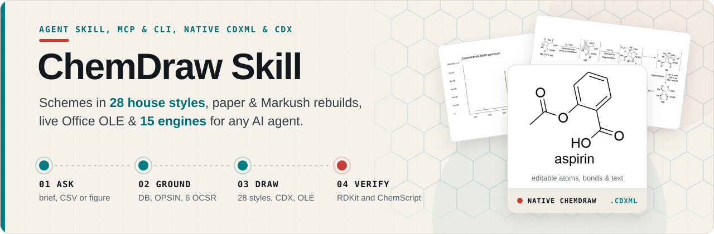
  </picture>
</p>

<p align="center">
  <a href="https://github.com/ZiChenWang114514/chemdraw-skill/actions/workflows/validate.yml"></a>
  <a href="https://zichenwang114514.github.io/chemdraw-skill/"></a>
  
  
  <a href="LICENSE"></a>
</p>

<p align="center">
  <a href="README.md">English</a> &nbsp;/&nbsp; <b>简体中文</b>
  &nbsp;&nbsp;
  <a href="#快速开始"><b>快速开始</b></a>、<a href="#支持的工作">支持的工作</a>、<a href="#作品展示">作品展示</a>、<a href="#期刊与课题组画法风格">28 种画法风格</a>、<a href="#反应计算器与化学报告">计算器</a>、<a href="#预测与分析引擎">引擎</a>、<a href="#平台支持">平台</a>、<a href="#常见问题">常见问题</a>、<a href="docs/guide.zh-cn.md">指南</a>、<a href="https://zichenwang114514.github.io/chemdraw-skill/"><b>官网</b></a>
</p>

**ChemDraw Skill** 让 AI 编程 Agent 直接产出原生可编辑的 ChemDraw 文档（`.cdxml` 与 `.cdx`）和 Word、PowerPoint 里可继续编辑的对象，不给无法修改的图片，也不凭记忆写 SMILES。它适用于 **Claude Code**、**Codex**、**Gemini CLI**、**GitHub Copilot**、**Cursor**、**OpenCode**，以及任何能运行命令行或支持 MCP 的 Agent。

你给它一句反应描述、一张 CSV 或 Excel 底物表、一张文献反应式截图，或一段专利马库什（Markush）权利要求。它按 **28 种实测的期刊与课题组画法风格**（*JACS*、*Angew. Chem.*、*Nature*、*Science*、*ACS Document 1996*、Baran、MacMillan、Studer 等）返回核对过的图。它还能运行 ChemDraw 自带的**化学计量表**，写 **ACS 格式的表征文字**，并调用 **15 个按需安装的本地引擎**做结构识别（OCSR）、逆合成和核磁预测。

> **前提：** 64 位 Python 3.10 至 3.13。桌面版 ChemDraw 可选：没有它仍可得到可编辑的 CDXML、结构核对和报告；原生 PNG 渲染、`.cdx` 文件和 Office 对象需要它。
>
> **为什么不让大模型直接写 SMILES，再用 RDKit 画图？** 凭记忆写出的 SMILES 常常是另一个化合物（少了抗衡离子、丢了手性中心），RDKit 画出的图片也无法在 ChemDraw 或 Word 里继续编辑。这里每个结构都来自名称解析、文件解析或你给的文件，画完后再读回核对，产物是原生 ChemDraw 文档。

## 快速开始

三步：安装，自检，发出第一个请求。

<!-- prerequisites -->
<details>
<summary><b>前提与可选参数</b>（64 位 Python 3.10 至 3.13，约 760 MB 磁盘，桌面版 ChemDraw 可选）</summary>
<br>

| 项目 | 说明 |
| --- | --- |
| **桌面版 ChemDraw**（可选） | Windows 或 macOS 上已激活的 ChemDraw 提供原生 300 dpi PNG 渲染、`.cdx` 转换、可交互的化学计量表和 Word/PowerPoint 对象。没有它，Skill 仍可在 Windows、macOS 和 Linux 上构建、编辑、识别和核对 `.cdxml` 文件，并运行批量计算（[没有 ChemDraw 时的差别](skill/chemdraw/references/operations.md#no-chemdraw-on-this-host)）。 |
| **运行时与磁盘** | 一个共享虚拟环境，约 760 MB，使用 64 位 Python 3.10 至 3.13。只写 `--extras` 安装最小核心；`--extras publication office` 安装指定的功能组。 |
| **可选参数** | `--opsin` 增加离线的 IUPAC 名称转结构（Windows 首次使用时自动获取 Java；macOS 和 Linux 需自行安装 Java）。`--mapping` 把 RXNMapper 和 LocalMapper 装进各自独立的环境。`image` 功能组的文字识别使用 Tesseract。 |
| **离线冒烟测试** | `cdx.py py $HOME/.claude/skills/chemdraw/scripts/smoke_all_tools.py --output-dir NEW_DIR` 在本机把每个工具调用一次（加 `--network` 连同联网接口一起测）。 |

</details>

**1. 安装。** 安装脚本可用 Python 3.9+ 运行，会自己找到 64 位 Python 3.10 至 3.13 来建运行时。

```bash
git clone https://github.com/ZiChenWang114514/chemdraw-skill.git
cd chemdraw-skill
python scripts/install.py --agent claude agents --runtime --apply
```

去掉 `--apply` 可先预览安装位置。如果机器上只有 Python 3.14+，请安装 3.12（例如 `uv python install 3.12`），或用 `--python <解释器>` 指定。

**2. 自检。** doctor 会报告桌面版 ChemDraw、Office、Python 功能组和已安装的引擎。

```bash
python $HOME/.claude/skills/chemdraw/scripts/cdx.py doctor
```

**3. 发出第一个请求。** 把下面任意一段贴给你的 Agent。

```text
用 ChemDraw Skill 画水杨酸 + Ac2O -> 阿司匹林（H2SO4 催化，室温，2 h，85%），用 acs_jacs 风格，输出可编辑的 CDXML 并渲染 300 dpi PNG。
```

```text
用 ChemDraw Skill 把 ./scheme.png 复刻成可编辑的 CDXML，保持原图朝向，逐个结构并排核对，并渲染原生预览图。
```

```text
用 ChemDraw Skill 对 "OCc1ccccc1.CC(=O)Cl>CCN(CC)CC.ClCCl>CC(=O)OCc1ccccc1" 运行 ChemDraw 的化学计量表，并把用量读回为 JSON。
```

手边没有 Agent？同一个入口也能在终端里直接用：

```bash
python $HOME/.claude/skills/chemdraw/scripts/cdx.py resolve aspirin Cs2CO3 --offline   # 不需要 ChemDraw
python $HOME/.claude/skills/chemdraw/scripts/cdx.py draw --name aspirin aspirin.cdxml --style acs_jacs --render
python $HOME/.claude/skills/chemdraw/scripts/cdx.py calc "OCc1ccccc1.CC(=O)Cl>>CC(=O)OCc1ccccc1"
```

<details>
<summary><b>其他 Agent、项目级安装、插件包与 MCP</b></summary>
<br>

| `--agent` | Skill 目录 | 由谁读取 |
| --- | --- | --- |
| `claude` | `~/.claude/skills/` | Claude Code（GitHub Copilot 和 OpenCode 也会读取） |
| `agents` | `~/.agents/skills/` | 通用的 Agent Skills 目录：Codex、Gemini CLI、GitHub Copilot、Cursor、OpenCode 等 |
| `gemini`、`copilot`、`cursor`、`opencode`、`kimi`、`pi` | 各 Agent 自己的目录 | 希望每个客户端各装一份时使用 |
| `codex`、`zcode`、`dsh`、`qoder`、`codebuddy`、`lingma`、`comate`、`bailian`、`qwen`、`trae`、`windsurf`、`cline`、`roo`、`goose`、`kiro`、`aider`、`amp`、`continue`、`zed`、`openhands`、`antigravity` | 各客户端自己的目录 | 更多客户端（加 `--mcp` 同时注册 `cdxml-toolkit` 服务） |

- **项目级或自定义位置。** `--project <repo>` 安装到项目内（`.claude/skills/`、`.agents/skills/`、`.github/skills/` 等）；`--destination <目录>` 安装到任意位置。
- **所有副本共用一个运行时。** `python scripts/install.py --runtime-only --apply` 原地升级，升级失败会自动回滚。
- **Claude Code 插件。** 每个发行版都附带 Skill 的插件包和 `SHA256SUMS`（由 `scripts/build_plugin.py` 生成）。插件只含 Skill，所以还要用 `--runtime-only --apply` 运行一次安装脚本来装运行时。
- **编辑器。** `python vscode/scripts/build_vsix.py --install-all` 为 VS Code、Cursor、Windsurf、Qoder、Trae、Kiro、Cline 和 Roo Code 安装配套扩展：`.cdxml` 与 `.mol` 的可视化编辑器、二维结构与子结构检索面板、三维 Mol* 查看器。
- **不会自动发现 `SKILL.md` 的 Agent** 需要在它的指令文件里加一行指向 `SKILL.md`。MCP 配置和完整命令参考见 [Agent 集成](skill/chemdraw/references/agent-integration.md)。

</details>

<details>
<summary><b><code>cdx.py</code> 命令速查</b></summary>
<br>

Agent 和人都只调用一个入口 `cdx.py`。任何 Python 都能启动它，它会自己切换到 toolkit 运行时里执行。

```bash
# 解析与绘制
python <skill>/scripts/cdx.py resolve aspirin                             # 名称/SMILES/CAS -> SMILES、分子式、分子量
python <skill>/scripts/cdx.py draw --name aspirin aspirin.cdxml --style acs_jacs --render
python <skill>/scripts/cdx.py draw --smiles "c1ccccc1,CC(=O)O" grid.cdxml --columns 2 --number --properties mw,formula --render
python <skill>/scripts/cdx.py draw --reaction "CC(=O)O.CCO>O=S(=O)(O)O>CCOC(C)=O" --yield "88%" rxn.cdxml --render

# 画法风格、结构检查与化学计量
python <skill>/scripts/cdx.py styles                                      # 列出 16 个预设 + 28 种画法风格
python <skill>/scripts/cdx.py inspect rxn.cdxml                           # 结构、分子式、分子量、拓扑
python <skill>/scripts/cdx.py report "OCc1ccccc1.CC(=O)Cl>>CC(=O)OCc1ccccc1" --balance
python <skill>/scripts/cdx.py calc "OCc1ccccc1.CC(=O)Cl>>CC(=O)OCc1ccccc1"

# 图像识别、Office 与诊断
python <skill>/scripts/cdx.py ocsr figure_crop.png                        # 结构识别（或用 decimer）
python <skill>/scripts/cdx.py render figure.cdxml                         # 原生 300 dpi PNG
python <skill>/scripts/cdx.py office-edit deck.pptx                       # 嵌入或更新可编辑的 ChemDraw 对象
python <skill>/scripts/cdx.py call resolve_name -a query=aspirin          # 调用任意已注册工具，参数写成 key=value
python <skill>/scripts/cdx.py studio                                      # 二维结构与检索工作台
python <skill>/scripts/cdx.py molstar aspirin                             # 三维 Mol* 构象与 PDB 查看器
python <skill>/scripts/cdx.py tools                                       # 列出已注册的工具
python <skill>/scripts/cdx.py doctor --text                               # 能力检查与运行日志（--log latest）
```

</details>

## 支持的工作

每个请求都走同样的四步：接收请求或数据；让每个结构都有来源（名称解析、文件解析或你给的文件）；生成原生 CDXML；再用 RDKit 和 ChemScript 把保存的文件读回核对。在这之上有五类工作：

| 工作 | 从哪里开始 | 你得到什么 |
| --- | --- | --- |
| **画一张新图** | [一句话请求](#one-command-figures)、[28 种画法风格](#期刊与课题组画法风格)、[ACS 1996 规格](#acs1996-drawings)、[CSV 或 Excel](#从数据生成可持续修改的论文图) | 读回核对过的 `.cdxml` 和原生 300 dpi `.png` |
| **复刻已有的图** | [文献反应式](#复刻论文反应图)、[专利 Markush 权利要求](#markush-demo) | 可编辑的 `.cdxml`、`.cxsmiles` 和并排对比图 |
| **做化学计算** | [化学计量、SI 表格、表征文字与原子映射](#反应计算器与化学报告) | ChemDraw 计量表的 JSON、ACS 文段、PMI 和原子映射 |
| **预测与识别** | [15 个按需安装的引擎](#预测与分析引擎) | 结构识别、逆合成、产物和核磁的候选结果，每条都标明是预测 |
| **放进 Office** | `cdx.py office-edit` | Word 和 PowerPoint 里可编辑的 ChemDraw 对象，附 PDF 预览 |

<details>
<summary><b>按领域列出的全部能力</b></summary>
<br>

| 领域 | 你得到什么 |
| --- | --- |
| **结构与反应** | 解析名称、CAS 号和 SMILES；绘制、编辑、清理、合并、拆分、转换和渲染 CDXML 或 CDX，不干扰已打开的 ChemDraw 窗口。 |
| **按请求画新图** | 单步反应、线性、汇聚和发散路线、催化循环、底物拓展面板和反应机理，一次完成绘制与核对。 |
| **期刊与课题组风格** | 28 种实测画法风格，量自 179 张开放许可插图、覆盖 23 类图，叠加在 16 个 ChemDraw 自带预设之上。 |
| **试卷、讲义与论文插图** | 用紧凑的 JSON 画 ACS Document 1996 格式的图：`GenericNickname` 缩写、中文注释、带框编号、轨道瓣、过渡态括号和三维模板（椅式、Newman、Haworth、Fischer）。 |
| **数据驱动的图** | 底物拓展图和 SAR 面板按化合物编号与 CSV 或 XLSX 绑定，之后更新数据不会丢掉在 ChemDraw 里的手工修改。 |
| **反应机理** | 按你列出的电子转移画全头和半头弯箭头，坐标、电荷和抗衡离子都准确。 |
| **专利 Markush 通式** | 从专利附图和权利要求得到通式（R 基、可变环、多中心键、重复数），导出 CDXML、CXSMILES 和 V3000 MOL。 |
| **图像识别** | 通过 DECIMER 接口或本地权重得到候选结构，带置信度和位置框。 |
| **引擎与预测** | 15 个按需安装、各自隔离的引擎：6 个结构识别引擎、PDF 结构切分、逆合成、正向产物、反应条件和 1H/13C 化学位移。 |
| **计算与报告** | ChemDraw 化学计量表及 JSON 读回、带 PMI 的批量 SI 物料表、HRMS 与 ACS 表征文字、138 条 GHS 安全提示、路线总收率和原子映射。 |
| **TLC 与装置图** | 原生 TLC 板（点样道、斑点、Rf、共点样、显色、二维板），以及用 ChemDraw 模板搭的实验装置。 |
| **谱图与曲线** | 处理后的一维核磁（Bruker、JCAMP-DX、JEOL、Varian/Agilent），含寻峰、积分、溶剂峰标记、局部放大和堆叠图；数值数据画成曲线。 |
| **实验记录** | LCMS 孔板和色谱报告（Waters、OpenLynx、Shimadzu、Agilent、mzML/mzXML），含 Cl/Br 的 `M+2` 核对、内标比值和 24、96 孔热图；SciFinder RDF。 |
| **分子比较** | 各平台都可用 RDKit 指纹相似度；精确的立体化学一致性由 ChemScript（Windows）或 ChemDraw（macOS）判断。 |
| **Office 文档** | Windows 和 macOS 桌面版 Word、PowerPoint 里可编辑的 ChemDraw 对象。 |
| **ChemScript 与 ChemDraw 接口** | Windows ChemScript SDK 的桥接，以及一份审计过的 ChemDraw 22.2 COM 对象、CDXML 元素和菜单命令目录（[详情](docs/guide.zh-cn.md#chemdraw-接口覆盖)）。 |
| **远程工作站** | 可选的带认证的 Streamable HTTP 服务，用于 Windows ChemDraw 主机，带健康检查和 Prometheus 接口。 |

`cdx.py tools` 列出已注册的工具；自动生成的[公开清单](skill/chemdraw/references/toolkit-public-inventory.md)列出内置 toolkit 中审计过的符号。

</details>

## 作品展示

每张卡片都是本仓库里某个可编辑 `.cdxml` 文件的 ChemDraw 原生渲染。点击卡片可查看它的流程、源数据和核对记录。

<table>
  <tr>
    <td colspan="3" align="center">
      <a href="#期刊与课题组画法风格">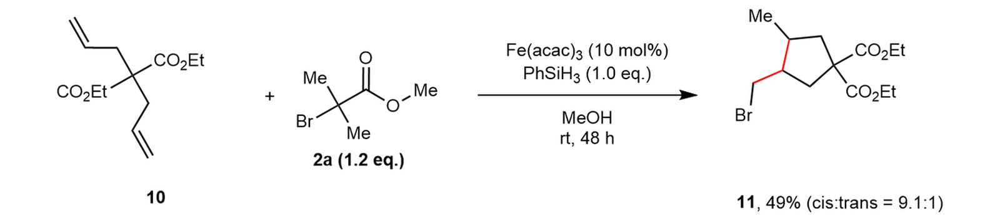</a>
      <br><b>28 种实测期刊与课题组画法风格 + 16 个 ChemDraw 预设</b><br><sub>量自 179 张开放许可插图，覆盖 23 类图；47 个文献复刻案例记录了每种风格复现了什么、哪里不同</sub>
    </td>
  </tr>
  <tr>
    <td colspan="3" align="center">
      <a href="#paper-scheme-demo">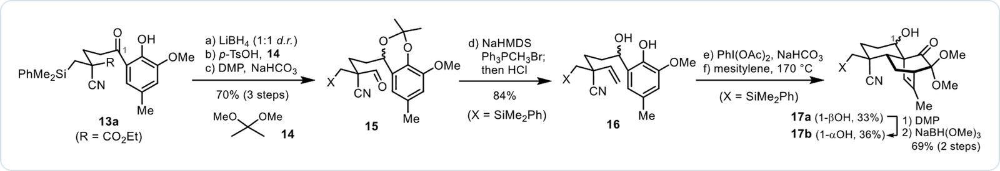</a>
      <br><sub>论文原图</sub><br><br>
      <a href="#paper-scheme-demo">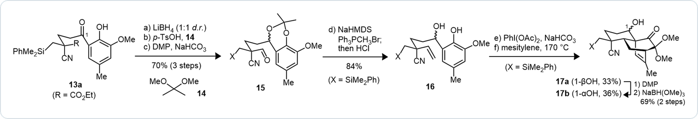</a>
      <br><b>论文反应路线 → 可编辑的 ChemDraw</b><br><sub>从图片重建五个结构、反应条件、收率和化合物编号</sub>
    </td>
  </tr>
  <tr>
    <td colspan="3" align="center">
      <a href="#markush-demo">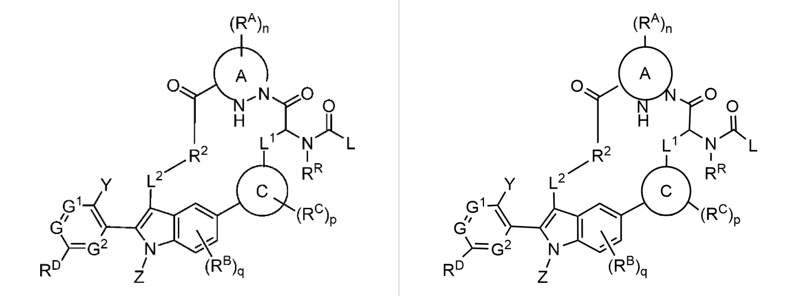</a>
      <br><b>专利 Markush 通式 → 可编辑的 ChemDraw</b><br><sub>专利附图（左）与原生重建（右）：R 基、可变环、一根多中心键和重复数</sub>
    </td>
  </tr>
  <tr>
    <td width="33%" align="center" valign="top">
      <a href="#complex-synthesis-demo">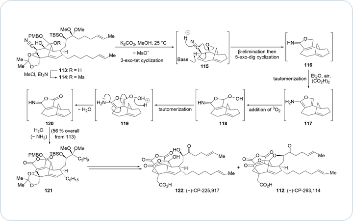</a>
      <br><b>复杂合成</b><br><sub>带机理箭头的完整多步路线</sub>
    </td>
    <td width="33%" align="center" valign="top">
      <a href="#mechanism-demo">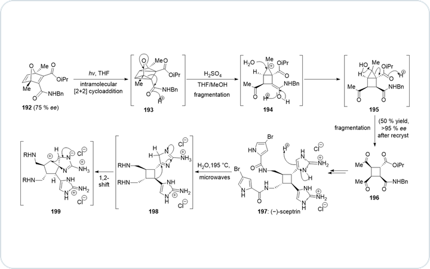</a>
      <br><b>反应机理</b><br><sub>电子箭头、电荷和抗衡离子</sub>
    </td>
    <td width="33%" align="center" valign="top">
      <a href="#stereo-reconstruction-demo">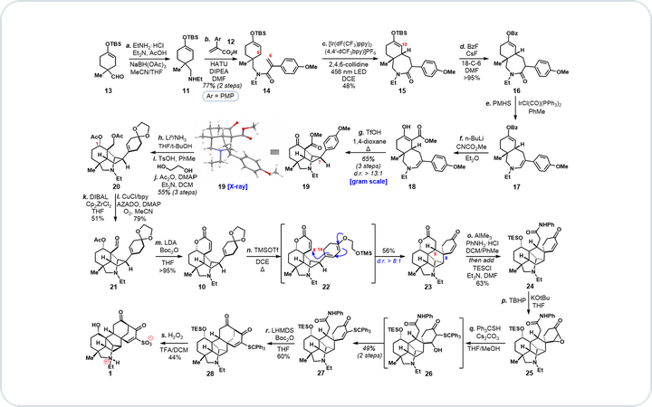</a>
      <br><b>二十个结构的合成路线</b><br><sub>两种化学软件读出的立体信息一致：20/20</sub>
    </td>
  </tr>
  <tr>
    <td width="33%" align="center" valign="top">
      <a href="#acs1996-drawings">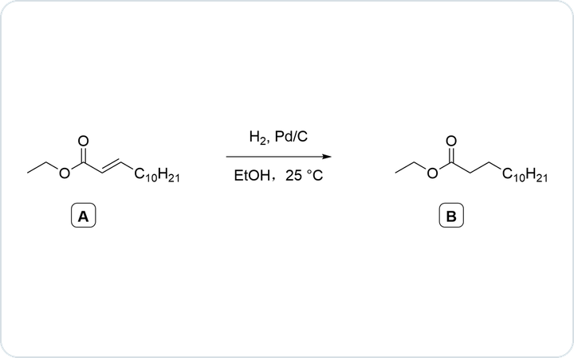</a>
      <br><b>试卷与讲义插图</b><br><sub>用紧凑的 JSON 规格画 ACS Document 1996 格式</sub>
    </td>
    <td width="33%" align="center" valign="top">
      <a href="#scientific-drawings-demo">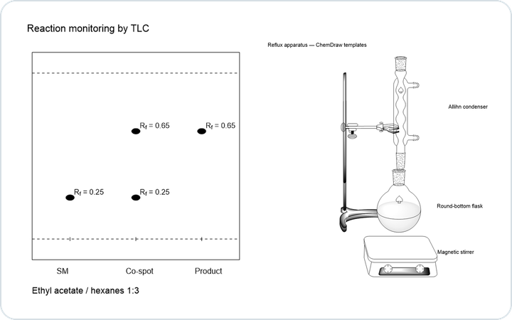</a>
      <br><b>TLC 与装置图</b><br><sub>原生薄层板、Rf 值和 ChemDraw 模板</sub>
    </td>
    <td width="33%" align="center" valign="top">
      <a href="#scientific-drawings-demo">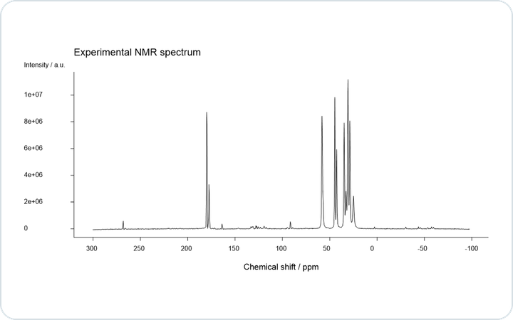</a>
      <br><b>谱图与曲线</b><br><sub>处理后的一维核磁和数值数据曲线</sub>
    </td>
  </tr>
  <tr>
    <td colspan="3" align="center">
      <a href="#预测与分析引擎">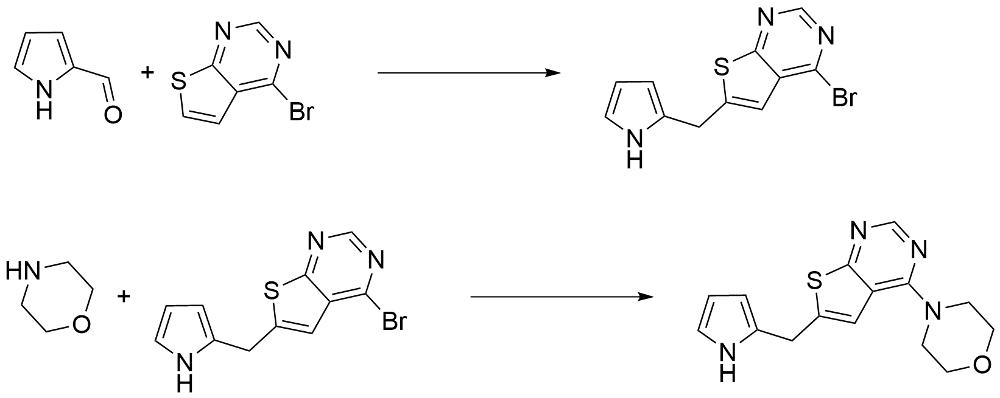</a>
      <br><b>按需安装的引擎给出的预测</b><br><sub>逆合成、产物和核磁位移，与实验记录的路线和实测谱图对照，没预测对的也保留</sub>
    </td>
  </tr>
</table>

## 绘制与排版新图

结构已知、图还不存在时，一个请求就能画出来、套好风格并核对。

<a id="one-command-figures"></a>

### 一句话生成新图

用一句话提出要求，例如“画水杨酸和乙酸酐生成阿司匹林，H2SO4（催化量），室温，2 h，85%”。Agent 写一份简短的 JSON 说明，一条命令完成绘制、渲染和核对：

```json
{
  "species": [
    {"id": "SA", "smiles": "OC(=O)c1ccccc1O", "label": "1"},
    {"id": "Ac2O", "name": "Ac2O"},
    {"id": "ASP", "smiles": "CC(=O)Oc1ccccc1C(=O)O", "label": "2"}
  ],
  "steps": [
    {"substrates": ["SA", "Ac2O"], "products": ["ASP"],
     "above": ["H2SO4 (cat.)"], "below": ["rt, 2 h"], "yield": "85%"}
  ]
}
```

```bash
python skill/chemdraw/scripts/cdx.py draw brief.json aspirin.cdxml --render
```

<p align="center">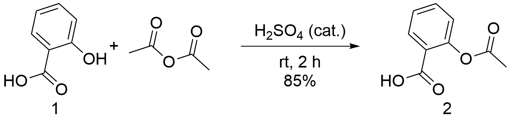</p>

单步反应可以不写文件：`cdx.py draw --reaction "A.B>reagent>C" out.cdxml`（多步或窄栏排版加 `--compact`）。同一条命令能画四类图：

| 图 | 说明里列什么 | 你得到什么 |
| --- | --- | --- |
| **反应或路线** | 物种、步骤、条件、收率 | 单步反应、线性、汇聚和发散路线或催化循环，支持自动换行、可逆和共振箭头、配位键和自由基 |
| **底物拓展** | 带编号、分组和实测数值的化合物 | 多页网格，每个编号和数值都在对应结构下方；没给的数值显示为短横线，绝不写成 `0` |
| **反应机理** | 物种、步骤和电子转移 | 全头或半头弯箭头，按实际坐标放置，并绕开原子和标签 |
| **分子或结构面板** | 一个或多个结构 | 单个分子或多列网格，可带编号、分子式和分子量说明、环内填色和取代基高亮 |

<table>
  <tr>
    <td width="50%" align="center" valign="top">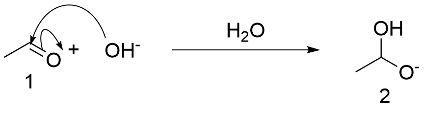<br><sub>反应机理：氢氧根加成的两根弯箭头</sub></td>
    <td width="50%" align="center" valign="top">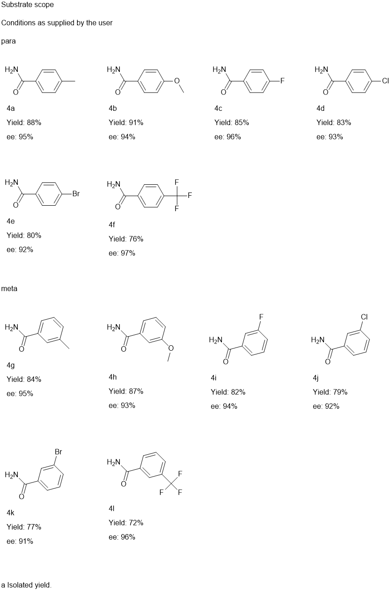<br><sub>底物拓展：一页十二个化合物</sub></td>
  </tr>
</table>

每份说明都要过同一组检查：

- **结构有来源。** 你给的 SMILES 原样使用；名称先查内置试剂表，再查 PubChem（`CHEMDRAW_OFFLINE=1` 时不查）。解析不出的名称会让运行停下。
- **不编造内容。** 你没给的条件保持空白，并在报告里注明。没有电子转移的机理步骤会被拒绝。
- **原子与电荷守恒。** 每一步都检查，缺少的副产物会在报告里点名，绝不悄悄画上去；保存后的结构还会读回，与说明对照。
- **版面经过测量。** 出现重叠、文字过小或超出页宽时，自动用更宽松的布局重排一次，并记入报告。
- **文件安全。** 从不覆盖已有文件。没有桌面版 ChemDraw 时，结果会标为未渲染的草稿；发表前请先看原生 PNG。

说明的完整格式和报告字段见[绘制新的反应路线](skill/chemdraw/references/scheme-drawing.md)。

<a id="期刊与课题组画法风格"></a>

### 期刊与课题组画法风格

一个 `style` 参数在两层里选：

- **16 个测量预设**，读自 ChemDraw 自带的样式表（默认 `acs1996`，另有 `wiley`、`rsc`、`nature`、`synthesis` 等 11 个）。它们只规定键长、线宽和字体。
- **28 张实测画法风格卡片**，涵盖 13 种期刊，7 种出版社、专利和教材，8 个课题组，量自 81 篇开放许可论文和教材中的 179 张图。一项惯例至少在两张图里一致才会记录。

每张卡片覆盖 23 类图。版式、编号、缩写、箭头和线条的几何尺寸以及颜色会自动套用；工具暂时画不了的惯例会作为收尾建议返回。

```bash
python skill/chemdraw/scripts/cdx.py styles                 # 预设与画法风格
python skill/chemdraw/scripts/cdx.py styles studer_group    # 查看一张卡片及其依据
python skill/chemdraw/scripts/cdx.py draw brief.json out.cdxml --style studer_group --render
```

<table>
  <tr>
    <td width="50%" align="center" valign="top">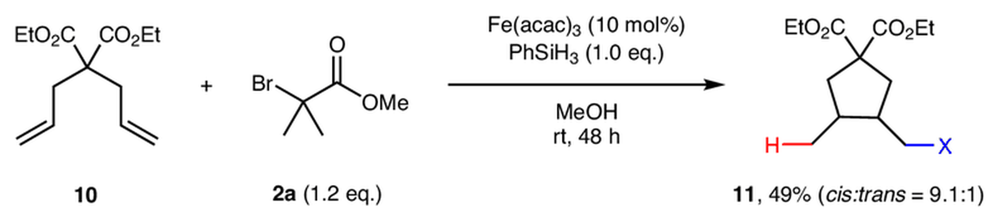<br><sub>已发表的反应式（Studer 课题组，<i>Nat. Commun.</i> 2024，CC BY 4.0）</sub></td>
    <td width="50%" align="center" valign="top"><br><sub>用 <code>"style": "studer_group"</code> 绘制，由 ChemDraw 渲染</sub></td>
  </tr>
</table>

同一个 Suzuki 偶联、同一份说明，六种画法风格：

<p align="center">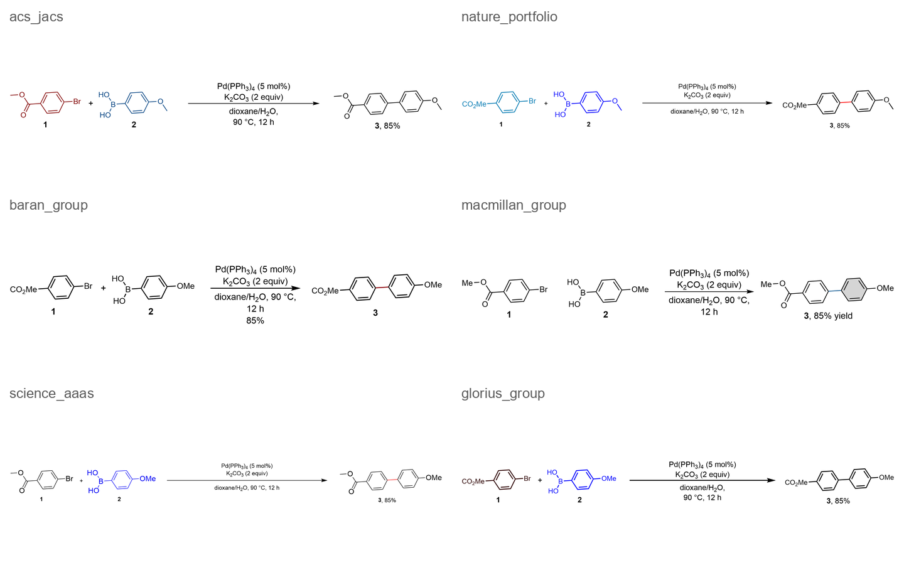</p>

<details>
<summary><b>28 种风格一览</b></summary>
<br>

**出版社、专利与教材**

| 风格 | 基础预设 | 画法特点 |
| --- | --- | --- |
| `nature_portfolio` | `nature` | Nature、Nat. Chem.：粗体编号与收率同行（`3a, 85%`），新键红色，底物用青色和蓝色 |
| `science_aaas` | `nature` | Science、Sci. Adv.：收率写在编号行，新键红色，引入的组分蓝色 |
| `wiley_angew` | `wiley` | Angew. Chem.、Chem. Eur. J.：粗体编号，试剂在箭头上、溶剂在箭头下，底物并排 |
| `rsc_journals` | `rsc` | Chem. Sci.、Chem. Commun.：粗体编号，收率写在编号后的括号里 |
| `cell_press_chem` | `wiley` | Chem、Chem Catalysis：粗体编号，收率在箭头下，分图用字母标注 |
| `openstax_chemistry` | `chemdraw_slide` | 教材插图：物种不编号，短的空心箭头，发生变化的原子用暗红色 |
| `uspto_patents` | `j_mol_mod` | 美国专利：黑色线条图，Times 字体标签，普通化合物编号，Markush 通式 |

**期刊**

| 风格 | 基础预设 | 画法特点 |
| --- | --- | --- |
| `acs_jacs` | `acs1996` | JACS、Org. Lett.、J. Org. Chem.：粗体编号，收率跟在编号后，底物用栗色和藏青色 |
| `org_lett` | `acs1996` | Org. Lett.：收率在产物编号下方，底物拓展网格，条件优化表 |
| `jmed_chem` | `acs1996` | J. Med. Chem.：每个箭头上方一个步骤字母，短箭头，SAR 表 |
| `acs_chem_biol` | `acs1996` | ACS Chem. Biol.：多分图，PROTAC 连接链用粉色，结构面板 |
| `jacs_au` | `acs1996` | JACS Au：概念图，光物理示意图，流动装置 |
| `oprd_process` | `acs1996` | Org. Process Res. Dev.：当量和体积，收率在箭头下，注明规模 |
| `jchem_educ` | `acs1996` | J. Chem. Educ.：教学用机理，归属面板，朴素的细箭头 |
| `mdpi_molecules` | `acs1996` | Molecules：新键粗体红色，引入的基团蓝色 |
| `beilstein_joc` | `nature` | Beilstein J. Org. Chem.：通式在上、产物网格在下，`2a: 69%` |
| `chemeurj` | `wiley` | Chem. Eur. J.：ChemDraw 调色板颜色，产物后衬灰色方框 |
| `dalton_transactions` | `rsc` | Dalton Trans.：金属前体写成化学式，杂原子按元素着色 |
| `natural_product_reports` | `rsc` | Nat. Prod. Rep.：箭头下方粗体收率，目标分子名称放在圆角框里 |
| `polymer_chemistry` | `rsc` | Polymer Chem.：重复单元加括号和下标 n，催化剂在箭头上方 |

**课题组**

| 风格 | 基础预设 | 画法特点 |
| --- | --- | --- |
| `baran_group` | `acs1996` | Baran（Scripps）：新键暗红色，大量使用缩写基团 |
| `macmillan_group` | `acs1996` | MacMillan（Princeton）：新键深蓝色，灰色高亮，`6, 76% yield`，不写加号 |
| `lipshutz_group` | `acs1996` | Lipshutz（UCSB）：收率在编号下方，表面活性剂和水写在箭头下 |
| `glorius_group` | `acs1996` | Glorius（Münster）：试剂片段分色，光催化概念图 |
| `houk_group` | `acs1996` | Houk（UCLA）：自由能曲线，过渡态面板，路径图 |
| `list_group` | `nature` | List（MPI Mülheim）：收率与 e.r. 叠放在产物下方，IDPi 催化剂 |
| `sarpong_group` | `nature` | Sarpong（Berkeley）：笼状多环用加粗的前方键，骨架编辑 |
| `studer_group` | `nature` | Studer（Münster）：转移的 H 和新键红色，比值跟在收率后 |

</details>

- **47 个文献复刻案例。** 47 张已发表的图按说明重画，并连同参考图、说明和原生渲染一起存档。每个 `CASE.md` 列出复现了什么，以及与原文的每一处差异；没有一个案例是完全一致的（[风格图库与复刻索引](showcase/house-styles/gallery/README.md#literature-replicas)）。
- **依据都留着。** 每个风格目录保存它的 CC BY 依据图和来源 DOI，每份绘图报告都写明套用或跳过了哪些惯例及原因。这些风格是实测得到的惯例，不是出版社的官方模板，也不复制原图。
- **单张图的临时样式。** 说明里可以设置 `title`、`panel_label`、各物种的颜色、缩写、朝向、说明文字和方框，不必改动卡片。MCP 客户端通过 `chemdraw://style-guide/{name}` 读取卡片。
- **ChemDraw 的已知限制。** 左侧连接的缩写位置是对的，但 ChemDraw 会把其中一些按从左到右书写（`CO2Me` 而不是 `MeO2C`），执行 **Clean Up Structure** 后才会改过来。

<a id="从数据生成可持续修改的论文图"></a>

### 从 CSV / Excel 生成 SAR 图和底物拓展图

用 CSV 或 XLSX 表格（XLSX 需要 `publication` 功能组）加上可信的结构，生成底物拓展图和 SAR 面板。化合物编号把每个数值绑定到对应的 ChemDraw 对象，之后更新数据或替换结构时，你手工调整的版面和标注都会保留；匹配有歧义时生成冲突草稿，不会猜（[流程与示例](skill/chemdraw/references/data-driven-figures.md)）。

<a id="acs1996-drawings"></a>

### 试卷与讲义插图：ACS Document 1996 格式

把图写成一份紧凑的 JSON 规格（带 `C10H21` 这类缩写节点的 SMILES、条件、箭头、粗体化合物编号和中文注释），得到可编辑的 ACS 1996 格式 CDXML 和原生 PNG：

```bash
python skill/chemdraw/scripts/cdx.py build skill/chemdraw/assets/acs1996/example.json example.cdxml --render
```

<p align="center">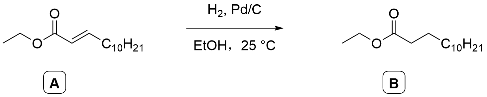</p>

缩写仍是真正的 `GenericNickname` 节点，下标和连接方向都正确；中文用中文字体，拉丁字母、数字和符号保持 Arial（[ACS 1996 绘图指南](skill/chemdraw/references/acs1996-drawings.md)）。

## 复刻论文反应图

从整张图出发，按八步进行，每一步都留下可以检查的东西：

<p align="center">
  <code>通读全图</code> → <code>裁剪结构</code> → <code>DECIMER</code> → <code>对齐朝向</code> → <code>并排核对</code> → <code>修正化学</code> → <code>组装版面</code> → <code>原生预览</code>
</p>

```text
用 ChemDraw Skill 复刻这张论文图。先通读整张反应路线，裁出每个完整结构，
取得 DECIMER 候选。保持原图朝向，查看真实的并排预览，只修正有问题的结构。
抄录反应条件，最后交付可编辑的 CDXML 和原生预览图。
```

<table>
  <tr>
    <td width="50%" align="center" valign="top">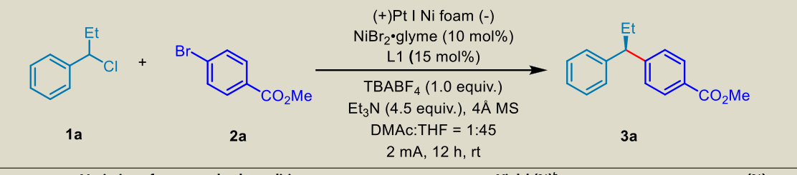<br><sub>已发表的反应式（CC BY 4.0）</sub></td>
    <td width="50%" align="center" valign="top">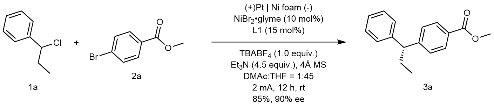<br><sub>由 <code>brief.json</code> 绘制，<code>"style": "nature_portfolio"</code></sub></td>
  </tr>
</table>

三张开放许可的反应式已完整重建，各带参考图、说明和原生渲染：

| 案例 | 画法风格 | 文件 |
| --- | --- | --- |
| 水相 Pd 催化胺化，*JACS Au* 2024 | `lipshutz_group` | [CASE.md](skill/chemdraw/assets/paper-replica/jacs-au-pd-amination/CASE.md) |
| 用于酰胺偶联的 DPDTC 合成，*Chem. Sci.* 2023 | `rsc_journals` | [CASE.md](skill/chemdraw/assets/paper-replica/chem-sci-amide-coupling/CASE.md) |
| Ni 催化电还原芳基化，*Nat. Commun.* 2025 | `nature_portfolio` | [CASE.md](skill/chemdraw/assets/paper-replica/nat-commun-ni-ereductive/CASE.md) |

- **指南。** [图像重建指南](skill/chemdraw/references/image-visual-review.md)、[任务模板](skill/chemdraw/assets/paper-replica/task-template.json)、[完整示例](skill/chemdraw/assets/paper-replica/example/CASE.md)，另有 47 张重画的图见[风格图库](showcase/house-styles/gallery/README.md#literature-replicas)。
- **辅助工具。** 裁剪、遮罩和对比工具会保留区域与结果的对应关系；折叠链和桥环可按原图坐标描画；立体化学按原子序号明确修改并读回；最终的图按固定坐标组装。
- **哪些内容会离开本机。** 识别时只把你选中的裁剪图上传到 DECIMER 接口。`cdx.py decimer --preflight` 会先列出这些文件，离线模式下什么都不发送。
- **离线重建。** `python skill/chemdraw/scripts/cdx.py py skill/chemdraw/assets/paper-reconstructions/rebuild.py ./paper-figures-output` 可重建下文的两张复杂路线图，不必重新识别（[重建示例](skill/chemdraw/assets/paper-reconstructions/README.md)）。

## 反应计算器与化学报告

这些工具从你提供的结构（SMILES、MOL/SDF 或 CDXML）出发。精确的化学计量在桌面版 ChemDraw 里算；其余的用 RDKit，在任何系统上都能运行。所有工具都不覆盖已有文件。

| 你想要 | 工具 | 你得到 |
| --- | --- | --- |
| 每种试剂和溶剂该称多少 | `cdx.py calc`、`stoichiometry_grid` | 反应式下方的 ChemDraw 化学计量表，以及表中数字的 JSON |
| 多个反应的 SI 物料表 | `si_materials_tables` | Markdown、CSV、可打印 HTML 或 JSON，最多 100 个反应 |
| HRMS 与表征文字 | `cdx.py report --hrms`、`hrms_line`、`characterization_text` | `HRMS (ESI) m/z calcd for ...` 和按 ACS 顺序排列的文段 |
| 路线的总收率和 PMI | `route_summary` | 线性或汇聚路线的一张汇总表 |
| 哪个原子变成了哪个 | `cdx.py report --map`、`map_reaction_atoms` | 原子映射、键的变化、反应中心 SMARTS、反应类型 |
| 分子式、质量、加合离子、logP | `cdx.py report`、`molecule_report` | 一张性质表 |
| 反应是否配平 | `cdx.py report --balance`、`check_reaction_balance` | 缺少的副产物和建议的系数 |
| 文件里的每个结构 | `cdx.py inspect`、`export_structures` | 结构、分子式、分子量、路线拓扑、SMILES、InChI、CSV 或 SDF |

```bash
python <skill>/scripts/cdx.py calc "OCc1ccccc1.CC(=O)Cl>CCN(CC)CC.ClCCl>CC(=O)OCc1ccccc1"
```

<p align="center">
  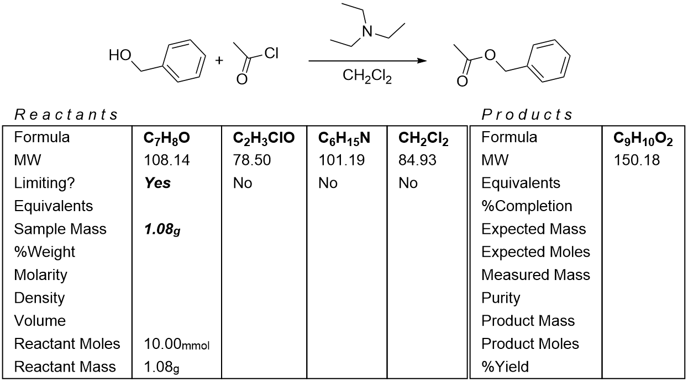
</p>

- **ChemDraw 自己的计量表。** `cdx.py calc` 对反应 SMILES 或 `.cdxml` 执行 **Structure &gt; Analyze Stoichiometry**，并写出新文件；你已打开的文档不受影响（菜单命令需要窗口，所以 ChemDraw 窗口会短暂出现）。修改任一质量、体积或当量，ChemDraw 会重算其余各项。
- **数字是读回来的，不是另算的。** `cdx.py calc --read reaction-stoichiometry.cdxml` 把每一行读成 JSON，装没装 ChemDraw 都能用，所以 Agent 引用的是 ChemDraw 的数字。
- **没有 ChemDraw 时。** `si_materials_tables` 可计算最多 100 个反应，给出摩尔浓度、原子经济性和过程质量强度（PMI；E 因子 = PMI − 1）。
- **138 种试剂的安全提示。** `reagent_safety` 附上 GHS 象形图、H 说明、沸点和闪点，以及结构警示（叠氮、过氧化物、有机锂、酰氯、氢化物）。表里没有的化学品显示 `"not listed"`，绝不显示 `"safe"`；以供应商的 SDS 为准。
- **表征文字。** `characterization_text` 用你给的数字为每个化合物写一段按 ACS 顺序排列的文字；1H 总积分或 13C 信号数与结构对不上时给出警告。它从不改动你的峰。
- **原子映射。** `map_reaction_atoms` 内置子结构映射，原子来源有歧义时会标出来，不会猜。`cdx.py install-mappers` 可加装 RXNMapper 和 LocalMapper，`compare: true` 会运行所有已装的映射器。由映射可得到反应中心 SMARTS、19 种反应类型之一，或把映射编号写到路线图的副本上。
- **路线汇总。** `route_summary` 从最终需求量反推线性或汇聚路线，报告最长线性序列收率和累计 PMI。缺少输入时返回 `null` 并给出警告。

输入与规则见[化学报告指南](skill/chemdraw/references/chemistry-reports.md)。

## 主打案例

真实的论文图和实验数据。每个案例都有原生预览、与参考图的对比和可编辑的下载文件。

<a id="stereo-reconstruction-demo"></a>

### 20 个结构：修复跨软件立体信息不一致

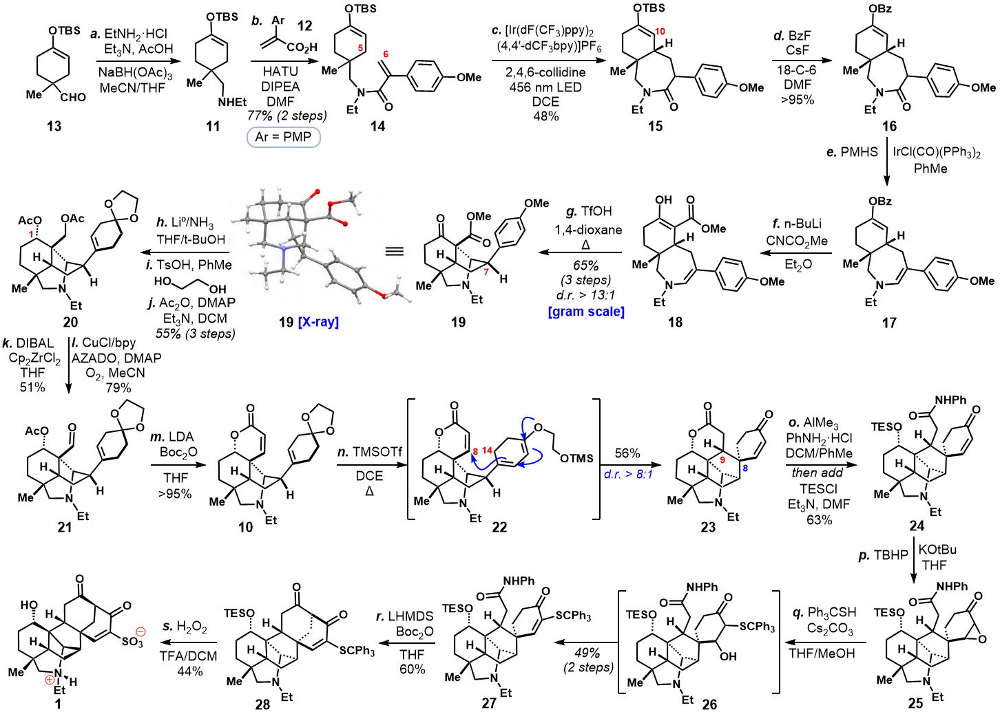

照原图逐笔画出时，20 个结构里有 16 个被 ChemScript 和 RDKit 读成不同的立体化学。保存的修订版让两者在全部 20 个结构上一致，同时保持核对过的分子不变。之后只改三处文字时，原生调用从 8 次降到 2 次，因为核对过的结构有缓存。X 射线图片裁自原论文，不在本仓库许可范围内。

[可编辑 CDXML](toolkit/assets/readme/stereo-reconstruction/reconstruction.cdxml) · [失败分析、流程与版权](toolkit/assets/readme/stereo-reconstruction/CASE.md) · [逐化合物的依据](toolkit/assets/readme/stereo-reconstruction/verification.json) · [增量修改的耗时](toolkit/assets/readme/stereo-reconstruction/incremental-verification.json)

<a id="paper-scheme-demo"></a>

### 论文反应路线

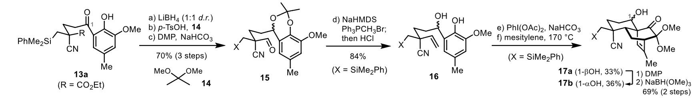

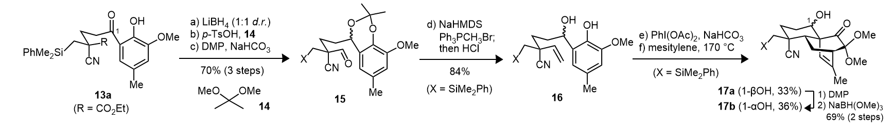

上图是已发表的反应路线，下图是由 ChemDraw 保存的重建结果。从保存的 CDXML 读回的五个结构与参考结构一致，17a/17b 共用的波浪键按原图保留。

[可编辑 CDXML](assets/readme/paper-replica/replica.cdxml) · [逐结构对比](assets/readme/paper-replica/structure-comparison.png) · [来源与核对](assets/readme/paper-replica/provenance.json)

<a id="mechanism-demo"></a>

### Sceptrin 反应机理

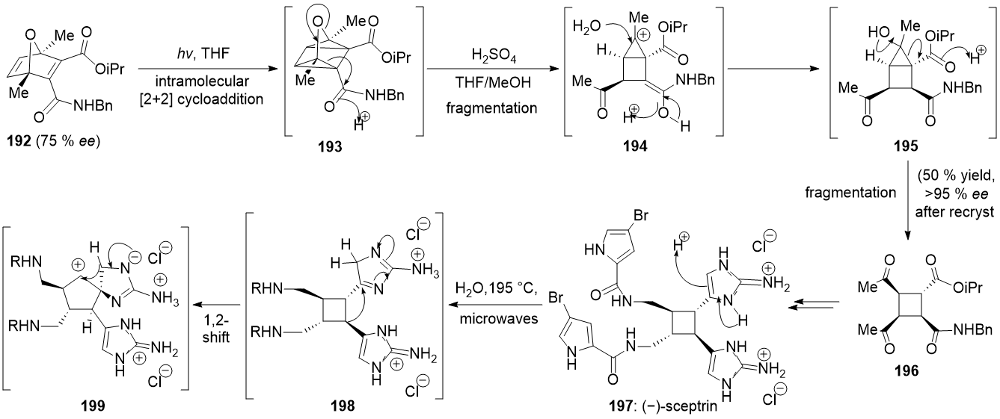

八个带编号的结构和六个氯离子，经过 ChemDraw 真实的 CDXML → CDX → CDXML 保存循环后，原子、立体化学和形式电荷都保持不变。R 基与原图一样保留为通用取代基。

[可编辑 CDXML](assets/readme/mechanism/mechanism.cdxml) · [原生 CDX](assets/readme/mechanism/mechanism.cdx) · [论文原图节选](assets/readme/mechanism/reference.png) · [并排对比](assets/readme/mechanism/comparison.png) · [核对详情](assets/readme/mechanism/provenance.json)

<a id="markush-demo"></a>

### 专利 Markush 通式


`cdx.py markush` 从专利附图和权利要求文字重建通式：R 基与连接基、可变环、位置可变的多中心键和重复数。Agent 负责抄录标签、检查读回的图像并对应权利要求条款；几何、CDXML 以及 CXSMILES 和 V3000 的导出由确定性的代码完成。本例的输出与手写的参考结构逐原子一致。

[可编辑 CDXML](assets/readme/markush/markush.cdxml) · [Markush 规格](assets/readme/markush/markush.json) · [CXSMILES](assets/readme/markush/markush.cxsmiles) · [V3000 molfile](assets/readme/markush/markush.mol) · [核对与局限](assets/readme/markush/provenance.json) · [流程](skill/chemdraw/references/markush.md)

<a id="scientific-drawings-demo"></a>

### 原生科研绘图

<table>
  <tr>
    <td width="50%" align="center" valign="top">
      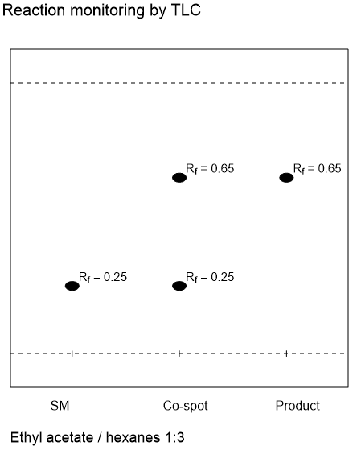<br>
      <b>TLC 板</b><br><sub>可编辑的薄层板、点样道和斑点对象，带 Rf 值 · <a href="assets/readme/scientific/tlc.cdxml">CDXML</a></sub>
    </td>
    <td width="50%" align="center" valign="top">
      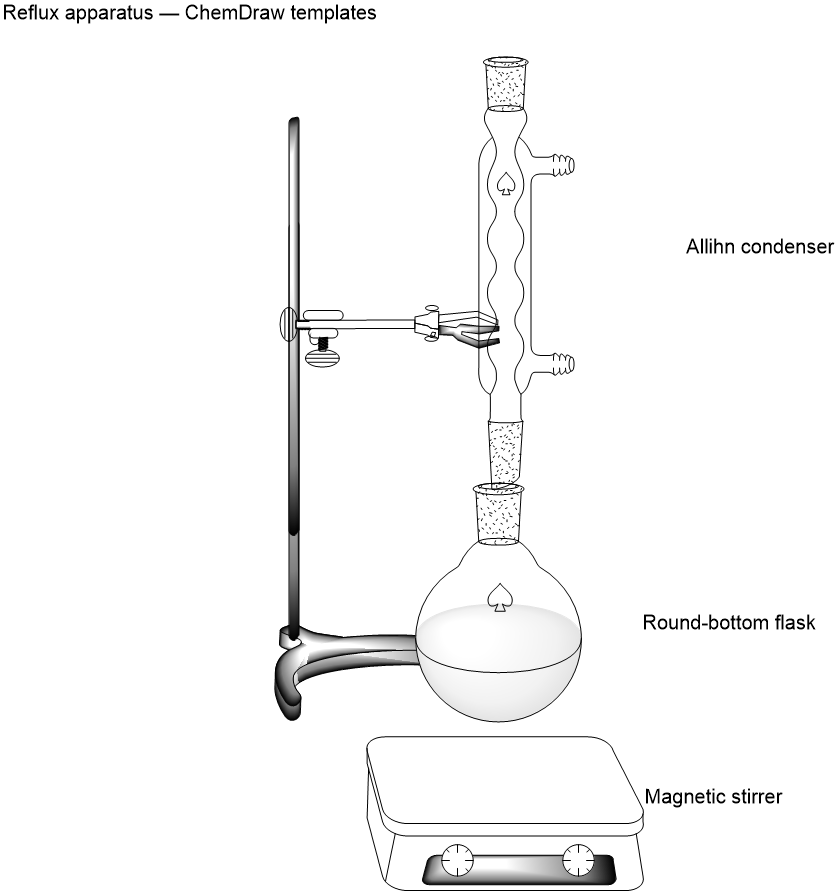<br>
      <b>实验装置</b><br><sub>用 ChemDraw 自带模板组装 · <a href="assets/readme/scientific/apparatus.cdxml">CDXML</a></sub>
    </td>
  </tr>
  <tr>
    <td width="50%" align="center" valign="top">
      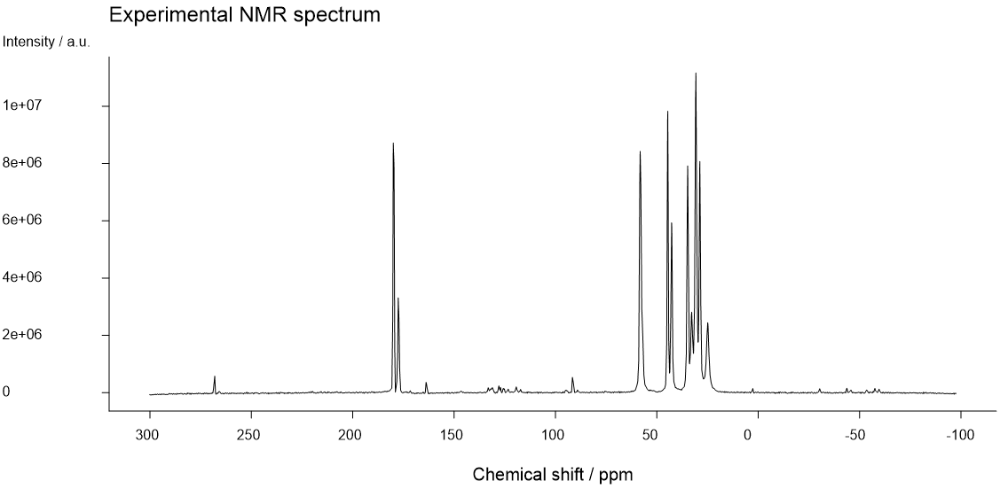<br>
      <b>实测核磁</b><br><sub>真实的一维处理数据，含寻峰和积分 · <a href="assets/readme/scientific/nmr.cdxml">CDXML</a></sub>
    </td>
    <td width="50%" align="center" valign="top">
      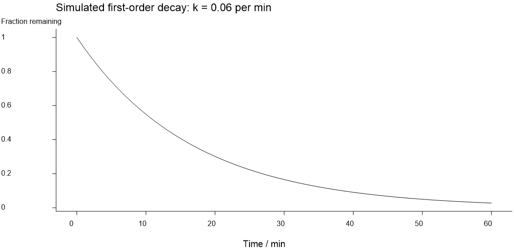<br>
      <b>反应动力学</b><br><sub>模拟的一级衰减，画成可编辑的曲线 · <a href="assets/readme/scientific/kinetics.cdxml">CDXML</a></sub>
    </td>
  </tr>
</table>

[运行这些示例](skill/chemdraw/references/scientific-workflows.md) · [数据与模板来源](assets/readme/scientific/provenance.json)

<a id="complex-synthesis-demo"></a>

### 复杂合成：101–112 与 113–122

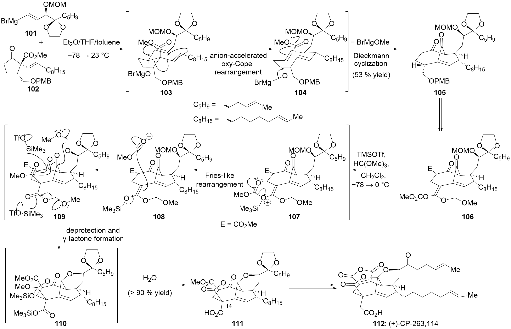

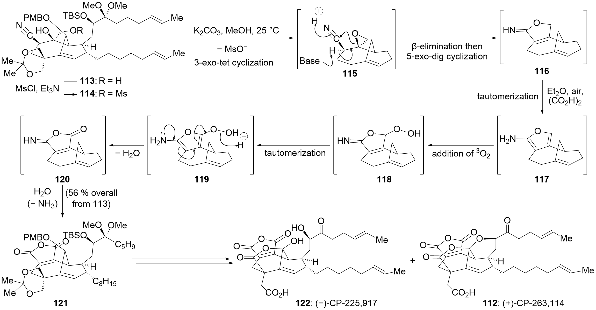

两张完整的路线图，结构都可编辑。每个化合物编号、反应条件和机理箭头都在，原生保存后连接关系、电荷、同位素和烯烃构型保持不变。[原子级对比](skill/chemdraw/assets/paper-reconstructions/stereochemistry-check.json)记录了各组分的哈希和原子映射。

101–112：[可编辑 CDXML](assets/readme/synthesis-101-112/figure.cdxml) · [与原图对比](assets/readme/synthesis-101-112/comparison-full.png) · [核对详情](assets/readme/synthesis-101-112/provenance.json)<br>
113–122：[可编辑 CDXML](assets/readme/synthesis-113-122/figure.cdxml) · [与原图对比](assets/readme/synthesis-113-122/comparison-full.png) · [核对详情](assets/readme/synthesis-113-122/provenance.json)

## 预测与分析引擎

十五个按需安装的引擎，用来识别结构图像、从 PDF 里切出结构，以及预测逆合成路线、产物、反应条件和 1H/13C 化学位移。

- **你同意之前什么都不下载。** 每个引擎装在自己的环境里。`cdx.py engines --recommend NEED` 显示一项任务需要什么，`CHEMDRAW_ENGINE_HOME` 可把存储位置换到别的磁盘。
- **本地运行，结果有标注。** 只有 `decimer-api` 会把图片发到网络；14 个本地引擎装好后离线运行。每条输出都标明是模型预测，引擎之间不一致时并排列出，绝不合并。

### 十五个引擎一览

| 引擎 | 用途 | 磁盘 | 许可 | GPU |
| --- | --- | --- | --- | --- |
| `decimer-api` | 图像转结构，远程服务 | 无 | MIT | 否 |
| `decimer-local` | 同一模型在本机运行 | 2.4 GB | MIT | 否（CPU） |
| `molscribe` | 图像转结构 | 4.7 GB | MIT | 是 |
| `molnextr` | 图像转结构 | 4.8 GB | Apache-2.0 | 是 |
| `molparser` | 图像转结构，支持 Markush | 3.4 GB | 权重仅限非商业 | 是 |
| `molvec` | 图像转结构，基于规则 | 2 MB | Apache-2.0 | 否（Java） |
| `decimer-segmentation` | 在页面上找出结构 | 2.1 GB | MIT | 否 |
| `aizynthfinder` | 逆合成，多步路线 | 1.7 GB | MIT | 否 |
| `synplanner` | 逆合成，多步路线 | 4.8 GB | MIT | 是 |
| `reactiont5-forward` | 产物预测 | 3.9 GB | MIT | 是 |
| `reactiont5-retro` | 单步逆合成 | 3.9 GB | MIT | 是 |
| `retrochimera` | 单步逆合成与多步路线 | 8.5 GB | 仅限科研 | 是 |
| `magnet` | 1H 与 13C 化学位移 | 5.4 GB | MIT | 是 |
| `nmrnet-pp` | 1H 与 13C 化学位移，第二个模型 | 4.5 GB | 代码 MIT，权重 CC BY 4.0 | 是 |
| `reacon` | 催化剂、溶剂和试剂组合 | 3.6 GB | 作者未声明许可 | 是 |

大小按 Windows 加 CUDA 版 PyTorch 计；CPU 安装更小（[完整注册表](skill/chemdraw/references/engines.md)）。下面的案例在一台 Windows 笔记本（RTX 5090）上运行，对照核对过的结构、实验记录或实测谱图，没做对的全部保留（[结果与来源](assets/readme/engines/provenance.json)）。耗时包含模型加载；`--accel on` 会保留一个常驻进程，重复调用 `predict products` 的耗时由 13.7 s 降到 0.6 s。

<details>
<summary><b>结构图像与 PDF</b></summary>
<br>

> **你这样说：**“用所有本地引擎识别这个结构，告诉我它们哪里不一致。” · “把这份 PDF 里的结构都找出来并识别。”

从一张已发表反应式裁出的三张图（化合物 13a、16 和 17，其中 R 和 SiMe<sub>2</sub>Ph 画成缩写），加上一张干净的伊马替尼 ChemDraw 图，交给六个引擎识别。读出的连接关系与核对过的结构相同就算对，R 和 X 按通配符处理；立体化学不计分。

<table>
  <tr>
    <td align="center" valign="bottom">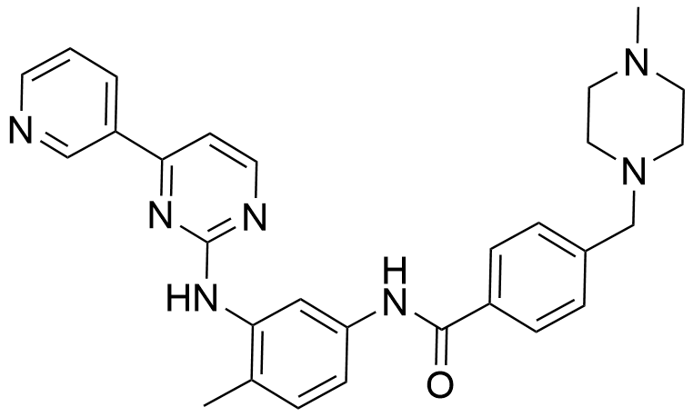<br><sub>伊马替尼</sub></td>
    <td align="center" valign="bottom">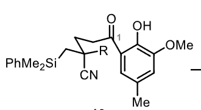<br><sub>13a</sub></td>
    <td align="center" valign="bottom">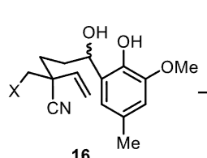<br><sub>16</sub></td>
    <td align="center" valign="bottom">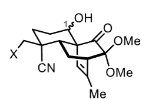<br><sub>17</sub></td>
  </tr>
</table>

| 图像 | MolScribe | MolNexTR | MolParser | MolVec | DECIMER（远程） | DECIMER（本地） |
| --- | --- | --- | --- | --- | --- | --- |
| 伊马替尼，干净的图 | 对 | 对 | 对 | 对 | 对 | 对 |
| 13a，含 R 和 SiMe<sub>2</sub>Ph | 错（硅基丢失，多出碎片） | 对 | 对 | 错（R 读成 P） | 错（环上出现 Hg） | 错（环上出现 Hg，多出碎片） |
| 16，含 X 缩写 | 错（X 丢失，多一个 C） | 错（X 丢失） | SMILES 无效 | 错（CH<sub>2</sub>X 读成乙基） | 错（环上甲基读成 NHMe） | 错（环上甲基读成 NHMe） |
| 17，桥环笼状结构 | SMILES 无效 | 对（带了一个 <sup>14</sup>C 标记） | SMILES 无效 | 错 | 对 | 对 |
| **正确数** | 4 个中 1 个 | 4 个中 3 个 | 4 个中 2 个 | 4 个中 1 个 | 4 个中 2 个 | 4 个中 2 个 |
| 每张图耗时 | 17 s | 19 s | 15 s | 3 s | 4 s（网络） | 57 s（CPU） |

两个独立模型结果一致是有用的线索：13a 上 MolNexTR 和 MolParser 一致且正确，17 上 MolNexTR 和 DECIMER 一致且正确。16 上六个引擎全错，也没有两个模型一致，这就说明该自己看图了。`decimer-local` 用同一套 DECIMER V2 权重在 CPU 上运行，每张图的结果都与远程服务相同。

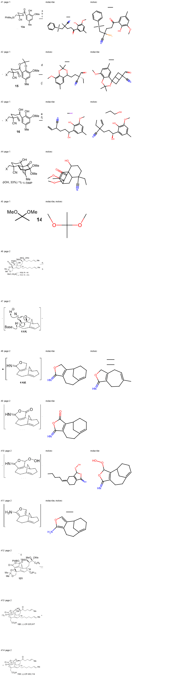

一份两页的 PDF 先经 DECIMER Segmentation 切分，再把每张裁剪图交给 MolScribe 和 MolVec。第 1 页的 5 个结构切出 5 张图，只有 1 张被两个引擎都读对；其余的丢了缩写基团。第 2 页切出 9 张图，其中 5 张两个引擎都没读出来。对照表把每张裁剪图和各引擎读出的结果放在一起，这些错误就是这样发现的。整个过程处理 14 张图，耗时 418 s。

**安装：** `ocsr-standard`（MolScribe 和 MolVec，4.7 GB）、`ocsr-full`（再加 MolNexTR 和 MolParser，12.9 GB）、`pdf`（切分器、MolScribe、MolVec，6.8 GB）。MolParser 的权重仅限非商业使用。MolVec 需要 Java。[详情](skill/chemdraw/references/engines.md#reading-a-structure-image)

</details>

<details>
<summary><b>逆合成路线、产物与反应条件</b></summary>
<br>

> **你这样说：**“用本地逆合成引擎找这个目标分子的前体，并把路线画出来。” · “这个反应得到什么产物，在什么条件下进行？”

实验记录本里的两步反应（[KL-CC-001 和 KL-CC-002](toolkit/samples/KL-CC-002/scheme.png)：Pd 催化胺化，然后丁基锂烷基化）和已发表的伊马替尼酰胺键断开，都有已知答案可以对照。

| 逆合成 | AiZynthFinder | RetroChimera | ReactionT5（逆向） | SynPlanner |
| --- | --- | --- | --- | --- |
| KL-CC-001，记录为 4-溴噻吩并[2,3-d]嘧啶 + 吗啉 | 记录的组合排第 2；第 1 是 4-氯类似物 | 氯类似物排第 1，记录的组合不在前 5 | 未命中（2,4-二氯化合物，还混入一个膦） | 记录的组合在第 4 条路线；第 1 条是氯类似物 |
| 伊马替尼，酰胺 + 苯胺 | 第 2（酸）和第 3（酰氯） | 第 1（酰氯） | 未命中 | 未搜索：目标分子在它的原料库里 |
| KL-CC-002，记录的两步路线 | 未命中 | 未命中 | 未命中 | 未命中 |
| 耗时 | 18 至 34 s | 99 至 155 s | 15 至 19 s | 44 至 76 s |

没有一个引擎给出 KL-CC-002 记录的最后一步。下面三条排名第一的路线按预测原样画出，绘图工具的配平检查标出了每条路线缺少的副产物。

<table>
  <tr>
    <td width="33%" align="center" valign="top"><br><sub>AiZynthFinder</sub></td>
    <td width="33%" align="center" valign="top">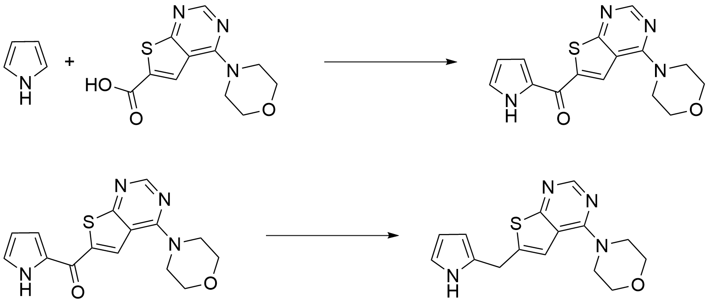<br><sub>SynPlanner</sub></td>
    <td width="33%" align="center" valign="top">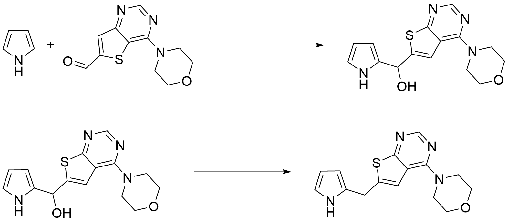<br><sub>RetroChimera</sub></td>
  </tr>
</table>

**产物。** ReactionT5（正向）对三个反应都把记录的产物排在第 1（11 至 16 s）；排在后面的结果里有脱氢吗啉和把 S 换成 O 的呋喃。**条件。** Reacon 三个都没对：胺化给出叠氮化钠和 THF，烷基化给出氢化钠和 DMF（记录为 n-BuLi、THF），伊马替尼酰胺化首选二氯甲烷。它只返回催化剂、溶剂和试剂的组合，不给温度、时间和用量。

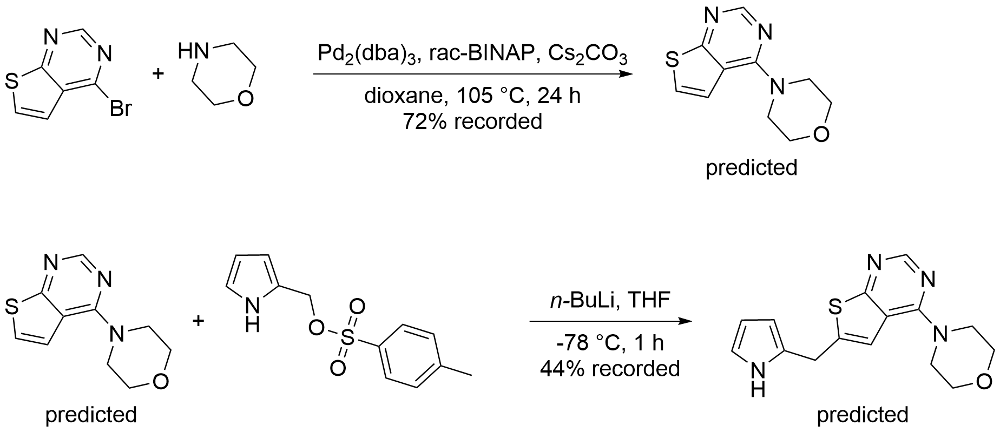

**安装：** `retro`（AiZynthFinder，1.7 GB）、`products`（3.9 GB）、`conditions`（Reacon，3.6 GB）；SynPlanner 和 ReactionT5 逆向按名称安装；`retro-chimera`（8.5 GB，需要约 14 GB 可用内存）。RetroChimera 仅限科研使用；Reacon 的作者没有声明许可，所以只在你要求时才从他们的仓库下载。[详情](skill/chemdraw/references/engines.md#predictions)

</details>

<details>
<summary><b>核磁化学位移与实测谱对比</b></summary>
<br>

> **你这样说：**“用两个核磁模型预测咖啡因的 1H 和 13C 化学位移，并与实测谱图对比。”

下图把 BMRB 的咖啡因处理谱（D<sub>2</sub>O，`bmse000206`）画成可编辑的 ChemDraw 曲线，每个预测位移画成一条线，实测峰画成刻度。

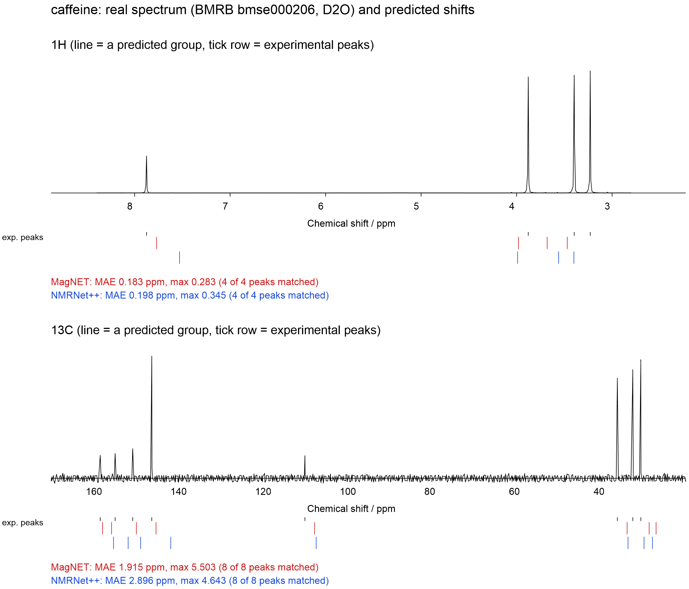

两个引擎还在 `nmrshiftdb2` 的 20 个已归属分子上运行，这些分子都有成对的 <sup>1</sup>H 和 <sup>13</sup>C 谱（215 组 <sup>1</sup>H、323 组 <sup>13</sup>C；不计可交换质子）。数值是逐分子的平均绝对误差，单位 ppm。

| 子集 | 分子数 | MagNET <sup>1</sup>H | NMRNet++ <sup>1</sup>H | MagNET <sup>13</sup>C | NMRNet++ <sup>13</sup>C |
| --- | --- | --- | --- | --- | --- |
| **全部** | 20 | **0.21**（最大 1.08） | **0.11**（最大 0.84） | **2.89**（最大 15.90） | **1.14**（最大 10.37） |
| CDCl<sub>3</sub> | 13 | 0.19 | 0.10 | 3.11 | 1.10 |
| DMSO-<i>d</i><sub>6</sub> | 7 | 0.26 | 0.13 | 2.48 | 1.22 |

**两列数字要分开看。** MagNET 只用计算得到的屏蔽常数训练，所以它的误差是在实验数据上的真实检验。这 20 条记录都来自 `nmrshiftdb2`，而它是 NMRNet++ 训练语料的一部分，所以 NMRNet++ 的数字是语料内的上限。在 GPU 上每个分子约需 30 s。预测值绝不会写进实验表征文字。

**安装：** `nmr`（MagNET，5.4 GB）和 `nmr-pp`（NMRNet++，4.5 GB；权重为 CC BY 4.0，不接受溶剂参数）。[全部 20 个分子的逐分子结果](assets/readme/engines/nmr/benchmark20.json) · [咖啡因图与数据](assets/readme/engines/nmr/caffeine/)

</details>

<details>
<summary><b>LCMS 孔板报告</b></summary>
<br>

> **你这样说：**“把这份 OpenLynx 报告和孔板布局对一下，告诉我哪些孔里有预期产物。”

不需要任何引擎。PyParse 示例数据集（Apache-2.0）里的 24 孔 Waters 报告和孔板布局用 11 s 解析完，24 个孔全部找到预期产物：21 个是 [M+H]<sup>+</sup>，两个 Boc 保护的哌嗪是 [M+H−C<sub>4</sub>H<sub>8</sub>]<sup>+</sup> 碎片，一个羧酸是 [M−H]<sup>−</sup>。

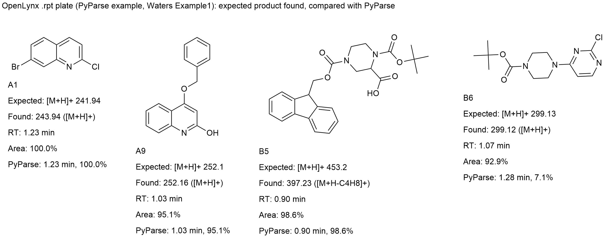

有 23 个孔的保留时间和纯度与 PyParse 自己的输出相差不超过 0.01。剩下的 B6 孔，toolkit 取带完整 [M+H]<sup>+</sup> 的峰（92.9%），PyParse 取碎片峰（7.1%）；规则见 [match_plate.py](assets/readme/engines/lcms/match_plate.py)。LCMS 工具还能读取 OpenLynx `.rpt`、Waters PDF 和 `.raw` 目录、Shimadzu `.daml`、Agilent `report.txt` 以及 `mzML`/`mzXML`，核对 Cl/Br 的 `M+2` 同位素峰形，并跟踪内标比值随时间的变化。

</details>

## 平台支持

可移植的部分（CDXML 生成与编辑、RDKit 核对、命令行和 MCP）在 Windows、macOS 和 Linux 上都能运行。原生 ChemDraw 在 Windows 上通过 COM 驱动，在 macOS 上通过 AppleScript 驱动，工具和输出相同。

| 能力 | Windows | macOS | Linux |
| --- | :---: | :---: | :---: |
| CDXML、RDKit、命令行和 MCP 工作流 | ✅ | ✅ | ✅ |
| ChemDraw 原生渲染、转换和清理 | ✅ <sub>已激活的安装</sub> | ✅ <sub>ChemDraw for macOS</sub> | — |
| ChemScript 操作（名称、分子式、清理、子结构） | ✅ <sub>兼容的 SDK</sub> | ✅ <sub>ChemDraw + OPSIN + RDKit</sub> | — |
| 直接调用 ChemScript SDK 的程序 | ✅ <sub>兼容的 SDK</sub> | ✅ <sub>模拟的核心接口</sub> | — |
| 可编辑的 Office ChemDraw 对象 | ✅ <sub>桌面版 Office</sub> | ✅ <sub>矢量预览，`cdx.py office-edit`</sub> | — |
| Office 文件的 PDF 预览 | ✅ <sub>桌面版 Office</sub> | ✅ <sub>已激活的 Microsoft 365</sub> | — |

<sub>✅ 支持，— 不支持（没有对应的接口）</sub>

ChemDraw、Microsoft Office、ChemScript 和 DECIMER 模型权重都不随本项目分发。[安装指南](docs/guide.zh-cn.md#首次安装)说明安装选项、手动建运行时和诊断方法；macOS 上的差别（自动化权限、隐藏的 ChemDraw 实例、字体替换、矢量预览和 ChemScript 模拟）见[运行说明](skill/chemdraw/references/operations.md#macos)。

<details>
<summary><b>各项目标需要什么</b></summary>
<br>

| 目标 | 在核心配置之外还需要 |
| --- | --- |
| 创建和编辑 CDXML | 任何能运行命令行的 Agent、64 位 Python 3.10–3.13 和内置的 toolkit 运行时（由 `scripts/install.py --runtime` 从 `toolkit/` 构建） |
| 原生 PNG、CDX 或 ChemDraw 清理 | 有许可且已激活的桌面版 ChemDraw：Windows 上用 COM 自动化，macOS 上用 ChemDraw for macOS 并授予自动化权限 |
| 分子比较或 ChemScript SDK 调用 | 相似度用 RDKit；精确核对和直接调用 SDK 的程序需要 Windows 上兼容的 ChemScript DLL（macOS 上由 ChemDraw、OPSIN 和 RDKit 代为完成） |
| 可编辑的 Word 或 PowerPoint 对象 | 用桌面版 ChemDraw 生成；PDF 预览需要桌面版 Word 或 PowerPoint（macOS 上需已激活） |
| 本地结构识别 | DECIMER 模型权重及其依赖 |
| 更多结构识别引擎和预测 | `cdx.py engines --recommend NEED`，你同意后再执行 `cdx.py install-engines --bundle NAME`；每个引擎 2 MB 到 8.5 GB，可用 `remove-engines` 卸载（[引擎](skill/chemdraw/references/engines.md)） |
| 远程访问 ChemDraw 工作站 | 一台 Windows 主机、带认证的 HTTP 配置和加密的网络通道 |

</details>

**macOS 方面需要帮助。** macOS 路径在 ChemDraw 26.0、macOS 26.6 和 Apple 芯片上测试过。欢迎反馈这些情况：Intel Mac 和其他 ChemDraw 版本，通过 Microsoft 365 for macOS 生成 PDF 预览，以及已模拟的 `StructureData`、`ReactionData` 和 `LargestCommonSubstructure` 之外的 ChemScript SDK 成员。请提交有针对性的 issue 或 pull request，写明 macOS 版本、芯片、ChemDraw 版本号、权限提示、命令输出和一个最小复现文件；不要提交受版权保护的论文、凭据或需要许可的 ChemDraw 资源（[贡献指南](.github/contributing.md)）。

## 测试与安全

- **持续检查。** 每个 pull request、合并和发版都会运行 `validate.yml`：分发规则，Windows（Python 3.13）和 Linux（Python 3.12）上的 toolkit 测试，Windows 上的 Skill 测试，以及对安装后 wheel 的冒烟测试。原生 ChemDraw、ChemScript 和 Office 自动化在一台有许可的 Windows 工作站和 macOS 26.6（Apple 芯片，ChemDraw 26.0）上检查，不在 CI 里。
- **不覆盖文件。** 工具写到新路径；除非你明确要求，否则遇到已有文件就拒绝。
- **联网都是明示的。** `cdx.py decimer` 只上传你选中的裁剪图。化学计量、报告和原子映射都在本地运行，`CHEMDRAW_OFFLINE=1` 会关闭名称解析对 PubChem 的回退查询。
- **引擎相互隔离。** 可选引擎装在各自的环境里离线运行，下载内容按哈希固定，每条输出都标明是预测。
- **远程 HTTP 需要认证。** 需要 bearer token、主机白名单，以及加密隧道或 HTTPS 代理（[安全策略](.github/SECURITY.md)）。

## 常见问题

<details>
<summary><b>哪些 Agent 能用？必须有 ChemDraw 或 MCP 吗？</b></summary>
<br>

任何能读 `SKILL.md` 并运行命令行的 Agent 都可以通过 `cdx.py` 使用，包括 Claude Code、Codex、Gemini CLI、GitHub Copilot、Cursor 和 OpenCode。MCP 是可选的。桌面版 ChemDraw 也是可选的：没有它仍然可以构建、编辑和核对 `.cdxml`，识别结构，运行批量计算；有了它还能做原生 PNG 渲染、`.cdx`、化学计量表和 Office 对象。见 [Agent 集成](skill/chemdraw/references/agent-integration.md)。

</details>

<details>
<summary><b>它会编造 SMILES、反应条件或反应机理吗？</b></summary>
<br>

不会。名称通过核对过的试剂表、PubChem、OPSIN 或 ChemScript 解析，解析不出的名称会让运行停下。你没给的条件保持空白。机理只画你列出的电子转移；箭头起点没有孤对电子、电荷或自由基时会标出来。

</details>

<details>
<summary><b>这些画法风格是期刊的官方模板吗？</b></summary>
<br>

不是。28 种画法风格是从开放许可的图里量出来的惯例，叠加在 16 个 ChemDraw 预设之上，不复制原图。`cdx.py styles` 列出全部风格，每张卡片都附有依据。见[期刊与课题组画法风格](#期刊与课题组画法风格)。

</details>

<details>
<summary><b>安全提示和引擎的结果能信到什么程度？</b></summary>
<br>

`reagent_safety` 是针对 138 种常用试剂的实验台提示，外加结构警示。表里没有的化合物显示 `"not listed"`，绝不显示 `"safe"`，以供应商的 SDS 为准。[15 个可选引擎](#十五个引擎一览)给出的是候选结果：独立模型之间一致是线索，不一致就要人工核对。请遵守上游的许可（`molparser` 仅限非商业，`retrochimera` 仅限科研，`reacon` 未声明许可）。

</details>

## 文档

| 从这里开始 | 深入了解 |
| --- | --- |
| [安装、排错与运行说明](docs/guide.zh-cn.md) | [自动生成的工具签名](skill/chemdraw/references/mcp-signatures.md) |
| [中文快速开始](docs/zh-cn.md)、[英文安装指南](docs/guide.md) | [内置 toolkit 的审计公开清单](skill/chemdraw/references/toolkit-public-inventory.md) |
| [Agent 集成与 `cdx.py` 命令参考](skill/chemdraw/references/agent-integration.md) | [Toolkit 开发者参考](toolkit/docs/agent-reference.md)、[自动生成的 MCP 工具参考](toolkit/docs/mcp-tools.md) |
| [按任务分类的工作流目录](skill/chemdraw/references/workflow-router.md) | [远程 HTTP 配置](skill/chemdraw/references/operations.md#remote-http-only-when-asked) |
| [贡献指南](.github/contributing.md)、[安全策略](.github/SECURITY.md) | [给贡献者的仓库说明](AGENTS.md) |
| [官网与分子实验室](https://zichenwang114514.github.io/chemdraw-skill/) | [落地页源码与部署](docs/website.md) |

可部署的 Skill 在 [`skill/chemdraw`](skill/chemdraw)。它驱动的化学运行时，也就是 `cdxml_toolkit` Python 包，在 [`toolkit`](toolkit)，带有自己的测试。

## 升级到 0.8.0

- **MCP 服务默认列出 26 个工具**（`standard` 配置），不再是全部 71 个。用 `--profile full` 启动服务或设置 `CHEMDRAW_MCP_PROFILE=full` 可得到其余工具；`cdx.py call` 在两种配置下都能调用每个工具。
- **返回结果统一成一种结构。** 只有工具执行完成且检查通过时 `ok` 才为 true；失败时带有 `error`，其中有 `code`、`message` 和 `hint`；没通过化学检查的结果放在 `rejected_result` 里返回。`cdx.py` 的退出码与 `ok` 一致。
- **名称按固定顺序解析。** 只有二级缩写表认识的名称会标为低可信或未解析。每个结果都报告 `source_tier`、`components` 和未指定的立体中心。
- **去掉了一种布局。** `render_scheme` 不再接受 `numbered-parallel`。
- **安装后的 Skill 约 2 MB。** 风格图库及其依据移到了 `showcase/house-styles/`；ChemDraw 的成员列表改用 `cdx.py catalog LAYER NAME` 读取。

## 许可证

本仓库中由 ZiChenWang114514 编写的代码和脚本以 **PolyForm Strict License 1.0.0** 授权，仅限非商业使用；提示词、画法风格卡片、文档和网站内容以 **CC BY-NC-ND 4.0** 授权；完整条款和商业咨询见 [LICENSE](LICENSE)。[`toolkit/`](toolkit) 中 Hiu Fung Kevin Lee 编写的上游 `cdxml-toolkit` 原始代码保留其 [MIT 许可](toolkit/LICENSE)，社区新增部分采用 [PolyForm Strict 1.0.0](toolkit/LICENSE-POLYFORM-STRICT.txt)，另见[第三方声明](toolkit/NOTICE.md)。ChemDraw、Microsoft Office、各 Agent 客户端、MCP Python SDK、RDKit、DECIMER 及其依赖各自保留原有的许可和使用条款。

这是一个独立的社区项目，与 Revvity、Anthropic、OpenAI、Google、GitHub、Microsoft、Anysphere、OpenCode 维护者，以及上游 `cdxml-toolkit`、MCP Python SDK、RDKit 和 DECIMER 的维护者均无隶属或背书关系。

<p align="right"><a href="#top">回到顶部 ↑</a></p>
