<a id="top"></a>

<p align="center">
  <picture>
    <source media="(prefers-color-scheme: dark)" srcset="./assets/readme/hero-dark.svg">
    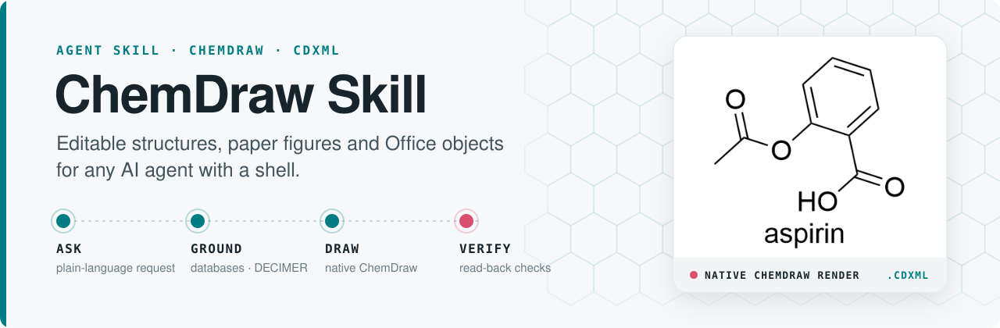
  </picture>
</p>

<h1 align="center">ChemDraw Skill：AI 绘制可编辑化学结构式</h1>

<h3 align="center">让 Claude Code、Codex 等任意 AI 编程 Agent 都能产出可编辑的 ChemDraw 化学图</h3>

<p align="center">
  画化学结构、复刻论文图、用表格数据生成 SAR 图，在 Word 和 PowerPoint 里放入可编辑的 ChemDraw 对象。
  同一个 Skill 还能算反应的投料量、写表征段落、给反应做原子映射。<br>
  Claude Code、Codex、Gemini CLI、GitHub Copilot、Cursor、OpenCode 以及任何能执行命令行的 Agent 都可以用。
</p>

<p align="center">
  <a href="https://github.com/ZiChenWang114514/chemdraw-skill/actions/workflows/validate.yml"></a>
  
  
  <a href="skill/chemdraw/references/agent-integration.md"></a>
  <a href="LICENSE"></a>
</p>

<p align="center">
  <a href="README.md">English</a> · <b>简体中文</b>
  <br>
  <a href="#快速开始">快速开始</a> · <a href="#作品展示">作品展示</a> · <a href="#支持的工作">支持的工作</a> · <a href="#反应计算器与化学报告">计算器</a> · <a href="#主打案例">案例</a> · <a href="#平台支持">平台</a> · <a href="#常见问题">常见问题</a> · <a href="docs/guide.zh-cn.md">指南</a> · <a href="https://zichenwang114514.github.io/chemdraw-skill/">官网</a>
</p>

<br>

<table>
  <tr>
    <td width="25%" valign="top"><b>结构有来源</b><br><sub>结构来自数据库、OPSIN、ChemScript 或 DECIMER，Agent 不凭记忆写 SMILES。</sub></td>
    <td width="25%" valign="top"><b>输出可编辑</b><br><sub>结果是 CDXML，原子、键和文字之后仍能在 ChemDraw 里修改。</sub></td>
    <td width="25%" valign="top"><b>一个命令</b><br><sub><code>cdx.py</code> 在任何 Agent 里运行所有工具，MCP 可选。</sub></td>
    <td width="25%" valign="top"><b>保存后核对</b><br><sub>ChemDraw 渲染并保存文件，再把化学结构读回来与输入比较。</sub></td>
  </tr>
</table>

## 作品展示

每张卡片都是本仓库中可编辑文件的 ChemDraw 原生渲染。点击卡片查看对应案例。

<table>
  <tr>
    <td colspan="3" align="center">
      <a href="#paper-scheme-demo">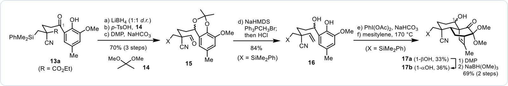</a>
      <br><sub>论文原图</sub><br><br>
      <a href="#paper-scheme-demo">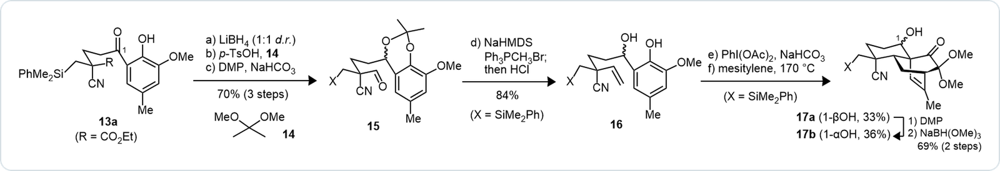</a>
      <br><b>论文反应路线 → 可编辑 ChemDraw</b><br><sub>从图片复刻五个结构、反应条件、产率和化合物编号</sub>
    </td>
  </tr>
  <tr>
    <td colspan="3" align="center">
      <a href="#markush-demo">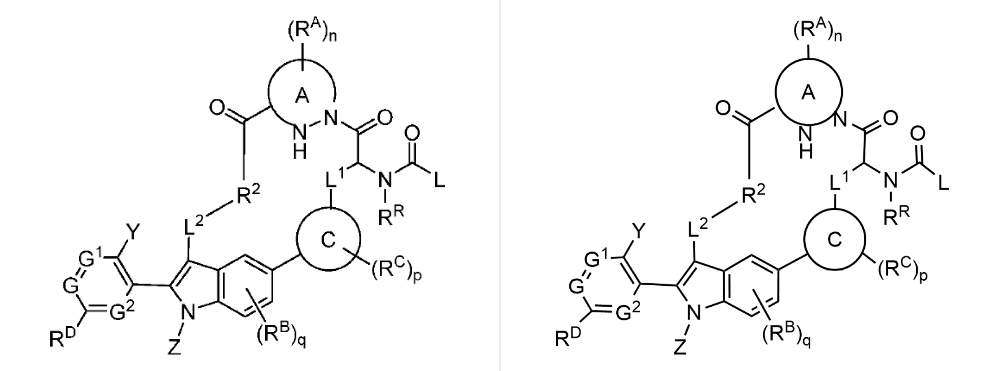</a>
      <br><b>专利 Markush 通式 → 可编辑 ChemDraw</b><br><sub>左为专利原图，右为原生复刻：R 基、可变环、多中心键与重复次数</sub>
    </td>
  </tr>
  <tr>
    <td width="33%" align="center" valign="top">
      <a href="#synthesis-113-demo">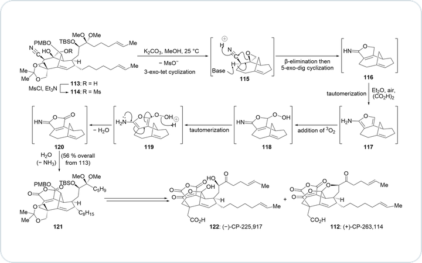</a>
      <br><b>复杂合成路线</b><br><sub>完整多步路线与机理箭头</sub>
    </td>
    <td width="33%" align="center" valign="top">
      <a href="#mechanism-demo">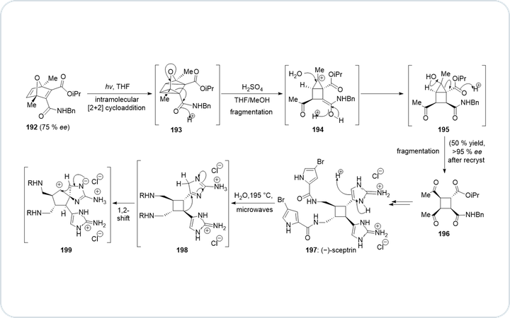</a>
      <br><b>反应机理</b><br><sub>电子箭头、电荷与抗衡离子</sub>
    </td>
    <td width="33%" align="center" valign="top">
      <a href="#stereo-reconstruction-demo">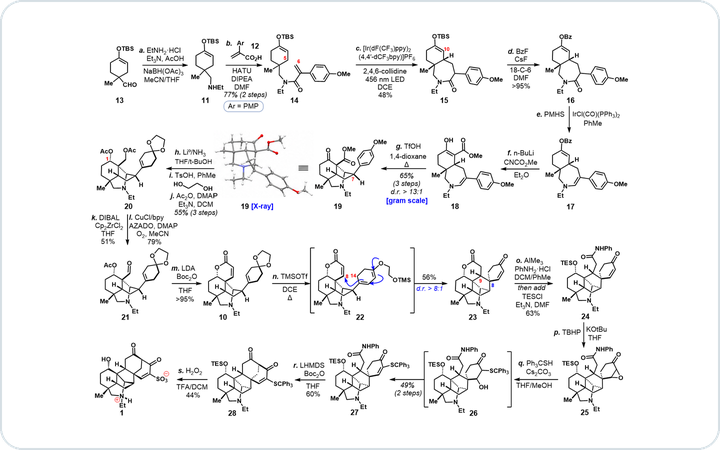</a>
      <br><b>20 个结构的合成路线</b><br><sub>不同化学软件读取的立体信息 20/20 一致</sub>
    </td>
  </tr>
  <tr>
    <td width="33%" align="center" valign="top">
      <a href="#acs1996-drawings">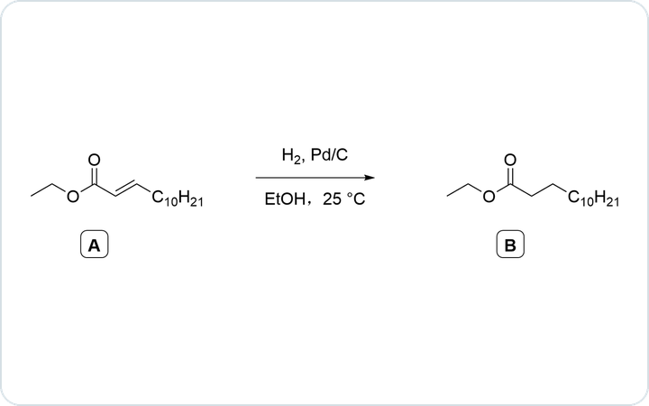</a>
      <br><b>试卷与讲义插图</b><br><sub>由小型 JSON 生成 ACS Document 1996 格式</sub>
    </td>
    <td width="33%" align="center" valign="top">
      <a href="#tlc-demo">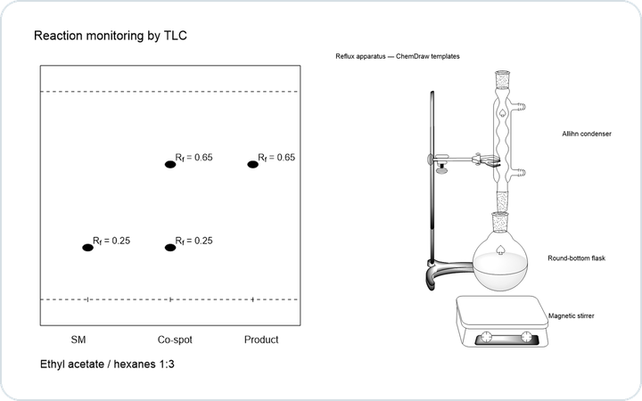</a>
      <br><b>TLC 与装置图</b><br><sub>原生 TLC 板、Rf 值与 ChemDraw 装置模板</sub>
    </td>
    <td width="33%" align="center" valign="top">
      <a href="#nmr-demo">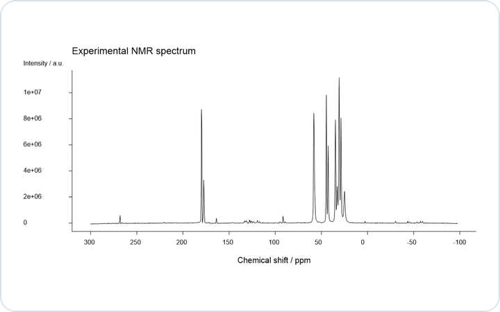</a>
      <br><b>谱图与科研绘图</b><br><sub>已处理的一维 NMR 与数值曲线</sub>
    </td>
  </tr>
</table>

## 快速开始

**1. 安装。** 安装脚本需要 Python 3.9+，它会自动查找 64 位 Python 3.10–3.13 作为工具包运行时（通过 `py` 启动器、`uv` 管理的解释器或 PATH 上的 `python3.x`）。

```bash
git clone https://github.com/ZiChenWang114514/chemdraw-skill.git
cd chemdraw-skill
python scripts/install.py --agent claude agents --runtime          # 仅预览
python scripts/install.py --agent claude agents --runtime --apply  # 安装
```

**2. 检查**本机可用的功能：

```bash
python ~/.claude/skills/chemdraw/scripts/cdx.py doctor
```

**3. 提问**，直接用自然语言告诉 Agent：

```text
用 ChemDraw Skill 把阿司匹林画成可编辑 CDXML，用 ChemDraw 原生渲染并给我看 PNG。
```

> [!NOTE]
> 内置工具包目前尚不支持 Python 3.14 及更新版本。如果你只有 3.14，请先安装 3.12（例如 `uv python install 3.12`）或用 `--python <解释器>` 指定。

想先试计算器而不是画图，可以运行 `python ~/.claude/skills/chemdraw/scripts/cdx.py calc`（[说明](#反应计算器与化学报告)）。

<details>
<summary><b>选择 Agent 与安装位置</b></summary>
<br>

| `--agent` | Skill 目录 | 读取它的 Agent |
| --- | --- | --- |
| `claude` | `~/.claude/skills/` | Claude Code（GitHub Copilot 和 OpenCode 也会读取） |
| `agents` | `~/.agents/skills/` | Agent Skills 通用目录：Codex、Gemini CLI、GitHub Copilot、Cursor、OpenCode 等 |
| `gemini`、`copilot`、`cursor`、`opencode`、`kimi`、`pi` | 各 Agent 自己的目录 | 需要装到专属目录时使用 |

- `--project <仓库>` 安装到项目级目录（`.claude/skills/`、`.agents/skills/`、`.github/skills/` 等）；`--destination <目录>` 可装到任意位置。
- 不支持自动发现 Skill 的 Agent，只需在它的指令文件里加一行指向 `SKILL.md`。
- 所有副本共用一套运行时。重复运行安装脚本即可原地升级；被替换的旧副本会先备份，出错时自动恢复。

各 Agent 的具体接入方式、命令白名单和可选的 MCP 注册见 [Agent 接入](skill/chemdraw/references/agent-integration.md)。

</details>

<details>
<summary><b><code>cdx.py</code> 统一入口</b></summary>
<br>

Agent 通过同一个入口调用所有功能；任何 Python 都能启动它，它会自动切换到工具包运行时：

```bash
python <skill>/scripts/cdx.py tools                                         # 列出已注册的工具
python <skill>/scripts/cdx.py call resolve_name --json '{"query": "aspirin"}'
python <skill>/scripts/cdx.py render figure.cdxml                           # 原生 300 dpi PNG
python <skill>/scripts/cdx.py decimer crop.png                              # 结构识别
```

</details>

## 支持的工作

| 领域 | 能做什么 |
| --- | --- |
| **结构与反应** | 解析名称和标识符；绘制、编辑、清理、合并、润色、拆分、转换和渲染 CDXML 或 CDX 文档。 |
| **按需求新画图** | 由简短的说明画出反应、多步路线、底物拓展图或机理，并在同一条命令里检查化学与版面。[详见下文](#one-command-figures)。 |
| **试卷、讲义与论文插图** | 由 JSON 描述生成 ACS Document 1996 格式插图，支持缩写节点、富文本、中文注释、箭头和带框化合物代号。 |
| **数据驱动绘图** | 由 CSV/XLSX 生成可编辑、可持续更新的底物拓展图和 SAR 图。 |
| **图像识别** | 通过 DECIMER API（或按要求使用本地 DECIMER 模型）提取候选结构、置信度和外接矩形。 |
| **分子比较** | 各平台均可使用 RDKit 指纹相似度；精确身份检查在 Windows 上通过 ChemScript，在 macOS 上通过 ChemDraw for macOS。 |
| **计算与报告** | 反应计算器（用量、收率、过程质量强度）；HRMS 表征句与完整表征段落；试剂安全提示；多步路线总收率；原子映射；性质表、反应配平检查与结构导出。[详见下文](#反应计算器与化学报告)。 |
| **TLC 与装置** | 原生 TLC 板、泳道、斑点及 ChemDraw 装置模板；支持 Rf 计算和可编辑装置组装。 |
| **谱图与科研绘图** | 对已处理的一维 NMR 数据寻峰并做指定区间积分；把数值数据输出为可编辑曲线。 |
| **专利 Markush 通式** | 从专利图片和权利要求文本提取通式：R 基、可变环、多中心键与重复次数，保存为 CXSMILES、V3000 molfile 和沿用原图版式的可编辑绘图。 |
| **反应机理** | 根据你列出的电子转移绘制弯箭头，或按明确的原子坐标复刻机理，包括电荷和抗衡离子。 |
| **Office 文档** | 在桌面版 Word 和 PowerPoint 文档中嵌入可编辑的 ChemDraw 对象，可在 Windows 或 macOS 上用 ChemDraw 生成。 |
| **实验记录** | 发现文件，并处理选定的 LCMS、SciFinder RDF 和实验记录工作流。 |
| **ChemScript SDK** | 在 Windows 上检查已安装的公共目录，并在独立工作进程中执行受支持的声明式调用（macOS 上由 ChemDraw、OPSIN 和 RDKit 完成 ChemScript 操作，并模拟核心 SDK 类）。 |
| **ChemDraw 接口覆盖** | 为 ChemDraw 22.2 的 ChemScript SDK、COM 对象、CDXML 元素和菜单命令建立目录，每一条标明是有专用工具、有已核对的配方，还是仅有文档；并提供操作 CDXML 元素、调用 COM 以及获取 ChemDraw 自身分子性质的工具。[详见](docs/guide.zh-cn.md#chemdraw-接口覆盖)。 |
| **远程工作站访问** | 可选地通过 Streamable HTTP 对外提供 Windows 原生主机服务，带健康检查与 Prometheus 端点。 |

生成的[公共接口清单](skill/chemdraw/references/toolkit-public-inventory.md)记录了内置工具包中已审计的公共符号，与已注册工具分开统计（`cdx.py tools` 会打印当前数量）。

<a id="acs1996-drawings"></a>

### 试卷与讲义插图：ACS Document 1996 格式

用一个小 JSON 描述图：带 C10H21 等缩写节点的 SMILES、反应条件、箭头、加粗化合物代号和中文注释，即可得到可编辑的 ACS 1996 CDXML 与 ChemDraw 原生 PNG：

```bash
python skill/chemdraw/scripts/cdx.py build skill/chemdraw/assets/acs1996/example.json example.cdxml --render
```

<p align="center">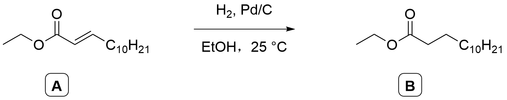</p>

缩写基团保存为真实的 `GenericNickname` 节点，下标与标签方向自动处理。中文字符使用中文字体，同一段里的英文、数字和符号保持 Arial。详见 [ACS 1996 绘图指南](skill/chemdraw/references/acs1996-drawings.md)。

<a id="one-command-figures"></a>

### 一句话生成新图

结构已知、图还不存在时，直接说一句话：“用水杨酸和乙酸酐画阿司匹林，H2SO4（催化量），室温 2 h，收率 85%。”你的 agent 会把它整理成一份简短的 JSON 说明，一条命令就能画图并做检查：

```bash
python skill/chemdraw/scripts/cdx.py draw brief.json aspirin.cdxml --render
```

```json
{
  "species": [
    {"id": "SA", "smiles": "OC(=O)c1ccccc1O", "label": "1"},
    {"id": "Ac2O", "name": "Ac2O"},
    {"id": "ASP", "smiles": "CC(=O)Oc1ccccc1C(=O)O", "label": "2"}
  ],
  "steps": [
    {"substrates": ["SA", "Ac2O"], "products": ["ASP"],
     "above": ["H2SO4 (cat.)"], "below": ["rt, 2 h"], "yield": "85%"}
  ]
}
```

<p align="center">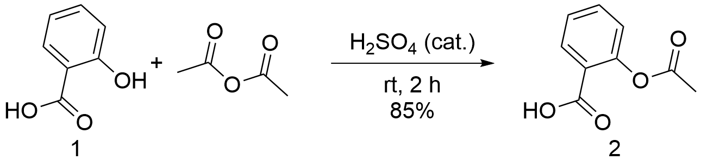</p>

同一条命令可以画三种图：

| 图的类型 | 说明里要列出的内容 | 得到什么 |
| --- | --- | --- |
| **反应或路线** | 物种、步骤、条件、收率 | 单步反应、线性路线、两条支线汇合的收敛路线，或一个原料生成多个产物的发散路线。长路线自动换行；可用 `reversible`（平衡）和 `resonance`（共振）箭头。 |
| **底物拓展** | 带编号、分组的化合物和你测得的数值 | 按需要排成多页可编辑版面，每个编号和数值都紧跟自己的结构。你没给的数值显示为短横线，绝不写成 0。 |
| **反应机理** | 物种、步骤和每一次电子转移 | 根据已绘制的坐标放置弯箭头，区分全箭头和半箭头，并绕开原子和标签。 |

<table>
  <tr>
    <td width="50%" align="center" valign="top">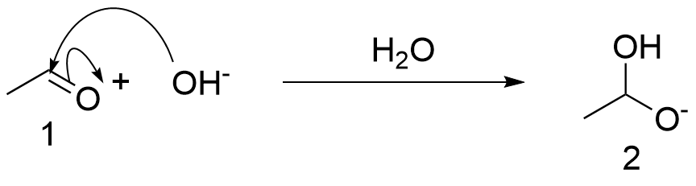<br><sub>机理：氢氧根加成，两条弯箭头</sub></td>
    <td width="50%" align="center" valign="top">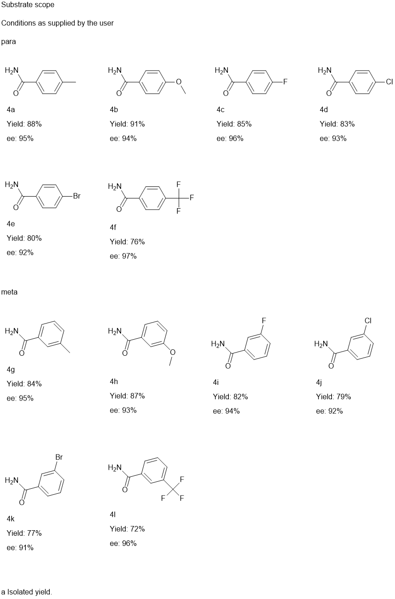<br><sub>底物拓展：十二个化合物排在一页</sub></td>
  </tr>
</table>

这条命令对说明做的事：

- **结构来自你或查表。** 你给的 SMILES 原样使用；名称先查内置试剂表，再查 PubChem（设置 `CHEMDRAW_OFFLINE=1` 时不联网）。无法解析的名称会让运行停下并要求提供 SMILES。
- **条件只来自你。** 没有给条件的步骤就不画条件，报告里会注明；工具不会自己补充化学内容。
- **检查化学。** 逐步计算原子与电荷是否守恒，缺少的副产物只会点名，不会画出来。保存之后，再把文件中的结构与说明逐一比对。
- **检查几何。** 测量重叠、过小的文字和超出页宽的图形。检查不通过时，会留出更多空间重新排版一次，并在报告里说明改了什么。
- **机理只画不推。** 电子转移由你列出，没有电子转移的步骤会被拒绝；箭头起点没有孤对电子、电荷或自由基时，照画但会标出提醒。
- **不覆盖已有文件。** 报告列出每个结构的来源、通过或未运行的检查，以及原生 PNG 的路径。没有 ChemDraw 时，文件会被标为未渲染的草稿。使用前请先打开 PNG 看一遍。

完整的说明格式和报告字段见[绘制新反应图](skill/chemdraw/references/scheme-drawing.md)。

<a id="从数据生成可持续修改的论文图"></a>

### 从 CSV / Excel 生成 SAR 图和底物拓展图

将 CSV/XLSX 与可信结构生成底物拓展图或完整结构 SAR 图。化合物 ID 绑定结构和实验指标；在 ChemDraw 手工编辑后更新数据或替换结构，保留无关布局与注释；无法唯一匹配时输出冲突草稿。详见[使用指南与示例](skill/chemdraw/references/data-driven-figures.md)。读取 XLSX 需要工具包的 `publication` 可选依赖。

## 反应计算器与化学报告

这些工具从你给出的结构（SMILES、MOL 或 SDF、CDXML）出发，用 RDKit 做计算和整理。它们不识别、也不修改结构，只有命名工具需要 ChemDraw。每个工具既在回复里给出结果，也可以写成新文件，已有文件不会被覆盖。

| 想做的事 | 工具 | 得到什么 |
| --- | --- | --- |
| 每种试剂和溶剂该称多少 | `cdx.py calc`、`reaction_calculator` | 可编辑的用量表、收率、原子经济性、PMI |
| 把用量写到流程图的结构下方 | 带 `scheme_output` 的 `reaction_calculator` | 加上数字的 CDXML 副本 |
| 一批反应的 SI 原料表 | `si_materials_tables` | Markdown、CSV、可打印 HTML 或 JSON，最多 100 个反应 |
| HRMS 与表征文字 | `hrms_line`、`characterization_text` | `HRMS (ESI) m/z calcd for ...` 与按 ACS 顺序排列的段落 |
| 多步路线的总收率和 PMI | `route_summary` | 线性或汇聚路线的一张表 |
| 哪个原子变成哪个原子 | `map_reaction_atoms` | 原子映射、键变化、反应中心 SMARTS、反应类型 |
| 分子式、质量、加合物、logP | `molecule_report` | 性质表 |
| 反应是否配平 | `check_reaction_balance` | 缺失的副产物与建议系数 |
| 文件里的全部结构 | `export_structures` | SMILES、InChI、CSV 或 SDF |

### 反应计算器

```bash
python <skill>/scripts/cdx.py calc "OCc1ccccc1.CC(=O)Cl>CCN(CC)CC.ClCCl>CC(=O)OCc1ccccc1" --scale 1
```

命令会在浏览器里打开一个页面（由 127.0.0.1 提供，关闭标签页几分钟后自动停止）。**Draw in ChemDraw** 会在 ChemDraw 里打开画布，保存后点 **Load drawing** 把反应读回来。直接改当量、mmol、质量或体积中的任何一格，其余数值跟着变。页面显示溶剂浓度、收率、原子经济性、反应质量效率和过程质量强度（PMI；E 因子等于 PMI 减 1）。质量未知的溶剂不计入 PMI，页面会说明。你没有给出的用量使用默认值（试剂 1 当量、金属催化剂 5 mol %、0.2 M），并标明是假设值。**Amounts into scheme** 会把数字写到你的 ChemDraw 流程图副本的结构下方。

常见溶剂和试剂会带 **Danger** 或 **Warning** 标记，来自内置的约五十种物质的表：GHS 图标、H 说明、沸点和闪点。表里没有的物质显示为“未收录”，而不是安全。这张表只是提醒，以供应商的 SDS 为准。

<p align="center">
  <picture>
    <source media="(prefers-color-scheme: dark)" srcset="assets/readme/gallery/calculator-dark.png">
    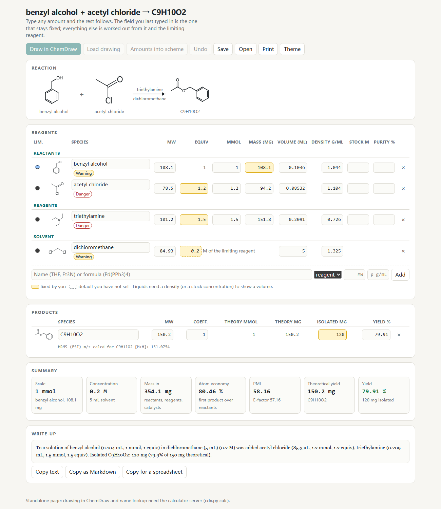
  </picture>
</p>

### 表征文字

`characterization_text` 为每个化合物写一段，顺序遵循 ACS：外观、Rf、熔点、比旋光度、IR、1H 与 13C 核磁、其他核、HRMS。你给出的数字原样输出，没有提供的内容直接省略。它还会把 1H 积分和 13C 信号数与结构对照，不一致时给出警告，但不会为了通过检查去改任何一个峰。

### 原子映射与反应类型

`map_reaction_atoms` 自带子结构方法。产物原子可能来自多个反应物原子时，它会如实指出，而不替你选一个。RXNMapper 和 LocalMapper 两个学习型映射器可用 `cdx.py install-mappers` 安装；`compare: true` 会把已安装的方法并排比较。多个反应可以一次映射，这很重要，因为每个学习型映射器启动一次要 10 到 35 秒。

映射完成后还可以要求：反应中心的反应 SMARTS（`template`）、仅凭结构判断的反应类型（`classify`，19 个模板，判断不了就是“未分类”），以及把映射编号写在你的图副本的原子旁（`map_numbers_into_scheme`）。遇到 H2N 这类拥挤的原子标签，请看一下图。

### 路线汇总

`route_summary` 按顺序接收合成的各步，每步给出收率以及投入和得到的质量（也可以给计算器格式的反应）。它返回最长线性序列上的总收率和累计 PMI，并把每一步缩放到下一步实际消耗的量。汇聚路线通过 `into` 字段表示。缺少的数字得到 `null` 和警告，不会猜。后处理和纯化溶剂只有算进投入质量才会计入。

```text
用 ChemDraw Skill 为这个酰胺偶联打开反应计算器，并把用量写到结构下面。
根据这些核磁峰和这个 HRMS 数值，写出化合物 3a 的表征段落。
```

完整的输入和规则见[化学报告指南](skill/chemdraw/references/chemistry-reports.md)。

## 主打案例

从真实论文图片和数据出发，直接查看原生预览、原图对照和可编辑文件。

| 案例 | 展示内容 | 亮点 |
| --- | --- | --- |
| [20 个结构](#stereo-reconstruction-demo) | 修复不同化学软件之间的立体信息分歧 | ChemScript 与 RDKit 立体信息 20/20 一致 |
| [论文反应路线](#paper-scheme-demo) | 五个结构、条件、产率与波浪键 | 完整可编辑复刻 |
| [Sceptrin 反应机理](#mechanism-demo) | 八个结构、电子箭头、电荷与条件 | 完整可编辑复刻 |
| [专利 Markush 通式](#markush-demo) | 从专利图片和权利要求文本提取 R 基、可变环与多中心键 | 结构与参考一致，附 CXSMILES 与 V3000 |
| [原生 TLC](#tlc-demo) | 可编辑泳道、斑点与 Rf | 可运行示例 |
| [原生装置图](#apparatus-demo) | 原生 ChemDraw 模板组装 | 可运行示例 |
| [实验 NMR 谱图](#nmr-demo) | 真实一维数据与可编辑谱图 | 可运行示例 |
| [模拟反应动力学](#kinetics-demo) | 数值数据转为可编辑曲线 | 可运行示例 |
| [复杂合成：101–112](#synthesis-101-demo) | 完整原生路线图与机理箭头 | 全部化合物、条件与箭头 |
| [复杂合成：113–122](#synthesis-113-demo) | 完整原生路线图与机理箭头 | 全部化合物、条件与箭头 |

<a id="stereo-reconstruction-demo"></a>

### 20 个结构：修复跨软件立体信息不一致


完全照原图画法绘制时，有 16 个结构在 ChemScript 与 RDKit 中读法不同。保存后的修复版让两者对**全部 20 个结构**读法一致，并保持复核后的目标分子；产物 **1** 为此改用了显式楔键。

[下载 CDXML](toolkit/assets/readme/stereo-reconstruction/reconstruction.cdxml) · [踩坑复盘、改进流程与版权说明](toolkit/assets/readme/stereo-reconstruction/CASE.md) · [逐结构证据与软件版本](toolkit/assets/readme/stereo-reconstruction/verification.json)

X-ray 图像裁自原论文，不在 MIT 许可范围内。

<details>
<summary><b>增量流程：</b>修改三处标题，原生调用 8 → 2 次</summary>
<br>

关联化学与绘图记录、验证缓存依赖、按变化局部检查，并分别验收原图版和兼容版。只修改变化的三处标题字号时，下方链接的实测中原生调用从 8 次减至 2 次，耗时从 33.53 秒降至 8.88 秒。[原图画法版](toolkit/assets/readme/stereo-reconstruction/source-oriented.cdxml) · [使用流程](skill/chemdraw/references/incremental-reconstruction.md) · [实测证据](toolkit/assets/readme/stereo-reconstruction/incremental-verification.json)

</details>

<a id="paper-scheme-demo"></a>

### 论文反应路线

把一张已发表的反应图复刻成可编辑的 ChemDraw 文档。示例保留了原图中的五个结构、反应条件、产率和化合物编号。

**论文原图**


**可编辑复刻，由 ChemDraw 保存**

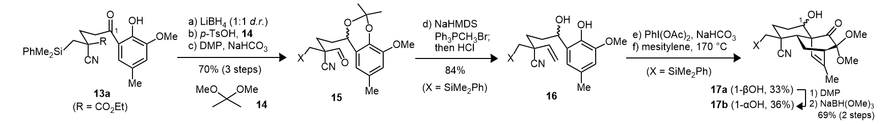

[下载可编辑 CDXML](assets/readme/paper-replica/replica.cdxml) · [查看逐结构左右对照](assets/readme/paper-replica/structure-comparison.png) · [案例来源与验证范围](assets/readme/paper-replica/provenance.json)

从保存的 CDXML 回读的五个结构与参考结构一致，17a/17b 共用的波浪键按原图保留。

<a id="mechanism-demo"></a>

### Sceptrin 反应机理


<details>
<summary>展开原始截图</summary>
<br>

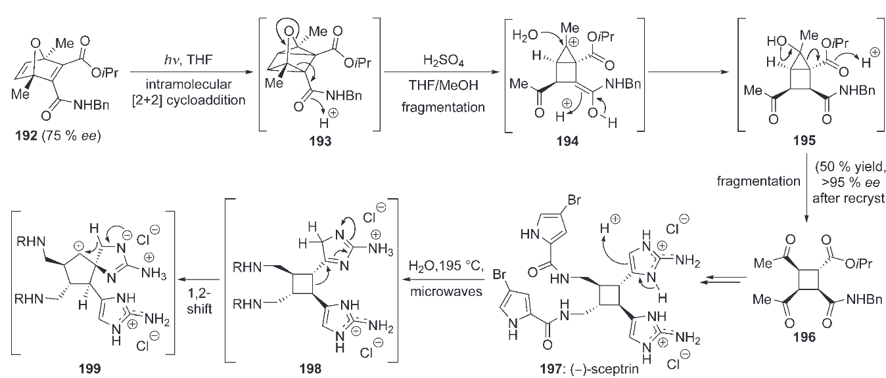

</details>

[可编辑 CDXML](assets/readme/mechanism/mechanism.cdxml) · [原生 CDX](assets/readme/mechanism/mechanism.cdx) · [左右对照](assets/readme/mechanism/comparison.png) · [验证详情](assets/readme/mechanism/provenance.json)

八个编号结构和六个氯离子经过真实的 ChemDraw CDXML → CDX → CDXML 保存后，原子、立体化学和形式电荷保持不变。R 基团与原图一样保留为通用取代基。

<a id="markush-demo"></a>

### 专利 Markush 通式


[可编辑 CDXML](assets/readme/markush/markush.cdxml) · [Markush 结构定义](assets/readme/markush/markush.json) · [CXSMILES](assets/readme/markush/markush.cxsmiles) · [V3000 molfile](assets/readme/markush/markush.mol) · [验证与局限](assets/readme/markush/provenance.json) · [工作流程](skill/chemdraw/references/markush.md)

输入是一张专利通式图和一段权利要求文本。结构里有 R 基和连接基、两个可变环、一个可以连在三个环位置之一的基团，以及重复次数。`cdx.py markush` 引导整个提取：agent 负责转录标签、核对读回图、检查左右对照图，并把每条权利要求转成取值，几何、结构和绘图都由代码完成。在附带的示例中，结果与手写的参考结构逐原子一致，绘图沿用原图版式（所绘墨迹与原图的重合度为 0.99）。结构同时保存为 CXSMILES 和 V3000 molfile，其他化学软件也能读取。

### 原生科研绘图

<table>
  <tr>
    <td width="50%" valign="top">
      <a id="tlc-demo"></a>
      <b>原生 TLC</b><br>
      <sub>原生 TLC 板、泳道和斑点，Rf 数值为示例。</sub><br><br>
      <p align="center">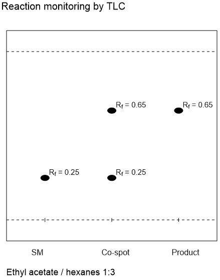</p>
      <sub><a href="assets/readme/scientific/tlc.cdxml">可编辑 CDXML</a> · <a href="skill/chemdraw/references/scientific-workflows.md">运行示例</a> · <a href="assets/readme/scientific/provenance.json">数据与模板来源</a></sub>
    </td>
    <td width="50%" valign="top">
      <a id="apparatus-demo"></a>
      <b>原生装置图</b><br>
      <sub>由 ChemDraw 自带装置模板组装，保留原生可编辑图形。</sub><br><br>
      <p align="center"></p>
      <sub><a href="assets/readme/scientific/apparatus.cdxml">可编辑 CDXML</a> · <a href="skill/chemdraw/references/scientific-workflows.md">运行示例</a> · <a href="assets/readme/scientific/provenance.json">数据与模板来源</a></sub>
    </td>
  </tr>
  <tr>
    <td width="50%" valign="top">
      <a id="nmr-demo"></a>
      <b>实验 NMR 谱图</b><br>
      <sub>真实的已处理一维 NMR 数据，支持寻峰和指定区间积分。</sub><br><br>
      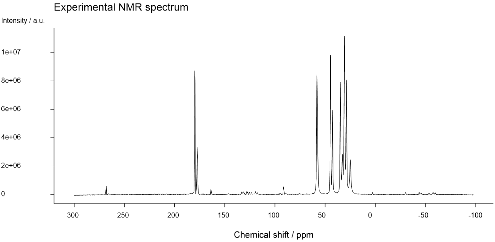<br>
      <sub><a href="assets/readme/scientific/nmr.cdxml">可编辑 CDXML</a> · <a href="skill/chemdraw/references/scientific-workflows.md">运行示例</a> · <a href="assets/readme/scientific/provenance.json">数据与模板来源</a></sub>
    </td>
    <td width="50%" valign="top">
      <a id="kinetics-demo"></a>
      <b>模拟反应动力学</b><br>
      <sub>把模拟的一阶衰减数据画成可编辑曲线。</sub><br><br>
      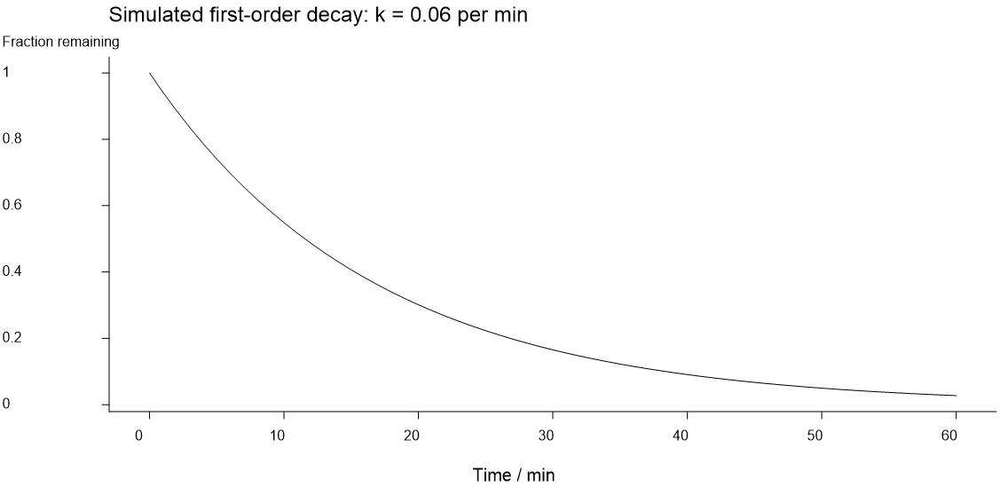<br>
      <sub><a href="assets/readme/scientific/kinetics.cdxml">可编辑 CDXML</a> · <a href="skill/chemdraw/references/scientific-workflows.md">运行示例</a> · <a href="assets/readme/scientific/provenance.json">数据与模板来源</a></sub>
    </td>
  </tr>
</table>

<a id="synthesis-101-demo"></a>

### 复杂合成：101–112

**完整路线图与可编辑结构。** 包含全部化合物编号、反应条件和机理箭头，原生保存后连接关系、电荷、同位素和双键几何保持不变。


[完整 CDXML](assets/readme/synthesis-101-112/figure.cdxml) · [原图与复刻对照](assets/readme/synthesis-101-112/comparison-full.png) · [验证与来源](assets/readme/synthesis-101-112/provenance.json)

<details>
<summary>展开原图与复刻对照</summary>


</details>

<a id="synthesis-113-demo"></a>

### 复杂合成：113–122

**完整路线图与可编辑结构。** 包含全部化合物编号、反应条件和机理箭头，原生保存后连接关系、电荷、同位素和双键几何保持不变。


[完整 CDXML](assets/readme/synthesis-113-122/figure.cdxml) · [原图与复刻对照](assets/readme/synthesis-113-122/comparison-full.png) · [验证与来源](assets/readme/synthesis-113-122/provenance.json)

<details>
<summary>展开原图与复刻对照</summary>

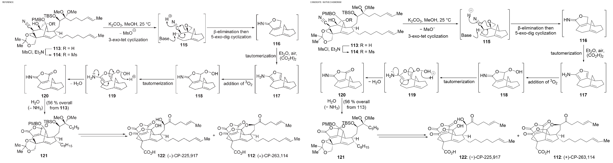

</details>

## 复刻论文反应图

先读整图，再沿一条路线执行：

<p align="center">
  <code>整图读图</code> → <code>裁切结构</code> → <code>DECIMER</code> → <code>匹配原图取向</code> → <code>左右对照</code> → <code>修正结构</code> → <code>组装版式</code> → <code>原生预览</code>
</p>

```text
使用 ChemDraw Skill 复刻这张论文图。先读完整反应流程，再裁切各个完整结构，
取得 DECIMER 识别候选。按原图取向重绘，实际查看左右对照并修正受影响结构；
转录反应条件，最后交付可编辑 CDXML 和原生预览。
```

[图像复刻指南](skill/chemdraw/references/image-visual-review.md) · [最小任务模板](skill/chemdraw/assets/paper-replica/task-template.json) · [绘图示例](skill/chemdraw/assets/paper-replica/example/CASE.md)

| 遇到的需求 | 现成处理路线 |
| --- | --- |
| 图像裁切与复核 | 裁切、遮罩和对照工具，保留区域与识别结果的对应关系 |
| 折叠链条或桥环取向 | 追踪原图坐标，检查交叉关系和键级 |
| 修正立体化学 | 查看原子编号，经接口明确修改，再读回最终 CDXML |
| 组装整张反应图 | 固定坐标、富文本条件、多种箭头和原生预览 |
| 绘图之外的化学处理 | RDKit 立体异构体与互变异构体枚举、MCS 和 R-group 分解 |

识别时只把任务图片及其裁切图上传到 DECIMER API（`cdx.py decimer --preflight` 可先查看将要发送的内容；要求离线时不上传）。

<details>
<summary><b>离线重建两张复杂路线图</b></summary>
<br>

两张路线图都由真实的分子对象（可编辑的原子、键和可展开缩写）以及文字、括号和电子箭头组成。[逐原子检查记录](skill/chemdraw/assets/paper-reconstructions/stereochemistry-check.json)给出组件哈希及原子对应关系。

安装运行时后，可离线重建这两张布局，无需再次调用 DECIMER（请使用新的输出目录）：

```bash
python skill/chemdraw/scripts/cdx.py py skill/chemdraw/assets/paper-reconstructions/rebuild.py ./paper-figures-output
```

原生预览需要桌面版 ChemDraw（Windows 或 macOS）。详见[重建示例](skill/chemdraw/assets/paper-reconstructions/README.md)。

</details>

## 平台支持

可移植化学层（CDXML 生成与编辑、RDKit 校验、命令行和 MCP）支持 Windows、macOS 和 Linux。原生 ChemDraw 在 Windows 上通过 COM 驱动，在 macOS 上通过 AppleScript 驱动，工具与输出相同。

| 能力 | Windows | macOS | Linux |
| --- | :---: | :---: | :---: |
| CDXML、RDKit、命令行与 MCP 工作流 | ✅ | ✅ | ✅ |
| ChemDraw 原生渲染、转换与清理 | ✅ <sub>需激活安装</sub> | ✅ <sub>ChemDraw for macOS</sub> | — |
| ChemScript 操作（命名、分子式、清理、子结构） | ✅ <sub>需兼容 SDK</sub> | ✅ <sub>ChemDraw + OPSIN + RDKit</sub> | — |
| 原始 ChemScript SDK 程序 | ✅ <sub>需兼容 SDK</sub> | ✅ <sub>核心 API 模拟</sub> | — |
| 可编辑 Office ChemDraw 对象 | ✅ <sub>桌面版 Office</sub> | ✅ <sub>矢量预览，`cdx.py office-edit`</sub> | — |
| Office 文件的 PDF 预览 | ✅ <sub>桌面版 Office</sub> | ✅ <sub>已激活的 Microsoft 365</sub> | — |

<sub>✅ 支持 · — 不支持（没有可用的 bridge）</sub>

macOS 上的差异（自动化权限、隐藏的 ChemDraw 实例、字体替换、基于 SVG 的矢量 OLE 预览、以 `office-edit` 代替双击编辑，以及 ChemScript 模拟）见[运维说明](skill/chemdraw/references/operations.md#macos)。

<details>
<summary><b>所需组件</b></summary>
<br>

| 目标 | 在核心安装基础上增加 |
| --- | --- |
| 创建和编辑 CDXML | 能执行命令行的任意 Agent、64 位 Python 3.10–3.13，以及内置工具包运行时（由 `scripts/install.py --runtime` 从 `toolkit/` 构建） |
| 原生 PNG、CDX 或 ChemDraw 清理 | 已获得许可并激活的桌面版 ChemDraw：Windows 上 COM 自动化可正常工作，或 macOS 上已授予自动化权限的 ChemDraw for macOS |
| 分子比较或 ChemScript SDK 调用 | 可移植相似度比较使用 RDKit；精确检查和原始 SDK 程序需 Windows 主机上的兼容 ChemScript DLL（macOS 上由 ChemDraw、OPSIN 和 RDKit 完成 ChemScript 操作） |
| 可编辑的 Word 或 PowerPoint 对象 | 用桌面版 ChemDraw 生成；PDF 预览需桌面版 Word 和/或 PowerPoint（macOS 上需已激活） |
| 本地光学结构识别 | DECIMER 模型权重及其运行时依赖 |
| 远程访问 ChemDraw 工作站 | Windows 主机、经过身份验证的 HTTP 配置以及加密网络通道 |

项目不附带 ChemDraw、Microsoft Office、ChemScript 和 DECIMER 模型权重。安装选项、手动创建运行时和诊断方法见[安装指南](docs/guide.zh-cn.md#首次安装)。

</details>

## 测试与安全

- CI 在 Windows 和 Linux 上运行 Skill 测试（Python 3.12，MCP 1.28.1 与 2.0.0），在 Python 3.10–3.13 上运行工具包测试，并在 Windows、Linux 和 macOS 上做端到端安装测试。ChemDraw、ChemScript 和 Office 的原生功能在一台已授权的 Windows 工作站上手动测试；macOS 的 AppleScript 路径在 macOS 26.6（Apple 芯片）和 ChemDraw 26.0 上测试过。
- 工具只写入新的输出路径，除非你明确要求，否则不会覆盖已有文件。
- 图像识别只把选定的图片发送到 DECIMER API。`cdx.py decimer --preflight` 可以先看将要发送什么，要求离线时不上传。各类报告和映射器在本地运行；计算器只有在名称不在内置表中时才会联网查询，`--offline` 可关闭。
- 远程使用 HTTP 服务时需要 Bearer 密钥和允许的主机列表，并应放在加密隧道或 HTTPS 代理之后。详见[安全策略](.github/SECURITY.md)。

## 常见问题

<details>
<summary><b>任意 AI Agent 都能使用这个 ChemDraw Skill 吗？</b></summary>
<br>

可以。Agent 需要能读取 Skill 指令并执行命令行，所有工具都通过 `cdx.py` 运行。安装脚本会把 Skill 放到 Claude Code、Codex、Gemini CLI、GitHub Copilot、Cursor、OpenCode 等读取 `SKILL.md` 目录的 Agent 能发现的位置；不支持 Skill 自动发现的 Agent，可在其指令文件中指向 `SKILL.md`；偏好 MCP（Model Context Protocol，模型上下文协议）的客户端也可以注册自带的服务。详见 [Agent 接入](skill/chemdraw/references/agent-integration.md)。

</details>

<details>
<summary><b>必须使用 MCP 服务吗？</b></summary>
<br>

不需要。命令行覆盖全部工具，并保留同样的工作进程隔离、ChemDraw 原生锁和超时控制。需要类型化工具调用的客户端仍可使用 MCP。

</details>

<details>
<summary><b>能从 Excel 实验数据生成 SAR 图和底物拓展图吗？</b></summary>
<br>

可以。将可信结构与 CSV/XLSX 数据绑定，生成可编辑的构效关系（SAR）图或底物拓展图。稳定的化合物 ID 保持数据对应，更新项目时保留无关的手工布局修改。详见[数据驱动绘图指南](skill/chemdraw/references/data-driven-figures.md)。

</details>

<details>
<summary><b>它会编造反应条件或推测机理吗？</b></summary>
<br>

不会。按需求画的图，条件、收率和实测数值只取自你给的内容；缺的就保持缺失，并在报告里说明。解析不了的名称会被拒绝，而不是猜一个。机理只按你列出的电子转移绘制，箭头起点没有孤对电子或电荷时会提醒，但不会判断机理本身对不对。详见[一句话生成新图](#one-command-figures)。

</details>

<details>
<summary><b>能帮我算每种试剂该称多少吗？</b></summary>
<br>

可以。`cdx.py calc` 会打开计算器页面，画出或粘贴反应后，改当量、mmol、质量或体积中的任何一个，浓度、收率、原子经济性和 PMI 随之变化。用量可以写到 ChemDraw 流程图的结构下方。你没有给出的用量使用默认值，并标明是假设值。详见[反应计算器与化学报告](#反应计算器与化学报告)。

</details>

<details>
<summary><b>安全信息可以信到什么程度？</b></summary>
<br>

它只是提醒，来自内置的约五十种常用溶剂和试剂表：GHS 图标、H 说明、沸点和闪点。表里没有的物质显示“未收录”，不会显示成安全。表中的数值按常见供应商的分类写成，各家会有出入，请以你实际使用的产品的 SDS 为准。

</details>

<details>
<summary><b>能把文献结构图复刻成可编辑 ChemDraw 文件吗？</b></summary>
<br>

[论文图复刻流程](skill/chemdraw/references/image-visual-review.md)结合结构确认、版式重建与原生视觉复核，输出可编辑 CDXML 和原生预览。

</details>

## 共同建设 macOS 支持

macOS 适配器通过 ChemDraw for macOS 的 AppleScript 字典驱动 ChemDraw，带超时、按用户的原生锁、暂存临时文件和保存后回读，并把 ChemScript 专有行为映射到 ChemDraw、OPSIN 和 RDKit。仍欢迎以下方面的帮助：

- Intel Mac 和其他 ChemDraw 版本（已测试：macOS 26.6、Apple 芯片上的 ChemDraw 26.0）；
- 通过已激活的 Microsoft 365 for macOS 生成 PDF 预览；
- 模拟范围（`StructureData`、`ReactionData`、`LargestCommonSubstructure` 核心）之外的 ChemScript SDK 成员。

请从[贡献指南](.github/contributing.md)开始，提交聚焦的 issue 或 PR，并附上准确的 macOS 版本、芯片、ChemDraw 构建号、权限提示、命令输出和最小复现文件。不要上传私有论文、凭据或受许可保护的 ChemDraw 资源。

## 文档

| 从这里开始 | 深入了解 |
| --- | --- |
| [安装与首次使用](docs/zh-cn.md) | [自动生成的工具签名](skill/chemdraw/references/mcp-signatures.md) |
| [安装、故障处理与运行维护](docs/guide.zh-cn.md) | [经过审计的内置工具包公共清单](skill/chemdraw/references/toolkit-public-inventory.md) |
| [Agent 接入与 `cdx.py` 命令参考](skill/chemdraw/references/agent-integration.md) | [工具包开发者参考](toolkit/docs/agent-reference.md) · [生成的 MCP 工具参考](toolkit/docs/mcp-tools.md) |
| [面向任务的工作流目录](skill/chemdraw/references/workflow-router.md) | [远程 HTTP 配置](skill/chemdraw/references/operations.md#remote-http-only-when-asked) |
| [贡献指南](.github/contributing.md) · [安全策略](.github/SECURITY.md) | [仓库贡献者说明](AGENTS.md) |
| [官网](https://zichenwang114514.github.io/chemdraw-skill/) | [落地页源码与部署说明](docs/website.md) |

可部署的 Skill 位于 [`skill/chemdraw`](skill/chemdraw)。它所驱动的化学运行时，即 `cdxml_toolkit` Python 包，位于 [`toolkit`](toolkit)，并带有自己的测试。

## 许可证

仓库自行编写的代码与文档采用 [MIT 许可证](LICENSE)。[`toolkit/`](toolkit) 中的内置工具包基于 Hiu Fung Kevin Lee 的原始 `cdxml-toolkit`，保留其自身的 [MIT 许可证](toolkit/LICENSE)和[第三方声明](toolkit/NOTICE.md)。ChemDraw、Microsoft Office、各 Agent 客户端、MCP Python SDK、RDKit、DECIMER 及其依赖项继续适用各自的许可证与使用条款。

本项目为独立社区项目，与 Revvity、Anthropic、OpenAI、Google、GitHub、Microsoft、Anysphere、OpenCode 维护者以及上游 `cdxml-toolkit`、MCP Python SDK、RDKit 或 DECIMER 的维护者不存在隶属关系，也未获得其认可。

<p align="right"><a href="#top">返回顶部 ↑</a></p>
