# Style gallery

One Suzuki coupling drawn by `cdx.py draw` once per style and rendered through desktop ChemDraw. Regenerate the CDXML files with `cdx.py py <skill>/scripts/style_gallery.py --output-dir NEW_DIR` and render them with `cdx.py render`. Each house style's folder beside this one holds its evidence crops, a README with the sources and a `replica/` folder of published figures redrawn in that style.

## Publishers and textbooks

| Style | Draws | Render |
| --- | --- | --- |
| [`cell_press_chem`](../cell_press_chem/README.md) Cell Press chemistry journals (Chem, Chem Catalysis) | 5 figure types, base `wiley` | 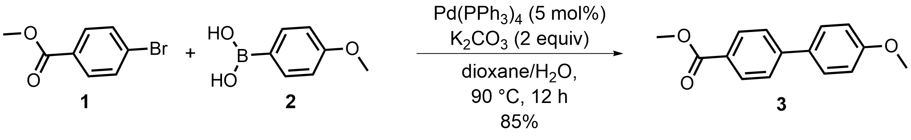 |
| [`nature_portfolio`](../nature_portfolio/README.md) Nature Portfolio | 1 figure type, base `nature` | 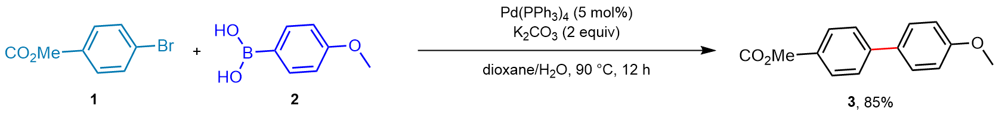 |
| [`openstax_chemistry`](../openstax_chemistry/README.md) OpenStax Chemistry textbooks (CC BY editions) | 6 figure types, base `chemdraw_slide` | 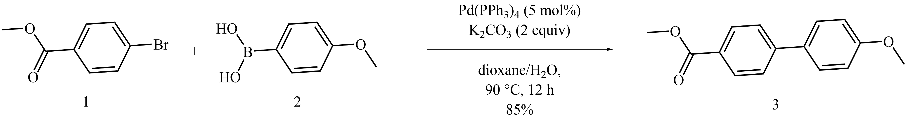 |
| [`rsc_journals`](../rsc_journals/README.md) Royal Society of Chemistry | 2 figure types, base `rsc` | 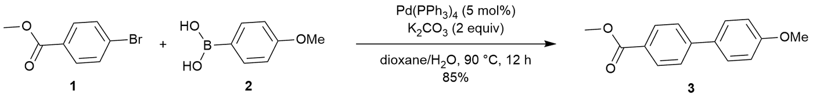 |
| [`science_aaas`](../science_aaas/README.md) Science / Science Advances (AAAS) | 1 figure type, base `nature` | 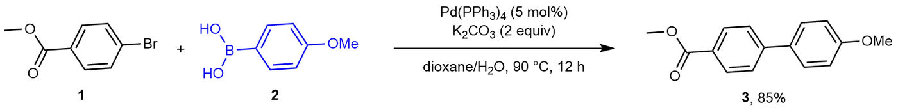 |
| [`uspto_patents`](../uspto_patents/README.md) US patents and published applications (USPTO) | 4 figure types, base `j_mol_mod` | 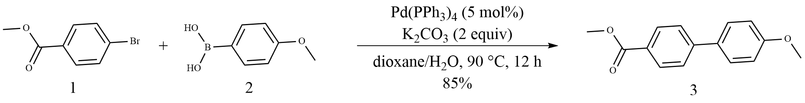 |
| [`wiley_angew`](../wiley_angew/README.md) Wiley-VCH chemistry journals (Angewandte Chemie, Chemistry - A European Journal) | 1 figure type, base `wiley` | 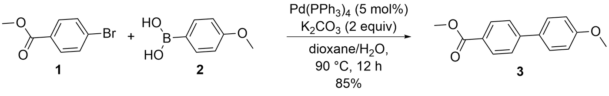 |

## Journals

| Style | Draws | Render |
| --- | --- | --- |
| [`acs_chem_biol`](../acs_chem_biol/README.md) ACS Chemical Biology | 4 figure types, base `acs1996` | 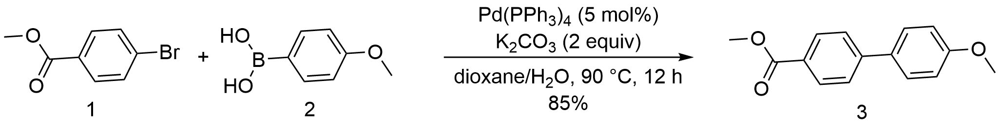 |
| [`acs_jacs`](../acs_jacs/README.md) ACS organic journals (JACS, Org. Lett., J. Org. Chem., JACS Au) | 1 figure type, base `acs1996` | 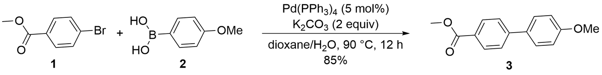 |
| [`beilstein_joc`](../beilstein_joc/README.md) Beilstein Journal of Organic Chemistry | 7 figure types, base `nature` | 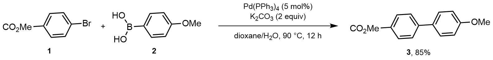 |
| [`chemeurj`](../chemeurj/README.md) Chemistry - A European Journal (Wiley-VCH) | 4 figure types, base `wiley` | 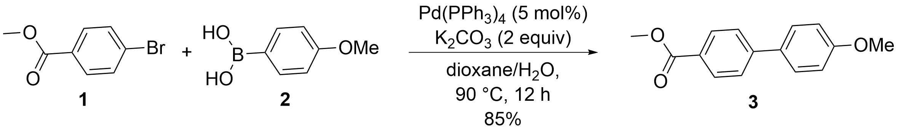 |
| [`dalton_transactions`](../dalton_transactions/README.md) Dalton Transactions (RSC) | 4 figure types, base `rsc` | 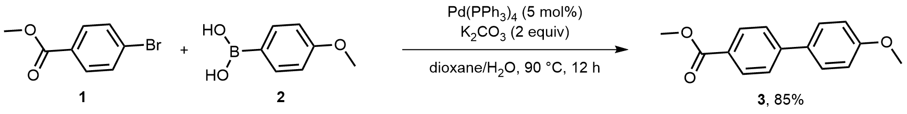 |
| [`jacs_au`](../jacs_au/README.md) JACS Au (ACS) | 6 figure types, base `acs1996` | 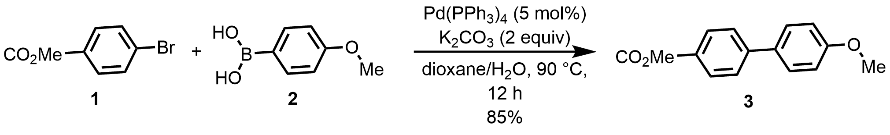 |
| [`jchem_educ`](../jchem_educ/README.md) Journal of Chemical Education (ACS) | 5 figure types, base `acs1996` | 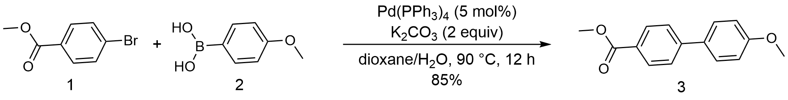 |
| [`jmed_chem`](../jmed_chem/README.md) Journal of Medicinal Chemistry (ACS) | 4 figure types, base `acs1996` | 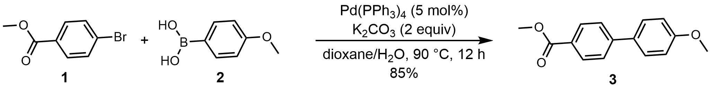 |
| [`mdpi_molecules`](../mdpi_molecules/README.md) Molecules (MDPI) | 6 figure types, base `acs1996` | 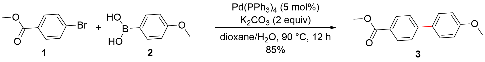 |
| [`natural_product_reports`](../natural_product_reports/README.md) Natural Product Reports (RSC) | 4 figure types, base `rsc` | 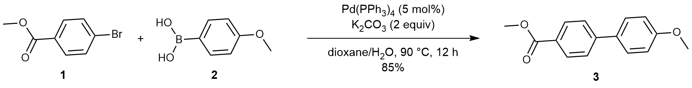 |
| [`oprd_process`](../oprd_process/README.md) Organic Process Research & Development (ACS) | 5 figure types, base `acs1996` | 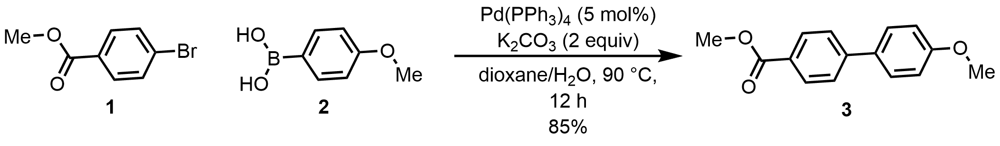 |
| [`org_lett`](../org_lett/README.md) Organic Letters (ACS) | 6 figure types, base `acs1996` | 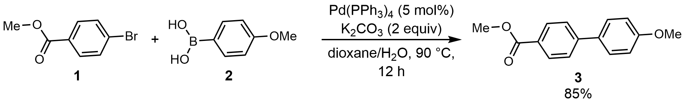 |
| [`polymer_chemistry`](../polymer_chemistry/README.md) Polymer Chemistry (RSC) | 4 figure types, base `rsc` | 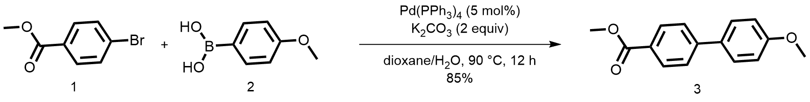 |

## Research groups

| Style | Draws | Render |
| --- | --- | --- |
| [`baran_group`](../baran_group/README.md) Baran group (Scripps Research) | 2 figure types, base `acs1996` | 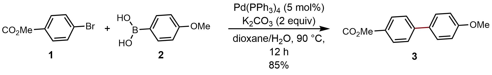 |
| [`glorius_group`](../glorius_group/README.md) Glorius group (University of Münster) | 5 figure types, base `acs1996` | 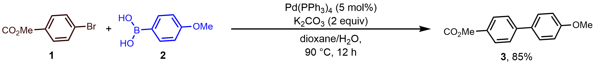 |
| [`houk_group`](../houk_group/README.md) Houk group (UCLA), computational organic chemistry | 5 figure types, base `acs1996` | 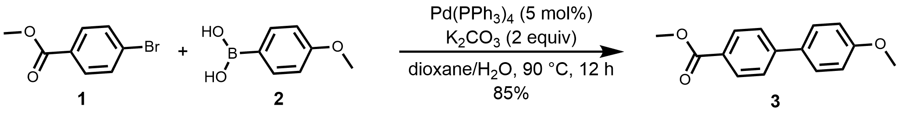 |
| [`lipshutz_group`](../lipshutz_group/README.md) Lipshutz group (UC Santa Barbara) | 2 figure types, base `acs1996` | 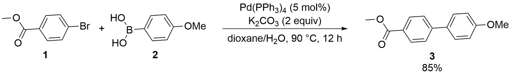 |
| [`list_group`](../list_group/README.md) List group (MPI für Kohlenforschung) | 5 figure types, base `nature` | 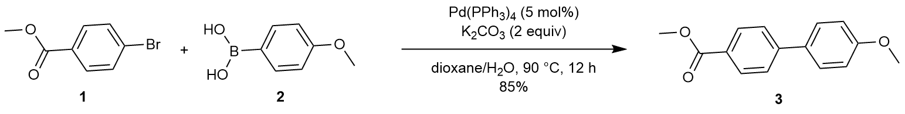 |
| [`macmillan_group`](../macmillan_group/README.md) MacMillan group (Princeton University) | 2 figure types, base `acs1996` | 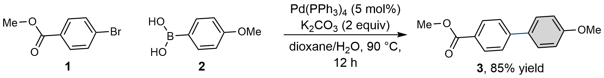 |
| [`sarpong_group`](../sarpong_group/README.md) Sarpong group (UC Berkeley) | 6 figure types, base `nature` | 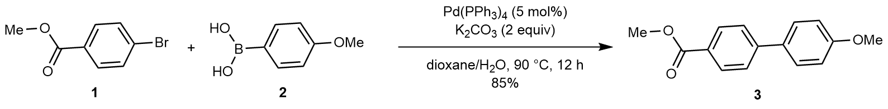 |
| [`studer_group`](../studer_group/README.md) Studer group (University of Münster) | 4 figure types, base `nature` | 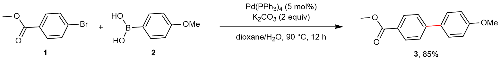 |

## Measurement presets

ChemDraw's stock style sheets alone, with no conventions:

| Preset | Render |
| --- | --- |
| `acs1996` | 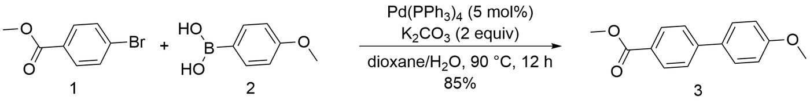 |
| `nature` | 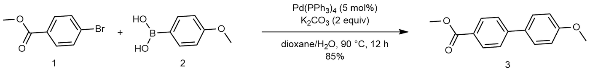 |
| `rsc` | 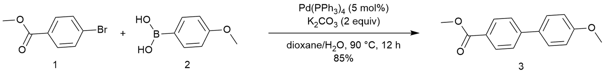 |
| `wiley` | 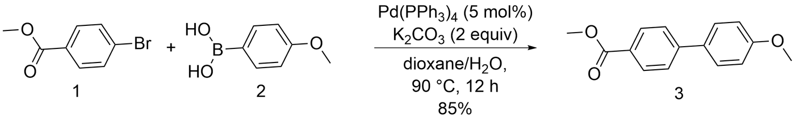 |

## Literature replicas

47 published figures, from single schemes to catalytic cycles and scope tables, each redrawn from a brief in the house style read from it and rendered by desktop ChemDraw. A case folder holds the reference crop, `brief.json`, the render, `replay.py` and `CASE.md`, which compares every convention the card claims for that figure type with the replica and lists the remaining differences. The last column counts the conventions the replica matches; a card lists more conventions than one figure uses, so the count is rarely complete.

### `acs_chem_biol`

| Case | Figure type | Published | Replica | Conventions matched |
| --- | --- | --- | --- | --- |
| [acs_chem_biol-05](../acs_chem_biol/replica/acs_chem_biol-05/CASE.md) | biomolecule, reaction scheme | 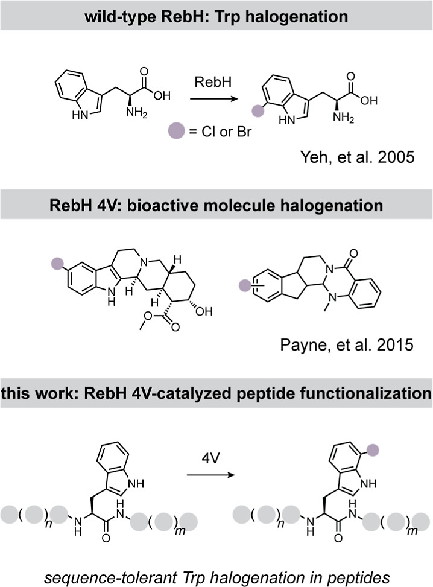 | 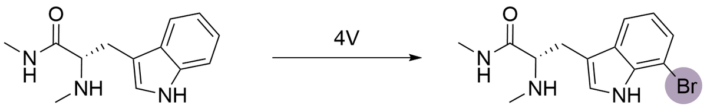 | 7 of 21 |
| [acs_chem_biol-06](../acs_chem_biol/replica/acs_chem_biol-06/CASE.md) | biomolecule, reaction scheme | 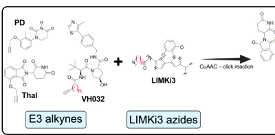 | 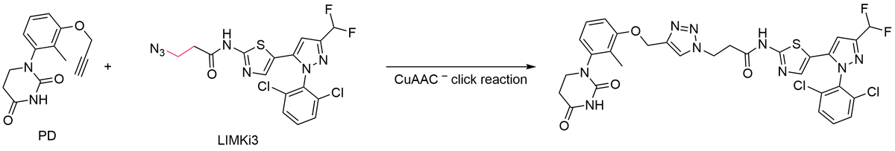 | 5 of 8 (1 partly) |

### `acs_jacs`

| Case | Figure type | Published | Replica | Conventions matched |
| --- | --- | --- | --- | --- |
| [acs_jacs-03](../acs_jacs/replica/acs_jacs-03/CASE.md) | reaction scheme | 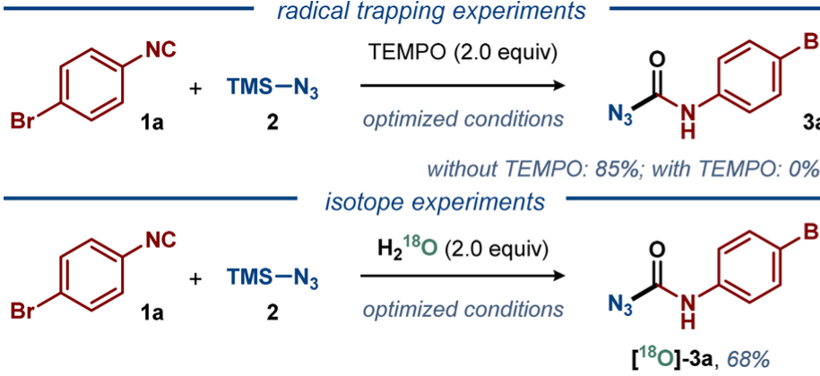 | 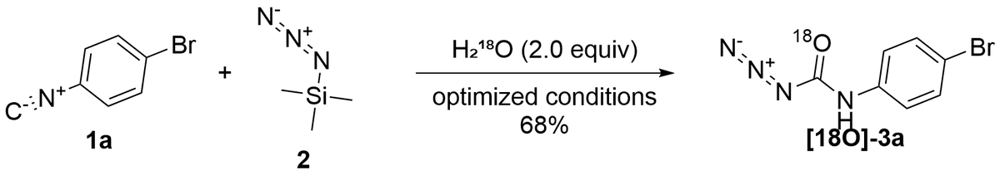 | 11 of 21 |
| [acs_jacs-04](../acs_jacs/replica/acs_jacs-04/CASE.md) | reaction scheme | 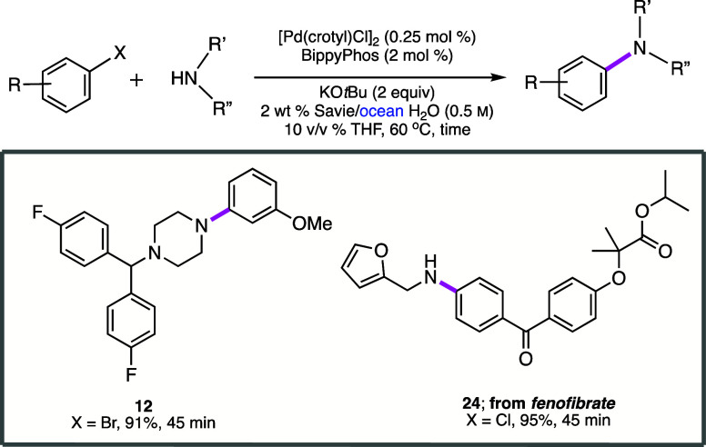 | 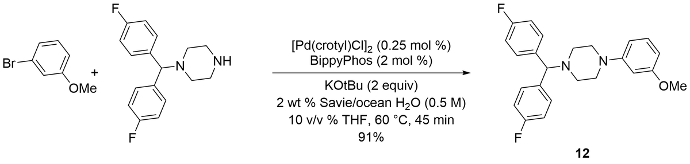 | 9 of 15 |

### `beilstein_joc`

| Case | Figure type | Published | Replica | Conventions matched |
| --- | --- | --- | --- | --- |
| [beilstein_joc-01](../beilstein_joc/replica/beilstein_joc-01/CASE.md) | reaction scheme, substrate scope | 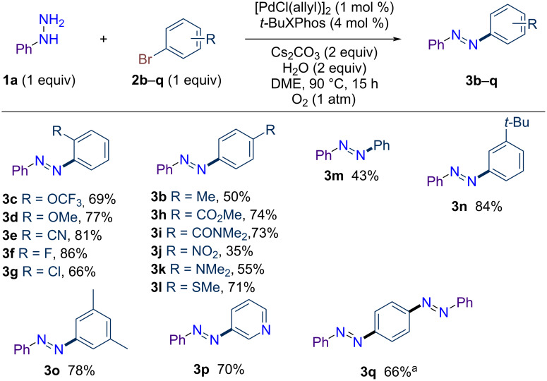 | 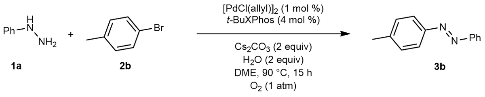 | 13 of 24 |
| [beilstein_joc-03](../beilstein_joc/replica/beilstein_joc-03/CASE.md) | catalytic cycle | 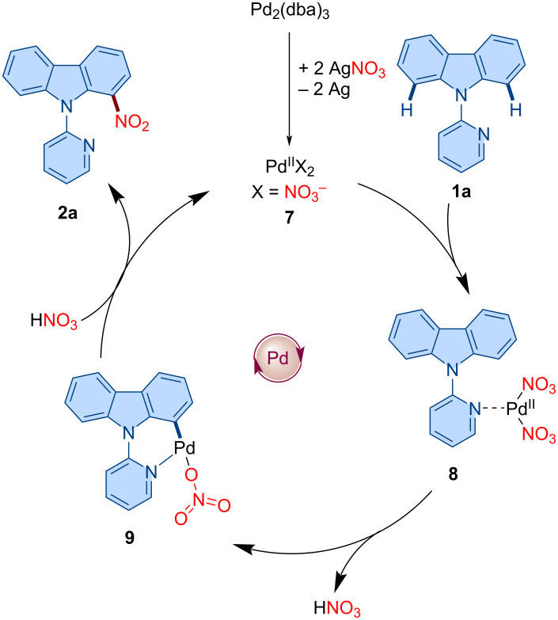 | 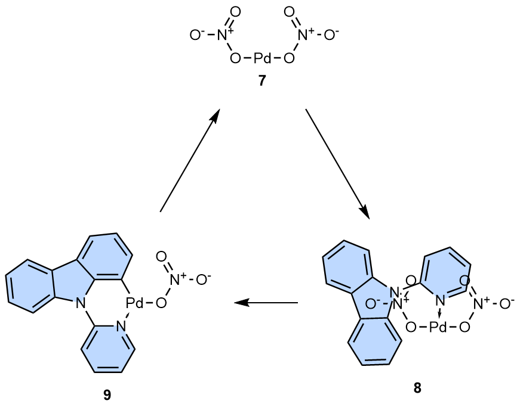 | 7 of 17 (1 partly) |

### `cell_press_chem`

| Case | Figure type | Published | Replica | Conventions matched |
| --- | --- | --- | --- | --- |
| [cell_press_chem-01](../cell_press_chem/replica/cell_press_chem-01/CASE.md) | reaction scheme | 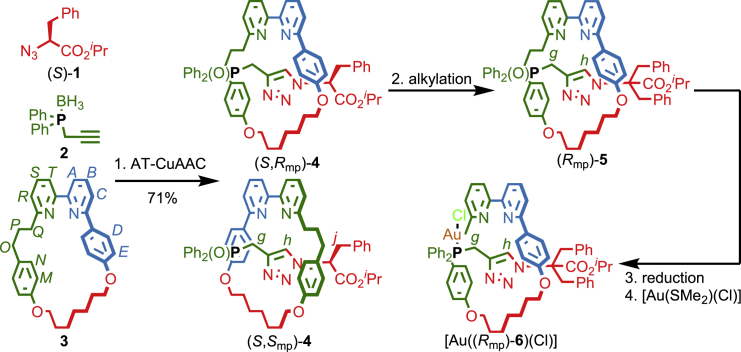 | 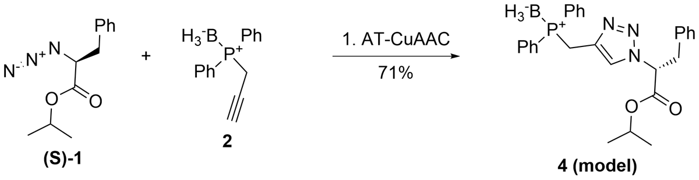 | 8 of 18 |
| [cell_press_chem-02](../cell_press_chem/replica/cell_press_chem-02/CASE.md) | reaction scheme | 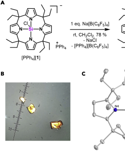 | 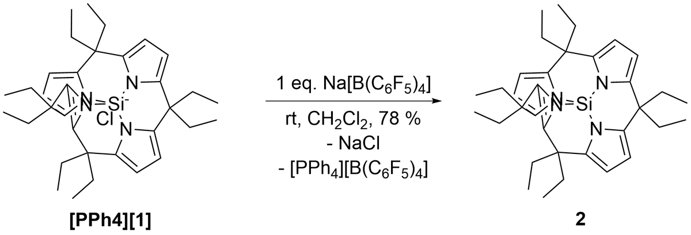 | 5 of 13 |

### `chemeurj`

| Case | Figure type | Published | Replica | Conventions matched |
| --- | --- | --- | --- | --- |
| [chemeurj-02](../chemeurj/replica/chemeurj-02/CASE.md) | reaction scheme | 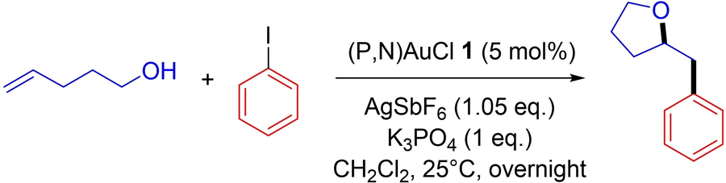 | 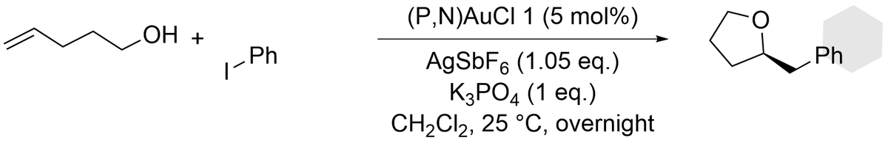 | 8 of 19 |
| [chemeurj-07](../chemeurj/replica/chemeurj-07/CASE.md) | catalytic cycle |  |  | 10 of 21 |

### `dalton_transactions`

| Case | Figure type | Published | Replica | Conventions matched |
| --- | --- | --- | --- | --- |
| [dalton_transactions-05](../dalton_transactions/replica/dalton_transactions-05/CASE.md) | coordination complex, catalytic cycle |  |  | 6 of 15 |
| [dalton_transactions-06](../dalton_transactions/replica/dalton_transactions-06/CASE.md) | coordination complex, reaction scheme |  |  | 5 of 12 |

### `glorius_group`

| Case | Figure type | Published | Replica | Conventions matched |
| --- | --- | --- | --- | --- |
| [glorius_group-01](../glorius_group/replica/glorius_group-01/CASE.md) | reaction scheme |  |  | 8 of 21 |
| [glorius_group-05](../glorius_group/replica/glorius_group-05/CASE.md) | catalytic cycle |  |  | 6 of 14 |

### `houk_group`

| Case | Figure type | Published | Replica | Conventions matched |
| --- | --- | --- | --- | --- |
| [houk_group-05](../houk_group/replica/houk_group-05/CASE.md) | structure panel |  |  | 3 of 10 (3 partly) |
| [houk_group-07](../houk_group/replica/houk_group-07/CASE.md) | reaction scheme |  |  | 6 of 19 |
| [houk_group-08](../houk_group/replica/houk_group-08/CASE.md) | reaction scheme |  |  | 7 of 15 |

### `jacs_au`

| Case | Figure type | Published | Replica | Conventions matched |
| --- | --- | --- | --- | --- |
| [jacs_au-02](../jacs_au/replica/jacs_au-02/CASE.md) | concept panel |  |  | 4 of 13 (1 partly) |
| [jacs_au-05](../jacs_au/replica/jacs_au-05/CASE.md) | setup diagram |  |  | 7 of 14 (2 partly) |

### `jchem_educ`

| Case | Figure type | Published | Replica | Conventions matched |
| --- | --- | --- | --- | --- |
| [jchem_educ-01](../jchem_educ/replica/jchem_educ-01/CASE.md) | reaction scheme |  |  | 5 of 12 |
| [jchem_educ-03](../jchem_educ/replica/jchem_educ-03/CASE.md) | mechanism |  |  | 7 of 13 |

### `jmed_chem`

| Case | Figure type | Published | Replica | Conventions matched |
| --- | --- | --- | --- | --- |
| [jmed_chem-03](../jmed_chem/replica/jmed_chem-03/CASE.md) | total synthesis |  |  | 10 of 16 |

### `lipshutz_group`

| Case | Figure type | Published | Replica | Conventions matched |
| --- | --- | --- | --- | --- |
| [lipshutz_group-01](../lipshutz_group/replica/lipshutz_group-01/CASE.md) | substrate scope |  |  | 13 of 17 |

### `list_group`

| Case | Figure type | Published | Replica | Conventions matched |
| --- | --- | --- | --- | --- |
| [list_group-05](../list_group/replica/list_group-05/CASE.md) | catalytic cycle |  |  | 7 of 16 |

### `macmillan_group`

| Case | Figure type | Published | Replica | Conventions matched |
| --- | --- | --- | --- | --- |
| [macmillan_group-02](../macmillan_group/replica/macmillan_group-02/CASE.md) | reaction scheme, substrate scope |  |  | 6 of 18 (2 partly) |
| [macmillan_group-03](../macmillan_group/replica/macmillan_group-03/CASE.md) | reaction scheme |  |  | 7 of 17 (3 partly) |

### `mdpi_molecules`

| Case | Figure type | Published | Replica | Conventions matched |
| --- | --- | --- | --- | --- |
| [mdpi_molecules-01](../mdpi_molecules/replica/mdpi_molecules-01/CASE.md) | reaction scheme |  |  | 4 of 10 (1 partly) |
| [mdpi_molecules-04](../mdpi_molecules/replica/mdpi_molecules-04/CASE.md) | catalytic cycle |  |  | 7 of 16 |

### `natural_product_reports`

| Case | Figure type | Published | Replica | Conventions matched |
| --- | --- | --- | --- | --- |
| [natural_product_reports-03](../natural_product_reports/replica/natural_product_reports-03/CASE.md) | biosynthesis, biomolecule |  |  | 6 of 14 |
| [natural_product_reports-06](../natural_product_reports/replica/natural_product_reports-06/CASE.md) | total synthesis |  |  | 9 of 17 (3 partly) |

### `nature_portfolio`

| Case | Figure type | Published | Replica | Conventions matched |
| --- | --- | --- | --- | --- |
| [nature_portfolio-01](../nature_portfolio/replica/nature_portfolio-01/CASE.md) | reaction scheme |  |  | 11 of 24 |
| [nature_portfolio-03](../nature_portfolio/replica/nature_portfolio-03/CASE.md) | substrate scope |  |  | 8 of 19 |

### `openstax_chemistry`

| Case | Figure type | Published | Replica | Conventions matched |
| --- | --- | --- | --- | --- |
| [openstax_chemistry-04](../openstax_chemistry/replica/openstax_chemistry-04/CASE.md) | coordination complex, stereo model |  |  | 4 of 13 |

### `oprd_process`

| Case | Figure type | Published | Replica | Conventions matched |
| --- | --- | --- | --- | --- |
| [oprd_process-03](../oprd_process/replica/oprd_process-03/CASE.md) | reaction scheme |  |  | 12 of 27 |
| [oprd_process-06](../oprd_process/replica/oprd_process-06/CASE.md) | process route |  |  | 4 of 12 (2 partly) |

### `org_lett`

| Case | Figure type | Published | Replica | Conventions matched |
| --- | --- | --- | --- | --- |
| [org_lett-04](../org_lett/replica/org_lett-04/CASE.md) | concept panel |  |  | 12 of 22 |
| [org_lett-09](../org_lett/replica/org_lett-09/CASE.md) | derivatization |  |  | 14 of 25 |

### `polymer_chemistry`

| Case | Figure type | Published | Replica | Conventions matched |
| --- | --- | --- | --- | --- |
| [polymer_chemistry-01](../polymer_chemistry/replica/polymer_chemistry-01/CASE.md) | polymer, reaction scheme |  |  | 6 of 15 |

### `rsc_journals`

| Case | Figure type | Published | Replica | Conventions matched |
| --- | --- | --- | --- | --- |
| [rsc_journals-01](../rsc_journals/replica/rsc_journals-01/CASE.md) | substrate scope |  |  | 9 of 20 (1 partly) |

### `sarpong_group`

| Case | Figure type | Published | Replica | Conventions matched |
| --- | --- | --- | --- | --- |
| [sarpong_group-04](../sarpong_group/replica/sarpong_group-04/CASE.md) | catalytic cycle |  |  | 9 of 19 |

### `science_aaas`

| Case | Figure type | Published | Replica | Conventions matched |
| --- | --- | --- | --- | --- |
| [science_aaas-01](../science_aaas/replica/science_aaas-01/CASE.md) | substrate scope |  |  | 6 of 19 |
| [science_aaas-03](../science_aaas/replica/science_aaas-03/CASE.md) | substrate scope |  |  | 9 of 25 |

### `studer_group`

| Case | Figure type | Published | Replica | Conventions matched |
| --- | --- | --- | --- | --- |
| [studer_group-06](../studer_group/replica/studer_group-06/CASE.md) | reaction scheme |  |  | 13 of 20 |

### `uspto_patents`

| Case | Figure type | Published | Replica | Conventions matched |
| --- | --- | --- | --- | --- |
| [uspto_patents-05](../uspto_patents/replica/uspto_patents-05/CASE.md) | reaction scheme |  |  | 8 of 18 (1 partly) |
| [uspto_patents-07](../uspto_patents/replica/uspto_patents-07/CASE.md) | reaction scheme |  |  | 7 of 17 |

### `wiley_angew`

| Case | Figure type | Published | Replica | Conventions matched |
| --- | --- | --- | --- | --- |
| [wiley_angew-02](../wiley_angew/replica/wiley_angew-02/CASE.md) | reaction scheme |  |  | 5 of 10 |
| [wiley_angew-03](../wiley_angew/replica/wiley_angew-03/CASE.md) | reaction scheme |  |  | 5 of 16 |
