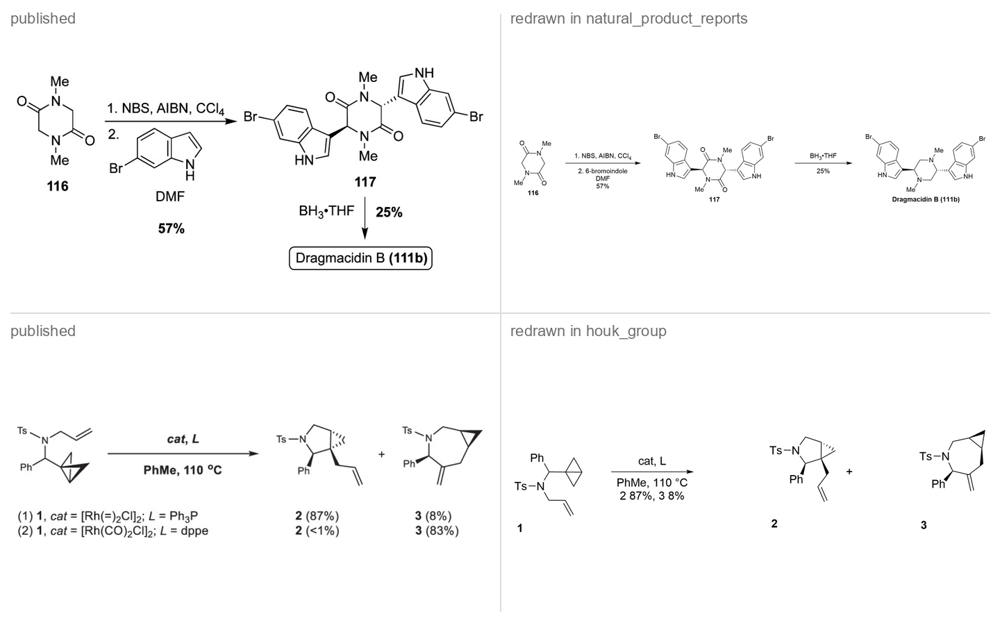

# Style gallery

**28 house styles · 23 figure types · 47 published figures redrawn**

Every picture below was drawn by <code>cdx.py draw</code> and rendered by desktop ChemDraw.

[Styles](#the-styles) &nbsp;·&nbsp; [Literature replicas](#literature-replicas) &nbsp;·&nbsp; [Measurement presets](#measurement-presets) &nbsp;·&nbsp; [Regenerate](#regenerate)

## The styles

One Suzuki coupling, drawn once per style from the same brief. The only thing that changes between the pictures is the house style: where the yield goes, how compounds are numbered, which bond is coloured, how long the arrow is. Click a name for the evidence crops and sources behind it.

### Publishers, patents and textbooks

**[Cell Press chemistry journals (Chem, Chem Catalysis)](../cell_press_chem/README.md)** `cell_press_chem` · 5 figure types · base `wiley` · 2 replicas

**[Nature Portfolio](../nature_portfolio/README.md)** `nature_portfolio` · 1 figure type · base `nature` · 2 replicas

**[OpenStax Chemistry textbooks (CC BY editions)](../openstax_chemistry/README.md)** `openstax_chemistry` · 6 figure types · base `chemdraw_slide` · 1 replica

**[Royal Society of Chemistry](../rsc_journals/README.md)** `rsc_journals` · 2 figure types · base `rsc` · 1 replica

**[Science / Science Advances (AAAS)](../science_aaas/README.md)** `science_aaas` · 1 figure type · base `nature` · 2 replicas

**[US patents and published applications (USPTO)](../uspto_patents/README.md)** `uspto_patents` · 4 figure types · base `j_mol_mod` · 2 replicas

**[Wiley-VCH chemistry journals (Angewandte Chemie, Chemistry - A European Journal)](../wiley_angew/README.md)** `wiley_angew` · 1 figure type · base `wiley` · 2 replicas

### Journals

**[ACS Chemical Biology](../acs_chem_biol/README.md)** `acs_chem_biol` · 4 figure types · base `acs1996` · 2 replicas

**[ACS organic journals (JACS, Org. Lett., J. Org. Chem., JACS Au)](../acs_jacs/README.md)** `acs_jacs` · 1 figure type · base `acs1996` · 2 replicas

**[Beilstein Journal of Organic Chemistry](../beilstein_joc/README.md)** `beilstein_joc` · 7 figure types · base `nature` · 2 replicas

**[Chemistry - A European Journal (Wiley-VCH)](../chemeurj/README.md)** `chemeurj` · 4 figure types · base `wiley` · 2 replicas

**[Dalton Transactions (RSC)](../dalton_transactions/README.md)** `dalton_transactions` · 4 figure types · base `rsc` · 2 replicas

**[JACS Au (ACS)](../jacs_au/README.md)** `jacs_au` · 6 figure types · base `acs1996` · 2 replicas

**[Journal of Chemical Education (ACS)](../jchem_educ/README.md)** `jchem_educ` · 5 figure types · base `acs1996` · 2 replicas

**[Journal of Medicinal Chemistry (ACS)](../jmed_chem/README.md)** `jmed_chem` · 4 figure types · base `acs1996` · 1 replica

**[Molecules (MDPI)](../mdpi_molecules/README.md)** `mdpi_molecules` · 6 figure types · base `acs1996` · 2 replicas

**[Natural Product Reports (RSC)](../natural_product_reports/README.md)** `natural_product_reports` · 4 figure types · base `rsc` · 2 replicas

**[Organic Process Research & Development (ACS)](../oprd_process/README.md)** `oprd_process` · 5 figure types · base `acs1996` · 2 replicas

**[Organic Letters (ACS)](../org_lett/README.md)** `org_lett` · 6 figure types · base `acs1996` · 2 replicas

**[Polymer Chemistry (RSC)](../polymer_chemistry/README.md)** `polymer_chemistry` · 4 figure types · base `rsc` · 1 replica

### Research groups

**[Baran group (Scripps Research)](../baran_group/README.md)** `baran_group` · 2 figure types · base `acs1996`

**[Glorius group (University of Münster)](../glorius_group/README.md)** `glorius_group` · 5 figure types · base `acs1996` · 2 replicas

**[Houk group (UCLA), computational organic chemistry](../houk_group/README.md)** `houk_group` · 5 figure types · base `acs1996` · 3 replicas

**[Lipshutz group (UC Santa Barbara)](../lipshutz_group/README.md)** `lipshutz_group` · 2 figure types · base `acs1996` · 1 replica

**[List group (MPI für Kohlenforschung)](../list_group/README.md)** `list_group` · 5 figure types · base `nature` · 1 replica

**[MacMillan group (Princeton University)](../macmillan_group/README.md)** `macmillan_group` · 2 figure types · base `acs1996` · 2 replicas

**[Sarpong group (UC Berkeley)](../sarpong_group/README.md)** `sarpong_group` · 6 figure types · base `nature` · 1 replica

**[Studer group (University of Münster)](../studer_group/README.md)** `studer_group` · 4 figure types · base `nature` · 1 replica

## Measurement presets

ChemDraw's stock style sheets with no conventions added, the layer every house style sits on.

<table><tr>
<td align="center" valign="top"> <code>acs1996</code></td>
<td align="center" valign="top"> <code>nature</code></td>
<td align="center" valign="top"> <code>rsc</code></td>
<td align="center" valign="top"> <code>wiley</code></td>
</tr></table>

## Literature replicas

47 published figures from 27 styles, from single schemes to catalytic cycles and scope tables. Each was redrawn from a brief in the house style read from it. Left is the published figure, right is the ChemDraw render. A case folder holds the reference crop, `brief.json`, the render, `replay.py` and `CASE.md`, which compares every convention the card claims for that figure type with the replica and lists what still differs. The count under each pair is the conventions the replica matches; a card lists more conventions than one figure uses, so it is rarely complete.

### ACS Chemical Biology

`acs_chem_biol`

**[`acs_chem_biol-05`](../acs_chem_biol/replica/acs_chem_biol-05/CASE.md)** biomolecule, reaction scheme · 7 of 21 conventions

<table>
<tr><th width="50%">Published</th><th width="50%">Redrawn in ChemDraw</th></tr>
<tr>
<td valign="middle" align="center"></td>
<td valign="middle" align="center"></td>
</tr>
</table>

**[`acs_chem_biol-06`](../acs_chem_biol/replica/acs_chem_biol-06/CASE.md)** biomolecule, reaction scheme · 5 of 8 conventions, 1 partly

<table>
<tr><th width="50%">Published</th><th width="50%">Redrawn in ChemDraw</th></tr>
<tr>
<td valign="middle" align="center"></td>
<td valign="middle" align="center"></td>
</tr>
</table>

### ACS organic journals (JACS, Org. Lett., J. Org. Chem., JACS Au)

`acs_jacs`

**[`acs_jacs-03`](../acs_jacs/replica/acs_jacs-03/CASE.md)** reaction scheme · 11 of 21 conventions

<table>
<tr><th width="50%">Published</th><th width="50%">Redrawn in ChemDraw</th></tr>
<tr>
<td valign="middle" align="center"></td>
<td valign="middle" align="center"></td>
</tr>
</table>

**[`acs_jacs-04`](../acs_jacs/replica/acs_jacs-04/CASE.md)** reaction scheme · 9 of 15 conventions

<table>
<tr><th width="50%">Published</th><th width="50%">Redrawn in ChemDraw</th></tr>
<tr>
<td valign="middle" align="center"></td>
<td valign="middle" align="center"></td>
</tr>
</table>

### Beilstein Journal of Organic Chemistry

`beilstein_joc`

**[`beilstein_joc-01`](../beilstein_joc/replica/beilstein_joc-01/CASE.md)** reaction scheme, substrate scope · 13 of 24 conventions

<table>
<tr><th width="50%">Published</th><th width="50%">Redrawn in ChemDraw</th></tr>
<tr>
<td valign="middle" align="center"></td>
<td valign="middle" align="center"></td>
</tr>
</table>

**[`beilstein_joc-03`](../beilstein_joc/replica/beilstein_joc-03/CASE.md)** catalytic cycle · 7 of 17 conventions, 1 partly

<table>
<tr><th width="50%">Published</th><th width="50%">Redrawn in ChemDraw</th></tr>
<tr>
<td valign="middle" align="center"></td>
<td valign="middle" align="center"></td>
</tr>
</table>

### Cell Press chemistry journals (Chem, Chem Catalysis)

`cell_press_chem`

**[`cell_press_chem-01`](../cell_press_chem/replica/cell_press_chem-01/CASE.md)** reaction scheme · 8 of 18 conventions

<table>
<tr><th width="50%">Published</th><th width="50%">Redrawn in ChemDraw</th></tr>
<tr>
<td valign="middle" align="center"></td>
<td valign="middle" align="center"></td>
</tr>
</table>

**[`cell_press_chem-02`](../cell_press_chem/replica/cell_press_chem-02/CASE.md)** reaction scheme · 5 of 13 conventions

<table>
<tr><th width="50%">Published</th><th width="50%">Redrawn in ChemDraw</th></tr>
<tr>
<td valign="middle" align="center"></td>
<td valign="middle" align="center"></td>
</tr>
</table>

### Chemistry - A European Journal (Wiley-VCH)

`chemeurj`

**[`chemeurj-02`](../chemeurj/replica/chemeurj-02/CASE.md)** reaction scheme · 8 of 19 conventions

<table>
<tr><th width="50%">Published</th><th width="50%">Redrawn in ChemDraw</th></tr>
<tr>
<td valign="middle" align="center"></td>
<td valign="middle" align="center"></td>
</tr>
</table>

**[`chemeurj-07`](../chemeurj/replica/chemeurj-07/CASE.md)** catalytic cycle · 10 of 21 conventions

<table>
<tr><th width="50%">Published</th><th width="50%">Redrawn in ChemDraw</th></tr>
<tr>
<td valign="middle" align="center"></td>
<td valign="middle" align="center"></td>
</tr>
</table>

### Dalton Transactions (RSC)

`dalton_transactions`

**[`dalton_transactions-05`](../dalton_transactions/replica/dalton_transactions-05/CASE.md)** coordination complex, catalytic cycle · 6 of 15 conventions

<table>
<tr><th width="50%">Published</th><th width="50%">Redrawn in ChemDraw</th></tr>
<tr>
<td valign="middle" align="center"></td>
<td valign="middle" align="center"></td>
</tr>
</table>

**[`dalton_transactions-06`](../dalton_transactions/replica/dalton_transactions-06/CASE.md)** coordination complex, reaction scheme · 5 of 12 conventions

<table>
<tr><th width="50%">Published</th><th width="50%">Redrawn in ChemDraw</th></tr>
<tr>
<td valign="middle" align="center"></td>
<td valign="middle" align="center"></td>
</tr>
</table>

### Glorius group (University of Münster)

`glorius_group`

**[`glorius_group-01`](../glorius_group/replica/glorius_group-01/CASE.md)** reaction scheme · 8 of 21 conventions

<table>
<tr><th width="50%">Published</th><th width="50%">Redrawn in ChemDraw</th></tr>
<tr>
<td valign="middle" align="center"></td>
<td valign="middle" align="center"></td>
</tr>
</table>

**[`glorius_group-05`](../glorius_group/replica/glorius_group-05/CASE.md)** catalytic cycle · 6 of 14 conventions

<table>
<tr><th width="50%">Published</th><th width="50%">Redrawn in ChemDraw</th></tr>
<tr>
<td valign="middle" align="center"></td>
<td valign="middle" align="center"></td>
</tr>
</table>

### Houk group (UCLA), computational organic chemistry

`houk_group`

**[`houk_group-05`](../houk_group/replica/houk_group-05/CASE.md)** structure panel · 3 of 10 conventions, 3 partly

<table>
<tr><th width="50%">Published</th><th width="50%">Redrawn in ChemDraw</th></tr>
<tr>
<td valign="middle" align="center"></td>
<td valign="middle" align="center"></td>
</tr>
</table>

**[`houk_group-07`](../houk_group/replica/houk_group-07/CASE.md)** reaction scheme · 6 of 19 conventions

<table>
<tr><th width="50%">Published</th><th width="50%">Redrawn in ChemDraw</th></tr>
<tr>
<td valign="middle" align="center"></td>
<td valign="middle" align="center"></td>
</tr>
</table>

**[`houk_group-08`](../houk_group/replica/houk_group-08/CASE.md)** reaction scheme · 7 of 15 conventions

<table>
<tr><th width="50%">Published</th><th width="50%">Redrawn in ChemDraw</th></tr>
<tr>
<td valign="middle" align="center"></td>
<td valign="middle" align="center"></td>
</tr>
</table>

### JACS Au (ACS)

`jacs_au`

**[`jacs_au-02`](../jacs_au/replica/jacs_au-02/CASE.md)** concept panel · 4 of 13 conventions, 1 partly

<table>
<tr><th width="50%">Published</th><th width="50%">Redrawn in ChemDraw</th></tr>
<tr>
<td valign="middle" align="center"></td>
<td valign="middle" align="center"></td>
</tr>
</table>

**[`jacs_au-05`](../jacs_au/replica/jacs_au-05/CASE.md)** setup diagram · 7 of 14 conventions, 2 partly

<table>
<tr><th width="50%">Published</th><th width="50%">Redrawn in ChemDraw</th></tr>
<tr>
<td valign="middle" align="center"></td>
<td valign="middle" align="center"></td>
</tr>
</table>

### Journal of Chemical Education (ACS)

`jchem_educ`

**[`jchem_educ-01`](../jchem_educ/replica/jchem_educ-01/CASE.md)** reaction scheme · 5 of 12 conventions

<table>
<tr><th width="50%">Published</th><th width="50%">Redrawn in ChemDraw</th></tr>
<tr>
<td valign="middle" align="center"></td>
<td valign="middle" align="center"></td>
</tr>
</table>

**[`jchem_educ-03`](../jchem_educ/replica/jchem_educ-03/CASE.md)** mechanism · 7 of 13 conventions

<table>
<tr><th width="50%">Published</th><th width="50%">Redrawn in ChemDraw</th></tr>
<tr>
<td valign="middle" align="center"></td>
<td valign="middle" align="center"></td>
</tr>
</table>

### Journal of Medicinal Chemistry (ACS)

`jmed_chem`

**[`jmed_chem-03`](../jmed_chem/replica/jmed_chem-03/CASE.md)** total synthesis · 10 of 16 conventions

<table>
<tr><th width="50%">Published</th><th width="50%">Redrawn in ChemDraw</th></tr>
<tr>
<td valign="middle" align="center"></td>
<td valign="middle" align="center"></td>
</tr>
</table>

### Lipshutz group (UC Santa Barbara)

`lipshutz_group`

**[`lipshutz_group-01`](../lipshutz_group/replica/lipshutz_group-01/CASE.md)** substrate scope · 13 of 17 conventions

<table>
<tr><th width="50%">Published</th><th width="50%">Redrawn in ChemDraw</th></tr>
<tr>
<td valign="middle" align="center"></td>
<td valign="middle" align="center"></td>
</tr>
</table>

### List group (MPI für Kohlenforschung)

`list_group`

**[`list_group-05`](../list_group/replica/list_group-05/CASE.md)** catalytic cycle · 7 of 16 conventions

<table>
<tr><th width="50%">Published</th><th width="50%">Redrawn in ChemDraw</th></tr>
<tr>
<td valign="middle" align="center"></td>
<td valign="middle" align="center"></td>
</tr>
</table>

### MacMillan group (Princeton University)

`macmillan_group`

**[`macmillan_group-02`](../macmillan_group/replica/macmillan_group-02/CASE.md)** reaction scheme, substrate scope · 6 of 18 conventions, 2 partly

<table>
<tr><th width="50%">Published</th><th width="50%">Redrawn in ChemDraw</th></tr>
<tr>
<td valign="middle" align="center"></td>
<td valign="middle" align="center"></td>
</tr>
</table>

**[`macmillan_group-03`](../macmillan_group/replica/macmillan_group-03/CASE.md)** reaction scheme · 7 of 17 conventions, 3 partly

<table>
<tr><th width="50%">Published</th><th width="50%">Redrawn in ChemDraw</th></tr>
<tr>
<td valign="middle" align="center"></td>
<td valign="middle" align="center"></td>
</tr>
</table>

### Molecules (MDPI)

`mdpi_molecules`

**[`mdpi_molecules-01`](../mdpi_molecules/replica/mdpi_molecules-01/CASE.md)** reaction scheme · 4 of 10 conventions, 1 partly

<table>
<tr><th width="50%">Published</th><th width="50%">Redrawn in ChemDraw</th></tr>
<tr>
<td valign="middle" align="center"></td>
<td valign="middle" align="center"></td>
</tr>
</table>

**[`mdpi_molecules-04`](../mdpi_molecules/replica/mdpi_molecules-04/CASE.md)** catalytic cycle · 7 of 16 conventions

<table>
<tr><th width="50%">Published</th><th width="50%">Redrawn in ChemDraw</th></tr>
<tr>
<td valign="middle" align="center"></td>
<td valign="middle" align="center"></td>
</tr>
</table>

### Natural Product Reports (RSC)

`natural_product_reports`

**[`natural_product_reports-03`](../natural_product_reports/replica/natural_product_reports-03/CASE.md)** biosynthesis, biomolecule · 6 of 14 conventions

<table>
<tr><th width="50%">Published</th><th width="50%">Redrawn in ChemDraw</th></tr>
<tr>
<td valign="middle" align="center"></td>
<td valign="middle" align="center"></td>
</tr>
</table>

**[`natural_product_reports-06`](../natural_product_reports/replica/natural_product_reports-06/CASE.md)** total synthesis · 9 of 17 conventions, 3 partly

<table>
<tr><th width="50%">Published</th><th width="50%">Redrawn in ChemDraw</th></tr>
<tr>
<td valign="middle" align="center"></td>
<td valign="middle" align="center"></td>
</tr>
</table>

### Nature Portfolio

`nature_portfolio`

**[`nature_portfolio-01`](../nature_portfolio/replica/nature_portfolio-01/CASE.md)** reaction scheme · 11 of 24 conventions

<table>
<tr><th width="50%">Published</th><th width="50%">Redrawn in ChemDraw</th></tr>
<tr>
<td valign="middle" align="center"></td>
<td valign="middle" align="center"></td>
</tr>
</table>

**[`nature_portfolio-03`](../nature_portfolio/replica/nature_portfolio-03/CASE.md)** substrate scope · 8 of 19 conventions

<table>
<tr><th width="50%">Published</th><th width="50%">Redrawn in ChemDraw</th></tr>
<tr>
<td valign="middle" align="center"></td>
<td valign="middle" align="center"></td>
</tr>
</table>

### OpenStax Chemistry textbooks (CC BY editions)

`openstax_chemistry`

**[`openstax_chemistry-04`](../openstax_chemistry/replica/openstax_chemistry-04/CASE.md)** coordination complex, stereo model · 4 of 13 conventions

<table>
<tr><th width="50%">Published</th><th width="50%">Redrawn in ChemDraw</th></tr>
<tr>
<td valign="middle" align="center"></td>
<td valign="middle" align="center"></td>
</tr>
</table>

### Organic Process Research & Development (ACS)

`oprd_process`

**[`oprd_process-03`](../oprd_process/replica/oprd_process-03/CASE.md)** reaction scheme · 12 of 27 conventions

<table>
<tr><th width="50%">Published</th><th width="50%">Redrawn in ChemDraw</th></tr>
<tr>
<td valign="middle" align="center"></td>
<td valign="middle" align="center"></td>
</tr>
</table>

**[`oprd_process-06`](../oprd_process/replica/oprd_process-06/CASE.md)** process route · 4 of 12 conventions, 2 partly

<table>
<tr><th width="50%">Published</th><th width="50%">Redrawn in ChemDraw</th></tr>
<tr>
<td valign="middle" align="center"></td>
<td valign="middle" align="center"></td>
</tr>
</table>

### Organic Letters (ACS)

`org_lett`

**[`org_lett-04`](../org_lett/replica/org_lett-04/CASE.md)** concept panel · 12 of 22 conventions

<table>
<tr><th width="50%">Published</th><th width="50%">Redrawn in ChemDraw</th></tr>
<tr>
<td valign="middle" align="center"></td>
<td valign="middle" align="center"></td>
</tr>
</table>

**[`org_lett-09`](../org_lett/replica/org_lett-09/CASE.md)** derivatization · 14 of 25 conventions

<table>
<tr><th width="50%">Published</th><th width="50%">Redrawn in ChemDraw</th></tr>
<tr>
<td valign="middle" align="center"></td>
<td valign="middle" align="center"></td>
</tr>
</table>

### Polymer Chemistry (RSC)

`polymer_chemistry`

**[`polymer_chemistry-01`](../polymer_chemistry/replica/polymer_chemistry-01/CASE.md)** polymer, reaction scheme · 6 of 15 conventions

<table>
<tr><th width="50%">Published</th><th width="50%">Redrawn in ChemDraw</th></tr>
<tr>
<td valign="middle" align="center"></td>
<td valign="middle" align="center"></td>
</tr>
</table>

### Royal Society of Chemistry

`rsc_journals`

**[`rsc_journals-01`](../rsc_journals/replica/rsc_journals-01/CASE.md)** substrate scope · 9 of 20 conventions, 1 partly

<table>
<tr><th width="50%">Published</th><th width="50%">Redrawn in ChemDraw</th></tr>
<tr>
<td valign="middle" align="center"></td>
<td valign="middle" align="center"></td>
</tr>
</table>

### Sarpong group (UC Berkeley)

`sarpong_group`

**[`sarpong_group-04`](../sarpong_group/replica/sarpong_group-04/CASE.md)** catalytic cycle · 9 of 19 conventions

<table>
<tr><th width="50%">Published</th><th width="50%">Redrawn in ChemDraw</th></tr>
<tr>
<td valign="middle" align="center"></td>
<td valign="middle" align="center"></td>
</tr>
</table>

### Science / Science Advances (AAAS)

`science_aaas`

**[`science_aaas-01`](../science_aaas/replica/science_aaas-01/CASE.md)** substrate scope · 6 of 19 conventions

<table>
<tr><th width="50%">Published</th><th width="50%">Redrawn in ChemDraw</th></tr>
<tr>
<td valign="middle" align="center"></td>
<td valign="middle" align="center"></td>
</tr>
</table>

**[`science_aaas-03`](../science_aaas/replica/science_aaas-03/CASE.md)** substrate scope · 9 of 25 conventions

<table>
<tr><th width="50%">Published</th><th width="50%">Redrawn in ChemDraw</th></tr>
<tr>
<td valign="middle" align="center"></td>
<td valign="middle" align="center"></td>
</tr>
</table>

### Studer group (University of Münster)

`studer_group`

**[`studer_group-06`](../studer_group/replica/studer_group-06/CASE.md)** reaction scheme · 13 of 20 conventions

<table>
<tr><th width="50%">Published</th><th width="50%">Redrawn in ChemDraw</th></tr>
<tr>
<td valign="middle" align="center"></td>
<td valign="middle" align="center"></td>
</tr>
</table>

### US patents and published applications (USPTO)

`uspto_patents`

**[`uspto_patents-05`](../uspto_patents/replica/uspto_patents-05/CASE.md)** reaction scheme · 8 of 18 conventions, 1 partly

<table>
<tr><th width="50%">Published</th><th width="50%">Redrawn in ChemDraw</th></tr>
<tr>
<td valign="middle" align="center"></td>
<td valign="middle" align="center"></td>
</tr>
</table>

**[`uspto_patents-07`](../uspto_patents/replica/uspto_patents-07/CASE.md)** reaction scheme · 7 of 17 conventions

<table>
<tr><th width="50%">Published</th><th width="50%">Redrawn in ChemDraw</th></tr>
<tr>
<td valign="middle" align="center"></td>
<td valign="middle" align="center"></td>
</tr>
</table>

### Wiley-VCH chemistry journals (Angewandte Chemie, Chemistry - A European Journal)

`wiley_angew`

**[`wiley_angew-02`](../wiley_angew/replica/wiley_angew-02/CASE.md)** reaction scheme · 5 of 10 conventions

<table>
<tr><th width="50%">Published</th><th width="50%">Redrawn in ChemDraw</th></tr>
<tr>
<td valign="middle" align="center"></td>
<td valign="middle" align="center"></td>
</tr>
</table>

**[`wiley_angew-03`](../wiley_angew/replica/wiley_angew-03/CASE.md)** reaction scheme · 5 of 16 conventions

<table>
<tr><th width="50%">Published</th><th width="50%">Redrawn in ChemDraw</th></tr>
<tr>
<td valign="middle" align="center"></td>
<td valign="middle" align="center"></td>
</tr>
</table>

## Regenerate

Regenerate the CDXML files with `cdx.py py <skill>/scripts/style_gallery.py --output-dir NEW_DIR` and render them with `cdx.py render`. Each house style's folder beside this one holds its evidence crops, a README with the sources and a `replica/` folder of published figures redrawn in that style.
